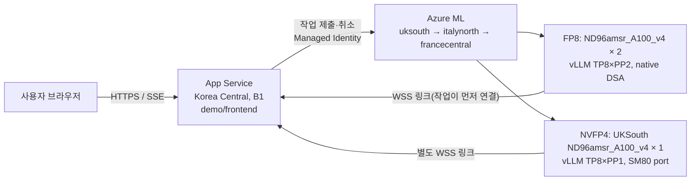

# A.X K2 데모 운영 가이드

A.X K2 FP8(16 A100, 2노드, TP8×PP2)와 공식 NVFP4(8 A100, 1노드, TP8)를
별도 프로필로 제공하는 데모입니다. 실제 준비 여부·실행 구성·문맥 한도는 `/api/models`로 확인합니다.



- 프런트엔드(App Service)는 항상 켜져 있습니다. 대화·파일은 임시 메모리에만 있으며 디스크에 저장하지 않습니다.
- 화면은 기존 채팅과 채팅형 모델 비교의 두 탭입니다(기본 진입: 모델 비교). 추론·도구·파일 표면은 동일하며 클러스터/벤치마크 대시보드나 보관 대화 UI는 없습니다.
- 기본은 **공개 데모 모드**(`AXK2_OPEN_DEMO=1`)입니다. 로그인 없이 주소만 알면 채팅할 수 있습니다(내부 데모용). 비밀번호로 막으려면 `AXK2_OPEN_DEMO=0`으로 `deploy.sh`를 다시 실행하세요. 관리자 페이지(`/admin`)는 어느 모드든 관리자 비밀번호가 필요합니다.
- GPU는 관리자가 켤 때만 돕니다. 켜면 지역 3곳에 동시에 저우선(low priority) 작업을 내고, 먼저 2노드를 모두 받은 곳을 남기고 나머지는 취소합니다.
- GPU 작업은 바깥에서 들어오는 포트가 없습니다. 작업 안의 `backend_link.py`가 App Service로 WebSocket을 열고, 채팅 요청은 이 링크를 타고 vLLM으로 갑니다.
- 저우선 노드는 회수(preemption)될 수 있습니다. 그러면 슈퍼바이저가 같은 지역에 다시 내고, 안 되면 다시 3곳 경주를 합니다. 화면에는 "준비 중"으로 보입니다.
- GPU 작업은 실행 스크립트(`aml/src`)를 작업 명령에 넣지 않고, 시작할 때 해당 프로필의 `/api/link/src`에서 작업에 고정된 아카이브를 내려받아 SHA-256을 확인합니다. gzip timestamp는 0으로 고정하며 `/home/data/sources`의 hash-addressed 아카이브는 재배포와 독립적으로 보존합니다. 이전 작업도 정확한 원본 아카이브/작업 매핑을 보존한 뒤 배포해야 합니다. 매핑이 없으면 현재 코드로 대체하지 않고 명시적으로 실패합니다.
- 켜고 나서 채팅이 되기까지 실측 약 25분입니다(노드 확보·InfiniBand 확인 → 가중치 676 GB 다운로드 약 18분 → 로드 약 5분). 노드를 기다리는 시간은 그때 용량에 따라 더 걸릴 수 있습니다.

## 처음 배포

For a new subscription, use the isolated Terraform and target-only deployment
workflow in [infra/README.md](infra/README.md), not the legacy defaults below.
It deploys the complete two-profile UI with both GPUs OFF, a single UK South
cluster, separate locked state and explicit subscription-scoped operations.

WSL(Ubuntu)에서, `az login`이 된 상태로 실행합니다. 로컬 pip 설치는 필요 없습니다(패키지는 App Service가 서버에서 설치).

```bash
AXK2_SUB=<구독 ID> bash demo/deploy.sh
```

- 없는 리소스만 만들고 코드를 다시 올립니다. 몇 번 실행해도 됩니다.
- 처음 실행할 때만 데모·관리자 비밀번호를 만들어 한 번 출력하고, `~/.axk2-demo/passwords`(권한 0600)에 보관합니다. 다시 실행해도 비밀번호는 바뀌지 않습니다.
- GPU 클러스터와 작업 영역은 `aml/setup_region.sh`로 미리 만들어 둡니다.
- 배포 중 게이트웨이 504가 보여도 Kudu 빌드는 계속됩니다. 스크립트가 `/healthz` 200을 확인할 때까지 기다립니다.

## 일상 운영 (`demo/ctl.sh`)

기존 `ctl.sh` 명령과 루트 API는 **FP8만** 대상으로 합니다. NVFP4는
`/models/nvfp4/api/admin/power`의 기존 관리자 인증을 사용하며 상태는
`/models/nvfp4/api/status`에서 확인합니다. 두 프로필은 Store/Supervisor/Hub/Gate와
작업 취소 범위를 분리하고, 동일 compute의 실제 AML RunId로 각자 노드를 계산합니다.
모델별 prefix는 API 전용이며 UI는 루트 주소에서만 제공합니다. 루트 `/admin`은 FP8 전용입니다.
NVFP4는 처음에는 꺼진 상태이며 UKSouth의 기존 compute에서 한 노드만 요청합니다.
사용자가 승인한 maxNodeCount=3은 재고 보장이 아닙니다. FP8의 전원·작업은
NVFP4 기동/복구에 의해 변경하지 않습니다. 탭/모델 선택도 GPU 기동을 유발하지 않습니다.

| 명령 | 하는 일 |
|---|---|
| `demo/ctl.sh status` | 전원 상태, 현재 작업·지역, 링크, 대기열, 평가 진행 상황 |
| `demo/ctl.sh on` | GPU 켜기 (과금 시작, 준비까지 실측 약 25분, 노드 대기에 따라 더 걸림) |
| `demo/ctl.sh off` | GPU 끄기 (작업 취소, 과금 중지) |
| `demo/ctl.sh restart` | 지금 GPU 작업을 새 작업으로 교체 |
| `demo/ctl.sh eval start aime,kobalt 4 0` | 벤치마크 평가 시작 (suite, 반복 횟수, suite별 무작위 표본 문항 수. 0이면 전체) |
| `demo/ctl.sh eval stop` | 평가 중지 (이미 받은 결과는 남음) |
| `demo/ctl.sh password demo` | 데모 비밀번호 교체 (기존 데모 세션은 로그아웃) |

평가와 채팅은 같은 클러스터를 씁니다. 평가 요청은 vLLM 우선순위가 낮아(채팅 0, 평가 10) 채팅이 먼저 들어가지만, 한 번 들어간 요청은 매 스케줄 단계를 함께 나눠 씁니다.

- 일반 평가(AIME·KoBALT·CLIcK·IFBench) 중에는 채팅이 됩니다. 실측으로 세 문장 답변이 약 8초 걸렸습니다(평소 첫 토큰 0.7초).
- NIAH(최대 25만 토큰 문맥)를 돌리는 동안에는 단계 하나가 수 초로 늘어 채팅이 사실상 멈춥니다. 그래서 NIAH는 항상 다른 suite 뒤에 돌고, **고객 시연 중에는 NIAH 평가를 돌리지 마세요.**

관리자 비밀번호는 `AXK2_ADMIN_PASSWORD` 환경 변수, `~/.axk2-demo/passwords`, 입력 프롬프트 순서로 찾습니다. 같은 기능을 브라우저의 `/admin` 페이지에서도 쓸 수 있습니다.

## 비용

- GPU: 노드·시간당 약 $8.19(uksouth 저우선) × 2노드 ≈ 시간당 $16. 같은 2노드를 온디맨드로 쓰면 시간당 약 $82입니다.
- 프런트엔드: App Service B1 한 대 (항상 켜짐, 월 수십 달러 수준).
- 관리자 페이지에 지역별 GPU 사용 시간과 추정 비용이 나옵니다. **사용자가 명시적으로 요청할 때만 GPU를 끕니다.** 시연 종료나 프런트엔드 재배포를 이유로 끄거나 재시작하지 않습니다.

## 고객에게 전달할 것

- 주소 `https://<앱 이름>.azurewebsites.net` (공개 데모 모드에서는 주소만 있으면 됩니다).
- 비밀번호 모드(`AXK2_OPEN_DEMO=0`)라면 데모 비밀번호도 함께(메일과 다른 경로로 전달 권장). `ctl.sh password demo`로 언제든 바꿔 접근을 끊을 수 있습니다.
- 공개 모드에서 접근을 끊으려면 `ctl.sh off`(GPU 끄기) 또는 `AXK2_OPEN_DEMO=0`으로 재배포하세요.
- 관리자 비밀번호는 고객에게 주지 않습니다.

## Microsoft Agent Framework 도구 데모

`agent-framework-core==1.20.0`의 실제 `Agent`, `FunctionInvocationLayer`, 스트리밍,
`FunctionMiddleware`를 사용합니다. `agent.py`의 `AXClient`는 기존 역방향 WebSocket으로만
vLLM에 요청하며 `reasoning_content`와 도구 호출/결과를 다음 모델 호출에 재전달합니다.
모델 판단·코드 생성·최종 답변은 선택한 self-hosted SKT A.X K2 프로필만 수행합니다.
OpenAI/Azure OpenAI/Foundry 추론, 대체 LLM, Azure AI Search는 사용하지 않습니다.
브라우저는 서버가 보낸 실제 추론과 도구 상태만 표시하며 실행 루프를 소유하지 않습니다.
MAF의 `options.instructions`를 실제 vLLM system 메시지로 전달합니다. 도구 안내와
현재 workspace 파일 목록이 모델에 누락되지 않도록 서버에서 매 턴 구성합니다.
동일 탭의 capability 토큰 안에서만 원본 reasoning·함수 호출 ID·실제 결과를 RAM에 보관합니다
(최대 160메시지/2 MiB, 실제 도구 결과 목록 48개/512 KiB). 오래된 전체 턴을 제외하면 안내하며
장기 기억·벡터 DB·영구 대화 저장은 없습니다. 새 채팅은 실행을 취소하고 이전 파일/토큰/대화를 폐기합니다.
도구 토글과 직접 입력한 명확한 도구·웹검색 금지를 서버 등록/실행 경계에서 적용합니다.
`금융 도구는 쓰지 마` 또는 `don't use web_iq_finance`처럼 이름을 지정한 금지는 해당
도구만 제외하며, 금지 문구의 단어를 긍정적인 실행 요청으로 라우팅하지 않습니다.
허용된 명시적 실행 요청에는 해당 함수 호출을 요청하고, 호출 없이 대기만 약속하면 A.X에 한 번만
실제 실행 또는 구체적 제한 설명을 재요청합니다. 그래도 필요한 호출이 없으면 미실행 오류입니다.
상태 카드는 실제 middleware 이벤트이며 턴 종료 뒤 백그라운드 작업은 없습니다.

데스크톱 화면의 채팅과 입력창은 동일한 1200px 상한과 좌우 gutter를 사용합니다.
시작 화면은 도구를 이어 쓰는 시연 예시 8개를 제공합니다(시각·계산·웹 검색·시세·장소·파일 작성·
차트·미리보기). 목록과 검증 방법은 아래 "시연 예시와 검증"에 있습니다. 카드 설명은 2줄까지만 보입니다.
클릭하면 전체 문구를 입력하고 도구를 자동으로 켜며(GPU가 준비돼 있으면 바로 전송),
1200px 이상에서는 4열×2행, 좁은 데스크톱에서는 2열×4행입니다.
본문 18px, 주요 전송·첨부·토글 컨트롤 42px이며 좁은 패널에서는 함께 줄어듭니다.
대화와 입력 영역 모두 동일한 stable scrollbar gutter를 예약하여 긴 대화에서도 정렬을 유지합니다.
CSS zoom/transform 확대나 상시 IDE 패널은 사용하지 않습니다.

추론 체크박스는 채팅·비교 두 탭 모두 꺼진 채로 시작합니다. 사용자가 켜면 그 탭에서 계속 켜져 있습니다.
도구 체크박스의 시작값은 그대로입니다(채팅 탭만 켬). 서버는 바꾸지 않았습니다. 브라우저는 항상 `thinking`
값을 보내며, 값이 없는 요청은 이전처럼 추론 켬으로 처리합니다. 출력 토큰 상한은 추론을 끄면 8192, 켜면
16384입니다(`demo/frontend/app.py`의 `MAX_TOKENS`). 끄기로 한 근거는 단일 측정 한 번입니다(웹 검색 예시 질문,
FP8 프로필). 추론을 켜면 첫 답변까지 33.5초였고 그중 2라운드 첫 토큰 1.84초 뒤 약 31초가 추론 출력이었습니다.
끄면 첫 답변까지 7.35초였습니다. 한 번 잰 값이라 평균이나 분포로 읽을 수 없습니다.

### 채팅형 모델 비교

채팅 탭의 모델 선택은 본문과 정렬된 상단 행에 고정 폭으로 표시하며, 비교 탭에서는
행 공간만 유지하고 감춥니다. 기존 채팅 표면은 유지합니다. 모델 변경/새 대화는 이전 요청을
취소하고 파일·대화 capability를 폐기합니다. 탭 전환은 각 탭의 입력·첨부·결과와
실행을 보존하며 자동 실행/취소를 하지 않습니다.

비교는 공유 질문/첨부를 한 번 표시하고 FP8/NVFP4 실제 응답을 좌우에 누적합니다.
기본은 독립 질문(이전 답변 제외, 도구/추론 끔)이며, 접는 공통 조건에서 고정 공통
문맥 또는 각자 대화 이어가기와 출력 상한/temperature/top_p를 선택합니다.
서버는 질문·파일 bytes/hash·시각·지침·생성 조건을 동일 RAM snapshot으로 고정합니다.
새 PDF의 실제 첫 판독도 동일 call ID/입력으로 두 MAF 실행에 전달합니다.
각자 이어가기는 이전 실제 답변·결과·수정 파일이 달라 문맥도 달라집니다.
도구를 켜면 에이전트 비교이며 이후 호출/결과는 달라질 수 있습니다.
각 실행은 새 비교 ID와 모델별 파일/대화 토큰을 갖고, 입력 업로드는 공유 공간에서만
허용합니다. 한쪽 미준비/오류/취소는 그대로 표시하며 다른 모델로 대체하지 않습니다.
최대 8개 비교/대화와 기존 workspace 용량·30분 idle 만료를 적용합니다.
새 대화/만료는 소유한 양쪽 공간과 보존 snapshot을 함께 폐기합니다.

각 답변 아래 TTFT(요청 처리 시작부터 첫 답변 content까지, 대기·추론 포함),
전체시간과 실제 입력/출력 usage를 표시합니다. output tok/s는 전체 모델 호출의
completion tokens를 모델 호출 elapsed 합으로 나눈 값이며 queue/prefill을 포함합니다.
순수 decode 속도나 GPU-direct 벤치마크가 아닙니다. 실제 usage가 없는 호출은
토큰/속도를 추정하지 않고 `미제공`으로 표시합니다. 공통 문맥 한도는 두 실행 엔진의
`/v1/models` 실제 한도 중 작은 값이며 어느 한쪽이 미확인이면 미제공입니다.
입력·출력·system/tool 문맥을 모두 포함하고 실제 토큰화 초과는 해당 엔진이 거부합니다.

NVFP4 지속 서빙 템플릿은 `aml/jobs/demo-nvfp4-nd96.yml`입니다.
공식 checkpoint/revision과 기존 SM80 port를 사용하고 1노드 MP executor로 실행합니다.
A100에는 FP4 Tensor Core가 없으며 Marlin W4A16/BF16 activation 경로이지
native FP4 연산이 아닙니다. 벤치마크용 `nvfp4-a100-nd96.yml`을 제출하지 않습니다.
NVFP4 readiness는 실제 staged checkpoint/revision/TP/PP/world size/source SHA를 검증합니다.
이미 실행 중인 legacy FP8은 재시작 없이 기존 링크 및 실제 AML job/runtime evidence를
보존하므로 새 staged-manifest 전송까지 소급 검증했다고 주장하지 않습니다.

지원 도구: 유리수 기반 정확 계산, IANA 시간대, 파일 목록/읽기/문자열 검색/텍스트 수정/
unified diff/다운로드, PDF 텍스트(page)/DOCX(paragraph)/TXT·MD(line) 참조,
CSV·XLSX 첫 시트의 profile/sum/mean/min/max와 SVG 막대 차트, 정적 HTML 미리보기.
PDF는 새 첨부를 실제 `read_pdf`로 확인한 후 답변합니다.
허용된 새 PDF는 서버가 확인한 정확한 경로로 실제 MAF 함수/middleware를
통해 첫 페이지를 먼저 읽고 그 결과를 A.X에 전달합니다. 모델의 계획 문장만으로 판독 완료를
표시하지 않으며 실패·취소는 확인 완료로 기록하지 않습니다. 도구 금지 시 판독하지 않습니다.
후속 페이지는 모델이 실제 도구로 읽어야 하며 첫 페이지 판독은 전체 문서 판독을 뜻하지 않습니다.
파일명·크기·레이아웃만으로
스캔 문서라고 추정하지 않습니다. 최대 100페이지, 호출당 1~5페이지(기본 3),
페이지당 10000자 chunk와 `next_page`/`next_offset`을 제공합니다.
Korean text layer도 읽으며 페이지 citation을 반환합니다. 암호화·손상·범위·자원 제한,
텍스트 없음, 실제 이미지 객체가 있지만 텍스트가 없는 경우를 별도 typed 결과로 표시합니다.
이미지-only 결과는 `ocr_not_configured`입니다. 복잡한 배치의 읽기 순서는 달라질 수 있고
텍스트 추출은 차트의 시각적 해석이 아닙니다. OCR은 미구성이며 외부로 PDF를 전송하지 않습니다.
XLSX 수식은 실행·평가하지 않고 오류로 안내합니다.
가짜 날씨는 등록하지 않습니다. 코드·diff·결과는 접이식 카드 안에 표시되고
실제 `write_file` 저장 성공 시 파일명과 다운로드 버튼은 카드를 펼치지 않아도 보입니다.
`.py`를 포함한 지원 파일은 대화의 권한 토큰으로만 다운로드하며 저장된 bytes와 UTF-8 파일명을
`Content-Disposition: attachment`로 전달합니다. 모델의 임의 링크를 다운로드 경로로 사용하지 않습니다.
차트/HTML은 버튼을 눌러야 열립니다. HTML은 URL 속성·활성 태그를 제거한 뒤
스크립트·폼·네트워크가 차단된 opaque sandbox iframe으로만 표시합니다
(외부 CSS/JS·이미지 및 동적 앱 실행은 지원하지 않음).

첨부는 대화별 무작위 capability 토큰으로 격리합니다. 토큰은 URL/쿠키/로그에 넣지 않습니다.
대화당 8 MiB/100파일, 동시에 16개 대화 workspace, 비활성 30분 후 정리
(재배포 시 소실), ZIP expanded 8 MiB/200 member/압축비 100 이하입니다.
절대 경로·상위 경로·심볼릭 링크·암호화 ZIP·미지원 파일은 거부합니다.
동일 이름 재업로드는 거부하고 모델 수정은 workspace 내부에서만 허용합니다.
추론은 최대 5회, 도구 실행 24회, 턴 15분으로 제한합니다.
취소 시 기존 relay의 cancel을 통해 vLLM 요청을 중단하며 GPU 작업 자체는 계속 실행됩니다.

모델이 보낸 도구 호출의 인자가 비었거나 공백뿐이면 `{}`로 처리합니다(`model_api.py`가 빈 인자를 `{}`로
바꾸는 규칙과 같고, 여기서는 공백뿐인 값도 포함합니다). 그 밖에 JSON 객체가 아닌 인자(깨진 JSON, 배열
등)는 턴을 끝내지 않고 도구 오류 결과로 모델에 돌려줍니다. 오류 문장은 문제 종류, 인자 길이, 인자 앞
80자까지의 인용을 담습니다. 이때 도구는 실행하지 않으며 `tool_invocations`에 세지 않지만 도구 호출 한도
(24회)에는 들어갑니다. 강제된 도구 선택은 그대로여서 모델이 같은 도구를 다시 호출할 수 있습니다.
다음 모델 호출에 다시 보내는 이력에서는 빈 인자와 깨진 인자를 `{}`로 바꿔 유효한 JSON을 유지합니다.

**Web IQ:** [공식 문서](https://webiq.microsoft.ai/documentation/)는 enterprise limited access를
설명합니다. `web_iq.py`는 공식 `mcp==1.30.0` SDK로 initialize → tools/list → tools/call을
수행합니다. 기존 승인된 사용자 프로젝트의 직접 MCP 계약
(`https://api.microsoft.ai/v3/mcp`, `x-apikey`, `web`, `query`)을 지원하고,
실제 서버가 광고한 도구별 input schema를 검증한 후에만 각각 native MAF 도구로 등록합니다.
Foundry 연결에서 키를 관리하더라도 검색은 MCP에 직접 보내며 Foundry 모델을 호출하지 않습니다.
미구성/연결 실패 시 검색 도구를 등록하지 않으며 `/api/capabilities`와 모델 system 메시지가
실제 상태와 blocker를 전달합니다. MCP 테스트 fixture는 실제 enterprise 검색 검증이 아닙니다.

기존 Web IQ 접근을 연결하려면 운영자가 승인된 키를 **secure App Service setting**
`AXK2_WEBIQ_API_KEY` 또는 승인된 secret reference로 설정하고
`AXK2_WEBIQ_ACCESS_APPROVED=1`로 검색 사용 승인을 표시합니다. 키를 채팅·repo·로그에 넣지 않습니다.
다른 검증된 enterprise 계약은 `AXK2_WEBIQ_ENDPOINT`, `AXK2_WEBIQ_TOOL`,
`AXK2_WEBIQ_QUERY_FIELD`, `AXK2_WEBIQ_ARGUMENTS_JSON`으로 명시합니다.
별도 계약의 bearer auth는 `AXK2_WEBIQ_BEARER_TOKEN`이며 API key와 동시에 설정하지 않습니다.
리디렉션·자동 OAuth/가입·권한 생성은 하지 않습니다. 연결 설정 변경 후 frontend를 다시 시작합니다.

로컬에서 키를 제공할 때는 AX worktree 루트의 git-excluded `.env.webiq`에
`AXK2_WEBIQ_API_KEY`와 `AXK2_WEBIQ_ENDPOINT`만 입력하고 저장 사실을 알려 주세요.
키 값을 채팅에 붙여 넣지 않습니다. 이 파일은 서버가 자동 로드하지 않으며,
운영자가 해당 파일만 읽도록 승인받은 뒤 실제 공개 검색을 검증하고 secure App Service
setting으로 전달합니다. 배포 bundle은 루트 입력 파일을 포함하지 않고 frontend 안의
모든 `.env`-prefixed 파일/디렉터리도 제외합니다.

공개 일반 검색어를 지원하며, 문서 5개 주제 제한은 없습니다.
현재 공급자가 광고하는 `web`, `news`, `finance`, `places`, `autosuggest`, `browse`,
`images`, `videos`, `sports`, `sonic`을 각각 `web_iq_<이름>` MAF 도구로 제공합니다.
`finance`에는 query/language/region만 전달하고, 뉴스·미디어·통합 검색 등에는
해당 도구가 실제 광고한 필드만 전달합니다. `sonic`은 통합 웹·뉴스·금융 검색이며 음성 도구가 아닙니다.
발견됐다는 사실과 실제 자료가 반환됐다는 사실은 구분합니다:
`tools`는 발견된 지원 목록, `verified_tools`는 성공한 실제 호출 목록입니다.
현재 공개 smoke 호출에서 10개 모두 실제 응답을 받았으나 autosuggest 응답에는 제안 목록이 없었습니다.
스포츠 응답에는 경기 자료가 있었지만 citation URL은 없었으며 출처 링크를 만들지 않습니다.

첨부 파일이 없는 대화에서는 자유로운 공개 검색과 후속 검색이 가능합니다.
첨부가 있는 대화에서는 서버가 최신 사용자 메시지로 **턴별 검색 허가**를 만들고
명시적인 검색 요청에 사용자가 직접 입력한 검색어만 허용합니다.
파일명·파일 내용·업로드에서 추출한 새 검색어는 middleware에 묶인 도구 permission이 거부합니다.
이는 비공개 파일을 검색 자료로 보내는 동의가 아닙니다.
같은 대화에서 첨부와 무관한 공개 검색을 하려면 검색어를 직접 입력하세요;
자유롭게 검색어를 확장하려면 파일 없는 새 대화를 사용합니다. 자격증명 형태의 검색어도 거부합니다.
요청 30초, 응답 192 KiB, 표시 citation 최대 12개이며 실제 공급자가 반환한 URL과 제목만
유지합니다(원본 행을 다시 복사하지 않습니다). 성공한 실제 query가 있어야 `verified_search`가 true입니다.
실제 schema에서 광고한 경우 기본 검색을 최대 5개 결과,
`contentFormat=passage`, `maxLength=1500`, `safeSearch=strict`로 제한합니다.
passage 미지원 browse는 text를 사용합니다. 상한 초과 입력은 오류로 표시하며 조용히 무시하지 않습니다.
이 기본값·상한 필드(`maxResults`, `maxResultsWeb`, `maxLength`, `contentFormat`, `safeSearch`,
`liveCrawl`, `renderDynamicPages`)는 서버가 주입하고 전체 schema로 검증하지만, 입력 토큰을 줄이려고
모델에게 보내는 도구 schema에서는 숨깁니다. 모델이 직접 보내도 검증 결과는 같습니다.
`browse`는 공개 HTTP(S) 도메인만 허용하며 자격증명·query string(`?`)·인증 URL·사설 DNS 주소를 거부합니다.
`#조각`만 안전 검사 전에 잘라 버리고 나머지 주소로 읽습니다. 이 제한(`?` 쿼리와 로그인·인증 경로
불가, `#` 무시)은 모델이 피하도록 도구 설명에도 적습니다.
공급자 indexed retrieval만 사용(`liveCrawl=none`, dynamic rendering 금지)하여
실시간 크롤링·리디렉션을 통한 내부 URL 접근을 요청하지 않습니다. App Service는 대상 페이지를 fetch하지 않습니다.
입력/결과/시간은 접이식 action 카드, 출처는 해당 카드의 링크로 확인합니다. 대체 검색은 없습니다.
뉴스·주가·장소는 실제 반환 필드를 읽기 쉽게 표시합니다. 카드의 '실제 반환 데이터'는 모델이 실제로 읽은
검색 결과 JSON과 같은 내용입니다. 같은 자료를 모델이 여러 번 읽지 않도록 `items`(제목·URL·스니펫·출처·날짜 등)에
담기는 web/news/videos/images/browse 응답은 원본 payload를 다시 넣지 않고 `provider_payload_chars`로 크기만 남깁니다.
`items`로 담기지 않는 응답(금융·장소·스포츠·sonic·알 수 없는 형태·일반 텍스트 등)은 원본을 한 번만
`provider_content`로 유지합니다.
시스템 프롬프트에서는 바뀌지 않는 규칙을 앞에, 매번 바뀌는 UTC 시각을 맨 끝에(분 단위) 두어
앞부분이 턴 사이에 같게 유지됩니다(vLLM prefix cache 적중 여부는 배포 후 측정 필요).
응답의 `metrics` 이벤트에는 기존 필드에 더해 모델 호출별 `rounds`(입력/출력 토큰, 첫 토큰까지 시간,
소요 시간, 공급자가 주면 `cached_tokens`)가 들어갑니다. 값이 없으면 `null`이며 추정하지 않습니다.
이미지·동영상은 원본 출처 링크만 제공하며 자동 로드/임베드/재배포하지 않습니다(CSP 유지).
금융 카드는 공급자의 종목·통화·가격·거래 시각·시간대·자료 출처를 표시하며
거래소나 지연 여부가 응답에 없으면 미제공/미확인입니다. 조회 시각은 시세 기준 시각이 아닙니다.
삼성전자 공개 live smoke는 `005930`, KRW, LSEG, `lastTradedAt`을 실제 반환했지만
거래소·지연 상태는 미제공이므로 실시간 KRX feed라고 보증하지 않습니다.

`run_tests`도 승인된 외부 격리 샌드박스가 없어 명시적 미구성 오류만 반환합니다.
호스트/GPU에서 업로드·모델 생성 코드를 실행하지 않으며 테스트 통과를 꾸미지 않습니다.
실행 서비스를 연결하려면 자원·시간·네트워크·자격증명 격리 계약과 별도 승인이 필요합니다.
새 리소스나 권한은 자동 생성하지 않습니다. 파일 수정·diff·미리보기·다운로드는 이와 독립적으로 동작합니다.

기존 서비스의 설정/identity/권한/GPU를 유지한 코드 전용 배포:

```bash
AXK2_SUB=<구독 ID> AXK2_FRONTEND_ONLY=1 bash demo/deploy.sh
```

배포 뒤 `/healthz`의 `agent: maf-1.20.0`을 확인하고 `/api/agent` 실제 턴을 검증하세요.
건강 응답만으로 모델·도구 실행 성공을 판단하지 않습니다.

### 시연 예시와 검증

시작 화면의 예시 8개는 후보 12개(`demo/tools/agentic_examples.py`)에서 골랐습니다. 버튼 문구는 후보의
`prompt`와 글자까지 같고(`tests/test_demo_agentic_examples.py`가 `chat.js`와 비교) 첨부 파일 없이
바로 시연할 수 있습니다. 앞의 두 개는 빠른 응답이고 나머지 여섯 개는 도구를 여러 번 잇는 시나리오입니다.

| 버튼 | 기대하는 도구 흐름 | 보여 주는 것 |
|---|---|---|
| 세 도시 현재 시각 | `get_current_time` 3회 | 시간대별 현재 시각, 빠른 응답 |
| 요금제 총액 계산 | `calculator` | 유리수 기반 정확 계산 |
| AI 반도체 뉴스 브리핑 | `web_iq_news` → `write_file` → `preview_html` | 뉴스 3건의 실제 출처, 파일 작성, 미리보기 |
| 반도체 두 종목 시세 비율 | `web_iq_finance`(두 종목) → `calculator` | 시세 기준 시각·지연 표시, 없는 값은 '미확인' |
| Foundry BYOM 연결 방법 | `web_iq_web` → `web_iq_browse` | 검색 → 문서 읽기 → 단계 요약 |
| 판교역 점심 일정 | `web_iq_places` → `get_current_time` → `write_file` | 장소 검색과 오늘 날짜의 일정 파일 |
| CSV 합계와 막대 차트 | `write_file` → `analyze_table`/`calculator` → `chart_table` | 파일 → 계산 → 차트(가상 데이터 표시) |
| 월별 매출 리포트 | `write_file` → `calculator`/`analyze_table` → `write_file` → `preview_html` | 계산 결과를 표가 있는 HTML로 미리보기 |

버튼에 넣지 않은 후보는 네 개입니다.

- 도구 없이 코드 작성(`code-baseline`)은 도구를 쓰지 않는 기준선(모델 호출 1번)이라 넣지 않았습니다.
- 계약서 PDF 조항 점검(`contract-review`)과 코드 버그 수정과 diff(`code-fix-diff`)는 첨부가 필요합니다.
  `check_agentic_examples.py --write-fixtures DIR`가 합성 계약서 `contract.pdf`(실제 계약이 아닙니다)와
  `discount.py`를 만듭니다. 시연하려면 만든 파일을 첨부한 뒤 후보의 `prompt`를 입력하세요. 두 후보는
  오프라인 시험만 했고 실서비스에서는 검증하지 않았습니다(**미확인**).
- A.X K2 공개 자료 조사(`axk2-public-research`: 검색 → 페이지 읽기 → 출처 표)는 첫 실서비스 검증에서
  `browse`가 검색 결과 주소를 거부해 통과하지 못했습니다. 원인은 `?`나 `#`가 붙은 주소로 **추정**합니다.
  서버와 문구를 고쳤으며, 다시 검증해 통과하기 전까지는 후보로만 둡니다.

검증 스크립트 `demo/tools/check_agentic_examples.py`(표준 라이브러리만 사용)는 배포된 데모를 웹 페이지와
같은 방식으로 호출합니다. 워크스페이스를 만들고, 필요하면 합성 파일을 올리고, `/api/agent`를 도구 켬·추론
끔으로 호출해 이벤트 스트림을 읽고, 만든 파일을 내려받아 HTML은 미리보기 경로로 열어 보고, 워크스페이스를
닫습니다. 공개(open) 모드만 지원하며 로그인하지 않습니다. 주소는 환경 변수 `AXK2_DEMO_URL`(또는
`--base-url`)로만 받고 출력과 결과에 쓰지 않습니다. 결과 파일은 저장소에 커밋하지 않습니다.

```bash
python demo/tools/check_agentic_examples.py --list
AXK2_DEMO_URL=<앱 주소> python demo/tools/check_agentic_examples.py --only plan-fee   # 계획만 출력
AXK2_DEMO_URL=<앱 주소> python demo/tools/check_agentic_examples.py --runs fp8=2,nvfp4=1 \
    --out result.json --table result.md --go
```

- `--go`가 없으면 아무것도 보내지 않고 실행 계획(예시, 횟수, 계획된 모델 호출)만 출력합니다.
- 실행은 순차이고 간격은 10초 이상입니다(`--gap`). `--runs fp8=2,nvfp4=1`은 예시마다 FP8을 2회,
  NVFP4(앱의 `/models/nvfp4`)를 1회 실행합니다.
- 이름 조회가 간헐적으로 실패하는 PC를 위해 기본값 `--dns doh`는 https 주소의 호스트를 `dns.google`
  (DNS-over-HTTPS)로 한 번 조회해 그 IP로 연결합니다. URL, TLS 서버 이름·인증서 검사, Host 헤더는
  그대로이고 시스템 DNS와 hosts 파일은 바꾸지 않으며 IP는 출력·저장하지 않습니다. 조회가 실패하면
  시스템 DNS를 씁니다(`--dns system`은 조회를 생략합니다).
- 다음을 모두 만족하면 통과입니다. 턴이 답변과 함께 끝남, 필수 도구가 순서대로 도구 오류 없이 실행됨
  (그 사이의 다른 호출은 허용하고 `calculator`/`analyze_table`처럼 '둘 중 하나 이상'인 묶음은 하나만
  성공하면 됨), 첫 도구가 강제된 도구와 같음, 답변의 링크가 모두 도구 결과에서 나옴, 필요한 파일이 있고
  HTML은 미리보기가 열림, 전체 시간이 `--max-seconds`(기본 45초) 이내, HTTP 5xx 없음. 기대한 숫자 같은
  내용 검사는 플래그로만 기록하고 통과·실패에는 쓰지 않습니다. 모델이 쓴 코드는 구문 분석만 하고
  실행하지 않습니다.
- 결과 JSON(`--out`)에는 실행마다 완료 여부, 호출된 도구와 오류, 출처 호스트, 만든 파일, TTFT·전체 시간,
  입출력 토큰, 모델 호출별 `rounds`, Web IQ 호출 수가 들어갑니다. 실패 원인을 가리는 증거로 HTML 미리보기의
  응답 상태·길이(`preview_status`, `preview_bytes`)와 거부된 `web_iq_browse` 주소의 형태(`?`·`#` 유무만,
  `url_shape`)를 남깁니다. 실패한 호출의 주소 원문은 남기지 않고 도구 오류 안의 웹 주소는 `<url>`로 바꿉니다.
- HTTP 응답 없이 끊긴 요청(이름 조회·연결·TLS·스트림)은 실패가 아니라 '연결 오류'로 따로 기록합니다.
  같은 후보에서 1회만 다시 시도하고(첫 시도는 `superseded`로 요약에 남음) 연속 3회면 계획을 멈춥니다.
  응답 시간만 넘긴 실행은 연결 오류가 아니라 실패입니다.

알려진 한계:

- 검색 결과는 호출마다 다릅니다. 기사·시세·식당은 그때 공급자가 돌려준 실제 자료이며, 합격 기준은 같은
  기사가 아니라 '링크가 도구 결과에서 나옴'입니다. 공급자가 주지 않은 시세 기준 시각·통화·지연 여부는
  프롬프트가 '미확인'으로 적게 합니다.
- 도구 4라운드를 모두 쓰면 도구가 꺼진 5번째 모델 호출에서 모델이 도구 호출 표식(`<tool_call>…`)을 글로
  낼 수 있고, 그러면 그 원문이 그대로 보입니다. 관찰: A.X K2 공개 자료 조사의 NVFP4 1회. 이번 수정은
  라운드를 낭비시키는 원인(빈 인자, `#`가 붙은 주소)만 줄이고 표식은 바꾸지 않았습니다. 이미 화면에
  보낸 글을 되돌려야 해서 프로토콜이나 버퍼링을 바꿔야 하므로 구현하지 않았습니다.
- NVFP4의 `browse` 호출 1회가 `invalid_public_locale`로 거부됐습니다. 모델이 언어·지역 값을 직접 보낸
  것으로 **추정**하며 고치지 않았습니다.
- 월별 매출 리포트에서 `report.html` 미리보기가 한 번 열리지 않았습니다(FP8 1회, 파일 226바이트). 원인은
  **미확인**이고, 다음 검증부터 미리보기 응답 상태·길이를 기록합니다. 프롬프트는 `h1`·`table`만 쓴
  표가 있는 완전한 HTML을 요구합니다(미리보기는 허용한 태그만 남깁니다).

## 문제 해결

| 증상 | 확인할 것 |
|---|---|
| 채팅이 "GPU 클러스터가 아직 준비되지 않았습니다" | `ctl.sh status`에서 전원이 on인지, 작업이 Running인지, 링크가 연결됐는지 |
| 켰는데 오래 준비 중 | 저우선 용량 부족일 수 있음. 슈퍼바이저가 지역을 돌며 다시 냅니다. 이벤트 로그 확인 |
| 채팅이 "입력을 읽는 중…"에서 몇 분씩 멈춤 | NIAH 평가가 도는 중인지 `ctl.sh status`의 평가 상태 확인. 시연 중이면 `ctl.sh eval stop` |
| 작업이 시작 몇 분 만에 실패하고 로그가 없음 | RunHistory `/details` API의 오류 확인(`ArgumentTooLong`이면 작업 명령·환경 변수가 너무 김) |
| 사이트가 안 열림 | `az webapp log tail -g <RG> -n <앱 이름>` |
| GPU 링크가 자꾸 끊김 | 관리자 이벤트의 `link` 항목. 로그 스트림의 `axk2.link` 줄은 배포 후 확인 전까지 미확인. "링크가 끊긴 이유 읽기"와 "로그가 남는 곳" 참고 |
| 비밀번호 분실 | 관리자 비밀번호로 `ctl.sh password demo`. 관리자 비밀번호까지 잃었으면 App Service 설정 `AXK2_ADMIN_PASSWORD_HASH`를 지우고 `deploy.sh`를 다시 실행 |

### 링크가 끊긴 이유 읽기

GPU 링크가 열리거나 닫힐 때마다 한 줄을 남깁니다(연결당 2줄). 같은 내용이 두 곳에 들어갑니다.

- 컨테이너 stderr(로거 `axk2.link`): 줄 앞에 UTC 시각이 붙습니다. 이 로거에만 핸들러를 붙이고 root
  로거와 다른 모듈의 로그 수준은 바꾸지 않습니다. 이 줄이 로그 스트림에 나오는지는 배포 후 확인
  전까지 **미확인**입니다. 보는 방법과 확인된 범위는 아래 "로그가 남는 곳"에 있습니다.
- 관리자 화면의 이벤트(`link`): 최근 100건, 건당 500자까지만 보관합니다. 닫힘 이벤트는 예전처럼 활성 작업일 때만 남고, 열림 이벤트는 등록된 작업이면 남습니다.

```text
link opened digest=1a2b3c4d previous=none
link closed digest=1a2b3c4d code=1006 up=3020.0s since_status=20.0s lost_streams=1

link opened digest=1a2b3c4d previous=replaced(4000) prev_up=3020.0s prev_since_status=45.0s
link closed digest=1a2b3c4d code=1000 up=3020.0s since_status=45.0s lost_streams=0 closed_by=replaced
```

| 필드 | 뜻 |
|---|---|
| `digest` | 작업 토큰 해시의 앞 8자. 관리자 화면의 작업 id(앞 10자)와 앞부분이 같습니다. FP8·NVFP4 앱이 이 로거를 함께 쓰므로 프로필 이름은 없고 `digest`로 구분합니다 |
| `previous` | 열림 줄에만 있습니다. `none`은 새 연결, `replaced(4000)`은 같은 작업이 다시 연결해 이전 소켓을 4000으로 닫고 받아들인 것입니다. 이전 소켓의 지속 시간·마지막 status 경과가 `prev_up`, `prev_since_status`입니다 |
| `code`, `reason` | 소켓이 끝날 때 받은 WebSocket 종료 코드와 사유. 코드가 없으면 `code=-`. 사유는 64자까지만, 따옴표·줄바꿈은 `?`로 바꿔 남깁니다 |
| `up` | 연결 지속 시간 |
| `since_status` | 마지막 status를 받은 뒤 지난 시간(`-`는 status를 한 번도 못 받음) |
| `lost_streams` | 링크와 함께 끊긴 진행 중 스트림 수 |
| `closed_by` | 웹앱이 먼저 닫았을 때만 있습니다. `replaced`(같은 작업의 재연결), `dropped`(슈퍼바이저가 작업을 정리), `shutdown`(웹앱 종료). 웹앱이 보낸 코드는 4000이지만 상대가 닫기 응답으로 다른 코드(예: 1000)를 보내면 그 값이 `code`에 찍힙니다 |
| `error` | 연결 루프를 빠져나온 예외의 클래스 이름(메시지는 남기지 않음) |
| `writer_error`, `close_1011` | 링크로 보내기에 실패한 예외의 클래스 이름과, 웹앱이 1011로 닫기를 시도한 결과(`yes` 또는 `failed`) |

`closed_by`가 없으면 상대가 먼저 닫았거나 연결이 사라진 것이고 `code`는 상대가 보낸 값입니다
(WebSocket 표준: 1000 정상, 1001 떠남, 1006 종료 프레임 없이 끊김). `code=1012`는 웹앱 서버가
종료·재시작 중이었다는 뜻입니다.

한계:

- `axk2.link` 줄은 stderr로만 나가고 앱이 파일에 쓰지 않습니다. 이 줄이 로그 스트림에 나오는지,
  나온다면 얼마나 보관되는지는 배포 후 확인 전까지 **미확인**입니다. 확인한 범위는 아래
  "로그가 남는 곳"에 있습니다.
- 이벤트 목록은 `state.json`(`AXK2_DATA`, 기본 `/home/data`)에도 저장됩니다. 열림·닫힘 이벤트는 남기는 즉시 저장하지 않고 목록에 추가만 합니다. 다음 저장 때 목록 전체가 `state.json`에 기록됩니다. 슈퍼바이저는 한 번 돌 때마다 저장합니다(주기는 `AXK2_INTERVAL`, 유휴 상태에서는 `AXK2_IDLE_INTERVAL`). 웹앱이 시작할 때 `state.json`에서 목록을 복원하므로, 웹앱을 재시작하거나 재배포한 뒤에도 마지막 저장까지의 최근 100건이 남습니다.
- 웹앱이 정상적으로 멈추면(uvicorn이 graceful shutdown을 시작해 열린 연결을 닫는 경우) 링크는
  `code=1012`로 닫힙니다. 활성 작업의 링크라면 이 닫힘 이벤트는 종료 직전의 마지막 저장에
  들어갑니다(**확인**: 로컬에서 실제 uvicorn으로 시험). 웹앱이 직접 닫으며 `closed_by=shutdown`으로
  남기는 줄은 마지막 저장보다 뒤에 기록되어 `state.json`에 없습니다(**확인**: 로컬에서 가짜 소켓으로
  시험). App Service가 종료 신호를 uvicorn에 전달하는지, 강제 종료까지 얼마나 기다리는지는
  **미확인**입니다.
- 프로세스가 강제 종료되면(예: 메모리 부족) 마지막 저장 뒤에 추가된 이벤트는 `state.json`에 없을
  수 있습니다. 이때 열려 있던 링크의 닫힘 줄은 컨테이너 로그에도 이벤트에도 남지 않습니다. 이미
  출력된 stderr 줄이 보관되는지는 **미확인**입니다.
- 토큰이 맞지 않아 거절된 재연결(4403)은 기록하지 않습니다.
- 토큰·요청 본문·프롬프트·헤더·IP·전체 해시는 남기지 않습니다.

### 로그가 남는 곳

배포하지 않고 읽기 전용으로 점검한 결과입니다. App Service 설정은 바꾸지 않았습니다. **확인**은
직접 읽어 본 것, **추정**은 관찰에서 짐작한 것, **미확인**은 아직 확인하지 못한 것입니다. 배포한 뒤
확인하면 이 절의 **미확인** 항목을 고치세요.

- 로그 스트림(`az webapp log tail`이 읽는 Kudu의 라이브 로그): Application logging이 꺼져 있어도
  컨테이너 stdout 줄(uvicorn 접속 줄)이 나옵니다(**확인**). 포털의 Log stream이 같은 내용을 보여
  주는지는 **미확인**입니다.
- `axk2.link` stderr 줄: 점검 때 아직 배포 전이어서 스트림에 나오는지는 **미확인**입니다. 배포한
  뒤 `az webapp log tail -g <RG> -n <앱 이름>` 출력에서 `" axk2.link "`가 들어간 줄을 찾으세요.
  링크가 열리거나 닫힐 때만 줄이 나오므로, 링크가 연결된 상태에서 확인해야 합니다.
- 로그 스트림의 보관 기간, 크기 상한, 재시작 뒤 유지 여부는 **미확인**입니다. 스트림 줄의 원본
  파일 경로에 `volatile`이 들어 있어 임시 저장일 것으로 **추정**합니다.
- 파일로 남는 컨테이너 로그(`*_default_docker*.log`): 점검한 앱 두 곳 중 `httpLogs.fileSystem`을
  켠 앱에는 있었고 끈 앱에는 없었습니다(**확인**). 이 설정을 켜야만 생긴다는 것은 **추정**입니다.
- 링크 끊김에 대해 앱이 스스로 남기는 영구 흔적은 `state.json`의 `link` 이벤트(최근 100건, 건당
  500자)뿐입니다. 저장은 최선 노력입니다. 이벤트는 다음 저장 때 기록되므로(기본값은 45초, 유휴
  상태에서는 300초 간격) 즉시 저장되지는 않습니다. 강제 종료되면 마지막 저장 뒤의 줄은 없을 수
  있습니다. 위 "한계"를 보세요.

웹앱 코드(`demo/frontend`)가 로그로 내보내는 출력은 다음과 같습니다. `print`는 쓰지 않습니다.

- `axk2.link`: 링크가 열리고 닫힐 때 stderr로 한 줄씩 나갑니다(위에서 설명).
- `axk2.model_api`: `/v1` 요청마다 JSON 한 줄(상태, 토큰 수, 시간 등)을 stdout으로 냅니다. 모델
  API 키 해시(`AXK2_MODEL_API_KEY_SHA256`)가 설정된 경우에만 켜집니다.
- `agent.py`의 `LOG.exception`: 채팅 턴이 예상하지 못한 예외로 끝나면 트레이스백을 남깁니다.
  `web_iq.py`와 `pdf_documents.py`는 `LOG.warning`(Web IQ 검색 실패, PDF 일부만 추출)을 씁니다. 이
  세 모듈은 핸들러가 없는 모듈 로거여서 파이썬 기본 처리에 따라 WARNING 이상만 stderr로 나갑니다
  (**확인**: uvicorn 로깅 설정을 적용한 로컬 프로세스에서 시험). 스트림에 나오는지는
  **미확인**입니다.
