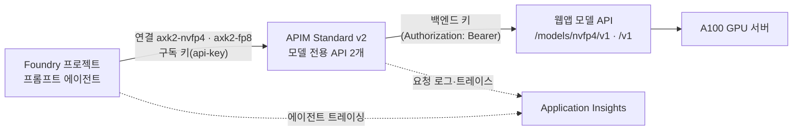

# Foundry BYOM 연결 — APIM을 거쳐 A.X K2 모델 API 호출

기준일: 2026-10-19 (UTC). 이 문서의 시각은 모두 UTC다. 한국 시각(KST)은 UTC보다 9시간 빠르다.

## 1. 요약

| 구분 | 내용 |
| --- | --- |
| 목적 | Foundry 에이전트가 APIM을 거쳐 A.X K2 모델 API를 호출하는 **외부 모델 연결(BYOM) 사전 검증**이다. Model Catalog 정식 등록이 아니다. |
| 만든 것 | 리소스 그룹 1개 안에 APIM Standard v2 1개, Foundry 계정·프로젝트 1세트(모델 배포 없음), Application Insights와 Log Analytics, 모델 전용 API 2개, Foundry 연결 2개, 트레이싱 연결 2개. 리소스 그룹과 secret named value는 `byom.py`가 만들고 나머지는 Bicep으로 배포했다. |
| 확인됨 | 게이트웨이 경유 NVFP4의 일반 응답, 스트리밍, 도구 호출, 도구 결과 후 응답이 모두 HTTP 200이다. 구독 키가 없거나 틀리면 401이다. 로그 상관 판정은 PASS다. Foundry(FP8 에이전트)가 게이트웨이로 보낸 요청 4건도 모두 200이고, 함수 도구와 MCP 도구가 요청에 실렸다(9.4절). |
| 실패 | 에이전트 담당의 첫 Foundry 호출(NVFP4)이 503으로 끝났다. 게이트웨이가 받은 4건 모두 백엔드가 503을 돌려줬다. 원인은 판단하지 않았다(9.3절). |
| 미확인 | 콘솔의 Active 표시, 에이전트 모델 선택 목록, NVFP4의 Foundry 경유 호출, 모델이 MCP 도구를 고르지 않은 이유. 4.3절에 정리했다. |
| 비용 | APIM 가동 시간 × 0.96 USD/h(계산값). 2026-10-19 12:48 기준 2.65 h, 약 2.54 USD다. |

## 2. 범위와 읽는 법

- 이 문서는 인프라와 연결만 다룬다: 연결 설계, APIM 연결, 게이트웨이 경유 모델 API 검증, Foundry 연결 생성이다. 에이전트 생성, 도구 연결, 콘솔 증거는 에이전트 담당이 기록한다.
- 모든 측정값은 **단일 표본**이다. 성능과 안정성을 보증하지 않는다. 부하·지연 검증은 고객 시나리오(동시 사용자 수, 입력·출력 길이)를 정한 뒤 따로 한다.
- 기존 앱의 `/api/agent`(MAF + Web IQ) 성공은 별개의 앱 경로 증거다. 이 문서의 Foundry BYOM 증거로 쓰지 않는다.
- 이전 구독의 수치(처리량, TTFT)는 인용하지 않는다.
- 이 저장소는 공개다. 문서와 증거에는 자리표시자만 쓴다: `<deployment>`(배포 접두사), `<subscription>`, `<apim-gateway>`, `<web-app>`, `<foundry-endpoint>`.
- 담당 구분: **인프라 담당**은 이 문서의 작성자다. **웹앱 담당**은 웹앱·GPU 배포와 백엔드 키를 맡는다. **모델 API 담당**은 `/v1/*` 코드와 스모크 도구를 맡는다. **에이전트 담당**은 에이전트·도구·콘솔 증거를 맡는다. **조정자**는 승인과 PR을 맡는다.
- 판정 표기: **확인됨**은 증거 파일이나 명령 출력으로 직접 본 사실이다. **실패**는 실행했으나 기대와 다른 결과다. **미확인**은 실행하지 않았거나 도구로 볼 수 없는 항목이다. `[문서]`는 Microsoft 문서에서 가져온 사실이다. **계산값**은 소매가로 계산한 추정이며 청구액이 아니다.

## 3. 구성



| 용어 | 뜻 |
| --- | --- |
| 게이트웨이 | APIM 서비스(Standard v2) 1개 |
| 모델 전용 API | 게이트웨이 안의 API. 모델마다 1개다: `axk2-nvfp4`(경로 `nvfp4/v1`), `axk2-fp8`(경로 `fp8/v1`) |
| 백엔드 | 웹앱의 모델 API. NVFP4는 `/models/nvfp4/v1/*`, FP8은 `/v1/*`다 |
| 구독 키 | 클라이언트(Foundry)가 게이트웨이에 보내는 키. 헤더 이름은 `api-key`다 |
| 백엔드 키 | 게이트웨이가 백엔드에 보내는 키. 게이트웨이의 secret named value `axk2-backend-key`에만 있다 |
| 연결 | Foundry 프로젝트의 `ApiManagement` 연결 |
| 스모크 도구 | 모델 API 담당의 `demo/tools/model_api_smoke.py`. 이 브랜치에는 없다. 검증에는 모델 API 담당의 커밋 `e70debb`에 있는 파일을 수정 없이 썼다(SHA-256 `38f9f10f…433e1d`) |

## 4. 현재 상태

### 4.1 확인됨

| 항목 | 결과 | 증거 |
| --- | --- | --- |
| 배포 | 모든 단계가 성공했다. APIM 상태는 `Succeeded`다. 연결 4개(모델 2개, 트레이싱 2개)를 읽었다 | `byom.py status`, `connections-*.json` |
| 인증 거부 | 구독 키가 없거나 틀리면 두 API 모두 401이다. 게이트웨이가 만든 응답이며 본문 키는 `message`와 `statusCode`다 | `probe-pre-go.json`, `apim-smoke-*-post-go.json` |
| 백엔드 fail-closed | 웹앱의 `/v1/*`를 활성화하기 전(10:13)에 유효한 구독 키로 `GET /models`를 호출하면 백엔드가 404를 돌려줬다. 게이트웨이가 백엔드까지 전달한다는 뜻이다 | `probe-pre-go.json` |
| 모델 목록 | `GET /models`가 200이다. NVFP4는 `ax-k2-nvfp4`, FP8은 `ax-k2-fp8`(`served_profile` fp8)을 돌려줬다 | `apim-smoke-nvfp4-post-go.json`, `apim-smoke-fp8-post-go.json` |
| 일반 응답 | NVFP4 `POST /chat/completions`가 200, `finish_reason=stop`이다 | `apim-smoke-nvfp4-post-go.json` |
| 스트리밍 | NVFP4가 SSE로 200을 돌려줬다. TTFT 0.409 s, 청크 간격이 균일해 스모크 도구가 `buffering: unlikely`로 판정했다 | `apim-smoke-nvfp4-post-go.json` |
| 도구 호출 | 도구 정의를 보내면 `finish_reason=tool_calls`와 `get_weather` 호출이 왔다. 도구 결과를 보내면 `stop`으로 끝나고 답변이 결과를 언급했다 | `apim-smoke-nvfp4-post-go.json` |
| 요청 ID 에코 | 인증된 6개 호출(NVFP4 5건, FP8 1건) 모두에서 보낸 `x-request-id`가 응답에 돌아왔다 | `apim-smoke-nvfp4-post-go.json`, `apim-smoke-fp8-post-go.json` |
| 로그 상관 | 스모크 POST 4건 모두 게이트웨이 요청, 트레이스, 백엔드 호출이 같은 OperationId로 이어진다. 백엔드 호출 4건이 모두 성공했다 | `apim-smoke-correlation-post-go.json` |
| 자격 증명 비전달 | 게이트웨이가 백엔드로 `api-key`·`Ocp-Apim-Subscription-Key` 헤더와 `api-key`·`subscription-key` 쿼리를 보내지 않는다(전달 헤더 트레이스 0건) | `apim-smoke-correlation-post-go.json`, `gateway-requests-foundry-first-call.json` |
| 백엔드 키 주입 | 전달 헤더 트레이스가 있는 모든 호출에서 `Authorization`이 주입됐다(스모크 GET 2건, 에이전트 담당의 POST 4건) | 위와 같음 |
| 로그 내용 | 로그 34행에 키와 프롬프트 본문이 없다 | `apim-smoke-correlation-post-go.json` |
| Foundry → 게이트웨이 도달 | Foundry 호출이 연결 `axk2-nvfp4`를 거쳐 게이트웨이에 도달했다. 요청은 chat completions 형식이고 본문의 `model`은 `ax-k2-nvfp4`였다 | `gateway-requests-foundry-first-call.json` |
| Foundry 트레이싱 | 에이전트 스팬(`invoke_agent`) 4건이 게이트웨이와 같은 Log Analytics 작업 영역에 기록됐다. 게이트웨이 요청과는 다른 OperationId다 | `gateway-requests-foundry-first-call.json` |
| Foundry(FP8 에이전트) → 게이트웨이 | 에이전트 담당의 호출 3묶음에서 게이트웨이가 `POST /fp8/v1/chat/completions` 4건을 받았고 모두 200이다. 응답은 모두 백엔드가 만들었다. `stream`은 `true`이고 본문에 `max_completion_tokens`와 `stream_options`가 있었다. 함수 도구 왕복은 2건이다 | `gateway-requests-foundry-fp8-bundles-1a-1b-mcp-never.json` |
| Foundry 요청의 도구 필드 | 함수 도구 요청과 MCP 도구 요청 모두 `tools`, `parallel_tool_calls`, `tool_choice`(`"auto"`)가 실렸다. Foundry는 MCP 도구를 요청에 실었다(9.4절) | 위와 같음 |

### 4.2 실패

| 항목 | 내용 |
| --- | --- |
| 첫 Foundry 호출 | 에이전트 담당이 11:45:07~11:45:23(KST 20:45)에 호출했고 약 16초 뒤 `model_error`로 실패했다. 게이트웨이는 같은 시간대에 `POST /nvfp4/v1/chat/completions` 4건을 받았고 4건 모두 503이었다. 4건 모두 백엔드 호출이 503을 반환했다. 게이트웨이가 만든 503이 아니다. 503의 원인은 판단하지 않는다. 상세는 9.3절이다 |

### 4.3 미확인

| 항목 | 확인 방법 | 담당 |
| --- | --- | --- |
| 콘솔에서 연결이 Active로 보이는지 | ARM과 데이터 플레인에는 상태 필드가 없다(`error: null`). 콘솔에서 확인한다 | 에이전트 담당 |
| 에이전트 모델 선택 목록에 `axk2-nvfp4/ax-k2-nvfp4`가 보이는지 | 콘솔 | 에이전트 담당 |
| NVFP4의 Foundry 경유 호출 | 첫 호출이 503이었다(4.2절). 503이 풀린 뒤 에이전트를 다시 호출한다. FP8은 4.1절이다 | 에이전트 담당 |
| 모델이 MCP 도구를 고르지 않은 이유 | MCP `never` 호출에서 도구가 요청에 실렸는데 모델이 도구 호출 없이 `stop`으로 끝냈다(9.4절). 프롬프트, 도구 설명, 모델 응답을 따로 본다 | 에이전트 담당 |
| 503의 원인 | 백엔드 로그와 백엔드 응답 본문을 확인한다 | 웹앱 담당 |
| 백엔드가 `stream_options`로 사용량 청크를 돌려주는지 | FP8 백엔드는 `max_completion_tokens`와 `stream_options`가 있는 요청 4건에 200으로 답했다(9.4절). 사용량 청크는 보지 않았다. NVFP4는 503 때문에 확인하지 못했다. GPU 호출이 생기므로 승인을 받는다 | 모델 API 담당 |
| `reasoning_content` 처리 | 도구 호출 응답을 에이전트 쪽에서 비교한다 | 에이전트 담당 |
| 콘솔 트레이싱이 두 AppInsights 연결 중 어느 쪽을 쓰는지 | 콘솔 | 에이전트 담당 |
| 트레이싱 Reader 역할이 필요한지 | 콘솔이 권한 오류를 보일 때만 필요하다. 추가하기 전에 조정자에게 알린다 | 인프라 담당 |
| `isDefault`, `isSharedToAll`이 에이전트 모델 참조에 영향을 주는지 | 콘솔과 에이전트 호출 | 에이전트 담당 |
| FP8의 chat·stream·tool(게이트웨이 경유) | 조정자 승인 후 같은 스모크 도구로 확인한다 | 인프라 담당 |
| 구독 키를 다시 만든 뒤 연결에 저장된 키가 갱신되는지 | `deploy connections` 재실행으로 확인한다. 재발급이 필요할 때만 시험한다 | 인프라 담당 |
| `limit-concurrency` 초과 시 응답 동작 | 측정하지 않았다 | 인프라 담당 |
| BYOM 지역 제약 | 문서에 없다. Korea Central에서 연결 생성은 성공했다 | — |
| 부하·지연 | 고객 시나리오를 정한 뒤 따로 측정한다 | — |

## 5. Foundry 요건 `[문서]`

근거: Foundry BYOM(AI Gateway) 문서(2026-08-13 갱신)와 `foundry-samples` 저장소의 연결 Bicep 샘플이다.

| 요건 | 내용 |
| --- | --- |
| 모델 형식 | OpenAI 호환 chat completions다. Foundry가 Base URL 뒤에 `chat/completions`를 붙인다 |
| APIM 티어 | `ApiManagement` 연결은 APIM Standard v2 또는 Premium만 지원한다 |
| 인증 | API key(헤더 이름과 값 템플릿) 또는 Managed Identity다 |
| 에이전트 | 프롬프트 에이전트만 지원한다. 지원 도구에 Functions와 MCP가 있다. 에이전트 모델 참조 형식은 `연결이름/모델이름`이다 |
| 역할 | 프로젝트에서 Foundry User 이상, 리소스 그룹에서 Contributor가 필요하다 |
| 도구 버전 | Azure CLI 2.67 이상(이 환경은 2.88.0), `azure-ai-projects` 2.0.0 이상이다 |
| 연결 상태 | 연결이 Inactive이면 엔드포인트와 자격 증명을 점검한다 |
| 지역 | Agent Service 지역에 Korea Central이 있다. BYOM 전용 지역 제약은 문서에 없다 |
| 문서 모순 | Foundry 샘플은 "연결은 포털 UI 미지원, CLI·템플릿 필요"라고 쓴다. Learn은 포털 마법사를 설명한다. 이 배포는 ARM/Bicep으로 만들었다. 콘솔 노출 여부는 에이전트 담당이 기록한다 |
| 모호한 문장 | "The Response API isn't supported at present"가 백엔드 프로토콜을 뜻하는지 에이전트 호출 방식을 뜻하는지 문서만으로는 알 수 없다. 문서 샘플은 Responses API의 `agent_reference`로 에이전트를 호출한다. **관측:** Foundry가 게이트웨이로 보낸 요청은 chat completions 형식이었다 |

## 6. 설계 결정과 근거

| 결정 | 선택 | 근거 | 하지 않은 것 |
| --- | --- | --- | --- |
| APIM 티어 | Standard v2 1개 | `[문서]` 지원 티어다. 조정자가 상한을 Standard v2 1개(0.96 USD/h)로 승인했다 | Basic v2, Developer, Premium, APIM 추가, VNet은 미지원이거나 승인 범위 밖이라 시도하지 않았다 |
| 연결 범주 | `ApiManagement` + 정적 모델 목록 | 모델이 2개로 고정이라 모델 탐색(discovery) 오퍼레이션이 필요 없다 | `ModelGateway`(웹앱 직접 연결)는 `ApiManagement` 연결이 Active가 되지 않을 때의 대안이다. 조정자 승인 없이 만들지 않는다 |
| 인증 | 구독 키(`ApiKey`, 헤더 `api-key`) | 설정이 단순하다. 연결 자격 증명을 Bicep 안에서 `listSecrets`로 읽어 키가 파일·로그·출력에 남지 않는다 | Managed Identity + `validate-azure-ad-token`은 쓰지 않았다 |
| 연결 모델 | 1차 NVFP4(`ax-k2-nvfp4`), 2차 FP8(`ax-k2-fp8`) | NVFP4는 GPU 1노드(A100 8장)를 쓴다. 다른 세션이 단일 UI 표본으로 같은 13.6K 토큰 프롬프트의 TTFT를 NVFP4 8.3초, FP8 11.9초로 보고했다(여기서 다시 측정하지 않았다). NVFP4에서 앱 경로의 도구 왕복이 검증돼 있다 | FP8의 chat·stream·tool은 게이트웨이 경유로 시험하지 않았다 |
| 지역 | 신규 리소스 전부 Korea Central | 계획 단계에서 UK South의 APIM v2 생성이 일시적으로 불가한 것을 확인했다. Korea Central은 `[문서]` Agent Service 지역이고 웹앱도 같은 지역에 있다 | 다른 지역은 지연·비용 영향을 평가하지 않았다 |
| 공개 범위 | 백엔드 `/v1/*`는 공용 URL이며 백엔드 키가 필요하다 | 웹앱 IP 제한은 사이트 전체에 적용돼 웹 데모를 막는다. APIM v2의 아웃바운드 IP는 공유되고 바뀔 수 있다. 비공개 연결은 VNet과 웹앱 변경이 필요해 범위 밖이다 | 백엔드 키는 게이트웨이와 0600 파일에만 둔다. 데모가 끝나면 웹앱 담당이 키를 교체하거나 해시를 비활성화한다 |

**범위 밖(조정자 지시나 승인 없이 하지 않는다):** `ModelGateway` 연결, 트레이싱 Reader 역할, FP8 chat·stream·tool 호출, 본문 로깅, 정책 예외, 다른 SKU, 웹앱·GPU 변경, 삭제(`destroy`).

## 7. 리소스와 비용

이름의 `<deployment>`는 배포 접두사다. 지역은 모두 Korea Central이다.

| 리소스 | 이름 | 설정 | 비용 |
| --- | --- | --- | --- |
| 리소스 그룹 | `rg-<deployment>-byom` | 태그 `purpose=axk2-demo`, `deployment`, `createdAt` | 없음 |
| Log Analytics | `<deployment>-byom-logs` | PerGB2018, 일일 상한 0.1 GB, 보존 30일 | 사용량 기준. 상한 안의 비용은 측정하지 않았다 |
| Application Insights | `<deployment>-byom-ai` | 작업 영역 기반 | 위와 같음 |
| Foundry 계정 | `<deployment>-foundry` | AIServices S0, 로컬 인증 끔, 공용 네트워크 허용, 시스템 할당 ID | 모델 배포가 없다. 계정 자체의 대기 비용은 문서상 없다 `[문서]` |
| Foundry 프로젝트 | `axk2-demo` | 프로젝트 범위에 운영자 역할 1개(Azure AI User, 콘솔 표기 Foundry User) | 없음 |
| APIM | `<deployment>-apim` | Standard v2 × 1. 중지할 수 없다 | 0.96 USD/h(계산값) |
| APIM 하위 | `axk2-backend-key`(secret named value), 제품 `axk2-models`, 구독 `foundry-byom`, API `axk2-nvfp4`·`axk2-fp8` | 구독의 `allowTracing`은 끔 | APIM에 포함 |
| Foundry 연결 | `axk2-nvfp4`, `axk2-fp8` | 프로젝트 수준 `ApiManagement` | 없음 |
| 트레이싱 연결 | `<deployment>-foundry-appinsights`(계정 수준), `<deployment>-byom-ai`(프로젝트 수준) | 범주 `AppInsights`, 같은 Application Insights를 가리킨다 | 없음 |

APIM은 요청 2026-10-19 10:09:35, 준비 10:11:48이다. 생성에 2분 13초가 걸렸다.

| 비용 항목 | 값 | 구분 |
| --- | --- | --- |
| APIM Standard v2 시간당 | 0.96 USD | 소매가 |
| 하루 / 일주일 | 약 23.04 USD / 약 161.28 USD | 계산값 |
| 누적 | `byom.py status`가 요청 시각부터 지금까지의 시간 × 0.96으로 계산한다. 예: 2026-10-19 12:18에 2.16 h, 약 2.07 USD | 계산값 |
| GPU | 추가 비용 없음. 이미 켜진 GPU를 그대로 쓴다. 이 작업은 GPU를 바꾸지 않는다 | — |

Basic v2(0.21 USD/h)는 `ApiManagement` 연결이 지원하지 않아 시도하지 않았다.

## 8. 게이트웨이 정책

정책은 `policies/model-api.xml`이고 `gateway.bicep`이 모델 전용 API마다 적용한다. 실행 순서대로 적었다.

| 순서 | 정책 | 동작 |
| --- | --- | --- |
| 1 | 요청 ID | 호출자의 `x-request-id`가 1~128자의 `[A-Za-z0-9._:-]`이면 그대로 쓴다. 아니면 APIM 요청 ID를 쓴다 |
| 2 | 속도 제한 | 구독당 60초에 30회다. 초과하면 429다(설정값이며 측정하지 않았다) |
| 3 | 클라이언트 자격 제거 | 헤더 `api-key`, `Ocp-Apim-Subscription-Key`와 쿼리 `api-key`, `subscription-key`를 지운다 |
| 4 | 백엔드 키 주입 | 헤더 `Authorization: Bearer`에 secret named value `axk2-backend-key`를 넣는다 |
| 5 | 요청 ID 전달 | 백엔드로 `x-request-id`를 보낸다. 응답에 `x-request-id`와 `x-apim-request-id`를 붙인다 |
| 6 | 트레이스 `axk2-forwarded-headers` | 모든 메서드. 헤더·쿼리의 존재 여부만 기록한다(값은 기록하지 않는다) |
| 7 | 트레이스 `axk2-request-shape` | POST만. 경로, 본문 필드 이름, `model`, `stream`, `max_tokens`·`max_completion_tokens` 유무, 메시지 수와 역할, 도구 이름과 개수(`tool_count`), `tool_choice`와 그 유무(`has_tool_choice`)를 기록한다. 본문 최상위의 숫자·불리언 값(`max_completion_tokens`, `temperature`, `top_p` 등)과 `stream_options`의 숫자·불리언 값은 `params`에 기록한다. 메시지 내용, 도구 스키마, 그 밖의 문자열 값(`model`, `tool_choice`, 도구 이름, 역할 제외)은 기록하지 않는다. 값을 읽지 못하면 `params`는 `unavailable`이다 |
| 8 | 백엔드 전달 | `forward-request` 타임아웃 230초, 응답 버퍼링 끔(스트리밍 무버퍼). 구독당 동시 2건(`limit-concurrency`) |
| 9 | 진단 설정 | 샘플링 100%, 헤더·본문 0바이트, 클라이언트 IP 미기록, W3C 상관, 오류는 항상 기록 |

백엔드는 `Authorization` Bearer와 `api-key` 중 하나만 맞아도 요청을 받는다. 그래서 백엔드 200만으로는 클라이언트 `api-key`가 제거됐다고 증명할 수 없다. 제거는 6번 트레이스로 확인한다.

7번의 값 기록(`params`, `tool_count`, `has_tool_choice`)은 2026-10-19 12:43 배포부터 적용된다. 그 전에 온 요청의 트레이스에는 이 값이 없다. 배포 뒤 라이브 정책이 저장소의 `policies/model-api.xml`과 같다는 것을 ARM에서 읽어 확인했다. 클라이언트 자격 제거 4개와 `Authorization` 주입은 그대로다. 새 값이 실제 요청에서 기록되는지는 배포 뒤 요청이 오기 전까지 미확인이다.

## 9. 결과 상세

### 9.1 스모크 도구 검증 (게이트웨이 경유, 단일 표본)

조건: 스모크 도구 SHA-256 `38f9f10f…433e1d`(수정 없음), 동시성 1, 재시도 0, thinking OFF, `--max-tokens 64`, 인증 헤더 `api-key`다. NVFP4는 실행 `fcfd5227`(2026-10-19 11:17:29)이고 GPU 입장(admission)이 4건이다. FP8은 실행 `cc97a261`(11:18:07)이고 GPU 입장이 0건이다.

| 검사 | 결과 | 클라이언트 측정 | 게이트웨이 요청 / 백엔드 호출 |
| --- | --- | --- | --- |
| NVFP4 models | 200, 모델 `ax-k2-nvfp4` | 0.133 s | 로그 상관 대상 아님(GET) |
| NVFP4 chat | 200, `stop` | 0.464 s | 401.3 ms / 399.0 ms |
| NVFP4 stream | 200, SSE, 66청크(내용 64), `finish_reason=length` | 연결 0.049 s, TTFT 0.409 s, 첫~마지막 청크 1.316 s, 최대 청크 간격 0.052 s, 전체 1.723 s | 1635.8 ms / 1632.4 ms |
| NVFP4 tool | 200, `tool_calls`(`get_weather`) | 0.949 s | 759.9 ms / 756.7 ms |
| NVFP4 tool_result | 200, `stop`, 결과를 언급 | 0.872 s | 692.2 ms / 682.6 ms |
| NVFP4 auth | 키 없음 401, 틀린 키 401 | 0.151 s, 0.177 s | 게이트웨이가 처리했다. 백엔드 호출이 없다 |
| FP8 models | 200, `served_profile` fp8 | 0.218 s | 로그 상관 대상 아님(GET) |
| FP8 auth | 키 없음 401, 틀린 키 401 | 0.175 s, 0.165 s | 게이트웨이가 처리했다. 백엔드 호출이 없다 |

- 게이트웨이 요청 시간과 백엔드 호출 시간의 차이는 2.3~9.6 ms다.
- 스모크 응답 본문의 `model` 값은 `axk2`다. 요청 값 `ax-k2-nvfp4`와 다르다.
- FP8의 chat, stream, tool은 시험하지 않았다(미확인).

### 9.2 로그 상관 (V6)

판정은 PASS다(`apim-smoke-correlation-post-go.json`, 창 시작 11:16:29).

- 스모크 POST 4건이 게이트웨이 요청, 트레이스, 백엔드 호출로 모두 이어졌고 백엔드 호출이 모두 성공했다.
- 스모크 POST 4건은 `axk2-forwarded-headers` 트레이스를 배포하기 전에 실행했다. 이 트레이스의 증거는 이후 스모크 GET 2건과 에이전트 담당의 POST 4건이다.
- 게이트웨이가 만든 401(키 없음·틀린 키)은 구독 정보와 트레이스가 로그에 없다. 스모크 창의 401 4건은 3.6 ms 이하로 끝났다. 사전 점검(10:13)에서 가장 먼저 보낸 401 2건은 각각 약 1.4 s였다(원인은 판단하지 않는다). 이 401에는 `x-request-id`가 돌아오지 않는다.
- Foundry의 에이전트 스팬은 게이트웨이 요청과 다른 OperationId에 기록된다. Foundry에서 게이트웨이로 trace-id가 전달되지 않는다. 둘은 시각으로 맞춘다.
- 로그 수집은 최대 약 5분 늦는다. 로그 조회는 5분 이상 기다린 뒤에 한다.
- `AppRequests.Url`에는 클라이언트 URL 전체가 있다. 증거에는 경로, 쿼리 이름, `api-version`만 남긴다.

### 9.3 에이전트 담당의 첫 Foundry 호출 (503)

증거: `gateway-requests-foundry-first-call.json`(창 11:44:30~11:46:30). 에이전트 담당은 호출 1건이 약 16초 뒤에 실패했다고 보고했다. 게이트웨이는 같은 시간대에 4건을 받았다. 4건이 Foundry의 재시도인지는 확인하지 못했다.

| 번호 | 도착 시각 | 상태 | 게이트웨이 총 소요 | 백엔드 호출 소요 |
| --- | --- | --- | --- | --- |
| 1 | 11:45:12.130 | 503 | 77.7 ms | 72.0 ms |
| 2 | 11:45:12.632 | 503 | 35.9 ms | 34.6 ms |
| 3 | 11:45:18.119 | 503 | 14.4 ms | 13.2 ms |
| 4 | 11:45:23.599 | 503 | 7.3 ms | 5.9 ms |

- 4건 모두 `POST /nvfp4/v1/chat/completions`이고 구독 `foundry-byom`이다. 도착 간격은 0.5초, 5.49초, 5.48초다.
- 4건 모두 백엔드 호출(`POST /models/nvfp4/v1/chat/completions`)이 503을 반환했다. 게이트웨이가 더한 시간은 1.2~5.7 ms다. 503은 백엔드 응답이다.
- 에이전트 담당은 오류 본문이 모델 API의 `backend_unavailable` 형태라고 보고했다. 이 문서는 본문을 기록하지 않아 직접 확인하지 못했다.
- **요청 형태(4건 동일):**
  - 경로 `/nvfp4/v1/chat/completions`, 쿼리 없음(`api-version` 없음), 구독 키는 헤더로 도착했다.
  - `model`은 `ax-k2-nvfp4`, `stream`은 `true`다.
  - `max_completion_tokens`가 있고 `max_tokens`는 없다.
  - 본문 필드는 `messages`, `stream`, `max_completion_tokens`, `stream_options`, `model`, `temperature`, `top_p`다.
  - 메시지는 2개(system, user)다. `tools`와 `tool_choice`는 없다.
  - User-Agent는 비어 있고 `x-request-id`는 없다.
- **정책 결과:** 클라이언트 자격 증명 전달 0건, `Authorization` 주입 4/4다.
- 이 호출에는 도구가 없었다. 도구가 있는 요청의 형태는 9.4절이다.
- 백엔드는 위 요청 형태(`stream_options`, `max_completion_tokens` 포함)를 받아야 한다. NVFP4가 받아들이는지는 503 때문에 확인하지 못했다. FP8은 같은 형태에 200으로 답했다(9.4절).

### 9.4 에이전트 담당의 FP8 호출 3묶음 (200)

증거: `gateway-requests-foundry-fp8-bundles-1a-1b-mcp-never.json`(창 12:27:30~12:31:30). 에이전트 담당이 FP8 에이전트로 호출한 묶음은 1a(도구 없음), 1b(함수 도구 왕복), MCP `never`(Learn MCP 도구)다. 게이트웨이가 받은 요청은 4건이고 모두 200이다. 이 요청은 정책의 값 기록을 배포하기 전에 왔다. 그래서 숫자·불리언 값과 도구 개수는 증거 파일에 없다.

| 묶음 | 도착 시각 | 상태 | 게이트웨이 총 소요 | 백엔드 호출 소요 | 메시지(역할) | 도구 이름 |
| --- | --- | --- | --- | --- | --- | --- |
| 1a | 12:28:14.812 | 200 | 3788.4 ms | 3780.5 ms | 2(system, user) | 없음 |
| 1b 첫 요청 | 12:29:07.893 | 200 | 2489.8 ms | 2486.3 ms | 2(system, user) | `lookup_demo_stock` |
| 1b 둘째 요청 | 12:29:11.045 | 200 | 1095.0 ms | 1091.5 ms | 5(system, user, assistant, assistant, tool) | `lookup_demo_stock` |
| MCP `never` | 12:30:26.739 | 200 | 2287.4 ms | 2286.0 ms | 2(system, user) | `mcp___mcp_microsoft_learn___microsoft_docs_search` |

- 4건 모두 `POST /fp8/v1/chat/completions`이고 백엔드 호출은 `POST /v1/chat/completions`다. 구독은 `foundry-byom`이고 `api-version`이 없으며 User-Agent는 비어 있다. 응답은 모두 백엔드가 만들었다. 게이트웨이가 더한 시간은 1.3~7.9 ms다.
- 요청의 `model`은 `ax-k2-fp8`, `stream`은 `true`다. `max_completion_tokens`가 있고 `max_tokens`는 없다.
- 본문 최상위 필드: 1a는 `messages`, `stream`, `max_completion_tokens`, `stream_options`, `model`, `temperature`, `top_p`다. 1b와 MCP 요청은 여기에 `tools`, `parallel_tool_calls`, `tool_choice`가 더해진다. `tool_choice`는 모두 `"auto"`다.
- MCP 요청에도 도구 정의가 실렸고 본문 모양이 1b와 같다(도구 이름만 다르다). Foundry는 MCP 도구를 요청에 실었다.
- Foundry `chat` 스팬의 종료 사유(`gen_ai.response.finish_reasons`)와 토큰 수(입력, 출력)는 1a `stop`(80, 15), 1b 첫 요청 `tool_calls`(310, 96), 1b 둘째 요청 `stop`(390, 36), MCP `stop`(477, 88)이다. 이 값은 개인 디렉터리 출력에서 읽었고 증거 파일에는 없다.
- MCP 호출은 요청 1건으로 끝났고 도구 실행 스팬이 없다(이 창의 스팬 이름은 `chat`과 `invoke_agent`뿐이다). 모델이 `tool_choice=auto`에서 도구 호출 없이 `stop`으로 끝냈다. 왜 도구를 고르지 않았는지는 판단하지 않는다.
- 정책 결과: 클라이언트 자격 증명 전달 0건, `Authorization` 주입 4/4다.
- NVFP4 첫 호출(9.3절)은 503이었고 FP8 호출은 200이다. 시각과 프로파일이 다르므로 차이의 원인은 판단하지 않는다.

## 10. Foundry 인계 정보 (에이전트 담당용)

| 항목 | 값 |
| --- | --- |
| 프로젝트 엔드포인트 | `https://<foundry-endpoint>/api/projects/axk2-demo` |
| 인증 | Microsoft Entra ID. 계정이 로컬(키) 인증을 꺼 두었으므로 키로 호출할 수 없다. 운영자 계정에 프로젝트 범위 Azure AI User(콘솔 표기 Foundry User) 역할을 할당했다 |
| 연결 이름 | `axk2-nvfp4`(1차), `axk2-fp8`(2차). 규칙은 `axk2-<프로파일>`이다 |
| 모델 이름 | `ax-k2-nvfp4`, `ax-k2-fp8`. 요청 본문의 `model` 값이다 |
| 에이전트 모델 참조 | `axk2-nvfp4/ax-k2-nvfp4`, `axk2-fp8/ax-k2-fp8` |
| 연결 형태 | 범주 `ApiManagement`, 인증 `ApiKey`, `deploymentInPath=false`(Foundry가 `<target>/chat/completions`로 POST), 정적 모델 목록, 모델 형식 `OpenAI`, `inferenceAPIVersion` 미지정(요청에 `api-version`이 붙지 않는다) |
| 구독 키 | 연결 안에 저장돼 있다. 에이전트 담당이 구독 키를 다룰 필요가 없다 |
| 호출 방식 | `[문서]` 프롬프트 에이전트를 Responses API의 `agent_reference`로 호출한다. `azure-ai-projects` 2.0.0 이상이 필요하다 |
| 트레이싱 | `AppInsights` 연결 2개(계정 수준, 프로젝트 수준). 같은 Application Insights를 가리킨다. 에이전트 스팬이 이 작업 영역에 들어온다(9.3절, 9.4절 호출에서 확인) |
| 사용 모델 표시 | 응답 본문의 `model`은 `axk2`다. 사용 모델을 보일 때는 연결 설정과 게이트웨이 요청 로그의 요청 `model` 값을 함께 쓴다 |

## 11. 알려진 한계

- `isDefault`: 서비스가 `axk2-fp8`에 true, `axk2-nvfp4`에 false를 지정했다. Bicep은 이 값을 설정하지 않는다. 프로젝트 수준 트레이싱 연결도 true다.
- `isSharedToAll`: Bicep에서 true로 배포했다. 프로젝트 수준 연결의 ARM 읽기값은 false다. 계정 수준 트레이싱 연결은 true다.
- Active: ARM과 데이터 플레인 모두 상태 필드가 없다. 4.3절을 따른다.
- 트레이싱 연결 2개: 공식 샘플이 계정 수준과 프로젝트 수준을 모두 만든다. `[문서]` 프로젝트당 Application Insights는 1개만 허용한다. 평가용 Reader 역할 2개는 만들지 않았다.
- 속도 제한은 구독당 60초에 30회다. 첫 Foundry 호출은 약 11.5초 동안 4건을 보냈다. 재시도가 반복되면 한도에 닿을 수 있다(측정하지 않았다).
- `axk2-request-shape` 트레이스는 Foundry 요청 형태를 보려고 켜 두었다. 필드 이름, 역할, 도구 이름·개수, `tool_choice`와 숫자·불리언 값만 기록하고 메시지 내용과 도구 스키마는 기록하지 않는다(8절). 형태 확인이 끝나면 정책에서 제거해도 된다.
- 게이트웨이가 만든 401의 본문은 OpenAI 오류 형식이 아니다(`message`, `statusCode`).
- 구독 키를 다시 만들면 연결에 저장된 키가 낡는다. `deploy connections` 재실행으로 갱신되는지는 미확인이다.
- APIM Standard v2는 중지할 수 없다. 삭제할 때까지 과금된다.

## 12. 실행 절차

모든 명령은 WSL(Ubuntu)에서 저장소 루트 기준으로 실행한다. WSL의 `az` 로그인은 모든 프로세스가 공유한다. 다른 세션이 `az login`을 하면 활성 계정이 바뀐다. 이 도구는 `az login`과 `az account set`을 호출하지 않으며 모든 `az` 호출에 `--subscription`을 붙인다.

**사전 조건**

1. 명령을 실행하기 전에 `az account show`로 활성 계정이 대상 구독인지 확인한다.
2. 코어 배포의 개인 디렉터리를 지정한다. 이 디렉터리에 `target.json`과 백엔드 키 파일이 있다.
   ```bash
   export AXK2_CORE_DIRECTORY=~/.axk2-targets/<deployment>
   ```
3. 상태·구독 키·원본 증거는 개인 디렉터리 `~/.axk2-targets/<deployment>-byom`에 둔다. 도구가 권한 0700으로 만든다. 이 디렉터리는 Linux 파일시스템이어야 하고 저장소 밖이어야 한다.

**배포 순서**

```bash
python3 demo/foundry-byom/byom.py init                          # 활성 계정 확인만
python3 demo/foundry-byom/byom.py deploy foundation --plan-only # what-if만 실행
python3 demo/foundry-byom/byom.py deploy foundation
python3 demo/foundry-byom/byom.py deploy apim
python3 demo/foundry-byom/byom.py key                           # 백엔드 키를 secret named value로 넣는다
python3 demo/foundry-byom/byom.py deploy gateway
python3 demo/foundry-byom/byom.py subkey                        # 구독 키를 개인 디렉터리 0600 파일로 쓴다
python3 demo/foundry-byom/byom.py deploy connections
python3 demo/foundry-byom/byom.py deploy tracing
```

- `deploy`는 먼저 what-if를 실행하고 `Delete`가 하나라도 있으면 중단한다. `--plan-only`를 붙이면 what-if에서 멈춘다.
- `deploy gateway`는 `key`를 먼저 실행해야 한다.
- `deploy tracing`은 프로젝트에 다른 AppInsights 연결이 있으면 중단한다.
- 키는 출력하지 않는다. 백엔드 키는 메모리에서만 읽고, 구독 키는 0600 파일에만 쓴다.

**검증**

```bash
python3 demo/foundry-byom/byom.py probe --label <label>                     # 인증 점검. 모델 호출은 없다
python3 demo/foundry-byom/byom.py connections --label <label>               # 연결 읽기
python3 demo/foundry-byom/byom.py telemetry --minutes 30 --label <label>    # 게이트웨이 로그 점검
python3 demo/foundry-byom/verify_gateway.py --go --label <label>            # 스모크 도구 + 로그 상관
python3 demo/foundry-byom/observe_requests.py --since 30m --label <label>   # 게이트웨이 요청 읽기 전용 관찰
python3 demo/foundry-byom/byom.py status                                    # APIM 가동 시간과 누적 비용
```

- `probe`의 유효 키 `GET /models`는 백엔드에 도달한다. 모델 호출은 아니다.
- `verify_gateway.py --go`는 GPU 입장 최대 4건(NVFP4 chat, stream, tool, tool_result)을 만든다. 조정자의 go를 받은 뒤에만 실행한다. `--go`가 없으면 요청을 보내지 않는다. `--phase correlate`는 로그 상관만 한다.
- 스모크 도구는 개인 디렉터리의 사본을 먼저 찾고, 없으면 `demo/tools/model_api_smoke.py`를 쓴다. `--smoke-tool`로 경로를 지정할 수 있다.
- 백엔드를 배포하거나 활성화하기 전에는 `/v1/*`가 404다(fail-closed). 활성화한 뒤에만 `--go`를 실행한다.
- 웹앱 재배포(재시작) 창에는 게이트웨이에서 웹앱으로 보내는 프로브와 스모크를 하지 않는다. 오탐이 난다.
- `observe_requests.py`는 읽기 전용이다. `--since`는 `30m`, `2h` 또는 오프셋이 있는 ISO 시각을 받는다. 로그가 최대 약 5분 늦으므로 창이 끝난 뒤 5분 이상 기다린다.
- 값 기록을 배포한 뒤(8절)의 요청에는 `parameters`(숫자·불리언 값), `toolCount`, `hasToolChoice`가 증거에 들어간다. 배포 전 요청에서는 이 값이 `null`이다.

**정책 변경**

1. `policies/model-api.xml`을 수정한다.
2. `deploy gateway --plan-only`로 what-if를 확인한다.
3. `deploy gateway`를 실행한다. 구독 키는 재배포 뒤에도 유지된다(임시 구독으로 확인했다).

**백엔드 키 교체**

백엔드 키 교체는 웹앱 담당 소관이다. 교체한 뒤 `byom.py key`를 실행해 게이트웨이의 secret을 갱신한다.

**단위 테스트**(오프라인, 네트워크 없음): `python -m unittest tests.test_foundry_byom`. 75개이며 Windows에서는 1개를 건너뛴다.

## 13. 문제 대응

| 증상 | 근거 | 조치 |
| --- | --- | --- |
| 게이트웨이 401 | 구독 키가 없거나 틀리면 게이트웨이가 401을 만든다(확인됨) | `byom.py subkey`로 키 파일을 갱신하고 `probe`로 확인한다. 연결에 저장된 키가 낡았을 수 있다(4.3절) |
| 유효한 구독 키인데 401 | 게이트웨이의 백엔드 키와 웹앱의 키가 어긋났을 가능성이 있다(조정자 지침) | 정지하고 웹앱 담당에게 알린다. 키를 교체한 뒤에는 `byom.py key`를 실행한다 |
| 백엔드 404 | 활성화 전 `/v1/*`가 404였다(fail-closed) | 웹앱 담당에게 배포·해시 활성화 상태를 묻는다 |
| 429 | 구독당 60초에 30회 제한이다(설정값) | 호출 수를 줄이거나 정책 한도를 조정한다(`deploy gateway`) |
| 503 | 첫 Foundry 호출에서 백엔드가 503을 반환했다(9.3절) | 웹앱 담당과 모델 API 담당에게 알린다 |
| 연결이 Inactive | `[문서]` 엔드포인트와 자격 증명을 점검한다 | `byom.py connections`로 ARM 값을 읽고 게이트웨이 `probe`로 엔드포인트를 확인한다. `ModelGateway` 대안은 조정자 승인 후에만 만든다 |

## 14. 삭제 절차

조정자의 지시가 있을 때만 실행한다. 웹앱과 GPU는 다른 리소스 그룹에 있다. 이 절차는 그 리소스를 건드리지 않는다.

1. `az account show`로 활성 계정이 대상 구독인지 확인한다.
2. 리소스 그룹을 삭제한다. 도구는 확인 이름과 리소스 그룹 태그(`purpose=axk2-demo`, `deployment`)를 검사한 뒤 `az group delete --yes --no-wait`를 실행한다.
   ```bash
   python3 demo/foundry-byom/byom.py destroy --confirm rg-<deployment>-byom
   ```
3. 삭제가 끝났는지 확인한다.
   ```bash
   az group exists -n rg-<deployment>-byom --subscription <subscription>
   ```
4. 같은 이름으로 다시 만들어야 하면 soft-delete된 리소스를 제거(purge)한다.
   ```bash
   az apim deletedservice purge --service-name <deployment>-apim --location koreacentral --subscription <subscription>
   az cognitiveservices account purge --name <deployment>-foundry --resource-group rg-<deployment>-byom --location koreacentral --subscription <subscription>
   ```
5. 필요하면 개인 디렉터리 `~/.axk2-targets/<deployment>-byom`을 지운다. 코어 디렉터리는 지우지 않는다.

## 15. 공개 저장소 규칙

- 구독 ID, 테넌트 ID, 키, 토큰, 계정 이름을 저장소에 넣지 않는다. 비밀과 상태는 개인 디렉터리(디렉터리 0700, 파일 0600)에만 둔다.
- 증거를 저장하는 `save_evidence`는 게이트웨이·웹앱·Foundry 호스트 이름, 홈 디렉터리의 사용자 이름, 배포 접두사를 자리표시자로 바꾼다. 호출자가 넘긴 키, 구독 ID, 테넌트 ID의 실제 값이나 JWT 형태의 토큰이 남아 있으면 저장을 거부한다.
- `tests/test_foundry_byom.py`의 `RepositoryTests`가 `demo/foundry-byom`과 `evidence/foundry-byom`의 모든 파일에서 실제 호스트 이름을 검사한다.
- 커밋하거나 푸시하기 전에 배포 접두사로 `git grep`을 실행해 결과가 0건인지 확인한다.
- 요청 ID는 비밀이 아니므로 증거에 남아 있을 수 있다.

## 16. 파일

| 경로 | 역할 |
| --- | --- |
| `foundation.bicep` | Log Analytics, Application Insights, Foundry 계정·프로젝트, 운영자 역할 할당 |
| `apim.bicep` | APIM Standard v2, Application Insights 로거, 진단 설정 |
| `gateway.bicep`, `modules/model-api.bicep` | 제품, 구독, 모델 전용 API(오퍼레이션 2개와 정책) |
| `policies/model-api.xml` | 모델 전용 API 정책(8절) |
| `connections.bicep` | Foundry 프로젝트 연결 2개 |
| `tracing.bicep` | 트레이싱(AppInsights) 연결 2개 |
| `byom.py` | 배포·검증·삭제 도구. 활성 계정을 확인하고, what-if에서 `Delete`가 있으면 중단한다 |
| `verify_gateway.py` | 스모크 도구를 게이트웨이에 실행하고 로그와 상관한다 |
| `observe_requests.py` | 시간 창 안의 게이트웨이 요청을 읽기 전용으로 관찰한다 |
| `../../tests/test_foundry_byom.py` | 오프라인 단위 테스트 |

증거 파일은 `../../evidence/foundry-byom/`에 있다.

| 파일 | 관측 시각 | 내용 |
| --- | --- | --- |
| `probe-pre-go.json` | 10:13 | 인증 점검(키 없음, 틀린 키, 유효 키 GET). 백엔드 활성화 전 |
| `telemetry-pre-go.json` | 10:22 | 위 호출의 게이트웨이 요청 로그 |
| `connections-pre-go.json` | 10:28 | 연결 읽기(트레이싱 연결 추가 전) |
| `connections-tracing.json` | 10:56 | 트레이싱 연결 추가 후 읽기 |
| `connections-post-go.json` | 11:47 | 스모크 이후 읽기 |
| `apim-smoke-nvfp4-post-go.json` | 실행 11:17, 저장 11:45 | NVFP4 스모크 결과(비밀 제거) |
| `apim-smoke-fp8-post-go.json` | 실행 11:18, 저장 11:45 | FP8 `models`·`auth` 결과 |
| `apim-smoke-correlation-post-go.json` | 11:45 | 로그 상관 판정 |
| `gateway-requests-foundry-first-call.json` | 창 11:44:30~11:46:30 | 에이전트 담당의 첫 Foundry 호출이 게이트웨이에서 어떻게 보였는지 |
| `gateway-requests-foundry-fp8-bundles-1a-1b-mcp-never.json` | 창 12:27:30~12:31:30, 저장 12:36 | 에이전트 담당의 FP8 호출 3묶음(9.4절) |

## 17. 다음 단계

| 담당 | 할 일 |
| --- | --- |
| 웹앱 담당, 모델 API 담당 | 503의 원인을 확인한다. NVFP4가 9.3절의 요청 형태를 받아들이는지 확인한다(FP8은 9.4절에서 200). 데모가 끝나면 백엔드 키를 교체하거나 해시를 비활성화한다 |
| 에이전트 담당 | NVFP4 에이전트를 다시 호출한다(첫 호출은 503). MCP 호출에서 모델이 도구를 고르지 않은 이유를 본다(9.4절). 콘솔의 Active 표시, 모델 선택 목록, 트레이싱, 도구 실행 기록을 기록한다 |
| 인프라 담당 | 연결·정책 문제(Active 아님, 401·404, 정책 변경 요청)에 대응한다. 호출 시각을 받으면 게이트웨이 요청을 읽기 전용으로 관찰한다. 값 기록(8절)이 실제 요청에서 남는지 확인한다 |
| 조정자 | FP8 chat·stream·tool 호출, `ModelGateway` 연결, 트레이싱 Reader 역할, 삭제는 지시하거나 승인할 때만 진행한다 |
