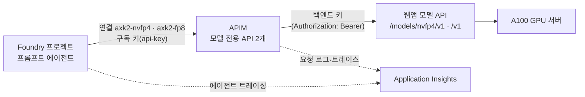

# Foundry BYOM 연결 — APIM을 거쳐 A.X K2 모델 API 호출

기준일: 2026-10-19~20 (UTC). 날짜가 없는 시각은 2026-10-19이다. 이 문서의 시각은 모두 UTC다. 한국 시각(KST)은 UTC보다 9시간 빠르다.

## 1. 요약

| 구분 | 내용 |
| --- | --- |
| 목적 | Foundry 에이전트가 APIM을 거쳐 A.X K2 모델 API를 호출하는 **외부 모델 연결(BYOM) 사전 검증**이다. Model Catalog 정식 등록이 아니다. |
| 만든 것 | 리소스 그룹 1개 안에 APIM 1개(Standard v2로 배포했다. 지금 라이브 티어는 Basic v2다. 9.8절), Foundry 계정·프로젝트 1세트(IaC로 만든 모델 배포는 없다), Application Insights와 Log Analytics, 모델 전용 API 2개, Foundry 연결 2개, 트레이싱 연결 2개. 리소스 그룹과 secret named value는 `byom.py`가 만들고 나머지는 Bicep으로 배포했다. 조정자 승인으로 IaC 밖에서 더미 도구 연결 1개를 추가로 만들었다(9.10절). |
| 확인됨 | 게이트웨이 경유 NVFP4의 일반 응답, 스트리밍, 도구 호출, 도구 결과 후 응답이 모두 HTTP 200이다. 구독 키가 없거나 틀리면 401이다. 로그 상관 판정은 PASS다. 에이전트 담당의 Foundry 호출로 게이트웨이가 받은 요청은 55건이다(스모크 제외). 2026-10-19 11:40~14:30 창이 25건, 2026-10-20 03:21~03:24 창이 6건, 04:27~04:37 창이 13건, 05:50~05:53 창이 5건, 06:50~06:53 창이 6건이다. 503 4건(첫 NVFP4 호출)을 뺀 51건이 모두 200이고 응답은 모두 백엔드가 만들었다. 함수 도구와 MCP 도구가 요청에 실렸다(9.4절~9.9절). D-1 더미 키 MCP 호출은 Foundry가 400 `tool_user_error`로 끝냈고 게이트웨이 요청이 0건이었다. 더미 값은 기록에서 발견되지 않았다(9.10절, 실패 경로만 본 결과다). |
| 실패 | (1) 에이전트 담당의 첫 Foundry 호출(NVFP4)이 503으로 끝났다. 게이트웨이가 받은 4건 모두 백엔드가 503을 돌려줬다(9.3절). (2) FP8 MCP `never` 변형(ablation) 호출이 Foundry에서 500 `model_error`로 끝났다. 게이트웨이는 요청 1건을 받았고 백엔드가 200을 돌려줬다(9.6절). 같은 에이전트·프롬프트로 다시 3회 호출했고 3회 모두 성공했다(9.7절). 2026-10-20에 같은 조건으로 3회 더 호출했고 3회 모두 성공했다(9.8절). (3) 2026-10-20 04:28 에이전트 B(ablation) 호출이 같은 형태의 500 `model_error`로 끝났다. 게이트웨이는 요청 1건을 받았고 백엔드가 200을 돌려줬다. 같은 날 이후 에이전트 B 호출 7회는 모두 성공했다. `temperature`만 0.3으로 바꾼 새 버전(B v2)의 호출 3회도 모두 성공했다(9.9절). 503과 500 두 건의 원인은 판단하지 않았다. 500 두 건의 가설과 직접 재현 결과는 4.3절과 9.9절에 있다. |
| 미확인 | 콘솔의 Active 표시, 에이전트 모델 선택 목록, 콘솔 트레이싱 화면, Basic v2에서 새 연결을 만들 수 있는지, 500 두 건이 Foundry 안에서 왜 났는지(가설과 직접 재현은 있으나 Foundry 쪽 관측이 없다), Foundry가 보고하는 입력 토큰이 모델 서버 값보다 4 작은 이유, MCP 도구 선택이 호출마다 달랐던 이유(`never` v1은 고르지 않았고 v2는 골랐다), MCP 인증이 성공하는 경로에서 키 값이 Foundry 기록에 남는지(9.10절). 4.3절에 정리했다. |
| IaC 밖의 변경 | 배포한 뒤 APIM 티어가 Standard v2에서 Basic v2로 바뀌었고 Foundry 계정에 모델 배포 2건(채팅 1, 임베딩 1)이 추가됐다. 웹앱의 App Service 계획 SKU(B1에서 F1)와 Always On도 같은 시간대에 바뀐 것을 웹앱 담당이 확인했다. 웹앱은 이 작업의 범위 밖이다. 이 작업은 이 변경들을 만들지 않았다. 가이드의 지원 티어는 Standard v2·Premium이지만 Basic v2에서도 기존 연결의 호출은 200이었다. 조정자가 Basic v2를 수용했고 Standard v2로 복구하지 않았다(9.8절). |
| 비용 | APIM 가동 시간 × 티어별 시간당 소매가(Standard v2 0.96 USD, Basic v2 0.21 USD)다. 계산값이며 청구액이 아니다. 2026-10-20 05:00 기준 약 8 USD다(Standard v2로 약 5~6시간, Basic v2로 약 13~14시간 가동한 것으로 계산, 7.7~8.5 USD. 7절). |

## 2. 범위와 읽는 법

- 이 문서는 인프라와 연결만 다룬다: 연결 설계, APIM 연결, 게이트웨이 경유 모델 API 검증, Foundry 연결 생성이다. 에이전트 생성, 도구 연결, 콘솔 증거는 에이전트 담당이 기록한다.
- 모든 측정값은 **단일 표본**이다. 성능과 안정성을 보증하지 않는다. 부하·지연 검증은 고객 시나리오(동시 사용자 수, 입력·출력 길이)를 정한 뒤 따로 한다.
- 기존 앱의 `/api/agent`(MAF + Web IQ) 성공은 별개의 앱 경로 증거다. 이 문서의 Foundry BYOM 증거로 쓰지 않는다.
- 이전 구독의 수치(처리량, TTFT)는 인용하지 않는다.
- 이 저장소는 공개다. 문서와 증거에는 자리표시자만 쓴다: `<deployment>`(배포 접두사), `<subscription>`, `<apim-gateway>`, `<web-app>`, `<foundry-endpoint>`.
- 담당 구분: **인프라 담당**은 이 문서의 작성자다. **웹앱 담당**은 웹앱·GPU 배포와 백엔드 키를 맡는다. **모델 API 담당**은 `/v1/*` 코드와 스모크 도구를 맡는다. **에이전트 담당**은 에이전트·도구·콘솔 증거를 맡는다. **조정자**는 승인과 PR을 맡는다.
- 판정 표기: **확인됨**은 증거 파일이나 명령 출력으로 직접 본 사실이다. **실패**는 실행했으나 기대와 다른 결과다. **미확인**은 실행하지 않았거나 도구로 볼 수 없는 항목이다. `[문서]`는 Microsoft 문서에서 가져온 사실이다. **계산값**은 소매가로 계산한 추정이며 청구액이 아니다.

## 3. 구성



| 용어 | 뜻 |
| --- | --- |
| 게이트웨이 | APIM 서비스 1개. 배포한 티어는 Standard v2이고 지금 라이브 티어는 Basic v2다(9.8절) |
| 모델 전용 API | 게이트웨이 안의 API. 모델마다 1개다: `axk2-nvfp4`(경로 `nvfp4/v1`), `axk2-fp8`(경로 `fp8/v1`) |
| 백엔드 | 웹앱의 모델 API. NVFP4는 `/models/nvfp4/v1/*`, FP8은 `/v1/*`다 |
| 구독 키 | 클라이언트(Foundry)가 게이트웨이에 보내는 키. 헤더 이름은 `api-key`다 |
| 백엔드 키 | 게이트웨이가 백엔드에 보내는 키. 게이트웨이의 secret named value `axk2-backend-key`에만 있다 |
| 연결 | Foundry 프로젝트의 `ApiManagement` 연결 |
| 스모크 도구 | 모델 API 담당의 `demo/tools/model_api_smoke.py`. 이 브랜치에는 없다. 검증에는 모델 API 담당의 커밋 `e70debb`에 있는 파일을 수정 없이 썼다(SHA-256 `38f9f10f…433e1d`) |

## 4. 현재 상태

### 4.1 확인됨

| 항목 | 결과 | 증거 |
| --- | --- | --- |
| 배포 | 모든 단계가 성공했다. APIM 상태는 `Succeeded`다. 연결 4개(모델 2개, 트레이싱 2개)를 읽었다 | `byom.py status`, `connections-*.json` |
| 인증 거부 | 구독 키가 없거나 틀리면 두 API 모두 401이다. 게이트웨이가 만든 응답이며 본문 키는 `message`와 `statusCode`다 | `probe-pre-go.json`, `apim-smoke-*-post-go.json` |
| 백엔드 fail-closed | 웹앱의 `/v1/*`를 활성화하기 전(10:13)에 유효한 구독 키로 `GET /models`를 호출하면 백엔드가 404를 돌려줬다. 게이트웨이가 백엔드까지 전달한다는 뜻이다 | `probe-pre-go.json` |
| 모델 목록 | `GET /models`가 200이다. NVFP4는 `ax-k2-nvfp4`, FP8은 `ax-k2-fp8`(`served_profile` fp8)을 돌려줬다 | `apim-smoke-nvfp4-post-go.json`, `apim-smoke-fp8-post-go.json` |
| 일반 응답 | NVFP4 `POST /chat/completions`가 200, `finish_reason=stop`이다 | `apim-smoke-nvfp4-post-go.json` |
| 스트리밍 | NVFP4가 SSE로 200을 돌려줬다. TTFT 0.409 s, 청크 간격이 균일해 스모크 도구가 `buffering: unlikely`로 판정했다 | `apim-smoke-nvfp4-post-go.json` |
| 도구 호출 | 도구 정의를 보내면 `finish_reason=tool_calls`와 `get_weather` 호출이 왔다. 도구 결과를 보내면 `stop`으로 끝나고 답변이 결과를 언급했다 | `apim-smoke-nvfp4-post-go.json` |
| 요청 ID 에코 | 인증된 6개 호출(NVFP4 5건, FP8 1건) 모두에서 보낸 `x-request-id`가 응답에 돌아왔다 | `apim-smoke-nvfp4-post-go.json`, `apim-smoke-fp8-post-go.json` |
| 로그 상관 | 스모크 POST 4건 모두 게이트웨이 요청, 트레이스, 백엔드 호출이 같은 OperationId로 이어진다. 백엔드 호출 4건이 모두 성공했다 | `apim-smoke-correlation-post-go.json` |
| 자격 증명 비전달 | 게이트웨이가 백엔드로 `api-key`·`Ocp-Apim-Subscription-Key` 헤더와 `api-key`·`subscription-key` 쿼리를 보내지 않는다(전달 헤더 트레이스 0건) | `apim-smoke-correlation-post-go.json`, `gateway-requests-foundry-first-call.json` |
| 백엔드 키 주입 | 전달 헤더 트레이스가 있는 모든 호출에서 `Authorization`이 주입됐다(스모크 GET 2건, 에이전트 담당의 POST 4건) | 위와 같음 |
| 로그 내용 | 로그 34행에 키와 프롬프트 본문이 없다 | `apim-smoke-correlation-post-go.json` |
| Foundry → 게이트웨이 도달 | Foundry 호출이 연결 `axk2-nvfp4`를 거쳐 게이트웨이에 도달했다. 요청은 chat completions 형식이고 본문의 `model`은 `ax-k2-nvfp4`였다 | `gateway-requests-foundry-first-call.json` |
| Foundry 트레이싱 | 에이전트 스팬(`invoke_agent`) 4건이 게이트웨이와 같은 Log Analytics 작업 영역에 기록됐다. 게이트웨이 요청과는 다른 OperationId다 | `gateway-requests-foundry-first-call.json` |
| Foundry(FP8 에이전트) → 게이트웨이 | 에이전트 담당의 호출 3묶음에서 게이트웨이가 `POST /fp8/v1/chat/completions` 4건을 받았고 모두 200이다. 응답은 모두 백엔드가 만들었다. `stream`은 `true`이고 본문에 `max_completion_tokens`와 `stream_options`가 있었다. 함수 도구 왕복은 2건이다 | `gateway-requests-foundry-fp8-bundles-1a-1b-mcp-never.json` |
| Foundry 요청의 도구 필드 | 함수 도구 요청과 MCP 도구 요청 모두 `tools`, `parallel_tool_calls`, `tool_choice`(`"auto"`)가 실렸다. Foundry는 MCP 도구를 요청에 실었다(9.4절~9.7절) | 위와 같음 |
| Foundry(NVFP4 에이전트) → 게이트웨이 | 첫 호출(503) 뒤 NVFP4 에이전트를 다시 호출했다. 게이트웨이가 받은 `POST /nvfp4/v1/chat/completions` 4건이 모두 200이다. 도구 없는 일반 요청 2건(12:46, 13:13)과 함수 도구 왕복 2건(12:47)이다(9.5절, 9.6절) | `gateway-requests-foundry-nvfp4-after-policy-update.json`, `gateway-requests-foundry-after-redeploy-nvfp4-and-mcp-never-v2.json` |
| Foundry → MCP 도구 호출 | `never` v2(12:39, 13:14)는 Foundry 호출 1건 안에서 모델 요청이 2건 나갔다. 둘째 요청에 `assistant`와 `tool` 메시지가 있고 Foundry가 `execute_tool` 스팬을 남겼다. `always`(12:40)는 Foundry 호출 2건에 모델 요청이 1건씩 나갔다. 에이전트 담당은 응답에 `mcp_call`이 나왔다고 보고했다. `never` v1(12:30)은 요청 1건, `stop`, 도구 실행 스팬 없음이다. ablation 재시험 3회(14:24~14:26)는 `never` v2와 같이 요청 2건, `chat` 스팬 1건이고 도구 이름이 `mcp_microsoft_learn.microsoft_docs_search`다(9.4절~9.7절) | `gateway-requests-foundry-mcp-never-v2-and-always.json`, `gateway-requests-foundry-after-redeploy-nvfp4-and-mcp-never-v2.json`, `gateway-requests-foundry-ablation-retest-1.json`~`-3.json` |
| 값 기록(정책 12:43 배포 뒤) | 배포 뒤 요청 13건에서 `max_completion_tokens`, `temperature`, `top_p`, `stream`, `stream_options`, 도구 개수, `tool_choice` 유무가 기록됐다(9.5절~9.7절) | 9.5절~9.7절의 증거 파일 중 12:46 이후 창 6개 |
| Foundry(FP8 에이전트) → 게이트웨이, 2026-10-20 | 에이전트 담당의 호출 19회(F3 ablation 3회 03:21~03:24, 에이전트 A·B 교차 10회 04:27~04:37, 요청 본문 캡처 3회 05:50~05:53, 온도 0.3 확인 3회 06:50~06:53)에서 게이트웨이가 `POST /fp8/v1/chat/completions` 30건을 받았고 모두 200이다(백엔드도 200, 재시도 없음). 본문 `model`은 30건 모두 `ax-k2-fp8`이고 `stream`은 `true`다. `Authorization` 주입과 자격 증명 비전달도 앞선 호출과 같았다. Foundry `chat` 스팬의 모델은 모두 `axk2-fp8/ax-k2-fp8`다. 호출당 요청 수는 도구 결과를 모델에 돌려준 호출이 2건, 도구를 부르지 않은 호출과 실패한 호출 1건이 각 1건이다(9.8절, 9.9절) | `gateway-requests-foundry-f3-ablation-1.json`~`-3.json`, `gateway-requests-foundry-f3b-series.json`, `gateway-requests-foundry-f3c-body-capture.json`, `gateway-requests-foundry-f3d-temp03-series.json`, `foundry-spans-f3-ablation.json`, `foundry-spans-f3b-series.json`, `foundry-spans-f3c-body-capture.json`, `foundry-spans-f3d-temp03-series.json` |
| Foundry 요청 본문 캡처(2026-10-20 05:50~05:53) | 에이전트 B 3회 호출 동안 APIM에 임시 trace를 추가해 모델 라우트의 요청 본문을 캡처했다(9.9절). 도구 목록을 실은 첫 모델 요청(R1) 본문 3건은 **바이트까지 같고** 크기는 모두 2333 B다. 같은 3건의 `Request Size`는 3978·3984·3982 B였다. `Request Size`에서 본문 크기를 뺀 값은 1645·1651·1649 B다. 본문이 같은데 `Request Size`가 달랐으므로 차이는 본문이 아니라 헤더에 있다. 값의 길이가 달랐던 헤더는 클라이언트 주소 헤더 2개(`CLIENT-IP`, `X-Forwarded-For`)뿐이다. 요청 5건 모두 게이트웨이·백엔드 200, `Authorization` 주입 5/5, 자격 증명 전달 0건이다. 두 번째 모델 요청(R2) 본문은 8 KB를 넘어 캡처하지 않았다. 본문 원본은 개인 파일에만 있고 저장소에 없다 | `gateway-requests-foundry-f3c-body-capture.json`, `foundry-spans-f3c-body-capture.json` |
| 온도 0.3 확인(2026-10-20 06:50~06:53) | 에이전트 B의 새 버전(`temperature`만 0.3으로 변경)을 3회 호출했고 3회 모두 성공했다. 게이트웨이 요청 6건(호출당 2건)이 모두 200이고 `Authorization` 주입은 6/6, 자격 증명 전달은 0건이다. 게이트웨이가 기록한 `temperature`는 6건 모두 0.3000000119209289(0.3의 32비트 부동소수 표현)다. 요청 본문 캡처 시리즈의 B 요청(`temperature` 1.0)과 값 기록이 다른 항목은 `temperature`뿐이다. Foundry 스팬에는 `temperature` 속성이 없다. 설정이 모델 요청에 실린다는 확인이며 500을 막는다는 근거는 아니다(9.9절) | `gateway-requests-foundry-f3d-temp03-series.json`, `foundry-spans-f3d-temp03-series.json` |
| D-1 더미 값 노출 점검(2026-10-20 07:07 호출 뒤) | 더미 값은 호출 창의 Log Analytics 11개 테이블(행이 있는 테이블은 `AppDependencies` 1건과 `AppMetrics` 1건뿐), 저장소(파일 278개), 세션 폴더(175개, 2개는 읽지 못해 건너뜀), 개인 디렉터리(22개, 더미 키 사본이 든 폴더 제외)에서 원문·앞 12자·뒤 12자·인코딩·대소문자 변형 어느 형태로도 나오지 않았다. 헤더 이름 `x-apikey`가 나온 Log Analytics 행도 없다. MCP 인증이 실패한 경로만 본 결과이고 인증이 성공하는 경로는 확인하지 못했다(9.10절) | `gateway-requests-foundry-d1-dummy-key.json`, `foundry-spans-d1-dummy-key.json` |
| 요청·응답 크기 | 게이트웨이 로그의 `Request Size`·`Response Size`를 증거에 `requestSize`·`responseSize`로 남긴다. 12:39 이후 요청 17건과 2026-10-20 요청 30건이 대상이다. `Request Size`는 **바이트 단위이고 HTTP 헤더 바이트를 포함한다.** 스모크 POST 3건(본문 223·237·447 B)의 로그 값이 1616·1633·1840이라 본문과 로그 값의 차가 1393·1396·1393 B로 거의 일정했고, 본문 길이의 차 224 B가 로그 값의 차 224 B와 같았다. 본문이 없는 `GET /models`는 1309 B였다. 본문 바이트 수는 스모크 도구의 요청 본문을 다시 만들어 계산한 값이다(`max_tokens`는 64로 가정했으므로 몇 바이트의 오차가 있을 수 있다). 이 확인은 읽기 전용 조회 결과이며 증거 파일을 남기지 않았다. 2026-10-20 캡처에서 본문이 같은 요청 3건의 `Request Size`가 3978·3984·3982 B로 달랐고 이 차이가 헤더 값 길이에 있었으므로 `Request Size`가 헤더를 포함한다는 판단과 일치한다. 캡처한 헤더의 이름·값 바이트를 합해도 `Request Size`와 약 290 B 차이가 남는다(원인 미확인). `Response Size`가 헤더를 포함하는지는 확인하지 않았다 | 9.5절~9.10절의 증거 파일 중 12:38 이후 창 8개(요청이 있는 파일은 7개)와 2026-10-20 게이트웨이 증거 8개(요청이 있는 파일은 6개) |

### 4.2 실패

| 항목 | 내용 |
| --- | --- |
| 첫 Foundry 호출 | 에이전트 담당이 11:45:07~11:45:23(KST 20:45)에 호출했고 약 16초 뒤 `model_error`로 실패했다. 게이트웨이는 같은 시간대에 `POST /nvfp4/v1/chat/completions` 4건을 받았고 4건 모두 503이었다. 4건 모두 백엔드 호출이 503을 반환했다. 게이트웨이가 만든 503이 아니다. 503의 원인은 판단하지 않는다. 상세는 9.3절이다 |
| FP8 MCP `never` 변형(ablation) 호출 | 에이전트 담당이 13:16:27~13:16:31(KST 22:16)에 호출했고 약 2초 뒤 Foundry가 500 `model_error`("The model produced invalid content…")로 끝냈다(에이전트 담당 보고). 게이트웨이는 같은 시간대에 `POST /fp8/v1/chat/completions` 1건(13:16:30.985)을 받았고 백엔드가 200을 돌려줬다. 백엔드 5xx가 아니고 요청이 빠진 것도 아니다. ±30초 안에 다른 요청이 없어 Foundry의 재시도로 보이는 요청도 없다. Foundry의 `invoke_agent` 스팬은 `ResultCode` 500, `error.type` `unknown`이다. 원인은 판단하지 않는다. 같은 에이전트·프롬프트·기본 온도로 14:24~14:26에 다시 3회 호출했고 3회 모두 성공했다(`invoke_agent` `ResultCode` 0, 게이트웨이 요청 2건, `mcp_` 도구 이름). 2026-10-20 03:21~03:24에 같은 에이전트로 3회 더 호출했고 3회 모두 성공했다(9.8절). 상세는 9.6절~9.8절이다 |
| 에이전트 B(ablation) 호출 2 (2026-10-20 04:28) | 에이전트 담당이 04:28:10~04:28:13에 호출했고 약 2.6초 뒤 Foundry가 500 `model_error`로 끝냈다(에이전트 담당 보고, 응답 ID 없음). 게이트웨이는 같은 시간대에 `POST /fp8/v1/chat/completions` 1건(04:28:12.982 도착)을 받았고 백엔드가 200을 돌려줬다. 13:16의 실패와 같이 `execute_tool` 스팬의 도구 이름이 `functions.` 형태이고 결과 속성이 없다. 원인은 판단하지 않는다. 같은 날 이후 에이전트 B 호출 7회(ⓑ 4·6·8·10번과 캡처 3회)는 모두 성공했고, 온도를 0.3으로 바꾼 새 버전의 호출 3회도 모두 성공했다. 상세는 9.9절이다 |
| D-1 더미 키 MCP 호출 (2026-10-20 07:07) | 에이전트 담당이 더미 키로 만든 연결을 쓰는 에이전트를 1회 호출했고, 대화 생성을 시작한 지 1.7초 만에 Foundry가 HTTP 400 `tool_user_error`로 끝냈다(에이전트 담당 보고). 오류 문구에 MCP 서버의 401 `auth_invalid_api_key`가 들어 있다. 게이트웨이의 모델 요청은 0건이다. Foundry 스팬은 `invoke_agent` 1건(`ResultCode` 500, `error.type` `tool_user_error`)뿐이다. 응답 객체와 출력 항목은 없다. 상세는 9.10절이다 |

### 4.3 미확인

| 항목 | 확인 방법 | 담당 |
| --- | --- | --- |
| 콘솔에서 연결이 Active로 보이는지 | ARM과 데이터 플레인에는 상태 필드가 없다(`error: null`). 콘솔에서 확인한다 | 에이전트 담당 |
| 에이전트 모델 선택 목록에 `axk2-nvfp4/ax-k2-nvfp4`가 보이는지 | 콘솔 | 에이전트 담당 |
| 에이전트 호출 500 두 건(13:16, 2026-10-20 04:28)의 원인 | **사실:** 두 건 모두 게이트웨이가 요청 1건을 받았고 백엔드가 200으로 답했다(4.2절). 두 건 모두 Foundry `execute_tool` 스팬의 도구 이름이 `functions.<label>.<tool>` 형태의 47자이고 결과 속성이 없다. 성공한 호출의 이름은 `mcp_<label>.<tool>` 형태의 41자다. 요청에 선언한 이름은 모든 요청에서 49자였다(9.6절, 9.9절). 스팬에 남는 이름은 모델이 쓴 이름이 아니라 Foundry가 변환한 값이다. 정상 실행의 41자 이름도 선언한 49자 이름과 다르기 때문이다. 그래서 스팬 이름만으로는 모델이 낸 원래 이름을 알 수 없고, 옛 추측(모델이 `functions.` 접두사가 붙은 이름을 냈다)은 유지하지 않는다. 직접 재생 244회(앞선 44회와 시리즈 1·2의 200회)에서 `functions.` 접두사가 붙은 이름은 나오지 않았다. 웹앱 담당이 Foundry의 실제 R1 본문(2333 B)을 APIM과 Foundry를 거치지 않고 모델 API에 직접 100회 보냈다. 100회 모두 HTTP 200이었다. 도구를 부른 94회 중 91회는 선언한 이름과 같았고 3회는 선언한 이름에서 `mcp___` 뒤의 `mcp_`가 빠진 45자 이름이었다. 도구 없이 답한 경우가 6회, 오류는 0회다(시리즈 1, 본문의 `temperature` 1.0 그대로). 본문에서 `temperature`만 0.3으로 바꿔 100회 더 보냈을 때(시리즈 2)는 100회 모두 200이었고 도구 호출 100회가 모두 선언한 이름과 같았다(근접명 0, 도구 없이 답한 경우 0, 오류 0). 모델이 선언한 이름과 다른 도구 이름을 낼 수 있다는 점은 이 직접 경로에서 재현됐다. **추정:** 선언한 이름과 같은 정상 도구 호출에서 벗어난 비율은 온도 1.0에서 9/100(95% 신뢰구간 약 4.8~16%), 0.3에서 0/100(상한 약 3.7%)이다. 피셔 정확검정(양측) p≈0.003이다. 근접명만 비교하면 3 대 0이라 p≈0.25이고 단독으로는 유의하지 않다. 온도 0.3에서 근접명이 없어진다는 점은 입증하지 못했다. 직접 경로, 본문 1종, 시간 창 1개의 결과다. Foundry에서 관측한 500 2건은 시리즈 1의 근접명 비율(3%)보다 높게 보이나 표본이 작아 유의한 차이로 볼 수 없다. **가설(추정):** 모델이 선언한 이름과 다른 도구 이름을 내보냈고 Foundry가 그것을 MCP 도구로 대응시키지 못해 500을 냈다. 정황은 두 가지다. 실패 스팬 이름의 길이가 근접명을 같은 규칙으로 변환한 값과 같고, 13:16 실패 응답이 같은 에이전트의 성공 응답보다 4 B 짧다(9.9절). **미확인:** Foundry 500이 근접명 때문인지(실패한 요청·응답 본문이 보존되지 않았고 재현에 쓴 본문은 성공한 호출의 것이다), 모델이 내보낸 원래 이름, 500의 `error.type`(스팬에는 `unknown`), 실패한 응답을 Foundry에서 읽을 수 있는지. 앞서 한 직접 재현 44회(0건)는 더 짧은 다른 본문(1837 B)으로 한 것이라 가설을 반증하지 못한다(9.9절). **완화책은 확인하지 못했다.** 후보는 둘이다. (1) Foundry 에이전트의 `temperature`를 0.3으로 낮춘다. 에이전트 담당이 에이전트 B의 새 버전(`temperature`만 0.3으로 변경)을 만들어 3회 호출했고 모두 성공했다. 요청 본문의 `temperature`는 6건 모두 0.3이었다(9.9절). 표본이 작아 500을 막는다고 말할 수 없다. 온도 1.0에서도 500 뒤의 같은 에이전트 호출 7회가 연속으로 성공했다. (2) 웹앱 쪽 근접명 보정은 후보이며 배포하지 않았다. 둘 다 500을 막는다고 확인하지 못했다. **진행 중:** 에이전트 담당의 실패 응답 읽기(읽기 전용)다. 이 문서를 쓴 시점에 끝나지 않았다 | 웹앱 담당, 에이전트 담당, 인프라 담당 |
| Basic v2에서 새 연결 생성과 콘솔 Active 표시 | 가이드는 `ApiManagement` 연결의 지원 티어로 Standard v2와 Premium만 적는다. 기존 연결의 호출은 Basic v2에서도 200이었다(9.8절, 9.9절). 새 연결을 만들어 보지 않았고 콘솔의 Active 표시도 보지 않았다. 새 연결은 Azure 쓰기이므로 조정자 승인을 받아 시험한다 | 인프라 담당, 조정자 승인 |
| F3 첫 호출이 느렸던 이유 | F3의 첫 호출은 R1 백엔드 시간이 4395 ms, 다음 두 호출이 1168·1155 ms였다. 요청 크기는 같다(9.8절). 웹앱 담당의 로그 대조에서 03:16~03:26에 컨테이너 시작·종료 기록이 없었고 첫 요청 직전 백엔드 상태 표본 62개(프로필별)가 정상이었다. 그래서 "유휴 뒤 컨테이너 재기동" 가설은 뒷받침되지 않는다(사실). 로그가 없다는 사실만으로 일시적인 플랫폼·네트워크 문제를 배제하지는 못한다. 경로별 첫 사용 초기화는 측정하지 않았다. 2026-10-20 캡처 시리즈의 첫 호출은 R1 백엔드 시간이 1230.1 ms로 셋째 호출의 R1(1220.6 ms)과 비슷했고, 온도 0.3 시리즈의 첫 호출도 1261.5 ms로 다음 두 호출(1223.0, 1214.9 ms)과 비슷했다. 두 시리즈 모두 F3와 같은 지연이 나타나지 않았다. 첫 호출의 R1을 비교할 수 있었던 시리즈는 F3, 캡처, 온도 0.3의 3개뿐이다. 다만 에이전트 담당이 알린 요청 시각부터 R1이 게이트웨이에 도착하기까지는 캡처와 온도 0.3 시리즈 모두 첫 호출이 1.2~1.7 s 길었다. Foundry 쪽 선행 구간이며 원인은 확인하지 못했다(9.9절) | 웹앱 담당, 에이전트 담당 |
| 지연 차이에 접두 캐시가 영향을 줬는지 | 에이전트 B의 두 호출(2026-10-20 ⓑ 4번, 10번)은 R2 요청 크기가 같은데(48164 B) R2 백엔드 시간이 5407.7 ms 대 2530.5 ms였다. 이후 시리즈까지 R2 11건을 모으면 입력 토큰 수별로 처음 나온 3건(F3-1, ⓑ 4, ⓑ 6)이 가장 느렸고(R2 백엔드 4956.6~6266.3 ms, R2 도착부터 `chat` 스팬 시작까지 3.15~4.36 s) 나머지 8건은 2178.3~2797.4 ms, 0.37~0.40 s였다(9.9절). 도착 → `chat` 시작을 첫 토큰까지의 시간으로 추정한다. 접두 캐시 효과와 **일치하지만 확정하지 못한다.** 2026-10-19 재시험 1~3에는 입력 토큰 수가 같은데 두 번째 호출도 느린 반례가 있다. 데모 serve 인자에서 접두 캐시를 끄지 않았고(웹앱 담당 확인) 적중 카운터가 수집되지 않았다. `chat` 스팬의 캐시 토큰 속성은 ⓑ의 9건에서 모두 0이고 다른 시리즈는 확인하지 않았다. 모델 서버가 캐시 토큰을 응답에 싣는지 모르므로 이 0은 적중 여부의 증거가 아니다 | 웹앱 담당 |
| 시리즈 첫 호출의 `Request Size`가 6~8 B 작은 경향 | 첫 호출의 `Request Size`가 다음 호출보다 6~8 B 작았다(F3 3976 대 3984, 에이전트 A 4012 대 4018, 에이전트 B 3978 대 3984). 반례가 있다. 13:16의 첫 ablation 호출은 3984였다. **사실(2026-10-20 캡처):** 에이전트 B 3회의 R1 본문은 바이트까지 같은 2333 B인데 `Request Size`는 3978(시리즈 첫 호출)·3984·3982였다. 값의 길이가 달랐던 헤더는 클라이언트 주소 헤더 2개뿐이다. 그래서 6~8 B 차이는 본문이 아니라 헤더에서 왔다. **미확인:** 두 헤더의 값 길이 차이가 설명하는 양은 첫 호출과 둘째 호출 사이 4 B(관측 6 B), 첫 호출과 셋째 호출 사이 2 B(관측 4 B)다. 시리즈 첫 호출만 계산보다 약 2 B 작았다. 이 2 B의 원인과 시리즈 첫 호출이 항상 가장 작은지는 모른다. 온도 0.3 시리즈는 R1 요청 크기가 3999, 3999, 3993 B였고 `temperature` 표기가 늘어난 것으로 보이는 15 B(추정)를 빼면 3984, 3984, 3978 B로, 가장 작은 것은 세 번째 호출이었다. 이 시리즈에서는 첫 호출이 가장 작다는 경향이 나타나지 않았다. 이 시리즈는 헤더를 캡처하지 않아 원인을 확인하지 못했다(9.9절) | 인프라 담당 |
| Foundry가 보고하는 입력 토큰이 모델 서버 값보다 4 작은 이유 | **사실:** Foundry의 실제 R1 본문(2333 B)을 웹앱 담당이 모델 API에 직접 1회 보냈을 때 모델 서버가 센 입력 토큰은 482(출력 42)였다. ⓑ에서 vLLM 지표로 잰 에이전트 B의 R1 값도 482였다. 같은 R1에 대해 Foundry는 478을 보고했다. 에이전트 A는 모델 서버 480, Foundry 476이고 F3의 큰 요청은 모델 서버 15558, Foundry 15554다. 차이는 매번 4였다. 도구 없이 답한 호출(모델 요청 1건)에서도 Foundry는 478을 보고했으므로 여러 요청을 합치는 과정에서 생긴 차이가 아니다(9.9절). **추정:** 웹앱 코드는 모델 서버의 `usage`를 그대로 전달하므로(저장소 코드를 읽었다. 배포된 판이 같은지는 확인하지 않았다) 차이는 Foundry가 값을 집계하거나 보고하는 곳에서 생긴다. **미확인:** 원인. 게이트웨이는 응답 본문을 읽지 않아 Foundry가 받은 `usage`를 볼 수 없다 | 웹앱 담당, 에이전트 담당 |
| 에이전트 담당의 호출이 아닌 인증 요청의 출처 | 2026-10-20 00:50~01:08에 구독 키로 인증된 요청 8건이 게이트웨이에 도달했다. 에이전트 담당의 호출이 아니고(에이전트 담당 확인) 대응하는 Foundry 스팬도 없다. 이 요청들의 증거 파일은 공개하지 않는다. 출처를 확인하지 못했다 | 조정자 |
| 모델이 MCP 도구를 고르는 일이 호출마다 달랐던 이유 | `never` v1(12:30)은 도구가 요청에 실렸는데 모델이 도구 호출 없이 `stop`으로 끝냈다(9.4절). `never` v2(12:39, 13:14)와 `always`(12:40)는 모델이 도구를 골랐다(9.5절, 9.6절). ablation 재시험 3회(14:24~14:26)도 도구를 골랐다(9.7절). 에이전트 버전 사이의 지시문·설정 차이는 이 문서에서 읽지 않았다. 차이의 원인은 판단하지 않는다 | 에이전트 담당 |
| 503의 원인 | 백엔드 로그와 백엔드 응답 본문을 확인한다. 이후 NVFP4 호출 4건(12:46 이후)은 200이다(4.1절). 11:45와 무엇이 달랐는지는 판단하지 않는다 | 웹앱 담당 |
| 백엔드가 `stream_options`로 사용량 청크를 돌려주는지 | FP8과 NVFP4 백엔드 모두 `max_completion_tokens`와 `stream_options`가 있는 Foundry 요청에 200으로 답했다(9.4절~9.7절). 사용량 청크 자체는 보지 않았다. 게이트웨이는 응답 본문을 기록하지 않는다. Foundry `chat` 스팬의 토큰 수가 백엔드 사용량에서 온 것인지는 확인하지 못했다. 확인하려면 모델 API를 직접 호출해야 하므로 승인을 받는다 | 모델 API 담당 |
| `reasoning_content` 처리 | 도구 호출 응답을 에이전트 쪽에서 비교한다 | 에이전트 담당 |
| 콘솔 트레이싱 화면과 두 AppInsights 연결 중 어느 쪽을 쓰는지 | 에이전트 스팬은 Log Analytics에서 읽혔다(9.5절, 9.6절). 콘솔 화면에 보이는지, 두 연결 중 어느 쪽을 쓰는지는 콘솔에서 확인한다 | 에이전트 담당 |
| 트레이싱 Reader 역할이 필요한지 | 콘솔이 권한 오류를 보일 때만 필요하다. 추가하기 전에 조정자에게 알린다. 운영자 계정(az CLI)은 읽기 전용 점검에서 Application Insights·Log Analytics 쿼리 권한과 Foundry 읽기 권한이 확인됐다(ARM 권한 조회, 리소스 그룹의 거부 할당 0건). 다른 계정으로 콘솔을 열면 그 계정을 따로 점검해야 한다. 역할은 만들지 않았다 | 인프라 담당 |
| `isDefault`, `isSharedToAll`이 에이전트 모델 참조에 영향을 주는지 | 콘솔과 에이전트 호출 | 에이전트 담당 |
| MCP 인증이 성공하는 경로에서 연결의 키 값이 Foundry 기록에 남는지 | 더미 키 호출(9.10절)은 MCP 인증이 실패한 경로만 봤다. 인증이 성공하고 도구가 실행되는 경로에서 Foundry가 키 값을 응답·대화·스팬에 남기는지는 그 점검으로 알 수 없다. 실제 키로 호출한 뒤 같은 노출 점검(호출 창의 Log Analytics, 저장소, 세션 폴더, Foundry 서버 기록)을 해서 확인한다. 실제 키를 쓰는 단계는 조정자의 승인과 에이전트 담당의 절차(`agent/DESIGN.md` 4.6절)를 따른다 | 에이전트 담당, 조정자 |
| Foundry가 연결의 키 이름 `x-apikey`를 헤더 이름으로 MCP 서버에 보내는지 | 오류 문구에 MCP 서버의 401 `auth_invalid_api_key`가 있어 키가 헤더로 도달했을 가능성이 높다(추정, 9.10절). 헤더 이름은 MCP 서버 쪽에서 확인하지 못했다. 실제 키를 쓴 호출이 인증을 통과하면 키가 서버가 읽는 헤더로 전달됐다고 볼 수 있다 | 에이전트 담당 |
| 더미 연결의 `isSharedToAll`이 요청값과 다르게 읽힌 이유 | D-1 더미 연결을 만들 때 PUT 본문에는 `isSharedToAll`을 true로 넣었으나 호출 뒤 ARM 읽기에서는 false였다. 이 호출은 연결을 찾지 못해 실패한 것이 아니라 MCP 서버의 401로 끝났다(9.10절). 원인을 확인하지 못했다. 연결 API 문서를 읽거나 새 연결로 같은 PUT을 다시 해 봐야 하고, 후자는 쓰기이므로 승인이 필요하다 | 인프라 담당 |
| FP8의 chat·stream·tool(스모크 도구, 게이트웨이 경유) | 스모크 도구로는 시험하지 않았다. Foundry 경유 FP8 호출에서는 일반 요청, 스트리밍 요청(`stream`이 `true`), 함수 도구 왕복, MCP 도구 요청이 200이었다(9.4절~9.7절). FP8의 TTFT·청크 간격(무버퍼 판정)은 측정하지 않았다. 스모크 도구로 확인하려면 조정자 승인이 필요하다 | 인프라 담당 |
| 구독 키를 다시 만든 뒤 연결에 저장된 키가 갱신되는지 | `deploy connections` 재실행으로 확인한다. 재발급이 필요할 때만 시험한다 | 인프라 담당 |
| `limit-concurrency` 초과 시 응답 동작 | 측정하지 않았다 | 인프라 담당 |
| BYOM 지역 제약 | 문서에 없다. Korea Central에서 연결 생성은 성공했다 | — |
| 부하·지연 | 고객 시나리오를 정한 뒤 따로 측정한다 | — |

## 5. Foundry 요건 `[문서]`

근거: Foundry BYOM(AI Gateway) 문서(2026-08-13 갱신)와 `foundry-samples` 저장소의 연결 Bicep 샘플이다.

| 요건 | 내용 |
| --- | --- |
| 모델 형식 | OpenAI 호환 chat completions다. Foundry가 Base URL 뒤에 `chat/completions`를 붙인다 |
| APIM 티어 | 가이드는 `ApiManagement` 연결의 지원 티어로 Standard v2와 Premium만 적는다. 이 배포의 라이브 티어는 Basic v2이고 기존 연결의 호출은 200이었다(9.8절). Basic v2에서 새 연결을 만들거나 콘솔의 Active 표시를 보는 일은 시험하지 않았다 |
| 인증 | API key(헤더 이름과 값 템플릿) 또는 Managed Identity다 |
| 에이전트 | 프롬프트 에이전트만 지원한다. 지원 도구에 Functions와 MCP가 있다. 에이전트 모델 참조 형식은 `연결이름/모델이름`이다 |
| 역할 | 프로젝트에서 Foundry User 이상, 리소스 그룹에서 Contributor가 필요하다 |
| 도구 버전 | Azure CLI 2.67 이상(이 환경은 2.88.0), `azure-ai-projects` 2.0.0 이상이다 |
| 연결 상태 | 연결이 Inactive이면 엔드포인트와 자격 증명을 점검한다 |
| 지역 | Agent Service 지역에 Korea Central이 있다. BYOM 전용 지역 제약은 문서에 없다 |
| 문서 모순 | Foundry 샘플은 "연결은 포털 UI 미지원, CLI·템플릿 필요"라고 쓴다. Learn은 포털 마법사를 설명한다. 이 배포는 ARM/Bicep으로 만들었다. 콘솔 노출 여부는 에이전트 담당이 기록한다 |
| 모호한 문장 | "The Response API isn't supported at present"가 백엔드 프로토콜을 뜻하는지 에이전트 호출 방식을 뜻하는지 문서만으로는 알 수 없다. 문서 샘플은 Responses API의 `agent_reference`로 에이전트를 호출한다. **관측:** Foundry가 게이트웨이로 보낸 요청은 chat completions 형식이었다 |

## 6. 설계 결정과 근거

| 결정 | 선택 | 근거 | 하지 않은 것 |
| --- | --- | --- | --- |
| APIM 티어 | 배포는 Standard v2 1개. 라이브는 Basic v2 1개 | `[문서]` Standard v2가 지원 티어다. 조정자가 상한을 Standard v2 1개(0.96 USD/h)로 승인했다. 배포한 뒤 티어가 IaC 밖에서 Basic v2로 바뀌었다(9.8절). Basic v2에서도 이번 호출은 200이었으나 가이드의 지원 티어는 Standard v2·Premium이다. 조정자가 Basic v2를 수용했다. Standard v2로 복구할지는 사용자가 원할 때 정한다. 복구하면 시간당 약 0.75 USD가 늘어난다(계산값) | Developer, Premium, APIM 추가, VNet은 미지원이거나 승인 범위 밖이라 시도하지 않았다. Basic v2는 이 작업이 만든 것이 아니다. `deploy apim`을 다시 실행하면 Standard v2로 되돌아가므로 실행하기 전에 조정자에게 알린다(12절) |
| 연결 범주 | `ApiManagement` + 정적 모델 목록 | 모델이 2개로 고정이라 모델 탐색(discovery) 오퍼레이션이 필요 없다 | `ModelGateway`(웹앱 직접 연결)는 `ApiManagement` 연결이 Active가 되지 않을 때의 대안이다. 조정자 승인 없이 만들지 않는다 |
| 인증 | 구독 키(`ApiKey`, 헤더 `api-key`) | 설정이 단순하다. 연결 자격 증명을 Bicep 안에서 `listSecrets`로 읽어 키가 파일·로그·출력에 남지 않는다 | Managed Identity + `validate-azure-ad-token`은 쓰지 않았다 |
| 연결 모델 | 1차 NVFP4(`ax-k2-nvfp4`), 2차 FP8(`ax-k2-fp8`) | NVFP4는 GPU 1노드(A100 8장)를 쓴다. 다른 세션이 단일 UI 표본으로 같은 13.6K 토큰 프롬프트의 TTFT를 NVFP4 8.3초, FP8 11.9초로 보고했다(여기서 다시 측정하지 않았다). NVFP4에서 앱 경로의 도구 왕복이 검증돼 있다 | FP8의 chat·stream·tool은 게이트웨이 경유로 시험하지 않았다 |
| 지역 | 신규 리소스 전부 Korea Central | 계획 단계에서 UK South의 APIM v2 생성이 일시적으로 불가한 것을 확인했다. Korea Central은 `[문서]` Agent Service 지역이고 웹앱도 같은 지역에 있다 | 다른 지역은 지연·비용 영향을 평가하지 않았다 |
| 공개 범위 | 백엔드 `/v1/*`는 공용 URL이며 백엔드 키가 필요하다 | 웹앱 IP 제한은 사이트 전체에 적용돼 웹 데모를 막는다. APIM v2의 아웃바운드 IP는 공유되고 바뀔 수 있다. 비공개 연결은 VNet과 웹앱 변경이 필요해 범위 밖이다 | 백엔드 키는 게이트웨이와 0600 파일에만 둔다. 데모가 끝나면 웹앱 담당이 키를 교체하거나 해시를 비활성화한다 |

**공식 샘플과의 대응.** 조정자 지침(공식 샘플 `apim-connection-common.bicep` 기준)과 이 배포를 비교했다.

| 항목 | 조정자 지침 | 이 배포 | 판정 |
| --- | --- | --- | --- |
| 연결 리소스 | `accounts/projects/connections@2025-04-01-preview`, 범주 `ApiManagement`, 인증 `ApiKey`, 키는 템플릿 안에서 `listSecrets`로 주입 | 같다(`connections.bicep`). 키는 출력·로그·파일에 남지 않는다 | 같음 |
| 메타데이터 | `deploymentInPath: 'false'`, `inferenceAPIVersion`, `models`(JSON 문자열 배열, `format: 'OpenAI'`) | `deploymentInPath: 'false'`, `models`(`format: 'OpenAI'`). `inferenceAPIVersion`은 지정하지 않았다 | 다름. Foundry 요청에 `api-version`이 붙지 않는다(9.3절~9.7절 관측) |
| 구독 범위 | 기본값 `master`(전체 API 접근)를 쓰지 않고 해당 API만 범위로 한 전용 구독 | 제품 `axk2-models`에만 범위를 둔 전용 구독 `foundry-byom`이다. 제품에는 모델 API 2개만 있다 | 충족 |
| 정책 | 샘플의 `validate-azure-ad-token` + `authentication-managed-identity`는 Azure OpenAI 백엔드용이라 쓰지 않는다 | 쓰지 않았다. `Authorization: Bearer`(secret named value)를 주입하고 `api-key`를 지운다. 백엔드는 웹앱이다 | 충족 |
| 스트리밍 | `forward-request buffer-response="false"`, 응답 본문 접근 없음, 타임아웃 120초 이상 | 타임아웃 230초, `buffer-response="false"`. 정책이 응답 본문에 접근하지 않는다. 요청 본문은 `preserveContent: true`로 읽는다. `set-variable`은 요청 ID 하나에만 쓴다 | 충족 |

**범위 밖(조정자 지시나 승인 없이 하지 않는다):** `ModelGateway` 연결, 트레이싱 Reader 역할, FP8 chat·stream·tool 호출, 본문 로깅, 정책 예외, 다른 SKU, 웹앱·GPU 변경, 삭제(`destroy`).

## 7. 리소스와 비용

이름의 `<deployment>`는 배포 접두사다. 지역은 모두 Korea Central이다.

| 리소스 | 이름 | 설정 | 비용 |
| --- | --- | --- | --- |
| 리소스 그룹 | `rg-<deployment>-byom` | 태그 `purpose=axk2-demo`, `deployment`, `createdAt` | 없음 |
| Log Analytics | `<deployment>-byom-logs` | PerGB2018, 일일 상한 0.1 GB, 보존 30일 | 사용량 기준. 상한 안의 비용은 측정하지 않았다 |
| Application Insights | `<deployment>-byom-ai` | 작업 영역 기반 | 위와 같음 |
| Foundry 계정 | `<deployment>-foundry` | AIServices S0, 로컬 인증 끔, 공용 네트워크 허용, 시스템 할당 ID | IaC로 만든 모델 배포는 없다. 이후 IaC 밖에서 모델 배포 2건(채팅 1, 임베딩 1)이 추가됐다(9.8절). 이 배포들의 비용은 확인하지 않았다. 계정 자체의 대기 비용은 문서상 없다 `[문서]` |
| Foundry 프로젝트 | `axk2-demo` | 프로젝트 범위에 운영자 역할 1개(Azure AI User, 콘솔 표기 Foundry User) | 없음 |
| APIM | `<deployment>-apim` | 배포는 Standard v2 × 1이다. 라이브는 Basic v2 × 1이다(IaC 밖의 변경, 9.8절). 중지할 수 없다 | Standard v2 0.96 USD/h, Basic v2 0.21 USD/h(계산값) |
| APIM 하위 | `axk2-backend-key`(secret named value), 제품 `axk2-models`, 구독 `foundry-byom`, API `axk2-nvfp4`·`axk2-fp8` | 구독의 `allowTracing`은 끔 | APIM에 포함 |
| Foundry 연결 | `axk2-nvfp4`, `axk2-fp8` | 프로젝트 수준 `ApiManagement` | 없음 |
| 더미 도구 연결 | `dummy-d1-*` 1개 | 범주 `RemoteTool`, 인증 `CustomKeys`. 에이전트 담당의 도구 연결 시험(D-1)용이다. 조정자 승인으로 ARM REST PUT 1회(api-version 2025-04-01-preview)로 만들었다. IaC에 없다. 키 값은 더미이며 어디에도 기록하지 않았다. 호출 뒤에도 삭제하지 않았다. 삭제는 조정자 승인 뒤에만 한다(14절). 시험 계획은 `agent/DESIGN.md` 4.6절에 있다 | 없음 |
| 트레이싱 연결 | `<deployment>-foundry-appinsights`(계정 수준), `<deployment>-byom-ai`(프로젝트 수준) | 범주 `AppInsights`, 같은 Application Insights를 가리킨다 | 없음 |

APIM은 요청 2026-10-19 10:09:35, 준비 10:11:48이다. 생성에 2분 13초가 걸렸다.

| 비용 항목 | 값 | 구분 |
| --- | --- | --- |
| APIM Standard v2 시간당 | 0.96 USD(하루 약 23.04 USD, 일주일 약 161.28 USD) | 소매가, 계산값 |
| APIM Basic v2 시간당 | 0.21 USD(하루 약 5.04 USD, 일주일 약 35.28 USD) | 소매가, 계산값 |
| 누적 | 2026-10-20 05:00까지 약 8 USD다. Standard v2로 약 5~6시간, Basic v2로 약 13~14시간 가동한 것으로 계산했다(7.7~8.5 USD). 티어가 바뀐 시각은 시간 범위로만 적었다(9.8절) | 계산값 |
| `byom.py status`의 누적 | 요청 시각부터 지금까지의 시간 × 0.96으로 계산한다. 티어가 Basic v2로 바뀐 뒤에는 실제 계산값보다 많게 나온다. 코드는 고치지 않았다. 예: 2026-10-19 14:34에 4.41 h, 약 4.23 USD | 계산값 |
| Standard v2로 되돌릴 때 | 시간당 약 0.75 USD(0.96 − 0.21)가 늘어난다 | 계산값 |
| GPU | 추가 비용 없음. 이미 켜진 GPU를 그대로 쓴다. 이 작업은 GPU를 바꾸지 않는다 | — |

Basic v2는 가이드가 `ApiManagement` 연결의 지원 티어로 적지 않은 티어다. 이 작업은 Basic v2를 만들지 않았다. 라이브 티어가 IaC 밖에서 바뀌었다(9.8절).

## 8. 게이트웨이 정책

정책은 `policies/model-api.xml`이고 `gateway.bicep`이 모델 전용 API마다 적용한다. 실행 순서대로 적었다.

| 순서 | 정책 | 동작 |
| --- | --- | --- |
| 1 | 요청 ID | 호출자의 `x-request-id`가 1~128자의 `[A-Za-z0-9._:-]`이면 그대로 쓴다. 아니면 APIM 요청 ID를 쓴다 |
| 2 | 속도 제한 | 구독당 60초에 30회다. 초과하면 429다(설정값이며 측정하지 않았다) |
| 3 | 클라이언트 자격 제거 | 헤더 `api-key`, `Ocp-Apim-Subscription-Key`와 쿼리 `api-key`, `subscription-key`를 지운다 |
| 4 | 백엔드 키 주입 | 헤더 `Authorization: Bearer`에 secret named value `axk2-backend-key`를 넣는다 |
| 5 | 요청 ID 전달 | 백엔드로 `x-request-id`를 보낸다. 응답에 `x-request-id`와 `x-apim-request-id`를 붙인다 |
| 6 | 트레이스 `axk2-forwarded-headers` | 모든 메서드. 헤더·쿼리의 존재 여부만 기록한다(값은 기록하지 않는다) |
| 7 | 트레이스 `axk2-request-shape` | POST만. 경로, 본문 필드 이름, `model`, `stream`, `max_tokens`·`max_completion_tokens` 유무, 메시지 수와 역할, 도구 이름과 개수(`tool_count`), `tool_choice`와 그 유무(`has_tool_choice`)를 기록한다. 본문 최상위의 숫자·불리언 값(`max_completion_tokens`, `temperature`, `top_p` 등)과 `stream_options`의 숫자·불리언 값은 `params`에 기록한다. 메시지 내용, 도구 스키마, 그 밖의 문자열 값(`model`, `tool_choice`, 도구 이름, 역할 제외)은 기록하지 않는다. 값을 읽지 못하면 `params`는 `unavailable`이다 |
| 8 | 백엔드 전달 | `forward-request` 타임아웃 230초, 응답 버퍼링 끔(스트리밍 무버퍼). 구독당 동시 2건(`limit-concurrency`) |
| 9 | 진단 설정 | 샘플링 100%, 헤더·본문 0바이트, 클라이언트 IP 미기록, W3C 상관, 오류는 항상 기록 |

백엔드는 `Authorization` Bearer와 `api-key` 중 하나만 맞아도 요청을 받는다. 그래서 백엔드 200만으로는 클라이언트 `api-key`가 제거됐다고 증명할 수 없다. 제거는 6번 트레이스로 확인한다.

7번의 값 기록(`params`, `tool_count`, `has_tool_choice`)은 2026-10-19 12:43 배포부터 적용된다. 그 전에 온 요청의 트레이스에는 이 값이 없다. 배포 뒤 라이브 정책이 저장소의 `policies/model-api.xml`과 같다는 것을 ARM에서 읽어 확인했다. 클라이언트 자격 제거 4개와 `Authorization` 주입은 그대로다. 배포 뒤 요청 13건(12:46:45~14:26:38)에서 새 값이 모두 기록됐다(확인됨, 9.5절~9.7절). 11:40~14:30 창의 Foundry 요청 25건 모두에서 클라이언트 자격 증명 전달은 0건이고 `Authorization` 주입은 25/25다.

## 9. 결과 상세

### 9.1 스모크 도구 검증 (게이트웨이 경유, 단일 표본)

조건: 스모크 도구 SHA-256 `38f9f10f…433e1d`(수정 없음), 동시성 1, 재시도 0, thinking OFF, `--max-tokens 64`, 인증 헤더 `api-key`다. NVFP4는 실행 `fcfd5227`(2026-10-19 11:17:29)이고 GPU 입장(admission)이 4건이다. FP8은 실행 `cc97a261`(11:18:07)이고 GPU 입장이 0건이다.

| 검사 | 결과 | 클라이언트 측정 | 게이트웨이 요청 / 백엔드 호출 |
| --- | --- | --- | --- |
| NVFP4 models | 200, 모델 `ax-k2-nvfp4` | 0.133 s | 로그 상관 대상 아님(GET) |
| NVFP4 chat | 200, `stop` | 0.464 s | 401.3 ms / 399.0 ms |
| NVFP4 stream | 200, SSE, 66청크(내용 64), `finish_reason=length` | 연결 0.049 s, TTFT 0.409 s, 첫~마지막 청크 1.316 s, 최대 청크 간격 0.052 s, 전체 1.723 s | 1635.8 ms / 1632.4 ms |
| NVFP4 tool | 200, `tool_calls`(`get_weather`) | 0.949 s | 759.9 ms / 756.7 ms |
| NVFP4 tool_result | 200, `stop`, 결과를 언급 | 0.872 s | 692.2 ms / 682.6 ms |
| NVFP4 auth | 키 없음 401, 틀린 키 401 | 0.151 s, 0.177 s | 게이트웨이가 처리했다. 백엔드 호출이 없다 |
| FP8 models | 200, `served_profile` fp8 | 0.218 s | 로그 상관 대상 아님(GET) |
| FP8 auth | 키 없음 401, 틀린 키 401 | 0.175 s, 0.165 s | 게이트웨이가 처리했다. 백엔드 호출이 없다 |

- 게이트웨이 요청 시간과 백엔드 호출 시간의 차이는 2.3~9.6 ms다.
- 스모크 응답 본문의 `model` 값은 `axk2`다. 요청 값 `ax-k2-nvfp4`와 다르다.
- FP8의 chat, stream, tool은 스모크 도구로 시험하지 않았다(미확인). Foundry 경유 FP8 호출은 200이었다(9.4절~9.7절).

### 9.2 로그 상관 (V6)

판정은 PASS다(`apim-smoke-correlation-post-go.json`, 창 시작 11:16:29).

- 스모크 POST 4건이 게이트웨이 요청, 트레이스, 백엔드 호출로 모두 이어졌고 백엔드 호출이 모두 성공했다.
- 스모크 POST 4건은 `axk2-forwarded-headers` 트레이스를 배포하기 전에 실행했다. 이 트레이스의 증거는 이후 스모크 GET 2건과 에이전트 담당의 POST 4건이다.
- 게이트웨이가 만든 401(키 없음·틀린 키)은 구독 정보와 트레이스가 로그에 없다. 스모크 창의 401 4건은 3.6 ms 이하로 끝났다. 사전 점검(10:13)에서 가장 먼저 보낸 401 2건은 각각 약 1.4 s였다(원인은 판단하지 않는다). 이 401에는 `x-request-id`가 돌아오지 않는다.
- Foundry의 에이전트 스팬은 게이트웨이 요청과 다른 OperationId에 기록된다. 게이트웨이 요청에는 호출자 쪽 부모 스팬 ID(`ParentId`)가 있어 Foundry가 `traceparent`를 보내는 것으로 보인다. 그 부모 스팬은 이 작업 영역에 없다. 에이전트 스팬과 게이트웨이 요청은 시각으로 맞춘다. 같은 Foundry 호출 안의 모델 요청은 OperationId를 공유할 수 있다. 그래서 `observe_requests.py`는 요청의 `Id`와 백엔드 호출·트레이스의 `ParentId`로 요청을 묶는다.
- 로그 수집은 최대 약 5분 늦는다. 로그 조회는 5분 이상 기다린 뒤에 한다.
- `observe_requests.py`는 `execute_tool` 스팬마다 도구 이름과 `gen_ai.tool.call.result` 속성의 유무(예/아니오)를 `callerSideSpans`에 센다. 쿼리는 속성 묶음을 가져오지 않고 속성 유무만 계산해 돌려준다. 속성 값(메시지, 도구 인자, 도구 결과)은 읽지 않는다. 이것은 이 도구의 동작이다. 스팬 값을 읽은 1회 예외는 이 도구가 아닌 별도 쿼리로 했다(9.9절). 영문자·숫자·`_`·`.`·`-` 100자 이내가 아닌 도구 이름은 `<other>`로 기록한다. 변경은 단위 테스트와, 9.6절의 ablation 창(13:16)과 `never` v2 창(13:14)을 읽기 전용으로 다시 읽은 결과로 확인했다. 두 창의 결과는 9.6절의 개인 디렉터리 출력과 같았다(ablation: 도구 이름 `functions.microsoft_learn.microsoft_docs_search`, 결과 속성 없음, `chat` 스팬 없음. `never` v2: 도구 이름 `mcp_microsoft_learn.microsoft_docs_search`, 결과 속성 있음, `chat` 스팬 1건). 이 확인 출력은 저장하지 않았다.
- `AppRequests.Url`에는 클라이언트 URL 전체가 있다. 증거에는 경로, 쿼리 이름, `api-version`만 남긴다.

### 9.3 에이전트 담당의 첫 Foundry 호출 (503)

증거: `gateway-requests-foundry-first-call.json`(창 11:44:30~11:46:30). 에이전트 담당은 호출 1건이 약 16초 뒤에 실패했다고 보고했다. 게이트웨이는 같은 시간대에 4건을 받았다. 4건이 Foundry의 재시도인지는 확인하지 못했다.

| 번호 | 도착 시각 | 상태 | 게이트웨이 총 소요 | 백엔드 호출 소요 |
| --- | --- | --- | --- | --- |
| 1 | 11:45:12.130 | 503 | 77.7 ms | 72.0 ms |
| 2 | 11:45:12.632 | 503 | 35.9 ms | 34.6 ms |
| 3 | 11:45:18.119 | 503 | 14.4 ms | 13.2 ms |
| 4 | 11:45:23.599 | 503 | 7.3 ms | 5.9 ms |

- 4건 모두 `POST /nvfp4/v1/chat/completions`이고 구독 `foundry-byom`이다. 도착 간격은 0.5초, 5.49초, 5.48초다.
- 4건 모두 백엔드 호출(`POST /models/nvfp4/v1/chat/completions`)이 503을 반환했다. 게이트웨이가 더한 시간은 1.2~5.7 ms다. 503은 백엔드 응답이다.
- 에이전트 담당은 오류 본문이 모델 API의 `backend_unavailable` 형태라고 보고했다. 이 문서는 본문을 기록하지 않아 직접 확인하지 못했다.
- **요청 형태(4건 동일):**
  - 경로 `/nvfp4/v1/chat/completions`, 쿼리 없음(`api-version` 없음), 구독 키는 헤더로 도착했다.
  - `model`은 `ax-k2-nvfp4`, `stream`은 `true`다.
  - `max_completion_tokens`가 있고 `max_tokens`는 없다.
  - 본문 필드는 `messages`, `stream`, `max_completion_tokens`, `stream_options`, `model`, `temperature`, `top_p`다.
  - 메시지는 2개(system, user)다. `tools`와 `tool_choice`는 없다.
  - User-Agent는 비어 있고 `x-request-id`는 없다.
- **정책 결과:** 클라이언트 자격 증명 전달 0건, `Authorization` 주입 4/4다.
- 이 호출에는 도구가 없었다. 도구가 있는 요청의 형태는 9.4절이다.
- 백엔드는 위 요청 형태(`stream_options`, `max_completion_tokens` 포함)를 받아야 한다. NVFP4가 받아들이는지는 이 호출에서는 503 때문에 확인하지 못했다. FP8은 같은 형태에 200으로 답했다(9.4절). 이후 같은 본문 필드 7개를 가진 NVFP4 요청 2건(12:46, 13:13)도 200이었다(9.5절, 9.6절). 이 호출에서는 값을 기록하지 않았으므로 값이 같았는지는 확인하지 못했다.

### 9.4 에이전트 담당의 FP8 호출 3묶음 (200)

증거: `gateway-requests-foundry-fp8-bundles-1a-1b-mcp-never.json`(창 12:27:30~12:31:30). 에이전트 담당이 FP8 에이전트로 호출한 묶음은 1a(도구 없음), 1b(함수 도구 왕복), MCP `never` v1(Learn MCP 도구, 에이전트 버전 1)이다. 게이트웨이가 받은 요청은 4건이고 모두 200이다. 이 요청은 정책의 값 기록을 배포하기 전에 왔다. 그래서 숫자·불리언 값과 도구 개수는 증거 파일에 없다.

| 묶음 | 도착 시각 | 상태 | 게이트웨이 총 소요 | 백엔드 호출 소요 | 메시지(역할) | 도구 이름 |
| --- | --- | --- | --- | --- | --- | --- |
| 1a | 12:28:14.812 | 200 | 3788.4 ms | 3780.5 ms | 2(system, user) | 없음 |
| 1b 첫 요청 | 12:29:07.893 | 200 | 2489.8 ms | 2486.3 ms | 2(system, user) | `lookup_demo_stock` |
| 1b 둘째 요청 | 12:29:11.045 | 200 | 1095.0 ms | 1091.5 ms | 5(system, user, assistant, assistant, tool) | `lookup_demo_stock` |
| MCP `never` v1 | 12:30:26.739 | 200 | 2287.4 ms | 2286.0 ms | 2(system, user) | `mcp___mcp_microsoft_learn___microsoft_docs_search` |

- 4건 모두 `POST /fp8/v1/chat/completions`이고 백엔드 호출은 `POST /v1/chat/completions`다. 구독은 `foundry-byom`이고 `api-version`이 없으며 User-Agent는 비어 있다. 응답은 모두 백엔드가 만들었다. 게이트웨이가 더한 시간은 1.3~7.9 ms다.
- 요청의 `model`은 `ax-k2-fp8`, `stream`은 `true`다. `max_completion_tokens`가 있고 `max_tokens`는 없다.
- 본문 최상위 필드: 1a는 `messages`, `stream`, `max_completion_tokens`, `stream_options`, `model`, `temperature`, `top_p`다. 1b와 MCP 요청은 여기에 `tools`, `parallel_tool_calls`, `tool_choice`가 더해진다. `tool_choice`는 모두 `"auto"`다.
- MCP 요청에도 도구 정의가 실렸고 본문 모양이 1b와 같다(도구 이름만 다르다). Foundry는 MCP 도구를 요청에 실었다.
- Foundry `chat` 스팬의 종료 사유(`gen_ai.response.finish_reasons`)와 토큰 수(입력, 출력)는 1a `stop`(80, 15), 1b 첫 요청 `tool_calls`(310, 96), 1b 둘째 요청 `stop`(390, 36), MCP `stop`(477, 88)이다. 이 값은 개인 디렉터리 출력에서 읽었고 증거 파일에는 없다.
- MCP `never` v1 호출은 요청 1건으로 끝났고 도구 실행 스팬이 없다(이 창의 스팬 이름은 `chat`과 `invoke_agent`뿐이다). 모델이 `tool_choice=auto`에서 도구 호출 없이 `stop`으로 끝냈다. 왜 도구를 고르지 않았는지는 판단하지 않는다. 이후 `never` v2는 도구를 골랐다(9.5절).
- 정책 결과: 클라이언트 자격 증명 전달 0건, `Authorization` 주입 4/4다.
- NVFP4 첫 호출(9.3절)은 503이었고 FP8 호출은 200이다. 시각과 프로파일이 다르므로 차이의 원인은 판단하지 않는다. 이후 NVFP4 호출은 200이었다(9.5절, 9.6절).

### 9.5 에이전트 담당의 후속 호출 (정책 값 기록 배포 12:43 전후)

증거: `gateway-requests-foundry-mcp-never-v2-and-always.json`(창 12:38:30~12:41:00), `gateway-requests-foundry-web-iq-marker-window.json`(창 12:42:00~12:46:20), `gateway-requests-foundry-nvfp4-after-policy-update.json`(창 12:46:20~12:49:00). 에이전트 담당과 조정자가 알린 호출 시각은 MCP `never` v2 12:39:05, MCP `always` 12:40:04, Web IQ 표식 12:43:37, NVFP4 1a 12:46:42, NVFP4 1b 12:47:18이다. MCP `never` v2는 에이전트 버전 2, MCP `always`는 버전 3이고 둘 다 FP8 API(`/fp8/v1`)로 왔다. NVFP4 1a와 1b는 NVFP4 API(`/nvfp4/v1`)로 왔다.

| 호출 | 도착 시각 | 상태 | 게이트웨이 총 소요 | 백엔드 호출 소요 | 메시지(역할) | 요청 / 응답 크기 | 값 기록 |
| --- | --- | --- | --- | --- | --- | --- | --- |
| MCP `never` v2 첫 요청 | 12:39:09.759 | 200 | 1254.1 ms | 1252.2 ms | 2(system, user) | 3996 / 6198 | 배포 전 |
| MCP `never` v2 둘째 요청 | 12:39:13.267 | 200 | 5840.0 ms | 5835.3 ms | 4(system, user, assistant, tool) | 48300 / 23410 | 배포 전 |
| MCP `always` 첫 요청 | 12:40:07.925 | 200 | 1189.4 ms | 1188.1 ms | 2(system, user) | 3996 / 6198 | 배포 전 |
| MCP `always` 둘째 요청 | 12:40:13.121 | 200 | 5487.4 ms | 5473.0 ms | 4(system, user, assistant, tool) | 48300 / 25034 | 배포 전 |
| Web IQ 표식(12:43:37) | 요청 없음 | — | — | — | — | — | — |
| NVFP4 1a | 12:46:45.221 | 200 | 2529.4 ms | 2264.4 ms | 2(system, user) | 2636 / 4688 | 배포 후 |
| NVFP4 1b 첫 요청 | 12:47:21.971 | 200 | 979.2 ms | 977.7 ms | 2(system, user) | 3075 / 5003 | 배포 후 |
| NVFP4 1b 둘째 요청 | 12:47:23.603 | 200 | 1204.8 ms | 950.2 ms | 4(system, user, assistant, tool) | 3408 / 8140 | 배포 후 |

- 크기 열은 게이트웨이 로그의 `Request Size`와 `Response Size`다. 단위는 문서로 확인하지 못했다(바이트로 추정한다).
- 요청 7건 모두 `POST`이고 쿼리와 User-Agent가 없으며 구독은 `foundry-byom`이다. `stream`은 `true`이고 `max_completion_tokens`가 있으며 `max_tokens`는 없다. 응답은 모두 백엔드가 만들었다. 클라이언트 자격 증명 전달은 0건이고 `Authorization` 주입은 7/7이다.
- "값 기록"은 정책의 값 기록(8절)을 배포한 12:43:04의 전후를 뜻한다. 배포 전 요청은 증거 파일의 `parameters`, `toolCount`, `hasToolChoice`가 `null`이다. 이 요청에도 `tool_choice` 문자열(`"auto"`)과 도구 이름은 기록돼 있다.
- **배포 뒤 첫 값(NVFP4):** 1a는 `max_completion_tokens` 256, `stream` `true`, `stream_options` `{"include_usage": true}`, `temperature` 1.0, `top_p` 1.0이다. `tools`와 `tool_choice`가 없다(`toolCount` 0, `hasToolChoice` `false`). 1b의 두 요청은 같은 값에 `tools` 1개(`lookup_demo_stock`), `tool_choice` `"auto"`, `parallel_tool_calls` `false`가 더해졌다(`toolCount` 1, `hasToolChoice` `true`). `max_completion_tokens`는 두 요청 모두 256이다.
- **MCP `never` v2(12:39):** 게이트웨이 요청 2건이 Foundry 호출 1건 안에서 나갔다. 스팬은 `invoke_agent` 1건(9420.6 ms), `execute_tool mcp_microsoft_learn.microsoft_docs_search` 1건(7395.3 ms), `chat` 1건(2009.7 ms, 종료 사유 `stop`, 입력 10531·출력 95 토큰)이다. 둘째 요청에 `assistant`와 `tool` 메시지가 있다. 모델이 첫 응답에서 MCP 도구를 골랐고 Foundry가 도구 결과를 넣어 다시 요청한 것으로 보인다(추정, 응답 본문은 기록하지 않는다). `execute_tool` 스팬은 `invoke_agent` 스팬과 같은 시각에 시작한다. 스팬 시작·종료의 정의는 확인하지 못했다.
- **MCP `always`(12:40):** Foundry 호출 2건에 게이트웨이 요청이 1건씩 나갔다. 호출 1(`invoke_agent` 1284.8 ms)에는 `chat` 스팬 1건(1270.1 ms, `tool_calls`, 입력 480·출력 41 토큰)이 있다. 호출 2(`invoke_agent` 8986.8 ms)에는 `execute_tool` 스팬 1건(5766.3 ms)과 `chat` 스팬 2건이 있다. `chat` 스팬 하나(12:40:09.651, 1018.6 ms, `tool_calls`, 입력 484 토큰)는 대응하는 게이트웨이 요청이 없다. 나머지 `chat` 스팬은 `stop`(2180.2 ms, 입력 10533·출력 102 토큰)이다. 대응이 없는 원인은 판단하지 않는다.
- 에이전트 담당은 `never` v2와 `always` 호출의 응답에 `mcp_call`이 나왔다고 보고했다(조정자 전달). 두 호출 모두 요청에 도구가 실렸고 `tool_choice`가 `"auto"`였다(위 표).
- Web IQ 표식 창(12:42:00~12:46:20)에는 게이트웨이 요청, 백엔드 호출, 트레이스, Foundry 스팬이 모두 0건이다. 에이전트 담당은 12:43:37의 Web IQ 호출을 Foundry 검증이 400으로 거절했다고 보고했다. 이 호출이 게이트웨이에 도달하지 않은 것과 맞는다.
- **관찰 도구 수정:** `observe_requests.py`는 처음에 요청과 백엔드 호출·트레이스를 OperationId로 이었다. 같은 Foundry 호출 안의 모델 요청은 OperationId를 공유하므로 두 요청이 같은 요청 형태와 같은 백엔드 시간으로 나오는 오류가 있었다. 지금은 `Id`와 `ParentId`로 잇는다(9.2절). 위 표는 고친 도구의 출력이다. 9.3절과 9.4절의 증거는 같은 창을 고친 도구로 다시 읽어 비교했고 영향이 없었다(요약과 창이 같고, 새로 생긴 키는 `hasToolChoice` 하나이며 값은 `null`이다).

### 9.6 에이전트 담당의 웹앱 재배포 뒤 호출 (13:00 이후)

증거: `gateway-requests-foundry-after-redeploy-nvfp4-and-mcp-never-v2.json`(창 13:12:30~13:16:30), `gateway-requests-foundry-ablation-fp8-after-redeploy.json`(창 13:16:00~13:19:30). 웹앱 담당이 웹앱을 다시 배포했고 새 워커는 13:00:28에 시작했다(조정자 보고). 에이전트 담당이 알린 호출 시각은 ① NVFP4 1a 13:13:27~13:13:33, ② FP8 MCP `never` v2 13:14:41~13:14:54, ③ FP8 MCP `never` 변형(ablation) 13:16:27~13:16:31이다. ③은 v2 지시문을 쓰고 `temperature`를 지정하지 않은 별도 에이전트(버전 1)의 호출이라고 보고됐다.

| 호출 | 도착 시각 | API | 상태 | 게이트웨이 총 소요 | 백엔드 호출 소요 | 요청 / 응답 크기 |
| --- | --- | --- | --- | --- | --- | --- |
| ① NVFP4 1a | 13:13:33.301 | NVFP4 | 200 | 694.9 ms | 693.5 ms | 2644 / 4901 |
| ② `never` v2 첫 요청 | 13:14:45.580 | FP8 | 200 | 1294.4 ms | 1291.6 ms | 3996 / 6198 |
| ② `never` v2 둘째 요청 | 13:14:49.604 | FP8 | 200 | 5635.7 ms | 5631.6 ms | 48300 / 24578 |
| ③ ablation | 13:16:30.985 | FP8 | 200 | 1129.1 ms | 1127.9 ms | 3984 / 5651 |

값 기록은 이 4건 모두 있다.

| 요청 | `max_completion_tokens` | `temperature` | `top_p` | 메시지(역할) | 도구 | `tool_choice` |
| --- | --- | --- | --- | --- | --- | --- |
| ① | 256 | 1.0 | 1.0 | 2(system, user) | 없음 | 없음 |
| ② 첫 요청 | 384 | 0.3 | 1.0 | 2(system, user) | 1개 | `"auto"` |
| ② 둘째 요청 | 342 | 0.3 | 1.0 | 4(system, user, assistant, tool) | 1개 | `"auto"` |
| ③ | 384 | 1.0 | 1.0 | 2(system, user) | 1개 | `"auto"` |

- 4건 모두 `stream`이 `true`이고 `stream_options`가 `{"include_usage": true}`다. 쿼리와 User-Agent가 없다. 클라이언트 자격 증명 전달은 0건이고 `Authorization` 주입은 4/4다.
- ①의 본문 필드는 9.3절과 같은 7개다. ②와 ③은 `tools`, `parallel_tool_calls`(`false`), `tool_choice`가 더해진 10개다. 도구는 `mcp___mcp_microsoft_learn___microsoft_docs_search` 1개다.
- ②의 `temperature` 기록값은 `0.3000000119209289`다. 0.3을 32비트 부동소수점으로 나타낸 값(약 0.3000000119)과 맞는다.
- **②의 `max_completion_tokens`:** 첫 모델 요청이 384이고 둘째가 342로 42 적다. 두 요청은 Foundry 호출 1건 안에서 나갔다. NVFP4 1b의 함수 도구 왕복은 Foundry 호출 2건이고 두 요청 모두 256이다(9.5절). 값이 달라지는 규칙은 확인하지 못했다.
- **②와 ③의 차이:** `temperature`가 0.3과 1.0이다. 첫 요청의 크기가 3996과 3984이고 첫 응답의 크기가 6198과 5651이다. 이 차이와 ③의 오류의 관계는 판단하지 않는다.
- **③의 결과를 나누면 다음과 같다.**
  - 게이트웨이는 요청 1건(13:16:30.985)을 받았다. ±30초 안에 다른 요청이 없고 가장 가까운 앞선 요청은 약 101초 전이다. Foundry의 재시도로 보이는 요청이 없다.
  - 백엔드는 200으로 응답했다(백엔드 호출 소요 1127.9 ms). 백엔드 5xx가 아니고 요청이 빠진 것도 아니다.
  - Foundry의 `invoke_agent` 스팬(13:16:30.941, 1218.1 ms)은 `ResultCode` 500, `error.type` `unknown`이다. 에이전트 담당은 Foundry가 약 2초 뒤 500 `model_error`("The model produced invalid content…")로 끝냈다고 보고했다.
  - 하위 `execute_tool functions.microsoft_learn.microsoft_docs_search` 스팬(1216.9 ms, `ResultCode` 0)이 있고 `chat` 스팬은 없다. ②의 도구 실행 스팬 이름은 `mcp_microsoft_learn.microsoft_docs_search`다. 요청에 실린 도구 이름은 둘 다 `mcp___mcp_microsoft_learn___microsoft_docs_search`다. ②의 도구 실행 스팬에는 `gen_ai.tool.call.result` 속성이 있고 ③의 도구 실행 스팬에는 없다(속성 이름만 확인했고 값은 읽지 않았다. 이후 갱신: ③의 `invoke_agent` 스팬 출력에서 도구 호출 이름만 조정자가 승인한 1회 읽기로 읽었다. 9.9절).
  - 추정: 모델이 `functions.` 접두사가 붙은 도구 이름을 내보냈고 Foundry가 이를 요청의 도구와 맞추지 못했을 수 있다. 근거는 정황뿐이다(스팬 이름, 결과 속성 유무). 확인하려면 같은 요청으로 모델 API를 직접 호출해 응답의 `tool_calls[].function.name`을 읽어야 한다. GPU 호출이므로 조정자 승인이 필요하다. 이후 갱신: 스팬에는 모델이 쓴 이름이 아니라 Foundry가 변환한 이름이 남고 직접 재생 244회에서 `functions.` 접두사가 나오지 않아, 이 추정은 9.9절의 가설로 바뀌었다.
- **누적(11:40~13:28 창, 스모크 제외):** 게이트웨이가 받은 Foundry 요청은 19건이다. 상태는 200이 15건, 503이 4건이다. NVFP4가 8건(503 4건, 200 4건)이고 FP8이 11건(모두 200)이다. 응답은 19건 모두 백엔드가 만들었다. 클라이언트 자격 증명 전달은 0건이고 `Authorization` 주입은 19/19다. Foundry `invoke_agent` 스팬은 17건이고 `ResultCode` 0이 12건, 500이 5건(11:45의 4건과 ablation 1건)이다.
- **게이트웨이가 더한 시간(11:40~13:28 창):** 게이트웨이 총 소요에서 백엔드 호출 소요를 뺀 값이다. 19건 중 17건이 14.4 ms 이하이고 최소는 1.2 ms다. 2건이 약 255~265 ms다(NVFP4 1a 12:46:45의 265.0 ms, NVFP4 1b 둘째 요청 12:47:23의 254.6 ms). 웹앱 재배포 뒤 4건은 1.2~4.1 ms다. 원인은 판단하지 않는다(단일 표본).
- 스팬의 이름·시각·종료 사유·토큰 수와 속성 이름은 개인 디렉터리 출력에서 읽었다. 이 절의 증거 파일에는 스팬 종류별 개수와 `ResultCode`만 있다. 이후에 만드는 증거 파일에는 `execute_tool` 스팬의 도구 이름과 결과 속성 유무도 들어간다(9.2절). 기존 증거 파일은 고치지 않았다.

### 9.7 에이전트 담당의 ablation 재시험 (14:24 이후)

증거: `gateway-requests-foundry-ablation-retest-1.json`(창 14:24:12~14:24:55), `gateway-requests-foundry-ablation-retest-2.json`(창 14:25:16~14:25:56), `gateway-requests-foundry-ablation-retest-3.json`(창 14:26:17~14:26:58). 9.6절 ③이 Foundry 500으로 끝났으므로 에이전트 담당이 같은 에이전트(버전 1)와 같은 프롬프트로 `temperature`를 지정하지 않고 3회 다시 호출했다. 에이전트 담당이 알린 시각(실행 시작 / `responses` 요청 / 종료)은 재시험 1이 14:24:27 / 14:24:29 / 14:24:40, 재시험 2가 14:25:31 / 14:25:32 / 14:25:41, 재시험 3이 14:26:32 / 14:26:33 / 14:26:43이다. 에이전트 담당은 3회 모두 완료됐고 응답에 `mcp_call`이 있었으며 클라이언트 `responses` 요청은 호출마다 1건(재시도 0건)이었다고 보고했다. 3회 모두 성공했으므로 `temperature` 0.3 대조 호출은 하지 않았다.

호출마다 게이트웨이 요청이 2건이다. 6건 모두 FP8 API다.

| 호출 | 요청 | 도착 시각 | 상태 | 게이트웨이 총 소요 | 백엔드 호출 소요 | 요청 / 응답 크기 |
| --- | --- | --- | --- | --- | --- | --- |
| 재시험 1 | 첫 요청 | 14:24:32.539 | 200 | 1248.6 ms | 1244.7 ms | 3984 / 6198 |
| 재시험 1 | 둘째 요청 | 14:24:35.964 | 200 | 5140.8 ms | 5138.6 ms | 48288 / 21752 |
| 재시험 2 | 첫 요청 | 14:25:33.568 | 200 | 1208.2 ms | 1206.5 ms | 3984 / 6198 |
| 재시험 2 | 둘째 요청 | 14:25:36.879 | 200 | 5196.0 ms | 5194.0 ms | 48288 / 22224 |
| 재시험 3 | 첫 요청 | 14:26:35.083 | 200 | 1169.0 ms | 1167.6 ms | 3984 / 5655 |
| 재시험 3 | 둘째 요청 | 14:26:38.309 | 200 | 6221.0 ms | 6218.3 ms | 63969 / 20827 |

값 기록은 6건 모두 있다.

| 요청 | `max_completion_tokens` | `temperature` | `top_p` | 메시지(역할) | 도구 | `tool_choice` |
| --- | --- | --- | --- | --- | --- | --- |
| 재시험 1~3의 첫 요청 | 384 | 1.0 | 1.0 | 2(system, user) | 1개 | `"auto"` |
| 재시험 1, 2의 둘째 요청 | 343 | 1.0 | 1.0 | 4(system, user, assistant, tool) | 1개 | `"auto"` |
| 재시험 3의 둘째 요청 | 345 | 1.0 | 1.0 | 4(system, user, assistant, tool) | 1개 | `"auto"` |

- 6건 모두 `stream`이 `true`이고 `stream_options`가 `{"include_usage": true}`이며 `parallel_tool_calls`가 `false`다. 본문 필드는 9.6절 ③과 같은 10개다. 도구는 `mcp___mcp_microsoft_learn___microsoft_docs_search` 1개다. 쿼리와 User-Agent가 없다. 클라이언트 자격 증명 전달은 0건이고 `Authorization` 주입은 6/6이다. 백엔드는 6건 모두 200으로 응답했다.
- **호출 안의 두 요청:** 도착 간격은 3.42 s, 3.31 s, 3.23 s다. 둘째 요청에 `assistant`와 `tool` 메시지가 있으므로 도구 결과를 받은 뒤의 이어 가기 요청이고 Foundry의 재시도가 아니다. 두 요청은 같은 `invoke_agent` 스팬 구간 안에 있다. 호출 사이 간격은 57.6 s와 58.2 s다.

Foundry 스팬은 다음과 같다. `invoke_agent`의 `ResultCode`는 3회 모두 0이다.

| 호출 | `invoke_agent` | `execute_tool` | `chat` | 종료 사유, 토큰(입력 / 출력) |
| --- | --- | --- | --- | --- |
| 재시험 1 | 8654.1 ms, 시작 14:24:32.473 | `mcp_microsoft_learn.microsoft_docs_search`, 6760.5 ms | 1건, 1877.0 ms, 시작 14:24:39.234 | `stop`, 10531 / 88 |
| 재시험 2 | 8578.8 ms, 시작 14:25:33.526 | 같은 이름, 6648.1 ms | 1건, 1906.9 ms, 시작 14:25:40.175 | `stop`, 10531 / 90 |
| 재시험 3 | 9541.0 ms, 시작 14:26:35.010 | 같은 이름, 7718.3 ms | 1건, 1806.8 ms, 시작 14:26:42.728 | `stop`, 15554 / 84 |

- **스팬 패턴:** 3회 모두 `execute_tool` 스팬 이름에 `functions.` 접두사가 없다. 요청에 실린 도구 이름은 9.6절과 같다. 3회 모두 `chat` 스팬이 있고 `gen_ai.tool.call.result` 속성이 있다. 9.6절 ③의 패턴(`functions.` 접두사, `chat` 스팬 없음, 결과 속성 없음)과 다르고 `never` v2(9.5절, 9.6절 ②)와 같다.
- **`execute_tool` 스팬의 구간:** `invoke_agent` 스팬과 같은 시각(1 ms 이내)에 시작하고 `chat` 스팬이 시작하는 시각(1 ms 이내)에 끝난다. 3회 모두 같다. 이 스팬의 소요(6.6~7.7 s)를 도구 호출만의 시간으로 읽지 않는다. 도구 호출은 첫 요청이 끝난 뒤 둘째 요청이 도착하기 전에 끝났어야 하는데 그 간격이 약 2.1~2.2 s이기 때문이다(추정). 스팬이 무엇을 덮는지는 확인하지 못했다.

③과 재시험을 나란히 놓으면 다음과 같다.

| 항목 | ③(13:16, 9.6절) | 재시험 1~3 |
| --- | --- | --- |
| `invoke_agent` | `ResultCode` 500, 1218.1 ms | `ResultCode` 0, 8578.8~9541.0 ms |
| 게이트웨이 요청 | 1건 | 호출마다 2건 |
| 백엔드 응답 | 200 | 6건 모두 200 |
| 첫 요청의 크기 / `max_completion_tokens` / `temperature` / `top_p` | 3984 / 384 / 1.0 / 1.0 | 3회 모두 3984 / 384 / 1.0 / 1.0 |
| 첫 응답의 크기 | 5651 | 6198, 6198, 5655 |
| `chat` 스팬 | 없음 | 호출마다 1건 |
| `execute_tool` 스팬 이름 | `functions.microsoft_learn.microsoft_docs_search` | `mcp_microsoft_learn.microsoft_docs_search` |
| `gen_ai.tool.type` 값 | `extension` | `extension` |
| `gen_ai.tool.call.arguments` 속성 | 있음 | 있음 |
| `gen_ai.tool.call.result` 속성 | 없음 | 있음 |

- **간헐적 실패(확인됨, 표본 4회):** 에이전트 담당 보고에 따르면 같은 에이전트와 프롬프트로 4회 호출했다. 첫 요청의 크기와 `max_completion_tokens`, `temperature`, `top_p`가 4회 모두 같다. 13:16의 1회가 실패했고 14:24~14:26의 3회가 성공했다. 기본 온도(1.0)에서 3회 성공했으므로 기본 온도만이 실패의 조건은 아니다. 4회로는 실패 비율을 말할 수 없다.
- **응답 크기:** 첫 응답의 크기는 성공 6198, 6198, 5655이고 실패 5651이다. 성공한 재시험 3의 5655가 실패한 ③의 5651에 가깝다. 응답 크기로는 성공과 실패를 가를 수 없다(단위는 확인하지 못했다. 바이트로 추정한다).
- **재시험 3의 둘째 요청:** 63969로 재시험 1, 2의 48288보다 크고, 그 호출의 `chat` 스팬 입력 토큰도 15554로 10531보다 많다. 도구 결과가 더 길었을 수 있다(추정, 도구 결과 본문은 읽지 않았다).
- **`max_completion_tokens`:** 첫 요청은 384로 같고 둘째 요청은 343, 343, 345다. 384에서 첫 모델 응답의 출력 토큰 수를 뺀 값일 수 있다(추정). 첫 응답의 출력 토큰 수는 이 호출들의 스팬에 없어 확인하지 못했다. 12:40 `always` 호출 1의 첫 모델 응답은 출력 41 토큰이었고(9.5절) 384에서 41을 빼면 343이다. 9.6절 ②는 첫 응답의 크기가 같은 6198인데 값이 342였다. 규칙은 확인하지 못했다.
- **③의 원인은 확인하지 못했다.** 모델 응답의 도구 이름을 Foundry가 대응시키지 못했다는 추정은 유지한다. 근거는 정황뿐이다(스팬 이름의 `functions.` 접두사, 결과 속성 없음, `chat` 스팬 없음). 확인하려면 같은 요청으로 모델 API를 직접 호출해 응답의 `tool_calls[].function.name`을 읽어야 한다. GPU 호출이므로 조정자 승인이 필요하며 이번 재시험에서는 호출하지 않았다. 이후 갱신: 스팬 이름은 Foundry가 변환한 값이라 `functions.` 접두사를 모델이 썼다는 근거가 되지 못한다(9.9절).
- **누적(11:40~14:30 창, 스모크 제외):** 게이트웨이가 받은 Foundry 요청은 25건이다(9.6절의 19건에 재시험 6건을 더했다). 상태는 200이 21건, 503이 4건이다. NVFP4가 8건(503 4건, 200 4건)이고 FP8이 17건(모두 200)이다. 응답은 25건 모두 백엔드가 만들었다. 클라이언트 자격 증명 전달은 0건이고 `Authorization` 주입은 25/25다. 스팬은 `invoke_agent` 20건(`ResultCode` 0이 15건, 500이 5건), `chat` 16건(모두 0), `execute_tool` 7건(모두 0)이다. `execute_tool` 7건의 이름은 `mcp_microsoft_learn.microsoft_docs_search` 6건과 `functions.microsoft_learn.microsoft_docs_search` 1건이고, 결과 속성은 6건에 있고 1건에 없다.
- **게이트웨이가 더한 시간:** 재시험 6건은 1.4~3.9 ms다. 25건 중 23건이 14.4 ms 이하이고 2건이 약 255~265 ms다(9.6절과 같은 2건).
- 종료 사유, 토큰 수, 스팬 시작 시각, 속성 이름과 `gen_ai.tool.type` 값은 개인 디렉터리 출력에서 읽었다. 이 절의 증거 파일에는 스팬 종류별 개수, `ResultCode`, `execute_tool` 스팬의 도구 이름과 결과 속성 유무가 있다. 속성 값(메시지, 도구 인자, 도구 결과)은 읽지 않았다. 기존 증거 파일은 고치지 않았다.

### 9.8 2026-10-20 F3 호출과 IaC 밖의 변경

이 절의 시각은 모두 2026-10-20(UTC)이다. 증거: `gateway-requests-foundry-f3-ablation-1.json`(창 03:21:00~03:21:40), `gateway-requests-foundry-f3-ablation-2.json`(창 03:22:15~03:22:45), `gateway-requests-foundry-f3-ablation-3.json`(창 03:23:20~03:23:50), `gateway-requests-foundry-f3-first-attempt-no-call.json`(창 03:09:30~03:11:00, 요청 0건), `foundry-spans-f3-ablation.json`(앞의 창 3개). 에이전트 담당이 F3라고 부른 묶음은 9.7절과 같은 에이전트(MCP `never` 변형 ablation, 버전 1)를 같은 프롬프트로 3회 부른 것이다. 첫 시도(03:10:16~03:10:35경)는 클라이언트 쪽 URL 오류로 끝나 모델 호출이 없었다(에이전트 담당 보고). 게이트웨이 요청도 0건이다(위 네 번째 증거). 03:21~03:24에 약 60 s 간격으로 3회 호출했고 게이트웨이는 `POST /fp8/v1/chat/completions` 6건을 받았다.

#### IaC 밖의 변경

F3 호출 전에 이 작업이 배포하지 않은 변경 3건을 읽기 전용 점검(Azure Resource Graph 변경 기록과 ARM 읽기)에서 확인했다. 변경한 주체의 이름은 적지 않는다.

| 대상 | 변경 | 시각(UTC) | 확인 방법 | 비고 |
| --- | --- | --- | --- | --- |
| APIM | 티어 `StandardV2` → `BasicV2`, 용량 1, 상태 `Succeeded` | 2026-10-19 15시대 | Resource Graph 변경 기록, ARM 읽기 | 이 작업의 배포 계정이 쓴 변경이 아니다. 사유는 확인하지 못했다 |
| 웹앱 App Service 플랜 | `B1` → `F1`, Always On 끔 | 2026-10-19 15시대 | Resource Graph 변경 기록(읽기), 웹앱 담당 확인 | 웹앱은 이 작업의 범위 밖이다. 이 문서는 변경 사실만 적는다 |
| Foundry 계정 | 모델 배포 2개(채팅 1, 임베딩 1) | 2026-10-20 00시대 | ARM 읽기 | 이 작업이 만들지 않았다. SKU와 비용은 확인하지 않았다 |

- **에이전트 담당의 호출이 아닌 인증 요청 8건(2026-10-20 00:50~01:08):** 구독 키로 인증된 채팅 완성 요청이다. FP8 4건과 NVFP4 4건이고 모두 게이트웨이와 백엔드가 200이다. 요청마다 도구가 1개 실렸고 `stream`이 `true`이며 `max_completion_tokens`가 4096이다(Foundry 요청은 384). 대응하는 Foundry 스팬이 없다. 출처는 확인하지 못했다(4.3절). 이 요청들의 증거 파일은 공개하지 않는다.
- **IaC와의 차이:** `apim.bicep`의 티어는 여전히 `StandardV2`다. `deploy apim` 단계를 다시 실행하면 라이브 Basic v2가 Standard v2로 바뀔 수 있다(되돌림은 시험하지 않았다. what-if는 `Delete`일 때만 중단한다). 실행하기 전에 조정자에게 알린다(12절).
- **비용:** 소매가 기준 시간당 0.96 USD(Standard v2)에서 0.21 USD(Basic v2)로 내려갔다(7절).
- **지원 티어:** Basic v2에서도 이번 호출은 200이었으나 가이드의 지원 티어는 Standard v2·Premium이다. Basic v2에서 새 연결을 만들 수 있는지와 콘솔의 Active 표시는 확인하지 못했다(4.3절).
- **결정:** 조정자가 Basic v2를 수용했고 Standard v2로 복구하지 않았다. 복구할지는 사용자가 원할 때 정한다. 복구하면 시간당 약 0.75 USD가 늘어난다(계산값).

#### F3 호출 3회

호출마다 게이트웨이 요청이 2건이다. 6건 모두 FP8 API다.

| 호출 | 요청 | 도착 시각 | 상태 | 게이트웨이 총 소요 | 백엔드 호출 소요 | 요청 / 응답 크기 |
| --- | --- | --- | --- | --- | --- | --- |
| F3-1 | 첫 요청 | 03:21:10.981 | 200 | 4397.1 ms | 4395.3 ms | 3976 / 5655 |
| F3-1 | 둘째 요청 | 03:21:17.321 | 200 | 6269.2 ms | 6266.3 ms | 63963 / 22234 |
| F3-2 | 첫 요청 | 03:22:24.750 | 200 | 1170.0 ms | 1168.2 ms | 3984 / 5655 |
| F3-2 | 둘째 요청 | 03:22:28.286 | 200 | 2334.7 ms | 2332.6 ms | 63963 / 22480 |
| F3-3 | 첫 요청 | 03:23:31.989 | 200 | 1156.2 ms | 1154.8 ms | 3984 / 5655 |
| F3-3 | 둘째 요청 | 03:23:35.215 | 200 | 2239.4 ms | 2237.2 ms | 63969 / 21088 |

값 기록은 6건 모두 있다.

| 요청 | `max_completion_tokens` | `temperature` | `top_p` | 메시지(역할) | 도구 | `tool_choice` |
| --- | --- | --- | --- | --- | --- | --- |
| 첫 요청 3건 | 384 | 1.0 | 1.0 | 2(system, user) | 1개 | `"auto"` |
| 둘째 요청 3건 | 345, 344, 344 | 1.0 | 1.0 | 4(system, user, assistant, tool) | 1개 | `"auto"` |

- 6건 모두 `stream`이 `true`이고 `stream_options`가 `{"include_usage": true}`이며 `parallel_tool_calls`가 `false`다. 본문 필드는 9.6절 ③과 같은 10개다. 도구는 `mcp___mcp_microsoft_learn___microsoft_docs_search` 1개다. 쿼리와 User-Agent가 없다. 클라이언트 자격 증명 전달은 0건이고 `Authorization` 주입은 6/6이다. 백엔드는 6건 모두 200으로 응답했다.
- **게이트웨이가 더한 시간:** 6건은 1.4~2.9 ms다.
- **호출 안의 두 요청:** 도착 간격은 6.34 s, 3.54 s, 3.23 s다. 첫 요청이 끝난 뒤 둘째 요청이 도착하기까지 약 1.9~2.4 s가 걸렸다. 호출 사이 간격은 67.4 s와 63.7 s다.

Foundry 스팬은 다음과 같다. `invoke_agent`의 `ResultCode`는 3회 모두 0이다.

| 호출 | `invoke_agent` | `execute_tool` | `chat` | 종료 사유, 토큰(입력 / 출력) |
| --- | --- | --- | --- | --- |
| F3-1 | 12703.2 ms, 시작 03:21:10.913 | `mcp_microsoft_learn.microsoft_docs_search`, 10762.7 ms | 1건, 1920.3 ms, 시작 03:21:21.677 | `stop`, 15554 / 90 |
| F3-2 | 5983.3 ms, 시작 03:22:24.671 | 같은 이름, 3981.9 ms | 1건, 1974.3 ms, 시작 03:22:28.654 | `stop`, 15554 / 91 |
| F3-3 | 5623.6 ms, 시작 03:23:31.927 | 같은 이름, 3683.2 ms | 1건, 1918.7 ms, 시작 03:23:35.611 | `stop`, 15554 / 85 |

- **스팬 패턴:** 3회 모두 `execute_tool` 스팬 이름에 `functions.` 접두사가 없고 `chat` 스팬이 1건이며 `gen_ai.tool.call.result` 속성이 있다. 9.7절의 성공한 호출과 같은 패턴이다. `chat` 스팬의 모델은 모두 `axk2-fp8/ax-k2-fp8`다. 입력 토큰은 3회 모두 15554다.
- **`execute_tool` 스팬의 구간:** `invoke_agent` 스팬과 같은 시각(1 ms 이내)에 시작하고 `chat` 스팬이 시작하는 시각(1 ms 이내)에 끝난다. 이 스팬의 소요를 도구 호출만의 시간으로 읽지 않는다(9.7절과 같다).
- **누적(F3까지):** 에이전트 담당이 보낸 요청은 31건이다(9.7절의 25건에 F3의 6건을 더했다). 200이 27건, 503이 4건이다. 같은 기간 구독 키로 인증된 요청은 39건이었고 나머지 8건은 에이전트 담당의 호출이 아니다(위).

#### F3 첫 호출이 느렸던 이유

- **사실:** F3-1의 첫 요청은 백엔드 호출 소요가 4395.3 ms이고 F3-2, F3-3은 1168.2 ms, 1154.8 ms다. 둘째 요청은 6266.3 ms 대 2332.6 ms, 2237.2 ms다. 요청 크기는 첫 요청이 3976, 3984, 3984 B이고 둘째 요청이 63963, 63963, 63969 B로 거의 같다. 게이트웨이가 더한 시간은 1.4~2.9 ms다. 그런데 `chat` 스팬의 소요는 1920.3 ms, 1974.3 ms, 1918.7 ms로 거의 같다. 둘째 요청이 도착한 시각에서 `chat` 스팬이 시작한 시각까지는 F3-1이 약 4.4 s이고 F3-2, F3-3은 약 0.4 s다. 두 시각은 APIM과 Foundry가 각자 기록한 값이라 두 서비스의 시계 차이를 재지 않았다.
- **추정:** 추가로 걸린 시간은 출력을 내기 전 단계(프롬프트 처리, 대기 또는 초기화)에 있고 출력 단계에는 없다. 근거는 위 시간 비교뿐이다.
- **사실(웹앱 담당의 로그 대조):** 컨테이너 시작·종료 기록은 IaC 밖의 변경 시간대에만 있었다. F3의 첫 요청 전후(03:16~03:26)에는 없었다. 첫 요청 직전의 백엔드 상태 표본 62개(프로필별)가 모두 정상이었다. 그래서 "유휴 뒤 컨테이너 재기동" 가설은 뒷받침되지 않는다. 로그가 없다는 사실만으로 일시적인 플랫폼·네트워크 문제를 배제하지는 못한다.
- **미확인:** 접두 캐시 적중 카운터가 수집되지 않아 캐시 미적중이 원인인지 확인하지 못했다. 경로별 첫 사용 초기화는 측정하지 않았다. 이후 시리즈의 첫 호출에서는 같은 지연이 나타나지 않았다(9.9절).

- 종료 사유, 토큰 수, 스팬 시작 시각, 도구 이름과 결과 속성 유무는 `foundry-spans-f3-ablation.json`에 있다. 속성 값(메시지, 도구 인자, 도구 결과)은 읽지 않았다. 기존 증거 파일은 고치지 않았다.

### 9.9 2026-10-20 에이전트 A·B 교차 호출, 500 한 건, 요청 본문 캡처, 온도 0.3 확인

이 절의 시각은 모두 2026-10-20(UTC)이다. 에이전트 담당이 보고한 시각은 에이전트 담당 쪽 시계 기준이며 게이트웨이 시계와 약 1.5 s 차이가 날 수 있다(에이전트 담당의 추정). 이 절의 관찰은 읽기 전용이다. 쓰기는 요청 본문 캡처를 위해 조정자가 승인한 APIM 정책 쓰기 2회(추가, 복원)뿐이다. 스팬의 메시지·도구 인자·도구 결과 속성 값은 읽지 않는 것이 원칙이고 조정자가 승인한 1회 읽기만 예외다(스팬의 도구 호출 이름 확인 절). 토큰 수와 같은 숫자 속성은 읽었다. 증거: `gateway-requests-foundry-f3b-series.json`과 `foundry-spans-f3b-series.json`(창 04:26:30~04:37:30), `gateway-requests-foundry-f3c-body-capture.json`과 `foundry-spans-f3c-body-capture.json`(창 05:49:30~05:53:30), `gateway-requests-foundry-f3d-temp03-series.json`(창 06:50:00~06:54:00)과 `foundry-spans-f3d-temp03-series.json`(창 06:50:00~06:54:30).

| 시리즈 | 시각(UTC) | 호출 | 게이트웨이 요청 | 결과 |
| --- | --- | --- | --- | --- |
| ⓑ 교차 호출 | 04:27~04:37 | 에이전트 A 5회, B 5회 | 13건(모두 200) | A는 5회 성공했다. B는 호출 2가 Foundry 500이고 나머지 4회는 성공했다 |
| 요청 본문 캡처 | 05:50~05:53 | B 3회 | 5건(모두 200) | 3회 성공했다 |
| 온도 0.3 확인 | 06:50~06:53 | B 새 버전(v2) 3회 | 6건(모두 200) | 3회 성공했다 |

- **ⓑ:** 에이전트 담당이 에이전트 A와 B를 약 60 s 간격으로 번갈아 10회 부른 시리즈다. 홀수 호출이 A, 짝수 호출이 B다.
- **에이전트 A:** MCP 도구를 붙인 "약한 지시문" 에이전트(버전 1)다. 지시문은 읽지 않았다. **에이전트 B:** 9.7절·9.8절과 같은 ablation 에이전트(버전 1)다. **B v2:** B에서 `temperature`만 0.3으로 바꾼 새 버전이다. 모델, 지시문, Learn MCP 도구는 B와 같고 `top_p`는 지정하지 않았다(에이전트 담당 보고).
- **R1, R2:** 한 호출 안에서 첫 모델 요청이 R1이고, 도구 결과를 싣고 두 번째로 가는 모델 요청이 R2다. 도구를 부르지 않았거나 실패한 호출은 R1만 있다.
- **누계:** 에이전트 담당이 보낸 요청은 9.8절의 31건에 ⓑ 13건과 캡처 5건을 더해 49건이고, 온도 0.3 확인 6건을 더해 55건이다.

#### ⓑ 교차 호출 10회

호출마다 게이트웨이 요청이 1~2건이다. 13건 모두 FP8 API이고 호출 번호 옆 괄호는 에이전트다. R1만 있는 호출은 에이전트 A의 5회, 도구 없이 답한 호출 8, 실패한 호출 2다.

| 호출 | 요청 | 도착 시각 | 상태 | 게이트웨이 총 소요 | 백엔드 호출 소요 | 요청 / 응답 크기 |
| --- | --- | --- | --- | --- | --- | --- |
| 1 (A) | R1 | 04:27:09.555 | 200 | 2312.8 ms | 2311.4 ms | 4012 / 21781 |
| 2 (B) | R1 | 04:28:12.982 | 200 | 1510.3 ms | 1508.7 ms | 3978 / 9940 |
| 3 (A) | R1 | 04:29:15.893 | 200 | 2458.1 ms | 2456.8 ms | 4018 / 25263 |
| 4 (B) | R1 | 04:30:19.410 | 200 | 1178.1 ms | 1176.9 ms | 3984 / 6198 |
| 4 (B) | R2 | 04:30:22.790 | 200 | 5409.4 ms | 5407.7 ms | 48164 / 24818 |
| 5 (A) | R1 | 04:31:29.822 | 200 | 1882.0 ms | 1880.8 ms | 4018 / 18792 |
| 6 (B) | R1 | 04:32:32.888 | 200 | 1223.9 ms | 1222.6 ms | 3984 / 6198 |
| 6 (B) | R2 | 04:32:36.053 | 200 | 4975.0 ms | 4956.6 ms | 48288 / 21527 |
| 7 (A) | R1 | 04:33:42.453 | 200 | 2275.0 ms | 2273.7 ms | 4018 / 23160 |
| 8 (B) | R1 | 04:34:46.035 | 200 | 523.0 ms | 520.7 ms | 3984 / 3288 |
| 9 (A) | R1 | 04:35:47.815 | 200 | 1918.4 ms | 1916.9 ms | 4018 / 19202 |
| 10 (B) | R1 | 04:36:50.650 | 200 | 1178.2 ms | 1177.0 ms | 3984 / 6198 |
| 10 (B) | R2 | 04:36:53.987 | 200 | 2535.1 ms | 2530.5 ms | 48164 / 24581 |

값 기록은 13건 모두 있다.

| 요청 | `max_completion_tokens` | `temperature` | `top_p` | 메시지(역할) | 도구 | `tool_choice` |
| --- | --- | --- | --- | --- | --- | --- |
| R1 10건 | 384 | 1.0 | 1.0 | 2(system, user) | 1개 | `"auto"` |
| R2 3건 | 343, 342, 343 | 1.0 | 1.0 | 4(system, user, assistant, tool) | 1개 | `"auto"` |

- 13건 모두 `stream`이 `true`이고 `stream_options`가 `{"include_usage": true}`이며 `parallel_tool_calls`가 `false`다. `model`은 `ax-k2-fp8`이고 본문 필드는 9.6절 ③과 같은 10개다. 도구는 `mcp___mcp_microsoft_learn___microsoft_docs_search` 1개(이름 49자)다. 쿼리와 User-Agent가 없다. 클라이언트 자격 증명 전달은 0건이고 `Authorization` 주입은 13/13이다. 백엔드는 13건 모두 200으로 응답했다.
- **게이트웨이가 더한 시간:** 13건은 1.2~18.4 ms다. 4.6 ms를 넘는 것은 호출 6의 R2(18.4 ms) 하나다.
- **간격:** 호출 사이는 61.8~67.0 s이고, 한 호출 안에서 R1과 R2는 3.2~3.4 s 간격으로 도착했다.
- **에이전트 A:** 5회 모두 R1 하나로 끝났고 응답은 18792~25263 B다. 도구를 부르지 않았다(`chat` 스팬 1건, `execute_tool` 스팬 없음).
- **에이전트 B:** 도구를 부른 호출 4, 6, 10은 R1 응답이 6198 B로 같다. 호출 8은 도구 없이 답했다(R1만, 응답 3288 B). 호출 2는 Foundry 500이었고 R1 응답이 9940 B다(다음 절).

Foundry 스팬은 다음과 같다. `invoke_agent`의 `ResultCode`는 호출 2만 500이고 나머지는 0이다.

| 호출 | `invoke_agent` | `execute_tool` | `chat` | 종료 사유, 토큰(입력 / 출력) |
| --- | --- | --- | --- | --- |
| 1 (A) | 2392.2 ms, 시작 04:27:09.503 | 없음 | 1건, 2373.1 ms | `stop`, 476 / 88 |
| 2 (B) | 1611.4 ms, `ResultCode` 500, 시작 04:28:12.943 | `functions.microsoft_learn.microsoft_docs_search`, 92.8 ms, 결과 속성 없음 | 1건, 1516.6 ms | `tool_calls`, 토큰 속성 없음 |
| 3 (A) | 2560.1 ms, 시작 04:29:15.821 | 없음 | 1건, 2538.8 ms | `stop`, 476 / 103 |
| 4 (B) | 8822.7 ms, 시작 04:30:19.394 | `mcp_microsoft_learn.microsoft_docs_search`, 6654.5 ms, 결과 속성 있음 | 1건, 2154.2 ms, 시작 04:30:26.049 | `stop`, 11277 / 101 |
| 5 (A) | 1945.7 ms, 시작 04:31:29.786 | 없음 | 1건, 1924.3 ms | `stop`, 476 / 75 |
| 6 (B) | 8233.5 ms, 시작 04:32:32.822 | 같은 이름, 6377.7 ms, 결과 속성 있음 | 1건, 1835.2 ms, 시작 04:32:39.201 | `stop`, 10531 / 87 |
| 7 (A) | 2359.3 ms, 시작 04:33:42.389 | 없음 | 1건, 2342.7 ms | `stop`, 476 / 94 |
| 8 (B) | 612.4 ms, 시작 04:34:45.970 | 없음 | 1건, 593.0 ms | `stop`, 478 / 9 |
| 9 (A) | 1998.0 ms, 시작 04:35:47.758 | 없음 | 1건, 1980.8 ms | `stop`, 476 / 77 |
| 10 (B) | 5914.4 ms, 시작 04:36:50.628 | 같은 이름, 3736.1 ms, 결과 속성 있음 | 1건, 2161.3 ms, 시작 04:36:54.365 | `stop`, 11277 / 100 |

- **스팬 패턴:** 성공한 B 호출(4, 6, 10)은 `execute_tool` 스팬 이름이 `mcp_microsoft_learn.microsoft_docs_search`이고 결과 속성이 있으며 `chat` 스팬이 1건이다. 9.7절·9.8절의 성공한 호출과 같은 패턴이다. 에이전트 A 5회와 B 호출 8은 `chat` 스팬 1건만 있고 `execute_tool` 스팬이 없다.
- **`execute_tool` 스팬의 구간:** 9.8절과 같이 `invoke_agent` 스팬과 같은 시각(1 ms 이내)에 시작하고 `chat` 스팬이 시작하는 시각(1 ms 이내)에 끝난다. 이 소요를 도구 호출만의 시간으로 읽지 않는다.
- **`chat` 스팬은 R2에 대응한다:** 도구를 부른 호출의 `chat` 스팬은 하나뿐이고 입력 토큰이 R2의 입력이다. R1에 대응하는 `chat` 스팬은 없다. 호출 2는 예외다. R1에 대한 `chat` 스팬(종료 사유 `tool_calls`)이 있고 그 뒤에 `execute_tool` 스팬(92.8 ms)이 이어진다(다음 절).

#### 500 두 건의 비교

호출 2(04:28)의 Foundry 500은 4.2절에 있다. 9.6절의 500(13:16)과 호출 2를 같은 항목으로 나란히 놓으면 다음과 같다.

| 항목 | 9.6절의 500(13:16) | 호출 2의 500(04:28) |
| --- | --- | --- |
| 게이트웨이 요청 | 1건(R1만), 백엔드 200 | 1건(R1만), 백엔드 200 |
| R1 응답 크기 | 5651 B. 같은 에이전트의 성공 응답은 6건 중 4건이 5655 B이고 2건이 6198 B다(9.7절, 9.8절) | 9940 B. 같은 시리즈에서 도구를 부른 성공 호출의 R1은 6198 B다(3/3) |
| `invoke_agent` | `ResultCode` 500, 1218.1 ms, `error.type` `unknown` | `ResultCode` 500, 1611.4 ms, `error.type` `unknown` |
| `chat` 스팬 | 없음 | 1건, 1516.6 ms, 종료 사유 `tool_calls`, 토큰 속성 없음 |
| `execute_tool` 스팬 | `functions.microsoft_learn.microsoft_docs_search`, 1216.9 ms, 결과 속성 없음 | 같은 이름, 92.8 ms, 결과 속성 없음 |
| 스팬의 입력 / 출력 속성 길이 | 955자 / 269자 | 955자 / 515자 |

- **공통(사실):** 두 건 모두 게이트웨이가 R1 하나만 받았고 백엔드가 200으로 답했다. R2는 오지 않았다. `invoke_agent`가 500이고 `execute_tool` 스팬의 이름이 `functions.` 접두사가 붙은 47자이며 결과 속성이 없다. 성공한 호출의 `execute_tool` 이름은 `mcp_` 접두사가 붙은 41자이고 결과 속성이 있다.
- **차이(사실):** 9.6절의 500에는 `chat` 스팬이 없고 호출 2에는 있다. 호출 2의 R1 응답은 성공한 R1보다 3742 B 길고 스팬의 출력 속성이 246자 길다. 출력 항목의 종류는 아래 도구 호출 이름 확인 절에 있다.
- **응답 크기(정황):** 9.6절의 500 응답(5651 B)은 성공 응답 중 5655 B인 것보다 4 B 짧다. 4 B는 `mcp_`의 길이(4자)와 같다. 성공 응답에는 6198 B인 것도 있어 응답 크기만으로 성공과 실패를 가를 수 없다는 9.7절의 결론은 유지한다. 호출 2는 이 비교를 적용할 수 없다.

#### 원인 가설과 직접 재생

웹앱 담당이 Foundry의 R1 본문(2333 B)을 웹앱 `/v1`로 APIM과 Foundry를 거치지 않고 직접 보냈다. 본문은 인프라 담당이 캡처했다(아래 요청 본문 캡처 절). 시리즈 1은 본문의 `temperature`(1.0) 그대로 100회, 시리즈 2는 본문에서 `temperature` 숫자만 0.3으로 바꿔(2333 B 유지) 100회 보냈다. 인프라 담당은 재생에 참여하지 않았고 이 절의 결과는 조정자가 전달한 웹앱 담당의 보고다. 웹앱 담당이 보낸 본문의 바이트와 SHA-256은 캡처와 일치했다. 이 본문을 1회 직접 보냈을 때 모델 서버가 센 입력 토큰은 482(출력 42)였고, 이 값은 ⓑ에서 vLLM 지표로 잰 에이전트 B의 R1 증가분(482)과 같다.

| 시리즈 | 본문 | 요청 | HTTP 200 | 도구 호출 | 선언한 이름과 같음 | 근접명 | 도구 없이 답함 | 오류 |
| --- | --- | --- | --- | --- | --- | --- | --- | --- |
| 1 | 캡처한 R1 본문 그대로(`temperature` 1.0) | 100 | 100 | 94 | 91 | 3 | 6 | 0 |
| 2 | 같은 본문에서 `temperature`만 0.3 | 100 | 100 | 100 | 100 | 0 | 0 | 0 |

- **근접명:** 선언한 이름 `mcp___mcp_<label>___<tool>`(49자)에서 `mcp___` 뒤의 `mcp_` 한 덩어리가 빠진 `mcp___<label>___<tool>`(45자)다. 시리즈 1의 근접명 3회가 모두 이 형태였다.
- **사실:** 모델이 선언한 이름과 다른 이름을 낼 수 있다는 점은 직접 경로에서 재현됐다(시리즈 1의 3회). 앞선 44회와 시리즈 1·2의 200회, 모두 244회에서 `functions.` 접두사가 붙은 이름은 나오지 않았다.
- **추정:** 선언한 이름으로 도구를 부르는 정상 동작에서 벗어난 비율(근접명과 도구 없이 답한 경우의 합)은 `temperature` 1.0에서 9/100(95% 구간 약 4.8~16%), 0.3에서 0/100(상한 약 3.7%)이다. 피셔 정확검정(양측) p≈0.003이다. 근접명만 비교하면 3 대 0이라 p≈0.25이고 단독으로는 유의하지 않다. 0.3에서 근접명이 없어진다는 점은 입증하지 못했다. 시리즈 1의 근접명 비율은 3%(95% 구간 약 1~8.5%)다. Foundry에서 관측한 500 2건은 이 비율보다 높게 보이나 호출 수가 적어 유의한 차이로 볼 수 없다.
- **해석 경계:** 직접 경로, 본문 1종, 시간 창 1개의 결과다. Foundry의 500이 건별로 무엇 때문인지와, 실패한 요청의 본문이 재생한 본문과 같은지는 입증하지 못했다. 재생에 쓴 본문은 성공한 호출의 것이다.
- **가설(추정):** 모델이 쓴 이름이 선언한 이름과 맞지 않아 Foundry가 MCP 도구 호출로 처리하지 못했을 수 있다. 정황은 둘이다. 첫째, 실패 스팬 이름의 길이(47자)가 근접명을 정상 이름과 같은 규칙으로 변환한 값에 `functions.`를 붙인 길이와 같다(아래 도구 호출 이름 확인 절). 둘째, 9.6절의 500 응답이 성공 응답(5655 B)보다 4 B 짧다(위 비교). 두 정황 모두 확정 근거가 아니다.
- **미확인:** Foundry의 500이 근접명 때문인지(실패한 요청·응답 본문이 보존되지 않았다), 모델이 낸 원래 이름, 500의 `error.type`(스팬 값은 `unknown`), 실패한 응답을 Foundry에서 읽을 수 있는지(에이전트 담당이 읽기 전용으로 확인 중이다).
- **앞선 직접 재생 44회와의 관계:** 앞서 한 직접 재생 44회(500 0건)는 재구성한 본문으로 한 것이라 Foundry의 실제 R1 본문과 달랐다. 재구성한 본문은 1837 B이고 모델 서버가 센 입력 토큰이 472로, 실제 본문(2333 B, 482)보다 10토큰 적었다. system 메시지의 파트 하나가 없었고 도구 선언의 JSON 스키마 필드 두 곳이 달랐다(내용은 적지 않는다). 그래서 44회의 0건은 이 가설을 반증하지 못한다.
- **완화책(후보, 미확인):** 후보는 둘이다. (1) 에이전트의 `temperature`를 0.3으로 낮춘다(아래 온도 0.3 확인 절). (2) 웹앱 쪽 근접명 보정은 후보이며 배포하지 않았다. 어느 쪽도 500을 막는다고 확인하지 못했다. 이 문서는 500이 해결됐다고 적지 않는다.

#### 스팬의 도구 호출 이름 확인(승인된 1회 읽기)

스팬의 `execute_tool` 이름이 `functions.` 형태인 것이 모델이 쓴 이름인지 가리기 위해 조정자가 읽기 1회를 승인했다. 대상은 500 두 건의 스팬 출력에서 도구 호출 이름과, 대조군으로 정상 종료한 에이전트 B 실행 5건(ⓑ 호출 4, 캡처 호출 1·3, 온도 0.3 호출 1·3)이다.

- **방법(사실):** 서버 쪽 쿼리가 `gen_ai.output.messages` 속성에서 `type`과 `name` 키의 값(영문자·숫자·`_`·`.`·`-` 1~80자 형식인 것만)과 항목 개수만 골라 돌려줬다. 도구 호출 이름의 길이와 일치 여부는 메모리에서만 비교했고 읽은 값은 파일, 셸 기록, 저장소, 세션 폴더에 쓰지 않았다. 사용자 입력, 시스템 지침, 도구 인자, 도구 결과는 읽지 않았다. 스팬 8건을 읽었다. 문법 오류로 거부된 쿼리가 1회 있었고(HTTP 400, 행 0건) 합성 데이터로 문법만 확인한 뒤 실제 읽기를 1회 했다. 이 읽기 뒤 스팬 값을 더 읽지 않았다.

| 스팬 | `ResultCode` | 출력 항목(종류별 개수) | 도구 호출 이름의 길이 | 선언한 이름(49자)과 같음 | 근접명(45자) | `functions.` 접두사 |
| --- | --- | --- | --- | --- | --- | --- |
| 9.6절 500의 `invoke_agent` | 500 | `tool_call` 1 | 47자 | 아니오 | 아니오 | 있음 |
| 호출 2 500의 `invoke_agent` | 500 | `text` 1, `tool_call` 1 | 47자 | 아니오 | 아니오 | 있음 |
| 호출 2의 `chat` 스팬 | 0 | `text` 1 | 도구 호출 항목 없음 | - | - | - |
| 정상 `invoke_agent` 5건 | 0 | `tool_call` 1, `tool_call_response` 1, `text` 1 | 41자 | 아니오 | 아니오 | 없음 |

- **비교의 범위:** 이름은 선언한 이름, 근접명, `functions.` 접두사와의 일치 여부와 길이로만 비교했다. 길이 47자와 41자는 `execute_tool` 스팬 이름 `functions.microsoft_learn.microsoft_docs_search`(47자)와 `mcp_microsoft_learn.microsoft_docs_search`(41자)의 길이와 같다.

- **사실:** 정상 실행의 스팬 이름(41자)은 선언한 이름(49자)과 다르다. 같은 본문을 직접 재생했을 때 모델은 선언한 이름(49자)을 냈다(시리즈 1과 2의 191회). 그래서 스팬에 남는 이름은 모델이 쓴 이름이 아니라 Foundry가 변환한 값이고, 스팬으로는 모델이 낸 원래 이름이 근접명이었는지 알 수 없다. 모델이 `functions.` 접두사가 붙은 이름을 냈다는 옛 추측(9.6절, 9.7절)은 근거가 없다.
- **사실:** 실패 2건의 이름은 `functions.` 접두사가 붙은 47자이고 대조군 5건의 이름은 접두사가 없는 41자다.
- **추정(단서):** 41자는 선언한 이름에서 `mcp___`(6자)를 떼고 `___`(3자)를 `.`(1자)로 바꾼 길이다(49 − 6 − 2). 근접명(45자)에 같은 규칙을 적용하면 37자이고 `functions.`(10자)를 붙이면 47자로 실패 이름의 길이와 같다. 모델이 쓴 이름이 선언한 이름과 맞지 않아 Foundry가 MCP 호출로 처리하지 못했을 수 있다는 가설과 같은 방향이다. 다른 원인을 배제하지 못한다.
- **사실:** 호출 2의 `chat` 스팬은 종료 사유가 `tool_calls`인데 출력 항목이 텍스트 1개뿐이고 도구 호출 항목이 없다. 정상 실행에는 R1의 `chat` 스팬이 없어 비교할 대조군이 없다.
- **미확인:** 모델이 낸 원래 이름, 500의 직접 원인, 호출 2의 `chat` 스팬 텍스트의 내용(읽지 않았다).
- **한계:** 스팬 값은 Foundry가 정규화한 값일 수 있다. 실패 2건과 대조군 5건이라 원인 확정이 아니라 단서다. 이 읽기는 증거 파일을 만들지 않았다.

#### 지연과 접두 캐시

9.8절의 F3-1은 R2가 느렸다. 이후 시리즈에서 도구를 부른 호출의 R2 11건을 시간순으로 놓았다. 입력 토큰은 Foundry `chat` 스팬의 값이다. "R2 도착 → `chat` 시작"은 APIM이 기록한 R2 도착 시각에서 Foundry가 기록한 `chat` 스팬 시작 시각까지의 차이이며, 두 서비스의 시계 차이는 재지 않았다. 순번은 2026-10-20 증거 안에서 같은 입력 토큰 수가 나온 차례다.

| 호출 | R2 입력 토큰 | 순번 | R2 백엔드 호출 소요 | R2 도착 → `chat` 시작 | `chat` 소요 |
| --- | --- | --- | --- | --- | --- |
| F3-1 | 15554 | 1 | 6266.3 ms | 4.36 s | 1920.3 ms |
| F3-2 | 15554 | 2 | 2332.6 ms | 0.37 s | 1974.3 ms |
| F3-3 | 15554 | 3 | 2237.2 ms | 0.40 s | 1918.7 ms |
| ⓑ 4 (B) | 11277 | 1 | 5407.7 ms | 3.26 s | 2154.2 ms |
| ⓑ 6 (B) | 10531 | 1 | 4956.6 ms | 3.15 s | 1835.2 ms |
| ⓑ 10 (B) | 11277 | 2 | 2530.5 ms | 0.38 s | 2161.3 ms |
| 캡처 1 | 10531 | 2 | 2178.3 ms | 0.40 s | 1788.5 ms |
| 캡처 3 | 10531 | 3 | 2797.4 ms | 0.39 s | 2412.6 ms |
| 온도 0.3 호출 1 | 10531 | 4 | 2462.5 ms | 0.40 s | 2067.2 ms |
| 온도 0.3 호출 2 | 10531 | 5 | 2648.3 ms | 0.39 s | 2266.0 ms |
| 온도 0.3 호출 3 | 10531 | 6 | 2508.8 ms | 0.38 s | 2136.7 ms |

- **사실:** 입력 토큰 수별로 처음 나온 R2 3건(F3-1, ⓑ 4, ⓑ 6)이 가장 느렸다. R2 백엔드 호출 소요가 4956.6~6266.3 ms이고 도착 → `chat` 시작이 3.15~4.36 s다. 나머지 8건은 2178.3~2797.4 ms와 0.37~0.40 s다. `chat` 소요는 11건 모두 1.79~2.41 s로 비슷하다.
- **사실:** (도착 → `chat` 시작)과 `chat` 소요를 더하면 R2 백엔드 호출 소요보다 5.5~77.5 ms 크다. 11건 중 9건은 10.0 ms 이하다. 처음 나온 R2가 더 걸린 시간은 `chat` 스팬이 시작하기 전 구간에 있다.
- **추정:** `chat` 스팬은 모델 서버가 첫 출력을 내는 시점에 시작하고, 도착 → `chat` 시작은 첫 토큰까지의 시간이다. 입력 토큰 수가 같은 앞선 호출의 프롬프트를 모델 서버가 접두 캐시로 재사용했다면 이 패턴이 설명된다. 확정하지 못한다.
- **반례(사실):** 2026-10-19의 재시험 1~3(9.7절)은 R2 도착 → `chat` 시작이 3.27 s, 3.30 s, 4.42 s이고 R2 백엔드 호출 소요가 5138.6 ms, 5194.0 ms, 6218.3 ms였다. 재시험 1과 2는 입력 토큰 수가 같은 10531인데 두 번째(재시험 2)도 느렸다. 입력 토큰 수가 같아도 프롬프트가 같았는지는 확인하지 않았고, 두 호출 사이에 캐시가 비워졌을 수 있다(추정). 위 패턴이 항상 나타난다고 볼 수 없다.
- **미확인:** 접두 캐시 적중 카운터는 수집되지 않았다. `chat` 스팬의 캐시 토큰 속성(`gen_ai.usage.cache_read.input_tokens`, `gen_ai.usage.cached_tokens`)은 ⓑ의 `chat` 스팬 중 토큰 수가 있는 9건에서 모두 0이다(값은 개인 디렉터리 출력에서 읽었다). R2 백엔드 시간이 달랐던 ⓑ 4(5407.7 ms)와 ⓑ 10(2530.5 ms)도 둘 다 0이라서 이 속성은 두 호출을 가르지 못한다. 모델 서버가 응답의 usage에 캐시 토큰을 싣는지 확인하지 않았으므로 이 0은 캐시가 적중하지 않았다는 증거도, 적중했다는 증거도 아니다. 다른 시리즈의 `chat` 스팬은 이 속성을 확인하지 않았다.
- **R1의 지연(사실):** F3-1의 R1처럼 느린(4395.3 ms) R1은 이후 시리즈에 없다. 도구를 부른 B 호출의 R1 8건(ⓑ 4, 6, 10, 캡처 1, 3, 온도 0.3 호출 1~3)은 백엔드 호출 소요가 1176.9~1261.5 ms다. F3-2, F3-3의 R1은 1168.2 ms, 1154.8 ms였다. 캡처 호출 1과 온도 0.3 호출 1은 시리즈의 첫 호출인데 R1이 1230.1 ms, 1261.5 ms였다.
- **Foundry의 선행 구간(사실, 원인 미확인):** 에이전트 담당이 알린 요청 시각(캡처 시리즈는 POST 시각, 온도 0.3 시리즈는 "첫 요청" 시각)부터 R1이 게이트웨이에 도착하기까지가 두 시리즈 모두 첫 호출에서 1.2~1.7 s 길었다. 캡처는 3.85 s 대 2.17 s, 2.36 s이고 온도 0.3은 3.63 s 대 2.28 s, 2.46 s다. 에이전트 담당의 시계가 게이트웨이보다 약 1.5 s 느리다고 추정되어 절대값에는 이 차이가 들어 있다. 시계 차이가 일정하면 호출 사이의 차이는 유효하다. 이 구간에서 Foundry가 무엇을 하는지는 확인하지 못했다. 응답 항목의 첫 항목이 `mcp_list_tools`이므로 MCP 도구 목록 조회가 이 구간에 들어 있을 수 있다(추정, 9.10절).

#### 요청 본문 캡처

원인 가설(위)을 확인하려면 Foundry가 실제로 보낸 R1 본문이 필요했다. 본문은 APIM 정책에 임시 로그를 넣어 얻었다. 조정자가 정책 쓰기 2회(추가, 복원)를 승인했고 둘 다 1회씩 썼다. 정책을 복원한 뒤 정책의 SHA-256 앞부분이 추가 전과 같았다. 복원은 추가 전에 받아 둔 APIM 직렬화 원본을 그대로 PUT하는 방식이었다.

- **방법:** `axk2-fp8` API의 정책에 `Body.As<byte[]>(preserveContent:true)`로 읽은 요청 본문을 base64로 바꿔 Application Insights 트레이스(`axk2-body-capture`)에 남기는 블록을 임시로 넣었다. 본문이 8192 B 미만일 때만 남기도록 했고, 수집 지연은 약 3분 이하였다. 트레이스는 `ParentId`로 요청에 이어진다. R2 본문은 크기가 8 KB를 넘어 캡처하지 않았다.
- **보관:** 정책 원본과 캡처한 본문은 개인 디렉터리 `~/.axk2-targets/<deployment>-byom`의 0600 파일에만 있고 저장소에는 없다. 이 문서와 증거 파일에는 본문, 프롬프트, 도구 스키마의 내용도, 본문의 해시도 적지 않았다.
- **창:** 정책 추가 05:48, 복원 05:57이다. 에이전트 담당은 05:50~05:53에 B를 60 s 간격으로 3회 불렀다. 이 창의 게이트웨이 요청은 5건이다(아래 표).

에이전트 담당이 보고한 호출은 다음과 같다(에이전트 담당 시계).

| 호출 | 시작 → 종료 | `responses` 요청 POST | 응답 항목 | 토큰(입력 / 출력) |
| --- | --- | --- | --- | --- |
| 1 | 05:50:08.594 → 05:50:18.893 | 05:50:10.365 | `mcp_list_tools`, `mcp_call`, `message` | 10531 / 125 |
| 2 | 05:51:18.893 → 05:51:31.939 | 05:51:28.093 | `mcp_list_tools`, `message`(도구 호출 없음) | 478 / 140 |
| 3 | 05:52:31.940 → 05:52:41.325 | 05:52:34.414 | `mcp_list_tools`, `mcp_call`, `message` | 10531 / 154 |

세 호출 모두 `model_error`와 게이트웨이·클라이언트 오류가 없었다. 게이트웨이 요청은 다음과 같다.

| 호출 | 요청 | 도착 시각 | 상태 | 게이트웨이 총 소요 | 백엔드 호출 소요 | 요청 / 응답 크기 |
| --- | --- | --- | --- | --- | --- | --- |
| 1 | R1 | 05:50:14.211 | 200 | 1377.4 ms | 1230.1 ms | 3978 / 6198 |
| 1 | R2 | 05:50:18.038 | 200 | 2180.5 ms | 2178.3 ms | 48282 / 20587 |
| 2 | R1 | 05:51:30.263 | 200 | 3220.6 ms | 3219.0 ms | 3984 / 33715 |
| 3 | R1 | 05:52:36.777 | 200 | 1222.4 ms | 1220.6 ms | 3982 / 6198 |
| 3 | R2 | 05:52:40.081 | 200 | 2799.3 ms | 2797.4 ms | 48288 / 27377 |

값 기록은 5건 모두 있다. `max_completion_tokens`는 R1 384, R2 342, `temperature` 1.0, `top_p` 1.0, 도구 1개, `tool_choice` `"auto"`다. `stream`이 `true`이고 `Authorization` 주입이 5/5이며 클라이언트 자격 증명 전달이 0건이다.

Foundry 스팬은 다음과 같다. `invoke_agent`의 `ResultCode`는 3회 모두 0이다.

| 호출 | `invoke_agent` | `execute_tool` | `chat` | 종료 사유, 토큰(입력 / 출력) |
| --- | --- | --- | --- | --- |
| 1 | 6102.7 ms, 시작 05:50:14.137 | `mcp_microsoft_learn.microsoft_docs_search`, 4297.5 ms, 결과 속성 있음 | 1건, 1788.5 ms, 시작 05:50:18.435 | `stop`, 10531 / 83 |
| 2 | 3312.3 ms, 시작 05:51:30.204 | 없음 | 1건, 3284.4 ms | `stop`, 478 / 140 |
| 3 | 6182.2 ms, 시작 05:52:36.723 | 같은 이름, 3751.3 ms, 결과 속성 있음 | 1건, 2412.6 ms, 시작 05:52:40.475 | `stop`, 10531 / 112 |

- **사실:** R1 본문 3건(호출 1, 2, 3의 R1)은 바이트가 같고 2333 B다. 본문의 키 순서는 `messages`, `stream`, `max_completion_tokens`, `stream_options`, `model`, `temperature`, `top_p`, `tools`, `parallel_tool_calls`, `tool_choice`다. `content`는 파트 목록이고 system 메시지가 2파트, user 메시지가 1파트다. 파이썬 `json.dumps` 기본 직렬화가 같은 바이트를 만든다. 요청 크기(3978, 3984, 3982)에서 본문을 뺀 값은 1645, 1651, 1649 B로 다르다. 3건에서 값 길이가 달랐던 헤더는 `CLIENT-IP`와 `X-Forwarded-For`뿐이다(4.3절).
- **사실:** 호출 2의 R1 응답(33715 B)은 도구를 부르지 않은 답이다. 도구를 부른 R1 응답은 호출 1, 3에서 6198 B로 같았다.
- **사실:** 호출 1의 R1에서 게이트웨이가 더한 시간이 147.3 ms다. 정책을 추가한 뒤 처음 받은 요청이다. 이후 요청은 1.6~2.2 ms다. 원인은 확인하지 못했다.
- **사실:** Foundry의 `invoke_agent` 스팬은 R1이 게이트웨이에 도착하기 54~74 ms 전에 시작한다(두 서비스의 시계 차이는 재지 않았다). 에이전트 담당이 알린 POST 시각부터 R1 도착까지의 구간(지연과 접두 캐시 절)은 이 스팬에 포함되지 않는 것으로 보인다.
- **미확인:** 실패한 호출의 요청 본문(캡처한 3건은 모두 성공한 호출이다)과 R2 본문(8 KB를 넘어 캡처하지 않았다)은 이 증거로 알 수 없다. Foundry 안에서 본문이 어떻게 만들어지는지도 알 수 없다.

#### 토큰 수 비교

웹앱 담당이 같은 R1 본문(2333 B)을 모델 API에 직접 1회 보냈을 때 모델 서버가 센 입력 토큰은 482(출력 42)였다. 이 입력 값은 ⓑ에서 vLLM 지표로 잰 에이전트 B의 R1 증가분(482)과 같다. 모델 서버가 센 값과 Foundry가 보고한 입력 토큰을 비교하면 다음과 같다.

| 대상 | 모델 서버가 센 입력 토큰 | Foundry가 보고한 입력 토큰 | 차이 |
| --- | --- | --- | --- |
| 에이전트 A(R1만 있는 호출) | 480 | 476 | −4 |
| 에이전트 B(도구를 부르지 않은 호출: ⓑ 8, 캡처 2) | 482 | 478 | −4 |
| F3(R2) | 15558 | 15554 | −4 |

- **사실:** 세 경우 모두 Foundry 쪽 값이 4 작다. 모델 요청이 1건뿐인 호출(에이전트 A, 에이전트 B의 ⓑ 8·캡처 2)에서도 같다.
- **추정:** 그래서 이 차이는 R1과 R2를 합치는 과정이 아니라 Foundry가 usage를 집계하거나 보고하는 단계의 일정한 오프셋으로 보인다. **미확인:** 원인(4.3절).
- **재구성한 본문과의 비교:** 앞선 직접 재생 44회에 쓴 재구성한 본문(1837 B)은 모델 서버가 센 입력이 472로, 실제 본문(2333 B)의 482보다 10토큰 적었다. 자세한 내용은 위 "원인 가설과 직접 재생"의 "앞선 직접 재생 44회와의 관계" 항목에 있다.

Foundry가 보고한 출력 토큰은 `chat` 스팬의 출력과 다를 수 있다. 도구를 부르지 않은 7회(ⓑ의 에이전트 A 5회, ⓑ 8, 캡처 2)는 보고한 입력·출력이 `chat` 스팬 값과 같다. 도구를 부른 8회는 입력만 같고 보고한 출력이 더 크다.

| 호출 | Foundry 보고 출력 | `chat` 스팬 출력(R2) | 차이 | R2 요청의 `max_completion_tokens` | 384 − R2 한도 |
| --- | --- | --- | --- | --- | --- |
| ⓑ 4 | 142 | 101 | 41 | 343 | 41 |
| ⓑ 6 | 129 | 87 | 42 | 342 | 42 |
| ⓑ 10 | 141 | 100 | 41 | 343 | 41 |
| 캡처 1 | 125 | 83 | 42 | 342 | 42 |
| 캡처 3 | 154 | 112 | 42 | 342 | 42 |
| 온도 0.3 호출 1 | 138 | 96 | 42 | 342 | 42 |
| 온도 0.3 호출 2 | 147 | 105 | 42 | 342 | 42 |
| 온도 0.3 호출 3 | 141 | 99 | 42 | 342 | 42 |

- **사실:** 도구를 부른 8회 모두 Foundry가 보고한 입력 토큰은 `chat` 스팬의 입력(R2의 입력)과 같다. 보고한 출력에서 `chat` 스팬의 출력을 뺀 값(41 또는 42)은 384에서 R2 요청의 `max_completion_tokens`를 뺀 값과 8/8에서 같다.
- **추정:** 보고한 출력은 R1의 출력과 R2의 출력의 합이다. 차이 41~42는 R1이 낸 도구 호출의 출력이고, R2 요청의 `max_completion_tokens`는 384에서 R1의 출력을 뺀 값이다. 서로 다른 세 출처(게이트웨이의 요청 값, Foundry 스팬, 에이전트 담당의 보고)가 8/8에서 일치한다. 웹앱 담당이 R1 본문을 직접 1회 보냈을 때 출력이 42였던 것도 이와 모순되지 않는다. 모델 서버가 센 R1 출력은 호출마다 확인하지 못했다. F3의 3회는 에이전트 담당이 보고한 출력을 이 문서에 기록하지 않아 표에서 뺐다.

#### 온도 0.3 확인

조정자가 에이전트 B에서 `temperature`만 0.3으로 바꾼 새 버전(B v2)을 만들고 3회만 부르라고 지시했다. 확인할 것은 두 가지다. 에이전트의 온도 설정이 모델 요청에 실리는지, 호출이 성공하는지다. 에이전트 담당이 B v2를 만들고 `GET`으로 읽어 온도를 확인했다. 인프라 담당은 게이트웨이 요청과 Foundry 스팬을 읽기 전용으로 관찰했다.

에이전트 담당이 보고한 호출은 다음과 같다(에이전트 담당 시계).

| 호출 | 시작 → 종료 | 첫 요청 | 응답 항목 | 토큰(입력 / 출력) |
| --- | --- | --- | --- | --- |
| 1 | 06:50:35.557 → 06:50:44.721 | 06:50:36.650 | `mcp_list_tools`, `mcp_call`, `message` | 10531 / 138 |
| 2 | 06:51:44.722 → 06:51:51.734 | 06:51:45.052 | 같음 | 10531 / 147 |
| 3 | 06:52:51.734 → 06:52:59.077 | 06:52:52.216 | 같음 | 10531 / 141 |

세 호출 모두 오류와 재시도가 없었다. Learn MCP의 출력은 3회 모두 43220자다. 에이전트 담당이 읽은 응답 객체의 `temperature`는 3회 모두 0.3000000119209289이고 `top_p`는 1.0이다. 에이전트 담당은 앞의 값이 0.3의 32비트 부동소수 표현이라고 설명했다. 게이트웨이 요청은 다음과 같다.

| 호출 | 요청 | 도착 시각 | 상태 | 게이트웨이 총 소요 | 백엔드 호출 소요 | 요청 / 응답 크기 |
| --- | --- | --- | --- | --- | --- | --- |
| 1 | R1 | 06:50:40.276 | 200 | 1264.7 ms | 1261.5 ms | 3999 / 6198 |
| 1 | R2 | 06:50:43.747 | 200 | 2464.7 ms | 2462.5 ms | 48295 / 23645 |
| 2 | R1 | 06:51:47.328 | 200 | 1224.6 ms | 1223.0 ms | 3999 / 6198 |
| 2 | R2 | 06:51:50.688 | 200 | 2650.1 ms | 2648.3 ms | 48295 / 25731 |
| 3 | R1 | 06:52:54.680 | 200 | 1216.5 ms | 1214.9 ms | 3993 / 6198 |
| 3 | R2 | 06:52:58.187 | 200 | 2510.8 ms | 2508.8 ms | 48303 / 24329 |

값 기록은 6건 모두 있다.

| 요청 | `max_completion_tokens` | `temperature` | `top_p` |
| --- | --- | --- | --- |
| R1 3건 | 384 | 0.3000000119209289 | 1.0 |
| R2 3건 | 342 | 0.3000000119209289 | 1.0 |

값 기록의 나머지 항목(`stream`, `stream_options`, `parallel_tool_calls`, `model`, 메시지, 도구, `tool_choice`, 본문 필드 10개)은 요청 본문 캡처 절의 B 요청과 같다. `Authorization` 주입은 6/6이고 클라이언트 자격 증명 전달은 0건이다. 게이트웨이가 더한 시간은 1.6~3.2 ms다. R1과 R2는 3.4~3.5 s 간격으로 도착했고, 앞 호출의 R2부터 다음 호출의 R1까지는 63.6 s, 64.0 s였다.

Foundry 스팬은 다음과 같다. `invoke_agent`의 `ResultCode`는 3회 모두 0이다.

| 호출 | `invoke_agent` | `execute_tool` | `chat` | 종료 사유, 토큰(입력 / 출력) |
| --- | --- | --- | --- | --- |
| 1 | 6025.6 ms, 시작 06:50:40.208 | `mcp_microsoft_learn.microsoft_docs_search`, 3942.0 ms, 결과 속성 있음 | 1건, 2067.2 ms, 시작 06:50:44.150 | `stop`, 10531 / 96 |
| 2 | 6078.5 ms, 시작 06:51:47.290 | 같은 이름, 3787.6 ms, 결과 속성 있음 | 1건, 2266.0 ms, 시작 06:51:51.078 | `stop`, 10531 / 105 |
| 3 | 6151.2 ms, 시작 06:52:54.571 | 같은 이름, 3996.1 ms, 결과 속성 있음 | 1건, 2136.7 ms, 시작 06:52:58.568 | `stop`, 10531 / 99 |

- **사실:** 3회 모두 성공했다. 게이트웨이 요청은 예상한 6건(호출당 2건)이고 모두 200이며 백엔드가 만들었다.
- **사실:** `temperature`는 R1과 R2 6건 모두 0.3000000119209289였다. B v2의 온도 설정이 모델 요청에 실린다. 게이트웨이가 기록한 값 중 요청 본문 캡처 시리즈의 B 요청(`temperature` 1.0)과 다른 것은 `temperature`뿐이다.
- **사실:** Foundry 스팬에는 요청의 `temperature`·`top_p` 속성이 없다. 온도는 스팬으로 확인할 수 없었고 게이트웨이의 값 기록과 응답 객체로 확인했다.
- **사실:** 도구를 부른 R1 응답 크기는 3회 모두 6198 B로 온도 1.0의 5건(ⓑ 3건, 캡처 2건)과 같다. R1 백엔드 호출 소요는 1261.5, 1223.0, 1214.9 ms로, F3-1의 R1(4395.3 ms) 같은 지연은 없었다. R2의 지연은 위 "지연과 접두 캐시" 절의 표에 있다.
- **사실:** R1 요청 크기 3999, 3999, 3993 B에서 15 B를 빼면 3984, 3984, 3978 B이고, 이는 이전 B의 R1 요청 크기 범위(3978~3984 B) 안이다. 가장 작은 요청은 시리즈의 세 번째 호출이다. 시리즈의 첫 호출이 가장 작다고 본 앞의 경향(4.3절)은 이 시리즈에서 나타나지 않았다.
- **추정:** 15 B는 `temperature` 표기가 `1.0`(3자)에서 `0.3000000119209289`(18자)로 늘어난 만큼이다. 세 번째 호출이 가장 작은 것은 헤더 값 길이의 차이로 보인다. 이 시리즈의 본문과 헤더는 캡처하지 않아서 크기로만 맞춰 본 것이고 확인하지 못했다.
- **해석 경계:** 3회 성공은 표본이 너무 작아 `temperature` 0.3이 500을 막는다는 근거가 되지 못한다. 온도 1.0에서도 ⓑ 호출 2의 500 뒤에 같은 에이전트(B)의 호출 7회가 연속으로 성공했다(ⓑ 4, 6, 8, 10과 캡처 1, 2, 3). 이 확인이 보여 주는 것은 온도 설정이 모델 요청에 실리고 호출이 성공했다는 것뿐이다.

#### 상태 점검

시리즈 전후에 읽기 전용으로 IaC 밖의 새 변경과 출처를 알 수 없는 요청이 생겼는지 점검했다. 건수와 상태만 읽었다.

| 점검 | 시각 | 결과 |
| --- | --- | --- |
| APIM·웹앱 변경 기록(Resource Graph) | ⓑ 전 04:20~04:24, ⓑ 후 04:46~04:47 | APIM 3건, 웹앱 6건이다. 두 점검의 내용이 같았고 새 변경 기록은 없었다 |
| APIM, Foundry 계정(ARM 읽기) | 04:40 | APIM 티어 `BasicV2`, 용량 1, 상태 `Succeeded`, 진단 설정 없음. Foundry 계정에는 IaC 밖에서 추가된 모델 배포 2건(채팅 1, 임베딩 1)이 있다 |
| 게이트웨이 요청의 출처 | 01:08:30~04:47 | `Authorization`이 주입된 요청 19건이다. F3의 6건과 ⓑ의 13건을 더한 값과 같고 출처를 알 수 없는 새 요청은 없었다 |
| 게이트웨이 요청의 출처 | 2026-10-19 09:00~2026-10-20 06:05 | `Authorization`이 주입된 요청 57건이다. 에이전트 담당이 보낸 49건과 에이전트 담당의 호출이 아닌 8건(00:50~01:08)을 더한 값과 같다. 클라이언트 자격 증명 전달은 0건이다. 구독 키 없이 루트 경로로 온 404 요청 7건은 이와 별도다 |

### 9.10 2026-10-20 D-1 더미 키 MCP 호출

에이전트 담당은 Web IQ의 실제 키를 쓰기 전에 더미 키로 연습했다(D-1, `agent/DESIGN.md` 4.6절). 확인할 것은 두 가지다. Foundry가 프로젝트 연결의 키 값을 기록에 남기는지, 에이전트의 `project_connection_id`에 넣은 연결 이름과 연결의 키 이름이 MCP 호출에서 통하는지다. 인프라 담당은 더미 연결을 만들었고, 호출 창을 읽기 전용으로 관찰했고, 더미 값이 기록에 남았는지 점검했다. 이 절의 시각은 모두 2026-10-20(UTC)이다. 에이전트 담당이 보고한 시각은 에이전트 담당 쪽 시계 기준이다. 증거: `gateway-requests-foundry-d1-dummy-key.json`과 `foundry-spans-d1-dummy-key.json`(창 07:06:30~07:13:00).

| 단계 | 내용 |
| --- | --- |
| 더미 연결 생성(인프라 담당) | 06:45:33에 ARM REST PUT 1회(api-version 2025-04-01-preview)로 만들었고 HTTP 200이었다. 조정자가 승인한 쓰기다. 연결은 `dummy-d1-*` 1개이고 범주 `RemoteTool`, 인증 `CustomKeys`, 키 이름 `x-apikey`, 대상은 Web IQ MCP 서버(`https://api.microsoft.ai/v3/mcp`, `agent/DESIGN.md` 4.1절)다. 키 값은 에이전트 담당이 0600 권한 파일로 넘긴 더미 값이다. 값을 출력하거나 기록하지 않았다. |
| 에이전트 생성(에이전트 담당) | D-1 더미 에이전트 버전 1을 만들었다. 모델은 `<fp8>/ax-k2-fp8`, `temperature`는 0.3이다. MCP 도구는 1개(`allowed_tools` 1개, `require_approval` `never`)이고 `project_connection_id`에 연결 이름을 넣었다. 읽어 본 에이전트 정의에는 연결 이름만 있고 키 값은 없었다. 만들 때 모델 호출은 없었다. |
| 호출(에이전트 담당) | 1회다. 대화 생성 시작 07:07:36.200, 응답 요청 POST 07:07:36.961, 종료 07:07:37.932(1732 ms)다. 클라이언트 HTTP 요청은 2건(대화 생성 1, 응답 1)이고 SDK 재시도는 없었다. |
| 결과(에이전트 담당) | Foundry가 HTTP 400 `tool_user_error`로 끝냈다. 오류 문구에 MCP 서버가 돌려준 401 `auth_invalid_api_key`가 들어 있다. 응답 객체, 출력 항목, 토큰 수는 없다. |

인프라 담당이 읽은 결과는 다음과 같다.

| 점검 | 결과 |
| --- | --- |
| 게이트웨이 요청 | 창(07:06:30~07:13:00)에서 모델 전용 API의 요청이 0건이다. 호출자는 구분하지 않았고 스모크 도구 요청도 0건이다. |
| Foundry 스팬 | `invoke_agent` 1건뿐이다. `ResultCode` 500, 소요 0.6 ms, 시작 07:07:39.660이다. `chat`과 `execute_tool` 스팬은 없다. |
| 스팬과 호출의 대응 | 스팬의 trace ID 앞 8자가 에이전트 담당이 알린 오류 본문의 `request_id` 앞 8자와 같다(두 값은 이 문서에 적지 않는다). 스팬 시작은 에이전트 담당이 알린 종료보다 1.7 s 늦다. 에이전트 담당의 시계가 서버보다 약 1.5 s 느리다는 추정(9.9절)을 적용하면 차이는 약 0.2 s다. 스팬 시각과 게이트웨이 시각의 시계가 같다고 가정한 계산이다. |
| 스팬 속성 | `error.type`은 `tool_user_error`다(9.9절의 500 두 건은 `unknown`이었다). 입력 메시지·출력 메시지·도구 정의 속성의 길이는 782자, 2자, 32자다. `error.type`은 짧은 분류 코드일 때만 값을 읽었고 나머지는 길이만 읽었다. |

노출 점검은 에이전트 담당의 요청으로 호출 뒤에 했다. 읽은 범위는 호출 시각을 포함한 창이다. 더미 값은 점검 프로세스 안에서만 읽었다. KQL 텍스트에 넣지 않았고 출력하지 않았다. 대조한 형태는 원문, 앞 12자, 뒤 12자, 인코딩·대소문자 변형(base64, base64url, URL 인코딩, 대문자, 소문자)이다.

| 대상 | 결과 |
| --- | --- |
| 호출 창의 Log Analytics 11개 테이블(`AppRequests`, `AppDependencies`, `AppTraces`, `AppExceptions`, `AppEvents`, `AppMetrics`, `AppPageViews`, `AppAvailabilityResults`, `AppSystemEvents`, `AppPerformanceCounters`, `AppBrowserTimings`) | 행이 있는 테이블은 `AppDependencies`(1건, 위 스팬)와 `AppMetrics`(1건)뿐이다. 더미 값과 일치한 행은 0건이다. 헤더 이름 `x-apikey`가 나온 행도 0건이다. |
| 저장소 | 파일 278개, 일치 0건 |
| 세션 폴더 | 파일 175개(2개는 읽지 못해 건너뜀), 일치 0건 |
| 개인 디렉터리 | 파일 22개(더미 키 사본이 든 폴더는 제외), 일치 0건 |

- **사실:** 게이트웨이에는 이 호출의 모델 요청이 없다. Foundry는 400 `tool_user_error`로 끝냈고 스팬은 `invoke_agent` 하나(0.6 ms)다. 에이전트 담당이 보낸 요청 누계는 55건 그대로다.
- **사실:** 호출 창의 Log Analytics와 위 세 위치에서 더미 값은 어떤 형태로도 나오지 않았다. 에이전트 담당도 노출 점검(출력, 저장소 증거, 비공개 사본, Foundry 서버 기록의 에이전트 버전·대화 항목)이 모두 0건이라고 보고했다.
- **추정:** Foundry는 첫 모델 요청 전에 MCP 도구 목록을 조회하고, 이 조회가 401로 실패하면 호출을 끝낸다. 모델 요청이 0건인 것과 맞는다. 성공한 호출에서도 도구 목록 조회가 첫 모델 요청 앞에 있다면 지연과 접두 캐시 절의 선행 구간에 들어 있을 수 있다(9.9절의 추정). 이 점검은 순서를 뒷받침할 뿐 선행 구간의 내용을 확인하지 못한다.
- **추정:** 오류 문구에 MCP 서버의 401 `auth_invalid_api_key`가 들어 있으므로 Foundry가 연결의 키를 서버가 키로 읽는 헤더에 실어 보냈을 가능성이 높다. 에이전트 담당이 로컬 `curl`로 직접 호출한 기준선에서 MCP 서버는 헤더가 없으면 `auth_missing_token`을, 틀린 키 헤더에는 `auth_invalid_api_key`를 돌려줬다(`agent/DESIGN.md` 4.5절, 저장소에 증거 파일 없음). 같은 기준으로 `project_connection_id`에 넣은 연결 이름은 해석된 것으로 보인다(에이전트 담당의 판정 기준, 같은 문서 4.6절). 헤더 이름이 `x-apikey`로 전달됐는지는 MCP 서버 쪽에서 확인하지 못했다.
- **미확인:** 성공 경로의 키 노출이다. 이 점검은 MCP 인증이 실패한 경로만 본다. 인증이 성공하고 도구가 실행되는 경로에서 Foundry가 키 값을 기록에 남기는지는 이 점검으로 알 수 없다.
- **미확인:** 스팬의 `ResultCode` 500과 클라이언트의 HTTP 400이 다른 이유다. 클라이언트가 응답 객체를 받지 못했는데 스팬에 응답 ID·대화 ID 속성이 있는 이유도 모른다(값은 읽지 않았다).
- **미확인:** 더미 연결의 `isSharedToAll`이다. 만들 때 PUT 본문에는 true를 넣었으나 호출 뒤 ARM 읽기에서는 false다. 이유를 확인하지 못했다. 이 호출은 연결을 찾지 못해 실패한 것이 아니라 MCP 서버의 401로 끝났다(오류 문구, 에이전트 담당 보고).
- **정리:** 더미 연결은 삭제하지 않았고 호출 뒤 ARM 읽기로 지금도 있음을 확인했다. D-1 더미 에이전트와 이 호출이 만든 대화 1개도 인프라 담당은 삭제하지 않았다. 삭제는 조정자 승인 뒤에만 한다. 순서는 에이전트, 연결이다(14절).

## 10. Foundry 인계 정보 (에이전트 담당용)

| 항목 | 값 |
| --- | --- |
| 프로젝트 엔드포인트 | `https://<foundry-endpoint>/api/projects/axk2-demo` |
| 인증 | Microsoft Entra ID. 계정이 로컬(키) 인증을 꺼 두었으므로 키로 호출할 수 없다. 운영자 계정에 프로젝트 범위 Azure AI User(콘솔 표기 Foundry User) 역할을 할당했다 |
| 연결 이름 | `axk2-nvfp4`(1차), `axk2-fp8`(2차). 규칙은 `axk2-<프로파일>`이다 |
| 모델 이름 | `ax-k2-nvfp4`, `ax-k2-fp8`. 요청 본문의 `model` 값이다 |
| 에이전트 모델 참조 | `axk2-nvfp4/ax-k2-nvfp4`, `axk2-fp8/ax-k2-fp8` |
| 연결 형태 | 범주 `ApiManagement`, 인증 `ApiKey`, `deploymentInPath=false`(Foundry가 `<target>/chat/completions`로 POST), 정적 모델 목록, 모델 형식 `OpenAI`, `inferenceAPIVersion` 미지정(요청에 `api-version`이 붙지 않는다) |
| 구독 키 | 연결 안에 저장돼 있다. 에이전트 담당이 구독 키를 다룰 필요가 없다 |
| 호출 방식 | `[문서]` 프롬프트 에이전트를 Responses API의 `agent_reference`로 호출한다. `azure-ai-projects` 2.0.0 이상이 필요하다 |
| 트레이싱 | `AppInsights` 연결 2개(계정 수준, 프로젝트 수준). 같은 Application Insights를 가리킨다. 에이전트 스팬이 이 작업 영역에 들어온다(9.3절~9.10절 호출에서 확인). 스팬 이름은 `invoke_agent <에이전트>:<버전>`, `chat <연결>/<모델>`, `execute_tool <도구>` 형태로 관찰했다 |
| 사용 모델 표시 | 응답 본문의 `model`은 `axk2`다. 사용 모델을 보일 때는 연결 설정과 게이트웨이 요청 로그의 요청 `model` 값을 함께 쓴다 |

## 11. 알려진 한계

- `isDefault`: 서비스가 `axk2-fp8`에 true, `axk2-nvfp4`에 false를 지정했다. Bicep은 이 값을 설정하지 않는다. 프로젝트 수준 트레이싱 연결도 true다.
- `isSharedToAll`: Bicep에서 true로 배포했다. 프로젝트 수준 연결의 ARM 읽기값은 false다. 계정 수준 트레이싱 연결은 true다. D-1 더미 연결도 요청값은 true였고 ARM 읽기값은 false다(9.10절). 원인은 확인하지 못했다.
- Active: ARM과 데이터 플레인 모두 상태 필드가 없다. 4.3절을 따른다.
- 트레이싱 연결 2개: 공식 샘플이 계정 수준과 프로젝트 수준을 모두 만든다. `[문서]` 프로젝트당 Application Insights는 1개만 허용한다. 평가용 Reader 역할 2개는 만들지 않았다.
- 속도 제한은 구독당 60초에 30회다. 첫 Foundry 호출은 약 11.5초 동안 4건을 보냈다. 재시도가 반복되면 한도에 닿을 수 있다(측정하지 않았다).
- `axk2-request-shape` 트레이스는 Foundry 요청 형태를 보려고 켜 두었다. 필드 이름, 역할, 도구 이름·개수, `tool_choice`와 숫자·불리언 값만 기록하고 메시지 내용과 도구 스키마는 기록하지 않는다(8절). 형태 확인이 끝나면 정책에서 제거해도 된다. 요청 본문을 얻으려고 조정자 승인으로 정책에 임시 블록을 넣었다가 복원했다. 복원한 뒤 정책의 SHA-256 앞부분이 추가 전과 같았다. 캡처한 본문은 저장소에 없다(9.9절).
- 게이트웨이가 만든 401의 본문은 OpenAI 오류 형식이 아니다(`message`, `statusCode`).
- 게이트웨이가 더한 시간: 2026-10-19의 요청 25건 중 23건이 14.4 ms 이하였고 2건이 약 255~265 ms였다(9.6절, 9.7절). 2026-10-20의 요청 30건 중 28건이 4.6 ms 이하였다. 18.4 ms가 1건(9.9절 호출 6의 R2)이고 147.3 ms가 1건(캡처용 정책을 추가한 뒤 처음 받은 요청, 9.9절)이다. 원인은 판단하지 않는다(단일 표본).
- 요청·응답 크기: 게이트웨이 로그의 `Request Size`와 `Response Size`를 증거의 `requestSize`와 `responseSize`에 기록한다. 단위는 문서로 확인하지 못했다(4.1절). 같은 본문(2333 B) 3건에서 `Request Size`가 3978, 3984, 3982로 달랐으므로 본문 크기만의 값이 아니다. 본문을 뺀 약 1.65 KB의 구성은 확인하지 못했다(4.3절, 9.9절).
- 스팬 수와 게이트웨이 요청 수가 다른 호출이 있다. `always` 호출 2는 `chat` 스팬이 2건이고 게이트웨이 요청이 1건이다. `never` v2는 `chat` 스팬이 1건이고 게이트웨이 요청이 2건이다. ablation은 `chat` 스팬이 없고 게이트웨이 요청이 1건이다(9.5절, 9.6절). ablation 재시험 3회는 `never` v2와 같이 `chat` 스팬 1건과 게이트웨이 요청 2건이다(9.7절). 이 문서의 요청 수는 게이트웨이가 받은 건수다. 원인은 판단하지 않는다.
- `max_completion_tokens`: 한 Foundry 호출 안의 두 모델 요청에서 384와 342(9.6절), 384와 343, 384와 343, 384와 345(9.7절)로 달랐다. 값이 정해지는 규칙은 확인하지 못했다. 384에서 첫 모델 응답의 출력 토큰 수를 뺀 값일 수 있다(추정, 9.7절). 9.9절의 호출도 첫 요청 384, 둘째 요청 342였고, 같은 본문을 직접 보냈을 때 출력 토큰이 42여서 384 − 42와 맞는다.
- 구독 키를 다시 만들면 연결에 저장된 키가 낡는다. `deploy connections` 재실행으로 갱신되는지는 미확인이다.
- APIM v2 티어(Standard v2, Basic v2)는 중지할 수 없다. 삭제할 때까지 과금된다.
- 배포한 APIM 티어(Standard v2)와 현재 티어(Basic v2)가 다르다. 배포한 뒤 티어가 IaC 밖에서 바뀌었다(9.8절). `apim.bicep`은 `StandardV2`로 그대로이므로 `deploy apim`을 다시 실행하면 Standard v2로 되돌아갈 수 있다(12절). `byom.py status`의 비용 계산은 0.96 USD/h로 세므로 현재 티어보다 많게 나온다(7절).
- Foundry가 보고하는 입력 토큰은 모델 서버가 센 값보다 매번 4 작았다. 원인은 확인하지 못했다(4.3절, 9.9절).
- Foundry의 500 `model_error`가 2건 있었다. 원인은 확인하지 못했다. 근접명 가설과 온도 0.3 완화책은 추정과 후보이며 해결을 확인하지 않았다(9.9절).
- MCP 도구 연결의 키 값이 Foundry 기록에 남는지는 인증이 실패한 경로만 점검했다. 인증이 성공하는 경로는 확인하지 않았다(9.10절).

## 12. 실행 절차

모든 명령은 WSL(Ubuntu)에서 저장소 루트 기준으로 실행한다. WSL의 `az` 로그인은 모든 프로세스가 공유한다. 다른 세션이 `az login`을 하면 활성 계정이 바뀐다. 이 도구는 `az login`과 `az account set`을 호출하지 않으며 모든 `az` 호출에 `--subscription`을 붙인다.

**사전 조건**

1. 명령을 실행하기 전에 `az account show`로 활성 계정이 대상 구독인지 확인한다.
2. 코어 배포의 개인 디렉터리를 지정한다. 이 디렉터리에 `target.json`과 백엔드 키 파일이 있다.
   ```bash
   export AXK2_CORE_DIRECTORY=~/.axk2-targets/<deployment>
   ```
3. 상태·구독 키·원본 증거는 개인 디렉터리 `~/.axk2-targets/<deployment>-byom`에 둔다. 도구가 권한 0700으로 만든다. 이 디렉터리는 Linux 파일시스템이어야 하고 저장소 밖이어야 한다.

**배포 순서**

```bash
python3 demo/foundry-byom/byom.py init                          # 활성 계정 확인만
python3 demo/foundry-byom/byom.py deploy foundation --plan-only # what-if만 실행
python3 demo/foundry-byom/byom.py deploy foundation
python3 demo/foundry-byom/byom.py deploy apim
python3 demo/foundry-byom/byom.py key                           # 백엔드 키를 secret named value로 넣는다
python3 demo/foundry-byom/byom.py deploy gateway
python3 demo/foundry-byom/byom.py subkey                        # 구독 키를 개인 디렉터리 0600 파일로 쓴다
python3 demo/foundry-byom/byom.py deploy connections
python3 demo/foundry-byom/byom.py deploy tracing
```

- `deploy`는 먼저 what-if를 실행하고 `Delete`가 하나라도 있으면 중단한다. `--plan-only`를 붙이면 what-if에서 멈춘다.
- **경고:** `apim.bicep`은 `StandardV2`를 배포한다. 현재 APIM 티어는 IaC 밖에서 Basic v2로 바뀌었다(9.8절). `deploy apim`을 다시 실행하면 Standard v2로 되돌아갈 수 있다(시험하지 않았다). 도구의 중단 조건은 `Delete`뿐이다. 그러므로 `--plan-only`로 what-if를 먼저 확인하고, 실행하기 전에 조정자에게 알린다.
- `deploy gateway`는 `key`를 먼저 실행해야 한다.
- `deploy tracing`은 프로젝트에 다른 AppInsights 연결이 있으면 중단한다.
- 키는 출력하지 않는다. 백엔드 키는 메모리에서만 읽고, 구독 키는 0600 파일에만 쓴다.

**검증**

```bash
python3 demo/foundry-byom/byom.py probe --label <label>                     # 인증 점검. 모델 호출은 없다
python3 demo/foundry-byom/byom.py connections --label <label>               # 연결 읽기
python3 demo/foundry-byom/byom.py telemetry --minutes 30 --label <label>    # 게이트웨이 로그 점검
python3 demo/foundry-byom/verify_gateway.py --go --label <label>            # 스모크 도구 + 로그 상관
python3 demo/foundry-byom/observe_requests.py --since 30m --label <label>   # 게이트웨이 요청 읽기 전용 관찰
python3 demo/foundry-byom/byom.py status                                    # APIM 가동 시간과 누적 비용
```

- `probe`의 유효 키 `GET /models`는 백엔드에 도달한다. 모델 호출은 아니다.
- `status`의 누적 비용은 가동 시간에 0.96 USD/h를 곱한다. 현재 티어(Basic v2, 0.21 USD/h)보다 많게 나온다(7절).
- `verify_gateway.py --go`는 GPU 입장 최대 4건(NVFP4 chat, stream, tool, tool_result)을 만든다. 조정자의 go를 받은 뒤에만 실행한다. `--go`가 없으면 요청을 보내지 않는다. `--phase correlate`는 로그 상관만 한다.
- 스모크 도구는 개인 디렉터리의 사본을 먼저 찾고, 없으면 `demo/tools/model_api_smoke.py`를 쓴다. `--smoke-tool`로 경로를 지정할 수 있다.
- 백엔드를 배포하거나 활성화하기 전에는 `/v1/*`가 404다(fail-closed). 활성화한 뒤에만 `--go`를 실행한다.
- 웹앱 재배포(재시작) 창에는 게이트웨이에서 웹앱으로 보내는 프로브와 스모크를 하지 않는다. 오탐이 난다.
- `observe_requests.py`는 읽기 전용이다. `--since`는 `30m`, `2h` 또는 오프셋이 있는 ISO 시각을 받는다. 로그가 최대 약 5분 늦으므로 창이 끝난 뒤 5분 이상 기다린다. 요청의 `Id`와 백엔드 호출·트레이스의 `ParentId`로 요청을 묶는다. 로그에 `Request Size`와 `Response Size`가 있으면 `requestSize`와 `responseSize`로 기록한다(단위는 4.1절). `execute_tool` 스팬은 도구 이름과 `gen_ai.tool.call.result` 속성의 유무(예/아니오)를 세어 `callerSideSpans`에 기록한다. 속성 값은 읽지 않는다(9.2절). 값을 읽은 1회 예외는 이 도구가 아닌 별도 쿼리로 했다(9.9절).
- 값 기록을 배포한 뒤(8절)의 요청에는 `parameters`(숫자·불리언 값), `toolCount`, `hasToolChoice`가 증거에 들어간다. 배포 전 요청에서는 이 값이 `null`이다.

**정책 변경**

1. `policies/model-api.xml`을 수정한다.
2. `deploy gateway --plan-only`로 what-if를 확인한다.
3. `deploy gateway`를 실행한다. 구독 키는 재배포 뒤에도 유지된다(임시 구독으로 확인했다).

**백엔드 키 교체**

백엔드 키 교체는 웹앱 담당 소관이다. 교체한 뒤 `byom.py key`를 실행해 게이트웨이의 secret을 갱신한다.

**단위 테스트**(오프라인, 네트워크 없음): `python -m unittest tests.test_foundry_byom`은 93개이며 Windows에서는 1개를 건너뛴다. 에이전트 담당의 `python -m unittest tests.test_foundry_byom_agent`는 163개이며 7개를 건너뛴다. 이 테스트의 `HygieneTests`도 `evidence/foundry-byom`의 파일에 식별자와 비밀이 없는지 검사한다(15절).

## 13. 문제 대응

| 증상 | 근거 | 조치 |
| --- | --- | --- |
| 게이트웨이 401 | 구독 키가 없거나 틀리면 게이트웨이가 401을 만든다(확인됨) | `byom.py subkey`로 키 파일을 갱신하고 `probe`로 확인한다. 연결에 저장된 키가 낡았을 수 있다(4.3절) |
| 유효한 구독 키인데 401 | 게이트웨이의 백엔드 키와 웹앱의 키가 어긋났을 가능성이 있다(조정자 지침) | 정지하고 웹앱 담당에게 알린다. 키를 교체한 뒤에는 `byom.py key`를 실행한다 |
| 백엔드 404 | 활성화 전 `/v1/*`가 404였다(fail-closed) | 웹앱 담당에게 배포·해시 활성화 상태를 묻는다 |
| 429 | 구독당 60초에 30회 제한이다(설정값) | 호출 수를 줄이거나 정책 한도를 조정한다(`deploy gateway`) |
| 503 | 첫 Foundry 호출에서 백엔드가 503을 반환했다(9.3절). 이후 NVFP4 요청 4건은 200이었다(9.5절, 9.6절) | 웹앱 담당과 모델 API 담당에게 알린다 |
| Foundry는 500 `model_error`, 게이트웨이 요청은 200 | 2건 있었다. 둘 다 Foundry `invoke_agent` 스팬이 500이었고 게이트웨이 요청은 200이었다(9.6절, 9.9절). 같은 에이전트의 재시험 3회는 성공했다(9.7절). 스팬에 남는 도구 호출 이름은 Foundry가 변환한 값이다(9.9절). 게이트웨이는 본문을 기록하지 않는다(8절) | 원인은 확인하지 못했다. 실패한 응답과 대화 항목은 에이전트 담당이 읽는다. 같은 요청으로 모델 API를 직접 호출하는 것은 GPU 호출이므로 조정자 승인을 받는다 |
| 게이트웨이 요청 없이 Foundry 400 `tool_user_error` | MCP 도구의 인증이 실패한 호출이다. 오류 문구에 MCP 서버의 401이 들어 있었다. 이 호출은 게이트웨이 요청이 0건이었고 `invoke_agent` 스팬의 결과 코드는 500, `error.type`은 `tool_user_error`였다(9.10절) | 모델 호출 전에 실패한 것이다. 도구 연결의 키 값과 헤더 이름을 에이전트 담당이 점검한다 |
| APIM 티어가 IaC와 다름 | 배포한 티어는 Standard v2이고 현재 티어는 Basic v2다. 티어는 IaC 밖에서 바뀌었다(9.8절). `apim.bicep`은 `StandardV2`다 | `deploy apim`을 다시 실행하기 전에 조정자에게 알린다(12절). 되돌릴지는 사용자가 정한다. Basic v2에서 새 연결이 동작하는지는 미확인이다(17절) |
| 연결이 Inactive | `[문서]` 엔드포인트와 자격 증명을 점검한다 | `byom.py connections`로 ARM 값을 읽고 게이트웨이 `probe`로 엔드포인트를 확인한다. `ModelGateway` 대안은 조정자 승인 후에만 만든다 |

## 14. 삭제 절차

조정자의 지시가 있을 때만 실행한다. 웹앱과 GPU는 다른 리소스 그룹에 있다. 이 절차는 그 리소스를 건드리지 않는다.

1. `az account show`로 활성 계정이 대상 구독인지 확인한다.
2. 리소스 그룹을 삭제한다. 도구는 확인 이름과 리소스 그룹 태그(`purpose=axk2-demo`, `deployment`)를 검사한 뒤 `az group delete --yes --no-wait`를 실행한다.
   ```bash
   python3 demo/foundry-byom/byom.py destroy --confirm rg-<deployment>-byom
   ```
3. 삭제가 끝났는지 확인한다.
   ```bash
   az group exists -n rg-<deployment>-byom --subscription <subscription>
   ```
4. 같은 이름으로 다시 만들어야 하면 soft-delete된 리소스를 제거(purge)한다.
   ```bash
   az apim deletedservice purge --service-name <deployment>-apim --location koreacentral --subscription <subscription>
   az cognitiveservices account purge --name <deployment>-foundry --resource-group rg-<deployment>-byom --location koreacentral --subscription <subscription>
   ```
5. 필요하면 개인 디렉터리 `~/.axk2-targets/<deployment>-byom`을 지운다. 코어 디렉터리는 지우지 않는다.

**D-1 더미 연결만 지울 때:** 더미 연결(`dummy-d1-*`)과 그 연결을 쓰는 더미 에이전트는 지우지 않았다(9.10절). 조정자 승인 뒤에 에이전트 담당이 에이전트를 먼저 삭제하고, 인프라 담당이 연결을 삭제한다(에이전트가 연결 이름을 참조하므로 이 순서를 권한다). 리소스 그룹을 삭제하면 둘 다 함께 사라진다.

## 15. 공개 저장소 규칙

- 구독 ID, 테넌트 ID, 키, 토큰, 계정 이름을 저장소에 넣지 않는다. 비밀과 상태는 개인 디렉터리(디렉터리 0700, 파일 0600)에만 둔다.
- 증거를 저장하는 `save_evidence`는 게이트웨이·웹앱·Foundry 호스트 이름, 홈 디렉터리의 사용자 이름, 배포 접두사를 자리표시자로 바꾼다. 호출자가 넘긴 키, 구독 ID, 테넌트 ID의 실제 값이나 JWT 형태의 토큰이 남아 있으면 저장을 거부한다. 거부 검사를 통과한 값 중 GUID 형태의 문자열(요청 ID 등)은 앞 8자와 `…`만 남겨 UTF-8로 기록한다.
- `tests/test_foundry_byom.py`의 `RepositoryTests`가 `demo/foundry-byom`과 `evidence/foundry-byom`의 모든 파일에서 실제 호스트 이름을 검사하고, `evidence/foundry-byom/*.json`에 전체 GUID가 없는지도 검사한다.
- 커밋하거나 푸시하기 전에 배포 접두사로 `git grep`을 실행해 결과가 0건인지 확인한다.
- 요청 ID는 앞 8자와 `…`만 공개한다(예: `1a2b3c4d…`). 같은 요청은 증거 파일마다 같은 앞 8자를 가진다.
- 요청·응답 본문, 프롬프트, 도구 스키마, 모델이 낸 도구 이름의 원문은 저장소에 넣지 않는다. 캡처한 본문은 개인 디렉터리의 0600 파일에만 있다. 스팬 값은 조정자가 승인한 범위에서 1회 읽었고 저장하지 않았다(9.9절).

## 16. 파일

| 경로 | 역할 |
| --- | --- |
| `foundation.bicep` | Log Analytics, Application Insights, Foundry 계정·프로젝트, 운영자 역할 할당 |
| `apim.bicep` | APIM Standard v2(`StandardV2`), Application Insights 로거, 진단 설정. 라이브 티어는 IaC 밖에서 Basic v2로 바뀌었다(7절, 12절) |
| `gateway.bicep`, `modules/model-api.bicep` | 제품, 구독, 모델 전용 API(오퍼레이션 2개와 정책) |
| `policies/model-api.xml` | 모델 전용 API 정책(8절) |
| `connections.bicep` | Foundry 프로젝트 연결 2개 |
| `tracing.bicep` | 트레이싱(AppInsights) 연결 2개 |
| `byom.py` | 배포·검증·삭제 도구. 활성 계정을 확인하고, what-if에서 `Delete`가 있으면 중단한다. `status`의 비용은 0.96 USD/h(Standard v2)로 계산한다(7절) |
| `verify_gateway.py` | 스모크 도구를 게이트웨이에 실행하고 로그와 상관한다 |
| `observe_requests.py` | 시간 창 안의 게이트웨이 요청을 읽기 전용으로 관찰한다. 요청을 `Id`와 `ParentId`로 묶고 요청·응답 크기를 기록한다. `execute_tool` 스팬의 도구 이름과 결과 속성 유무도 센다 |
| `../../tests/test_foundry_byom.py` | 오프라인 단위 테스트(93개) |

증거 파일은 `../../evidence/foundry-byom/`에 있다. 파일 안의 요청 ID는 앞 8자와 `…`만 공개한다(15절).

| 파일 | 관측 시각 | 내용 |
| --- | --- | --- |
| `probe-pre-go.json` | 10:13 | 인증 점검(키 없음, 틀린 키, 유효 키 GET). 백엔드 활성화 전 |
| `telemetry-pre-go.json` | 10:22 | 위 호출의 게이트웨이 요청 로그 |
| `connections-pre-go.json` | 10:28 | 연결 읽기(트레이싱 연결 추가 전) |
| `connections-tracing.json` | 10:56 | 트레이싱 연결 추가 후 읽기 |
| `connections-post-go.json` | 11:47 | 스모크 이후 읽기 |
| `apim-smoke-nvfp4-post-go.json` | 실행 11:17, 저장 11:45 | NVFP4 스모크 결과(비밀 제거) |
| `apim-smoke-fp8-post-go.json` | 실행 11:18, 저장 11:45 | FP8 `models`·`auth` 결과 |
| `apim-smoke-correlation-post-go.json` | 11:45 | 로그 상관 판정 |
| `gateway-requests-foundry-first-call.json` | 창 11:44:30~11:46:30 | 에이전트 담당의 첫 Foundry 호출이 게이트웨이에서 어떻게 보였는지 |
| `gateway-requests-foundry-fp8-bundles-1a-1b-mcp-never.json` | 창 12:27:30~12:31:30, 저장 12:36 | 에이전트 담당의 FP8 호출 3묶음(9.4절) |
| `gateway-requests-foundry-mcp-never-v2-and-always.json` | 창 12:38:30~12:41:00, 저장 13:30 | MCP `never` v2와 `always`(9.5절) |
| `gateway-requests-foundry-web-iq-marker-window.json` | 창 12:42:00~12:46:20, 저장 13:30 | Web IQ 표식 창. 게이트웨이 요청 0건(9.5절) |
| `gateway-requests-foundry-nvfp4-after-policy-update.json` | 창 12:46:20~12:49:00, 저장 13:30 | 값 기록 배포 뒤 NVFP4 1a·1b(9.5절) |
| `gateway-requests-foundry-after-redeploy-nvfp4-and-mcp-never-v2.json` | 창 13:12:30~13:16:30, 저장 13:30 | 웹앱 재배포 뒤 NVFP4 1a와 MCP `never` v2(9.6절) |
| `gateway-requests-foundry-ablation-fp8-after-redeploy.json` | 창 13:16:00~13:19:30, 저장 13:30 | ablation 호출(9.6절) |
| `gateway-requests-foundry-ablation-retest-1.json` | 창 14:24:12~14:24:55, 저장 14:32 | ablation 재시험 1(9.7절) |
| `gateway-requests-foundry-ablation-retest-2.json` | 창 14:25:16~14:25:56, 저장 14:32 | ablation 재시험 2(9.7절) |
| `gateway-requests-foundry-ablation-retest-3.json` | 창 14:26:17~14:26:58, 저장 14:32 | ablation 재시험 3(9.7절) |
| `gateway-requests-foundry-f3-first-attempt-no-call.json` | 2026-10-20 창 03:09:30~03:11:00, 저장 04:14 | F3 첫 시도(클라이언트 쪽 URL 오류, 모델 호출 없음). 게이트웨이 요청 0건(9.8절) |
| `gateway-requests-foundry-f3-ablation-1.json` | 2026-10-20 창 03:21:00~03:21:40, 저장 04:10 | F3 호출 1. 요청 2건(9.8절) |
| `gateway-requests-foundry-f3-ablation-2.json` | 2026-10-20 창 03:22:15~03:22:45, 저장 04:08 | F3 호출 2. 요청 2건(9.8절) |
| `gateway-requests-foundry-f3-ablation-3.json` | 2026-10-20 창 03:23:20~03:23:50, 저장 04:08 | F3 호출 3. 요청 2건(9.8절) |
| `foundry-spans-f3-ablation.json` | 2026-10-20 위 호출 3개의 창, 저장 04:31 | F3 호출 3회의 Foundry 스팬 9건(`invoke_agent` 3, `chat` 3, `execute_tool` 3)(9.8절) |
| `gateway-requests-foundry-f3b-series.json` | 2026-10-20 창 04:26:30~04:37:30, 저장 04:48 | 에이전트 A·B 교차 10회 호출의 게이트웨이 요청 13건(9.9절) |
| `foundry-spans-f3b-series.json` | 2026-10-20 위와 같은 창, 저장 04:48 | 위 호출의 스팬 24건(`invoke_agent` 10, `chat` 10, `execute_tool` 4). `invoke_agent` 1건이 `ResultCode` 500이다(9.9절) |
| `gateway-requests-foundry-f3c-body-capture.json` | 2026-10-20 창 05:49:30~05:53:30, 저장 06:19 | 요청 본문 캡처 3회 호출의 게이트웨이 요청 5건. 본문은 없고 크기·형태·시간만 있다(9.9절) |
| `foundry-spans-f3c-body-capture.json` | 2026-10-20 위와 같은 창, 저장 06:20 | 위 호출의 스팬 8건(`invoke_agent` 3, `chat` 3, `execute_tool` 2)(9.9절) |
| `gateway-requests-foundry-f3d-temp03-series.json` | 2026-10-20 창 06:50:00~06:54:00, 저장 06:56 | 온도 0.3 확인 3회 호출의 게이트웨이 요청 6건(9.9절) |
| `foundry-spans-f3d-temp03-series.json` | 2026-10-20 창 06:50:00~06:54:30, 저장 06:59 | 위 호출의 스팬 9건(`invoke_agent` 3, `chat` 3, `execute_tool` 3)(9.9절) |
| `gateway-requests-foundry-d1-dummy-key.json` | 2026-10-20 창 07:06:30~07:13:00, 저장 07:13 | D-1 호출 창. 게이트웨이 요청 0건, `invoke_agent` 스팬 1건(`ResultCode` 500)(9.10절) |
| `foundry-spans-d1-dummy-key.json` | 2026-10-20 창 07:06:30~07:13:00, 저장 07:13 | D-1 호출의 스팬 1건(`invoke_agent`)(9.10절) |

증거 파일이 없는 관찰이 있다. 에이전트 담당의 호출이 아닌 인증 요청 8건은 증거 파일을 공개하지 않는다(4.3절). 스팬의 도구 호출 이름을 읽은 1회는 파일을 만들지 않았다(9.9절). 캡처한 요청 본문은 개인 디렉터리의 0600 파일에만 있다(9.9절).

## 17. 다음 단계

| 담당 | 할 일 |
| --- | --- |
| 웹앱 담당, 모델 API 담당 | 503의 원인을 확인한다. 이후 NVFP4 요청 4건은 200이었다(9.5절, 9.6절). 웹앱 쪽 근접명 보정은 후보이며 배포하지 않았다(9.9절). Foundry가 보고한 입력 토큰이 모델 서버 값보다 4 작은 이유(4.3절)를 에이전트 담당과 함께 확인한다. 데모가 끝나면 백엔드 키를 교체하거나 해시를 비활성화한다 |
| 에이전트 담당 | Foundry 500 2건의 원인(9.6절, 9.9절)은 실패한 응답과 대화 항목을 읽어야 확인할 수 있다. 에이전트 담당의 읽기 전용 확인은 이 문서를 쓴 시점에 끝나지 않았다. 같은 에이전트의 재시험 3회는 성공했다(9.7절). 콘솔의 Active 표시, 모델 선택 목록, 트레이싱, 도구 실행 기록을 기록한다. 12:43:37의 Web IQ 호출은 Foundry 검증에서 400으로 거절됐다고 보고됐다(9.5절). 거절 사유와 다음 시험은 에이전트 담당이 정한다. MCP 도구 연결의 키 값이 기록에 남는지는 인증이 실패한 경로만 점검했다(9.10절). 실제 키를 쓰는 단계는 조정자의 승인과 `agent/DESIGN.md` 4.6절의 절차를 따른다. MCP `never` v1과 v2의 도구 선택 차이(9.4절, 9.5절)는 에이전트 버전의 설정을 비교해 기록한다 |
| 인프라 담당 | 연결·정책 문제(Active 아님, 401·404, 정책 변경 요청)에 대응한다. 호출 시각을 받으면 게이트웨이 요청을 읽기 전용으로 관찰한다. 형태 확인이 끝나면 `axk2-request-shape` 트레이스를 정책에서 제거할지 조정자와 정한다(11절). Basic v2에서 새 연결을 만들어 보는 시험과 D-1 더미 연결의 삭제는 조정자 승인을 받은 뒤에만 한다(4.3절, 14절) |
| 조정자 | 모델 API 직접 재생(GPU 호출)은 조정자 승인으로 웹앱 담당이 했다(9.9절). 이후의 추가 직접 호출, FP8 chat·stream·tool 스모크, `ModelGateway` 연결, 트레이싱 Reader 역할, 삭제는 지시하거나 승인할 때만 진행한다. Standard v2로 복구할지는 사용자가 원할 때 정한다(6절). 에이전트 담당의 호출이 아닌 인증 요청 8건의 출처는 확인하지 못했다(4.3절) |
