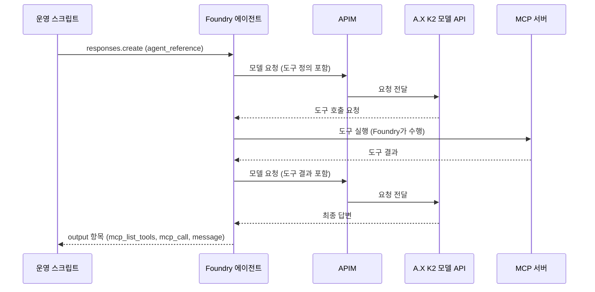

# Foundry BYOM 에이전트 데모: 설계와 확인 계획

이 문서는 `demo/foundry-byom/agent/` 스크립트의 설계와 확인 계획이다.
Phase 0 작성 시점에는 Foundry에서 A.X K2를 실제로 호출해 확인한 사항이 없었다.
이후의 실측 결과와 인프라 담당이 보고한 APIM 기록은 3.4절에 구분해 모았다. 아직 모델 응답을 받은 호출은 없다.
인프라(APIM, Foundry 리소스, 연결)와 모델 API는 이 문서의 범위 밖이다.

## 0. 표기

| 표기 | 뜻 |
|---|---|
| 확인됨(문서) | Microsoft Learn 또는 공개 샘플에서 직접 확인한 사실이다. 이 환경에서 동작한다는 뜻은 아니다. |
| 확인됨(로컬) | 이 저장소의 코드, 설치한 SDK, 단위 테스트로 확인한 사실이다. |
| 확인됨(실측) | 이 저장소의 스크립트를 실행한 결과다. `evidence/foundry-byom/`의 증거 파일이 뒷받침한다. |
| 확인됨(1a 트레이스) | 인프라 담당이 APIM 기록에서 읽어 보고한 사실이다. 이 저장소의 스크립트가 측정한 값이 아니다. 요약은 `phase1a-plain.apim-report.json`에 있다. |
| 부분 확인 | 일부만 확인했다. 확인한 범위와 남은 범위를 같은 행에 적는다. |
| 추정 | 근거는 있으나 직접 확인하지 못한 해석이다. 확인 조건을 같은 행에 적는다. |
| 미확인 | 문서에 없거나 문구가 모호하다. 실제 호출로 확인해야 한다. 3.3절에 모았다. |
| 권고 | 이 문서의 제안이다. 결정은 사용자가 한다. |
| 확인 필요 | 정보가 없어 지금은 판단할 수 없다. 담당자에게 확인해야 한다. |

"확인됨(문서)"와 "확인됨(로컬)"은 "Foundry에서 A.X K2가 동작한다"는 증거가 아니다.
"확인됨(1a 트레이스)"는 Foundry가 보낸 요청이 APIM을 거쳐 모델 API에 도달했다는 증거다. A.X K2가 답했다는 증거가 아니다.

## 1. 목적과 범위

### 1.1 목적

Foundry에서 만든 프롬프트 에이전트가 BYOM(Bring your own model) 연결로 A.X K2를 호출하고, MCP 도구를 쓰는 과정을 보여 준다.
도구는 두 단계로 시험한다. 먼저 인증이 없는 공개 MCP 서버를 시험하고, 다음에 Web IQ 검색을 연결한다.
이 작업은 외부 모델 연결(BYOM) 검증이다. Model Catalog 정식 등록이 아니다.

완료 기준은 "Foundry에서 A.X K2를 쓰는 에이전트가 검색 도구를 호출하고 답변하는 것을 보여 주는 것"이다.
콘솔이 어디까지 표시하는지는 실제 확인 전까지 미확인이다.

### 1.2 연결 구조

연결 구조는 `Foundry 에이전트 → APIM(인증·요청 전달) → A.X K2 모델 API → A100 서버`이다.
도구를 쓸 때의 예상 흐름은 아래와 같다.



그림 1. 문서 기반 예상 흐름 (미확인). 실제 호출 순서와 요청 내용은 Phase 1에서 확인한다.

### 1.3 단계

| 단계 | 내용 | 클라우드 호출 |
|---|---|---|
| Phase 0 | 문서 확인, 스크립트·테스트·설계 작성 | 없음 |
| Phase 0.5 | 제어 평면 점검: 연결 조회, 도구 없는 에이전트 버전 생성 | 읽기와 에이전트 버전 쓰기만. 모델 호출 없음. 도구 없음 |
| Phase 1 | 모델 호출, 공개 MCP, Web IQ, 콘솔 확인 | 에이전트 버전·대화·응답 생성 |

진행 상태는 3.4절에 있다. Phase 0과 Phase 0.5는 끝났다. Phase 1은 1a 첫 시도에서 모델 쪽 503(`backend_unavailable`)을 받아 멈췄다. 재시도는 승인되었다. 모델 API가 복구되고 시작 신호가 오면 실행한다.

Phase 1은 아래 세 조건이 모두 충족된 뒤에만 시작한다.

1. 인프라 담당이 연결이 Active라고 확인했다.
2. 모델 API가 배포되었다.
3. 모델 API 직접 스모크 시험이 통과했다.

### 1.4 허용과 금지

| 구분 | 내용 |
|---|---|
| 허용 | 기존 Foundry 프로젝트 안의 에이전트 버전·대화·응답 생성(Phase 1). 연결 읽기와 에이전트 버전 생성(Phase 0.5). |
| 금지 | 새 Azure 리소스 생성, RBAC 변경, APIM·웹앱 설정·배포, GPU·작업 변경. |
| 금지 | `az login`, `az account set`. `az` 로그인 상태는 같은 환경을 쓰는 모든 프로세스가 공유한다. |
| 금지 | 키, 토큰, 비밀번호, 구독 ID, tenant ID, 객체 ID, 구독 ID가 들어간 전체 리소스 ID를 출력·문서·커밋에 쓰는 일. |
| 제한 | 실제 모델 호출은 최소로 한다. 동시성 1, 출력 상한 설정, thinking 끔. |

### 1.5 서술 규칙

- 기존 앱 경로(MAF `/api/agent`)에서 Web IQ가 성공한 기록은 별도 경로의 증거다. 이 데모의 증거로 쓰지 않는다.
- 이전 환경에서 측정한 처리량·지연 수치를 이 환경의 수치로 쓰지 않는다.
- 미확인 항목을 확인됨으로 바꾸려면 Phase 1의 실제 증거가 있어야 한다.

## 2. 잠정 계약

아래 값은 인프라 담당과 맞춘 잠정 값이다. 값이 바뀌면 이 표를 고친다.
배포별 실제 이름은 저장소에 쓰지 않고, 실행할 때 환경변수와 CLI 인자로만 전달한다.

| 항목 | 값 |
|---|---|
| 프로젝트 엔드포인트 | `https://<resource>.services.ai.azure.com/api/projects/<project>` |
| BYOM 연결 | `<connection>`(NVFP4), `<connection-fp8>`(FP8). 카테고리 ApiManagement, 인증 ApiKey, `deploymentInPath=false`, 정적 모델 목록 |
| 에이전트 모델 참조 | `<connection>/ax-k2-nvfp4`, `<connection-fp8>/ax-k2-fp8` |
| 모델 API 경로 | FP8: `/v1/...`, NVFP4: `/models/nvfp4/v1/...`. 엔드포인트는 `GET /v1/models`, `POST /v1/chat/completions` |
| 호출 방식 | 프롬프트 에이전트와 Responses API(`agent_reference`). 고전 Assistants API는 쓰지 않는다. |
| 호출자 인증 | Microsoft Entra 토큰(`az` 로그인 계정). Foundry 계정은 로컬 키 인증을 끈 상태다. |
| 필요한 역할 | 프로젝트 범위의 Foundry User(구 Azure AI User) 이상 |

## 3. 확인된 사실과 미확인 항목

### 3.1 문서에서 확인한 사실

출처 표기는 아래와 같다.

| 표기 | 출처 |
|---|---|
| [BYOM] | https://learn.microsoft.com/azure/foundry/agents/how-to/ai-gateway (로컬 사본 기준 2026-08-13 갱신) |
| [MCP] | https://learn.microsoft.com/azure/foundry/agents/how-to/tools/model-context-protocol |
| [MCP-AUTH] | https://learn.microsoft.com/azure/foundry/agents/how-to/mcp-authentication (ms.date 2026-09-04) |
| [FUNC] | https://learn.microsoft.com/azure/foundry/agents/how-to/tools/function-calling |
| [TRACE] | https://learn.microsoft.com/azure/foundry/observability/how-to/trace-agent-setup |
| [TRACE-DATA] | https://learn.microsoft.com/azure/foundry/observability/concepts/trace-data |
| [REPLAY] | https://learn.microsoft.com/azure/foundry/observability/how-to/trace-agent-replay |
| [SAMPLE] | `microsoft-foundry/foundry-samples` 저장소의 `infrastructure/infrastructure-setup-bicep/01-connections/` |

| ID | 사실 | 출처 |
|---|---|---|
| D1 | 에이전트의 모델 참조 형식은 `<connection-name>/<model-name>`이다. | [BYOM] |
| D2 | 호출 순서는 `agents.create_version(PromptAgentDefinition)` → `get_openai_client()` → `conversations.create()` → `responses.create(..., extra_body={"agent_reference": {"name": ..., "type": "agent_reference"}})`이다. | [BYOM] |
| D3 | 이 기능은 프롬프트 에이전트만 지원한다. 같은 절에 "The Response API isn't supported at present."라는 문장도 있다. 이 문장의 뜻은 U1에서 따로 다룬다. | [BYOM] Supported configurations |
| D4 | 지원 도구에 MCP와 Functions가 있다. 웹 검색·Bing 도구는 목록에 없다. 따라서 검색은 MCP 서버로 연결한다. | [BYOM] |
| D5 | 필요한 역할은 프로젝트의 Foundry User(구 Azure AI User) 이상이다. SDK는 azure-ai-projects 2.0.0 이상, Python 3.10 이상이다. | [BYOM] |
| D6 | ApiManagement 연결의 기본값: 모델 목록 `/deployments`, 모델 조회 `/deployments/{deploymentName}`, 제공자 AzureOpenAI. 인증은 API 키 또는 Entra ID다. 명시한 메타데이터 값이 기본값보다 우선한다. | [BYOM] |
| D7 | Foundry는 모델 프로토콜에 따라 요청 경로를 붙인다. `Include deployment name in URL path` 설정은 `/deployments/{name}/chat/completions` 경로를 만든다. | [BYOM] |
| D8 | 연결 확인 방법: Admin-connected models 탭(Manage → Resource details), SDK 시험 프롬프트, APIM 분석에서 Agent Service 엔드포인트의 요청 확인. | [BYOM] |
| D9 | 문제 해결: 연결이 Inactive이면 URL과 자격 증명을 확인한다. 에이전트가 model not found 오류를 반환하면 `<connection>/<model>` 형식을 확인한다. 오류가 나는 시점은 적혀 있지 않다. | [BYOM] |
| D10 | APIM 쪽 기록: Application Insights 연결, 진단 로그(샘플링 100%, 오류 항상 기록, 상세도 Information). 조회 테이블은 `requests`, `dependencies`, `exceptions`, `traces`, `ApiManagementGatewayLogs`다. | [BYOM] |
| D11 | BYOM은 프롬프트 에이전트를 Responses API로 호출할 때만 동작한다. 고전 Assistants API는 `invalid_engine_error: Failed to resolve model info`로 실패한다. 게이트웨이는 OpenAI 호환 Chat Completions(POST)와 함수·도구 호출을 지원해야 한다. | [SAMPLE] |
| D12 | 정적 모델 목록은 샘플 Bicep의 매개변수 `staticModels`로 받아 연결 메타데이터의 `models` 키에 문자열로 저장한다. 다른 키는 `modelDiscovery`, `customHeaders`, `inferenceAPIVersion`, `deploymentAPIVersion`, `deploymentInPath`다. API 키 헤더는 기본 `api-key`이며 `authConfig`로 바꿀 수 있다. | [SAMPLE] |
| D13 | MCP 도구의 `require_approval` 기본값은 `always`다. 값은 `always`, `never`, `{"never": [도구 이름...]}`이다. | [MCP] |
| D14 | `always`이면 응답에 `mcp_approval_request` 항목이 나온다. 이어 가려면 `mcp_approval_response` 항목(`approval_request_id`는 승인 요청 항목의 ID, `approve: true`)을 `input`에 담고, `previous_response_id`에 원래 응답 ID를 넣고, `agent_reference`를 함께 보낸다. 문서의 Python 샘플은 첫 요청에 conversation을 쓰고 승인 후속 요청에는 `previous_response_id`를 쓴다. | [MCP] |
| D15 | 응답 출력 항목 종류: `message`, `function_call`, `mcp_list_tools`, `mcp_call`, `mcp_approval_request`, `oauth_consent_request`. 함수 호출은 `call_id`가 같은 `function_call_output` 항목으로 답한다. | [MCP], [FUNC] |
| D16 | MCP 제한: 스트리밍이 아닌 호출은 100초 제한이 있다. 도구 정의에 `anyOf`/`allOf`가 있거나 매개변수가 여러 타입을 받으면 "Invalid tool schema" 오류가 날 수 있다. 런타임은 원격 MCP 서버 엔드포인트만 받는다. | [MCP] |
| D17 | MCP 도구는 원격 서버가 필요로 하는 사용자 지정 헤더(예: 인증 키)를 전달할 수 있다. 문서는 전달하는 데이터를 검토하고 감사용으로 기록하라고 경고한다. | [MCP] |
| D18 | MCP 인증 방식: 키 기반(프로젝트 연결의 Custom keys), Entra 에이전트 ID, Entra 프로젝트 관리 ID, OAuth ID 통과, 인증 없음. 프로젝트에 접근할 수 있는 사람은 프로젝트 연결에 저장된 API 키에 접근할 수 있다. 공유 자격 증명은 런타임에 전달하지 말고 프로젝트 연결에 저장하라고 권고한다. | [MCP-AUTH] |
| D19 | 프로젝트 연결은 `azd ai connection create <name> --kind remote-tool --target <url> --auth-type custom-keys --custom-key "Header=Value"`로 만든다. `--auth-type` 값에는 `none`, `custom-keys`, `oauth2`, `user-entra-token` 등이 있다. | [MCP] |
| D20 | 추적은 기본으로 꺼져 있다. Application Insights를 프로젝트에 연결하면 서버 측 추적이 켜진다. 추적에는 사용자 입력, 모델 입출력, 도구 호출과 인자·결과가 기록된다. 조회에는 Log Analytics Reader 역할이 필요하다. | [TRACE], [TRACE-DATA] |
| D21 | 포털에서는 에이전트의 Traces 페이지에서 Response ID 또는 Trace ID로 검색하고 Conversation ID를 선택해 대화 이력, 실행 단계와 도구 호출, 사용자와 에이전트의 입출력을 본다. 최근 90일 추적을 조회할 수 있다. | [TRACE] |
| D22 | Trace Replay(미리보기)는 Conversation ID 또는 Trace ID에서 연다. Trajectories 보기에 에이전트 추론, 도구 호출, 대화 턴이 계층 구조로 나온다. User 보기는 대화를 채팅 형태로 보여 준다. | [REPLAY] |

### 3.2 로컬에서 확인한 사실

azure-ai-projects 2.9.0, azure-identity 1.26.0으로 확인했다. 이 버전은 시험에 쓴 버전이며 최소 요구 버전이 아니다(최소는 D5).

| 항목 | 확인한 내용 |
|---|---|
| 클래스와 필드 | `AIProjectClient`, `PromptAgentDefinition`(`model`, `instructions`, `temperature`, `tools`, `tool_choice` 등), `MCPTool`(`server_label`, `server_url`, `allowed_tools`, `require_approval`, `project_connection_id`, `headers`, `authorization` 등), `FunctionTool`(`name`, `description`, `parameters`, `strict` 등)이 있다. |
| 에이전트 API | `agents.get`, `agents.get_version`, `agents.create_version`, `agents.delete`가 있다. |
| 연결 API | `connections.list`, `connections.get(name, include_credentials=False)`가 있다. 자격 증명 값을 요청하지 않고 조회할 수 있다. |
| OpenAI 클라이언트 | `get_openai_client()`는 `{프로젝트 엔드포인트}/openai/v1`을 기준 URL로, `https://ai.azure.com/.default`를 토큰 범위로 쓴다. |
| 자격 증명 고정 | `AzureCliCredential(subscription=...)`는 토큰 명령에 `--subscription`을 붙인다. |
| 단위 테스트 | SDK를 모킹한 단위 테스트가 `tests/test_foundry_byom_agent.py`에 있다. SDK가 없는 환경에서는 SDK 호환성 시험만 건너뛴다. |

### 3.3 미확인 항목

아래 항목은 문서가 없거나 모호하다. 단계 열은 확인할 수 있는 가장 이른 단계다.
각 항목의 현재 상태는 3.4절에 있다. U1, U4, U5, U6, U13, U15는 1a 시도 1의 APIM 기록으로 일부를 확인했다. 이 행에는 확인한 부분과 남은 부분을 나누어 적었다.

| ID | 미확인 항목 | 확인 방법 | 단계 |
|---|---|---|---|
| U1 | "The Response API isn't supported at present." 문장의 뜻. 모델 백엔드가 Responses 프로토콜을 받지 못한다는 뜻인지, 에이전트를 Responses API로 호출할 수 없다는 뜻인지 모른다. 같은 문서의 샘플은 `responses.create`로 에이전트를 호출한다. 추정: 백엔드가 Chat Completions를 쓴다는 뜻이다. **확인됨(1a 트레이스):** Foundry가 모델 쪽으로 보낸 요청은 Chat Completions 형태(`/chat/completions`, `messages` 필드)다. **미확인:** 모델이 답한 뒤 응답이 Responses API 형식으로 끝까지 돌아오는지 여부. 1a 시도 1은 모델 쪽 503으로 끝났다. | 도구 없는 에이전트를 `responses.create`로 호출해 응답을 받는다. | 1 |
| U2 | 에이전트 버전 생성이 모델 참조를 검증하는지 여부. D9는 오류 시점을 적지 않았다. | 생성 후 `agents.get`으로 저장된 참조를 읽는다. 생성이 성공해도 검증 여부는 알 수 없으므로 "수락됨, 검증 여부 미확인"으로 기록한다. 잘못된 참조 대조는 7절 N1에서 한다. | 0.5, 1 |
| U3 | 연결의 Active/Inactive 상태를 SDK로 읽을 수 있는지 여부. | `connections.get` 결과에서 상태 필드를 찾는다. 없으면 포털의 Admin-connected models 탭에서 확인한다(6절). | 0.5 |
| U4 | Foundry가 모델 API로 보내는 요청 필드. **확인됨(1a 트레이스, 도구 없는 에이전트):** 경로는 연결 대상 경로 뒤에 `/chat/completions`를 붙인 형태다. 쿼리 문자열과 `api-version`이 없다. 최상위 필드는 `messages`(system과 user 2개), `stream`(true), `max_completion_tokens`, `stream_options`, `model`(`ax-k2-nvfp4`), `temperature`, `top_p`다. `tools`와 User-Agent는 없다. **미확인:** 도구를 담은 요청의 필드(`tools`, `tool_choice`, `parallel_tool_calls`, 함수 `strict`). `stream_options`, `temperature`, `top_p`의 값. 모델 API가 이 필드를 모두 처리하는지 여부. | 1b의 함수 도구 호출과 Learn MCP 호출 때 인프라 담당에게 APIM 기록의 필드 이름과 비밀이 아닌 값(숫자, 논리값)을 받는다. | 1 |
| U5 | `max_output_tokens`, `max_tool_calls`, `timeout`을 `agent_reference`와 함께 보낼 수 있는지 여부. **확인됨(실측):** Foundry는 `max_output_tokens=256`을 담은 요청을 거부하지 않았다. Foundry 쪽 400이 없었다. **확인됨(로컬):** `timeout`은 SDK 요청 옵션이며 요청 본문에 실리지 않는다. `--max-tool-calls 0`이면 `max_tool_calls`를 보내지 않는다. **확인됨(1a 트레이스):** 모델 요청에 `max_completion_tokens` 필드가 있었다. `max_output_tokens`에서 변환된 것으로 추정한다. **미확인:** `max_completion_tokens`의 값. 0이 아닌 `max_tool_calls`를 Foundry가 받는지 여부. 출력 길이가 상한을 지키는지 여부. | 다음 호출 때 인프라 담당에게 `max_completion_tokens` 값을 받는다. 응답을 받으면 `usage`의 출력 토큰 수가 상한 이하인지 본다. | 1 |
| U6 | 응답 `model` 필드의 값. **확인됨(1a 트레이스):** 모델 API로 가는 요청의 `model` 값은 `ax-k2-nvfp4`다. **미확인:** 응답 `model` 필드의 값. 1a 시도 1은 응답을 받지 못했다. | 응답을 받으면 실행 요약의 `model` 필드를 본다. | 1 |
| U7 | 실행 시점 MCP 헤더(`headers`, `authorization`)를 BYOM 에이전트의 `agent_reference` 호출에서 쓸 수 있는지, 헤더가 MCP 서버에 적용되는지, 값이 응답과 저장소에 남지 않는지 여부. | 4.5절 시험. | 1 |
| U8 | Custom keys 연결의 키 이름(`x-apikey`)이 그대로 헤더 이름으로 전달되는지 여부. D19의 예시는 `Authorization`이다. | Web IQ 연결 시험(승인 후). | 1 |
| U9 | Web IQ `web` 도구의 스키마와 전송 방식이 Foundry MCP 도구와 호환되는지 여부. D16의 스키마 제한에 걸릴 수 있다. Web IQ 스키마는 읽지 않았다. | `mcp_list_tools` 결과. | 1 |
| U10 | MCP 출력 항목의 실제 모양과 승인 흐름. 스크립트는 승인 후속 요청을 D14의 샘플과 같이 `previous_response_id`로 보낸다. 승인 뒤의 응답이 대화 항목에 남는지는 모른다. | `--require-approval always`로 만든 에이전트를 `--approve-tool`로 실행한 뒤 `conversations.items`를 읽는다. | 1 |
| U11 | 포털 화면별 표시 범위. 6절의 화면 이름은 문서 기준이다. BYOM 에이전트에서 모델 참조·대화·도구 단계가 어디까지 보이는지 모른다. | 콘솔 확인과 캡처. | 1 |
| U12 | 실행 신원의 데이터 평면 권한. 역할 부여 뒤 전파에 시간이 걸릴 수 있다. | Phase 0.5 첫 호출 결과(401/403 여부). | 0.5 |
| U13 | `deploymentInPath=false`일 때 실제 요청 경로, ApiManagement 연결이 API 키를 싣는 헤더 이름. **확인됨(1a 트레이스):** 경로는 연결 대상 경로 뒤의 `/chat/completions`이며 `/deployments/…` 구간이 없다. 키는 `api-key` 헤더로 도착했다. 게이트웨이는 4건 모두에서 이 헤더, 구독 키 헤더, 쿼리 문자열을 지우고 `Authorization`(게이트웨이 키)을 붙여 전달했다. 모델 API가 401이 아니라 503을 돌려줬으므로 키 거부가 아니다. **미확인:** FP8 연결과 도구 호출 요청에서도 같은지 여부. | 다음 호출 때 APIM 기록을 다시 읽는다. | 1 |
| U14 | thinking 끔 방법. Foundry가 thinking을 끄는 요청 필드를 보낼 수 있는지 모른다. 보낼 수 없으면 모델 API의 기본값이 꺼짐이어야 한다. | 도구 없는 호출 응답에서 reasoning 흔적을 확인한다(`no_thinking_trace`). 모델 API 담당에게 기본값을 확인한다. | 1 |
| U15 | APIM 진단 로그에 요청 본문이 남는지 여부와 Foundry 호출자를 식별할 단서. **확인됨(1a 트레이스):** 인프라 담당은 APIM 기록에서 본문의 필드 이름, `model`과 `stream` 값, 메시지 개수와 역할을 읽었다. 호출자 단서는 두 가지다. 하나는 연결 전용 APIM 구독이다. 다른 하나는 같은 Application Insights의 `invoke_agent <에이전트>:<버전>` 스팬이며, 시각으로 맞춰 본다. 요청에 User-Agent 헤더가 없다. 다른 헤더는 보고에 없다. **미확인:** `max_completion_tokens`, `stream_options`, `temperature`, `top_p`의 값과 메시지 내용이 기록에 남는지 여부. 요청 ID로 Foundry 쪽 기록과 APIM 기록을 직접 연결할 수 있는지 여부. | 다음 호출 때 시작 시각(KST)을 인프라 담당에게 전달하고 같은 방식으로 읽는다. | 1 |
| U16 | Foundry를 거친 호출에서 모델 서버가 도구 호출을 구조화해 돌려주는지 여부. 모델 서버는 `--tool-call-parser hermes`와 `--enable-auto-tool-choice`가 있어야 한다(`docs/SERVING_DESIGN.md` 187~203행, `docs/HANDOFF.md` 201행). 없으면 `<tool_call>` 원문이 `content`에 섞인다. | 도구 호출 결과의 `content`와 `tool_calls`를 본다. | 1 |
| U17 | 대화·응답 조회 API(`conversations.items.list`, `responses.retrieve`)가 BYOM 에이전트의 기록에도 동작하는지 여부. | `collect_evidence.py`. | 1 |

### 3.4 실측 결과

Phase 0.5(제어 평면)와 Phase 1a 첫 시도(시도 1)를 실행했다. 증거 파일은 `evidence/foundry-byom/`에 있다.
이 절은 증거 파일이 뒷받침하는 사실만 적는다. 응답 ID와 요청 ID는 앞 8자만 적는다.
"확인됨(1a 트레이스)" 행은 인프라 담당이 APIM 기록에서 읽어 보고한 내용이다. 이 저장소의 스크립트가 측정한 값이 아니다.

| 항목 | 상태 | 내용 | 증거 파일 |
|---|---|---|---|
| 연결 계약 | 확인됨(실측) | 연결 2개가 계약과 같다. 카테고리는 ApiManagement, 인증은 ApiKey, `deploymentInPath=false`이고 모델 목록이 맞는다. 조회 결과에 자격 증명 값은 없다. 대상 경로는 NVFP4가 `/nvfp4/v1`, FP8가 `/fp8/v1`이다. 서비스가 FP8 연결에 `isDefault=true`를 붙였다. 에이전트의 모델 참조가 명시적이므로 영향이 없다. 프로젝트에는 AppInsights 연결도 있다. | `phase05-connections.connections.json` |
| U3 | 확인됨(실측) | `connections.list`와 `connections.get`은 Active/Inactive 상태를 돌려주지 않는다. 메타데이터 키는 `deploymentInPath`와 `models`뿐이다. 상태는 포털에서 확인해야 한다(6.5절). | 위와 같음 |
| D12 | 확인됨(실측) | 정적 모델 목록이 연결 메타데이터의 `models` 키에 들어 있다(샘플의 `staticModels` 매개변수가 이 키로 저장된다). 연결에 `authConfig`와 `modelDiscovery` 설정은 없다. 그래서 API 키 헤더는 기본값(`api-key`)일 것으로 예상했다. 1a 시도 1의 APIM 기록에서 키가 `api-key` 헤더로 도착했다(확인됨(1a 트레이스), U13). | 위와 같음 |
| U2 | 부분 확인 | 에이전트 버전 생성이 `<connection>/ax-k2-nvfp4`를 받아들였다. `agents.get`과 `agents.get_version`이 같은 참조를 돌려줬다. 생성이 참조를 검증하는지는 모른다. 잘못된 참조 대조(7절 N1)는 하지 않았다. | `phase05-create-agent.create.json` |
| U12 | 확인됨(실측) | 프로젝트 범위 권한으로 연결 조회, 에이전트 버전 생성, 대화 생성, 응답 요청이 401/403 없이 통과했다. | 위 두 파일과 `phase1a-plain.run.json` |
| U1 | 부분 확인 | **확인됨(실측):** Foundry는 `agent_reference`를 담은 `responses.create` 요청을 받아들였고 모델 쪽 호출까지 진행했다. **확인됨(1a 트레이스):** 모델 쪽으로 간 요청은 Chat Completions 형태(`/chat/completions`, `messages` 필드)다. 그래서 문서의 "The Response API isn't supported at present."는 모델 백엔드 프로토콜을 가리킨다고 본다(추정). **미확인:** 모델이 답한 뒤 응답이 Responses API 형식으로 끝까지 돌아오는지 여부. 시도 1은 모델 쪽 503으로 끝났다. | `phase1a-plain.run.json`, `phase1a-plain.apim-report.json` |
| 모델 쪽 오류 | 확인됨(실측) | 모델 쪽이 503을 돌려주면 Foundry는 HTTP 503, 오류 코드 `model_error`로 감싸고 메시지에 모델 게이트웨이 응답 원문을 싣는다. 시도 1의 원문은 `backend_unavailable`("The model backend is not ready. Retry later.")였다. 필드를 거부하는 400이 아니다. 이 503이 모델 API(웹앱)에서 왔다는 것은 APIM 기록이 확인했다(아래 "APIM 수신" 행). | `phase1a-plain.run.json`, `phase1a-plain.apim-report.json` |
| APIM 수신(1a 시도 1) | 확인됨(1a 트레이스) | 같은 POST 요청 4건이 20:45:12.13, 20:45:12.63, 20:45:18.12, 20:45:23.60(KST)에 도착했다. 간격은 0.5초, 5.5초, 5.5초다. 4건 모두 503이다. 503은 APIM이 아니라 모델 API(웹앱)가 돌려줬다. APIM 자체 오버헤드는 1.2~5.7 ms이고 모델 API 구간은 5.9~72.0 ms다. 429, APIM 예외, 정책 오류는 없다. 모델 API가 6~72 ms 만에 응답했으므로 GPU 대기 시간 초과가 아니라 사전 점검에서 빨리 실패한 것으로 보인다(보고자의 추정). | `phase1a-plain.apim-report.json` |
| 요청 형태(1a 시도 1) | 확인됨(1a 트레이스) | 인프라 담당은 4건을 같은 요청으로 보았다. 경로는 연결 대상 경로 뒤의 `/chat/completions`이고 쿼리 문자열과 `api-version`이 없다. 본문은 `stream=true`, `model=ax-k2-nvfp4`이며 `max_tokens`가 아니라 `max_completion_tokens`를 쓴다. 최상위 필드는 `messages`(system과 user 2개), `stream`, `max_completion_tokens`, `stream_options`, `model`, `temperature`, `top_p`다. 에이전트 정의에 `temperature`와 `top_p`를 지정하지 않았는데도 두 필드가 실렸다. `tools`와 User-Agent는 없다. 이 요청은 도구 없는 에이전트의 것이다. 필드 값(`max_completion_tokens`, `stream_options`, `temperature`, `top_p`)은 보고에 없다. 모델 API가 이 필드를 모두 처리하는지는 미확인이다. 시도 1의 응답이 503이었기 때문이다. | `phase1a-plain.apim-report.json` |
| 게이트웨이 정책(1a 시도 1) | 확인됨(1a 트레이스) | 4건 모두에서 게이트웨이가 `api-key` 헤더, 구독 키 헤더, 쿼리 문자열을 지우고 `Authorization`(게이트웨이 키)을 붙여 전달했다. 모델 API가 401이 아니라 503을 돌려줬으므로 키 거부가 아니다. | `phase1a-plain.apim-report.json` |
| 호출 추적(1a 시도 1) | 확인됨(1a 트레이스) | 같은 Application Insights에 `invoke_agent <에이전트>:<버전>` 스팬이 4개 있다. 결과 코드는 500이고 소요는 98~169 ms이며 시도마다 별도 트레이스다. 추적 수집 경로는 동작한다. | `phase1a-plain.apim-report.json` |
| Foundry의 5xx 재시도 | 추정 | 이 저장소의 클라이언트는 `responses.create`를 1번 보냈고 자동 재시도를 껐다(`max_retries=0`). 루프백 서버 시험에서도 503을 받은 호출이 서버에 1번만 도달했다(확인됨(로컬)). 그런데 APIM에는 같은 요청 4건과 `invoke_agent` 스팬 4개가 있다. 그래서 Foundry 서비스가 모델 쪽 503을 3번 다시 보냈다고 추정한다. 시도 1에는 클라이언트 요청 카운터가 없었다. 모델 쪽 5xx로 실패한 다음 호출에서 `client_http.responses_posts`가 1이고 같은 호출의 APIM 요청이 2건 이상이면 확인된 것으로 바꾼다. Foundry가 모든 5xx를 다시 보내는지 503만 다시 보내는지는 모른다. 호출 1번이 모델 API에 최대 4번 도달할 수 있으므로 모델 호출 예산은 `responses.create` 횟수가 아니라 APIM 요청 수로 센다(8.3절). | `phase1a-plain.run.json`, `phase1a-plain.apim-report.json` |

## 4. Web IQ 연결 방식

### 4.1 기존 클라이언트(확인됨(로컬))

`demo/frontend/web_iq.py`의 형식만 읽었다. 비밀 값은 읽지도 복사하지도 않았다.

| 항목 | 내용 |
|---|---|
| 서버 URL | 환경변수 `AXK2_WEBIQ_ENDPOINT`. API 키 방식에서 비어 있으면 기본값 `https://api.microsoft.ai/v3/mcp`를 쓴다. |
| 인증 헤더 | API 키는 `x-apikey: <키>`, 토큰은 `Authorization: Bearer <토큰>`이다. 값은 `AXK2_WEBIQ_API_KEY`, `AXK2_WEBIQ_BEARER_TOKEN`에서 읽는다. 둘을 함께 설정하면 거부한다. |
| 도구와 인자 | 도구 `web`, 질의 필드 `query`, 기본 인자 `language=ko`, `region=KR`. |
| 사용 승인 | `AXK2_WEBIQ_ACCESS_APPROVED=1`이 있어야 호출한다. |
| 전송과 제한 | Streamable HTTP MCP. HTTP 제한 시간 20초. |

### 4.2 옵션 비교

기준은 비밀이 저장되는 위치와 보안 영향이다.

| 옵션 | 비밀이 놓이는 곳 | 보안 영향 | 상태와 평가 |
|---|---|---|---|
| A. 인증 없는 공개 MCP(Microsoft Learn MCP) | 없음 | 없음 | 첫 도구 시험용. 비밀이 필요 없다. |
| B. 실행 시점 헤더(`responses.create`의 도구 정의 `headers`/`authorization`) | 호출 프로세스 메모리와 전송 구간. 저장 위치는 없다고 추정한다. | 에이전트 정의에는 남지 않는다. Foundry가 값을 기록하는지는 미확인이다. | 도구 정의에 필드가 있다(확인됨(로컬)). BYOM 에이전트의 `agent_reference` 호출에서 동작하는지는 U7이다. |
| C. 에이전트 정의의 `headers` | 에이전트 버전. 추정. | 에이전트를 읽을 수 있는 모든 사람이 값을 볼 수 있다. | 쓰지 않는다. |
| D. 프로젝트 연결(Custom keys, `project_connection_id`) | Foundry 프로젝트 연결 | 프로젝트에 접근할 수 있는 사람이 키를 읽을 수 있다(D18). 새 리소스를 만들므로 승인이 필요하다. | 문서가 권고하는 방식이다. 키 이름은 U8이다. |
| E. Entra ID, 관리 ID, OAuth | 해당 없음 | 해당 없음 | Web IQ가 키 또는 Bearer 토큰 방식이므로 후보에서 제외한다. |
| F. APIM 앞단 프록시가 키를 붙이는 방식 | APIM | 인프라 변경이 필요하다. | 이 단계의 범위 밖이다. |

### 4.3 질문별 답

| 질문 | 답 |
|---|---|
| 프로젝트 연결이 반드시 필요한가? | 필수는 아니다. 도구 정의에 `headers`와 `authorization` 필드가 있다. 다만 문서는 공유 자격 증명을 프로젝트 연결에 저장하라고 권고한다(D18). |
| 실행 시점 헤더 전달이 가능한가? | 도구 정의상 가능하다. BYOM 에이전트를 `agent_reference`로 호출할 때 도구 정의를 재정의할 수 있는지, 헤더가 적용되는지는 문서에 없다(U7). |
| 헤더 값이 기록에 남는가? | 문서에 없다. 추적에는 도구 인자와 결과가 기록된다(D20). 헤더가 포함되는지는 미확인이다. |

### 4.4 권고

1. 첫 도구 시험은 옵션 A(공개 Learn MCP)로 한다. 비밀이 필요 없다.
2. Web IQ를 연결하기 전에 옵션 B를 더미 표식 값으로 시험한다. 시험 범위와 한계는 4.5절에 있다.
3. 실제 Web IQ 키를 Foundry에 넘기는 모든 방식은 사용자의 명시 승인을 받은 뒤에만 쓴다. 옵션 B로 실제 키를 쓰는 경우와 옵션 D가 여기에 해당한다.
4. 옵션 B가 `agent_reference` 호출에서 동작하지 않으면 옵션 D를 쓴다. 옵션 C는 쓰지 않는다.
5. 옵션 D를 쓰면 데모 전용이며 교체할 수 있는 키를 쓴다. 프로젝트 접근자를 최소로 두고, 데모가 끝나면 연결을 삭제하고 키를 폐기한다.

비밀을 어디에 새로 두는지는 사용자가 결정한다. 위 순서는 권고이며 결정이 아니다.

### 4.5 옵션 B 시험과 한계

더미 표식 값은 비밀이 아닌 무작위 문자열이다. 시험 순서는 아래와 같다.

1. 환경변수 `BYOM_PROBE_HEADER`에 `probe-<무작위 문자열>`을 넣는다.
2. 공개 Learn MCP로 `run_prompt.py --scenario mcp --mcp-request-header X-Probe=BYOM_PROBE_HEADER`를 실행한다.
3. 아래 세 가지를 판정한다.
   - API가 요청을 받아들이는지 확인한다.
   - 표식 값이 응답, 에이전트 버전, 대화 항목에 없는지 확인한다(`collect_evidence.py --scan-env BYOM_PROBE_HEADER`, 점검 ID `request_secret_not_in_server_records`).
   - Application Insights와 포털 화면에 표식 값이 없는지 KQL과 화면 검색으로 직접 확인한다.

한계는 두 가지다.

- 공개 MCP 서버는 더미 헤더를 무시한다. 이 시험으로는 "Foundry가 MCP 서버에 헤더를 전달했는가"를 알 수 없다. 전달 여부는 실제 Web IQ 호출이 성공할 때만 증명된다. 그때 실제 키가 Foundry를 지나가므로 승인이 필요하다.
- `--scan-env`는 API로 읽은 기록만 검사한다. Application Insights와 포털 화면은 검사하지 않는다.

## 5. 스크립트

### 5.1 파일

| 파일 | 역할 | 클라우드 호출 | 단계 |
|---|---|---|---|
| `byom_common.py` | 설정 검증, 비밀 제거, 자격 증명 고정, SDK 클라이언트 생성, 증거 파일 쓰기 | 없음 | 공용 |
| `inspect_connections.py` | 프로젝트 연결을 읽기 전용으로 조회하고 2절 계약과 비교한다. 자격 증명 값은 요청하지 않는다. | 읽기 | 0.5 |
| `create_agent.py` | 에이전트 버전을 멱등하게 만든다. 만든 뒤 `agents.get`과 `agents.get_version`으로 읽어 저장된 모델 참조를 비교한다. `--delete`는 대조용 임시 에이전트만 지운다. | 에이전트 버전 쓰기와 읽기. 모델 호출 없음 | 0.5, 1 |
| `run_prompt.py` | 프롬프트를 한 번 실행하고 출력 항목 종류, 도구 호출 항목, 최종 답, usage를 요약한다. | 모델 호출 | 1 전용 |
| `collect_evidence.py` | 비밀을 제거한 증거 JSON을 만들고 점검 항목을 판정한다. | 읽기(선택) | 1 |
| `requirements.txt` | `azure-ai-projects>=2.0.0,<3`, `azure-identity>=1.26.0` | 없음 | 공용 |

`create_agent.py`와 `inspect_connections.py`는 OpenAI 클라이언트를 만들지 않으므로 모델을 호출할 수 없다.
`create_agent.py`는 저장된 최신 정의가 요청한 정의와 같으면 새 버전을 만들지 않는다. 새 버전이 필요하면 `--force`를 쓴다.

`run_prompt.py`는 OpenAI 클라이언트의 자동 재시도를 끈다(`max_retries=0`). 실행 요약의 `client_http`는 클라이언트가 실제로 보낸 HTTP 요청 수다.

| 키 | 뜻 |
|---|---|
| `requests` | OpenAI 클라이언트가 보낸 모든 HTTP 요청의 수. 대화 생성 요청을 포함한다. |
| `responses_posts` | `/responses`로 보낸 POST 요청의 수. `responses.create` 호출 수와 같아야 한다. 더 크면 SDK가 요청을 다시 보낸 것이다. |

`client_http`는 클라이언트가 보낸 요청만 센다. Foundry가 모델 API로 보낸 요청은 세지 않는다. 그 요청은 APIM 기록에서만 볼 수 있다(8.3절의 예산 규칙).

### 5.2 설정

| 환경변수 | CLI 인자 | 용도 | 기본값 |
|---|---|---|---|
| `FOUNDRY_PROJECT_ENDPOINT` | `--project-endpoint` | 프로젝트 엔드포인트. `--dry-run`이 아니면 필수다. | 없음 |
| `FOUNDRY_BYOM_AUTH` | `--auth` | `cli`(az 로그인), `default`(DefaultAzureCredential), `browser`(대화형 로그인) | `cli` |
| `FOUNDRY_BYOM_AZ_SUBSCRIPTION` | 없음 | `cli` 방식에서 토큰 명령에 `--subscription`을 붙인다. | 없음 |
| `FOUNDRY_BYOM_CONNECTION` | `--connection` | BYOM 연결 이름 | 없음 |
| `FOUNDRY_BYOM_MODEL` | `--model` | 연결 뒤의 모델 이름 | `ax-k2-nvfp4` |
| `FOUNDRY_BYOM_AGENT` | `--agent-name` | 에이전트 이름 | `byom-demo-agent` |
| `FOUNDRY_BYOM_MCP_URL` | `--mcp-url` | MCP 서버 URL(https, 쿼리 없음). `webiq` 프리셋은 필수다. | 프리셋 |
| `FOUNDRY_BYOM_MCP_CONNECTION` | `--mcp-connection` | MCP 자격 증명을 담은 프로젝트 연결의 이름(값이 아니다) | 없음 |
| `BYOM_REDACT_LITERALS` | 없음 | 출력에서 가릴 배포별 문자열. 쉼표로 구분하며 `실제값=별칭` 형식을 쓸 수 있다. | 없음 |
| `BYOM_PRIVATE_DIR` | 없음 | 개인 원본 디렉터리. 절대 경로이며 저장소 밖이어야 한다. 지정하면 증거 파일의 복사본을 여기에 쓴다. 복사본은 비밀 제거는 같고 응답 ID와 대화 ID를 줄이지 않는다. POSIX에서는 현재 사용자 소유의 0700 디렉터리여야 하며 없으면 만든다. 파일 권한은 0600이다. | 없음(복사본을 쓰지 않는다) |

그 밖의 주요 인자는 아래와 같다.

| 인자 | 스크립트 | 뜻 |
|---|---|---|
| `--dry-run` | 전부 | SDK 불러오기, 자격 증명, 네트워크 없이 실행 계획만 출력한다. |
| `--tool none\|function\|mcp` | `create_agent.py` | 에이전트에 붙일 도구. 기본 `none`. |
| `--mcp-preset learn\|webiq`, `--mcp-allowed-tools`, `--require-approval never\|always` | `create_agent.py` | MCP 서버 프리셋, 허용 도구, 승인 정책. 기본 `learn`, `never`. |
| `--evidence-label LABEL` | `inspect_connections.py`, `create_agent.py`, `run_prompt.py` | 결과를 `evidence/foundry-byom/<LABEL>.connections.json`, `.create.json`, `.run.json`에 저장한다. |
| `--scenario plain\|function\|mcp` | `run_prompt.py` | 시나리오 프롬프트. 기본 `plain`. |
| `--max-output-tokens`, `--max-tool-calls`, `--max-rounds`, `--timeout` | `run_prompt.py` | 호출 상한. 기본 512, 4, 4, 180초. |
| `--approve-tool NAME` | `run_prompt.py` | 이 도구의 MCP 승인 요청만 승인한다. |
| `--expect-failure` | `run_prompt.py` | 음성 대조. 호출이 실패해야 성공으로 판정한다. |
| `--mcp-request-header NAME=ENVVAR` | `run_prompt.py` | 실험용. 값은 환경변수에서 읽고 출력·저장하지 않는다. |
| `--label`, `--mark ID=STATUS[:NOTE]`, `--scan-env ENVVAR`, `--offline` | `collect_evidence.py` | 증거 파일 이름, 수동 점검 결과 기록, 비밀 반향 검사, 네트워크 없는 실행. |

종료 코드는 아래와 같다.

| 코드 | 뜻 |
|---|---|
| 0 | 성공 |
| 1 | 실행 또는 API 오류, 판정 실패 |
| 2 | 설정 오류 |
| 3 | 미완. 확인되지 않은 점검이 남았다. |

### 5.3 비밀 처리 규칙

1. 비밀은 환경변수로만 받는다. CLI 인자, 파일, 출력에 값을 쓰지 않는다.
2. 배포별 이름(리소스 이름 접두어, 구독 이름, 연결 이름)은 `BYOM_REDACT_LITERALS`로 실행할 때만 지정한다. 이 값은 커밋하지 않는다.
3. 모든 출력과 증거 파일은 저장 전에 비밀 제거를 거친다. 대상은 GUID, 이메일, JWT, `Authorization` 헤더, Azure 호스트 이름, IPv4, 전체 리소스 ID, `/api/projects/<이름>` 경로, 환경변수에서 읽은 비밀 값이다.
4. 출력 키 중 `credential`, `credentials`, `headers`, `token`, `secret`, `password`, `authorization`, `api_key`는 값을 통째로 가린다.
5. `FOUNDRY_BYOM_AZ_SUBSCRIPTION`을 지정하면 `az` 토큰 명령에 구독이 고정된다. 지정하지 않으면 공유 `az` 로그인의 활성 구독을 따른다.
6. 커밋하는 증거 파일에는 응답 ID, 대화 ID, 요청 ID의 앞 8자만 남긴다(예: `resp_1a2b3c4d…`). 전체 값은 `BYOM_PRIVATE_DIR`의 개인 원본에만 있다. 콘솔에서 대화를 찾을 때는 개인 원본의 전체 값을 쓴다.

### 5.4 실행 환경과 시험

- Python 3.10 이상이 필요하다. 가상환경은 저장소 밖에 만들고 `pip install -r demo/foundry-byom/agent/requirements.txt`로 설치한다. 가상환경을 커밋하지 않는다.
- 실행 계획만 확인하는 예시는 아래와 같다. `my-connection`은 예시 이름이다.

```bash
python demo/foundry-byom/agent/create_agent.py --dry-run --connection my-connection --model ax-k2-nvfp4
python demo/foundry-byom/agent/create_agent.py --dry-run --connection my-connection --tool mcp --mcp-preset learn
python demo/foundry-byom/agent/run_prompt.py --dry-run --scenario mcp
python demo/foundry-byom/agent/inspect_connections.py --dry-run --expect my-connection=ax-k2-nvfp4
```

- 단위 테스트 실행 명령은 아래와 같다. 네트워크와 자격 증명을 쓰지 않는다.

```bash
python -m unittest discover -s tests -p "test_foundry_byom*.py"
```

## 6. 콘솔 확인 계획

화면 이름은 문서 기준이다. 실제 화면과 다를 수 있으며 U11에서 확인한다.

### 6.1 확인 대상별 화면

| 확인 대상 | 화면 위치 | 볼 것 | 근거 | 점검 ID |
|---|---|---|---|---|
| (a) 모델 설정 | Foundry 포털 → Manage → Resource details → Admin-connected models 탭 | 연결이 목록에 있음, 모델 목록, 연결 상태(Active/Inactive) | 확인됨(문서) D8, D9 | `console_model_settings` |
| (a) 모델 설정 | 에이전트 상세 화면, 모델 선택 화면 | 에이전트의 모델이 `<connection>/ax-k2-nvfp4`로 보이는지 | 미확인(U11) | `console_model_settings` |
| (b) 대화 | 에이전트의 Traces 페이지 → Response ID 또는 Trace ID로 검색 → Conversation ID 선택 | 대화 이력, 사용자와 에이전트의 입출력 | 확인됨(문서) D21 | `console_conversation`, `tracing_visible` |
| (c) 도구 실행 기록 | Traces 페이지의 Conversation ID 또는 Trace ID → Trace Replay(미리보기)의 Trajectories 보기 | 모델 호출, 도구 실행, 응답을 span 단위로 선택해 확인 | 확인됨(문서) D22 | `console_tool_history` |

API로 읽은 대화 항목의 도구 기록은 콘솔 점검이 아니다. `collect_evidence.py`가 `conversation_tool_history`로 따로 점검한다.

### 6.2 선행 조건

- 추적은 기본으로 꺼져 있다. 프로젝트에 Application Insights가 연결되어 있어야 한다(D20).
- 조회하는 사용자는 연결된 Application Insights의 Log Analytics Reader 역할이 필요하다.
- 연결이 없으면 인프라 담당에게 요청한다. 이 단계에서 직접 연결하지 않는다.

### 6.3 로그인과 캡처

1. 포털 로그인은 사용자가 직접 한다. 자격 증명과 MFA 입력은 사용자에게 맡긴다.
2. 로그인 화면이 나타나면 작업을 멈추고 사용자에게 넘긴다.
3. 이미 로그인된 브라우저 창에서만 화면을 읽는다.
4. 캡처는 자동화 도구로 하거나 사용자가 스크린샷을 보내는 방식으로 한다. 두 방식 모두 아래 점검표를 쓴다.
5. 스크린샷은 기본으로 저장소 밖에 둔다. 저장소에 올리는 이미지는 점검표를 통과한 것만 올리며, 올릴지는 사용자가 결정한다.

### 6.4 비식별 점검표

캡처 전에 아래 항목을 모두 확인한다.

- [ ] 구독 ID, tenant ID, 객체 ID와 이름이 보이지 않는다.
- [ ] 테넌트 도메인, 계정 이메일, 표시 이름이 보이지 않는다.
- [ ] 실제 리소스 그룹, 리소스, 프로젝트 이름과 호스트 이름이 보이지 않는다.
- [ ] 키, 토큰, 연결 문자열이 보이지 않는다.
- [ ] 주소 표시줄이 잘렸다. 포털 URL의 `wsid=` 값에 전체 리소스 ID가 들어 있다.
- [ ] 브라우저 탭 제목과 북마크가 보이지 않는다.
- [ ] IP 주소가 보이지 않는다.
- [ ] 시연 입력과 출력에 개인정보가 없다. 추적에는 도구 인자와 결과가 기록된다(D20).

### 6.5 사용자 확인 체크리스트

사용자가 로그인한 브라우저에서 아래 순서로 확인한다. 캡처하기 전에 6.4절 점검표를 적용한다.
화면에 보이지 않는 항목은 "표시 없음"으로 기록한다. 추측해서 채우지 않는다(U11).
Response ID와 Conversation ID의 전체 값은 개인 원본(`BYOM_PRIVATE_DIR`)에서 읽는다. 저장소의 증거 파일에는 앞 8자만 있다.

| 순서 | 화면 | 할 일 | 기대 결과(문서 기준) | 기록 |
|---|---|---|---|---|
| 1 | Foundry 포털 | 사용자가 직접 로그인하고 대상 프로젝트를 연다. 자격 증명과 MFA는 사용자만 입력한다. | 프로젝트 화면이 열린다. | 없음 |
| 2 | Manage → Resource details → Admin-connected models 탭 | 연결 2개를 찾는다. | 두 연결이 목록에 있다. 상태가 Active다. 모델 이름이 `ax-k2-nvfp4`와 `ax-k2-fp8`이다. | 상태와 모델 이름이 보이는 화면. `console_model_settings` |
| 3 | 에이전트 상세 화면 | 에이전트가 쓰는 모델 표시를 본다. | 모델이 `<connection>/ax-k2-nvfp4`로 보인다. | 모델 표시 화면. `console_model_settings` |
| 4 | 에이전트의 Traces 페이지 | 실행 결과의 Response ID로 검색한다. 시간대로 좁혀도 된다. | 호출 한 건이 목록에 나온다. | 검색 결과 화면. `tracing_visible` |
| 5 | Conversation ID 선택 | 대화 이력을 본다. | 사용자 입력, 에이전트 출력, 확인 코드(`r-<hex>`)가 보인다. | 대화 화면. `console_conversation` |
| 6 | Trace Replay(미리보기) → Trajectories 보기 | 모델 호출과 도구 호출 span을 하나씩 선택한다. | 도구 이름, 인자, 결과, 최종 답변이 보인다. | span 상세 화면. `console_tool_history` |

결과는 `collect_evidence.py --mark <점검 ID>=<STATUS>[:<메모>]`로 기록한다.
STATUS는 `confirmed`, `failed`, `unverified`, `not_applicable` 중 하나다.
예: `--mark console_model_settings=confirmed:Admin-connected models 탭에서 Active 확인`.

## 7. 증거 설계: 사용 모델이 A.X K2임을 보이는 방법

한 가지 증거만으로는 부족하다. 세 증거 (i)~(iii)가 같은 추적 문자열(`r-<hex>` 형식의 무작위 값, `--nonce`)과 같은 시간대에서 서로 맞아야 한다.
모델의 자기소개 답변은 증거로 쓰지 않는다.

| 번호 | 증거 | 수집 위치 | 점검 ID | 한계 |
|---|---|---|---|---|
| (i) | 에이전트 정의의 모델 참조가 `<connection>/ax-k2-nvfp4`다. | `create_agent.py` 출력의 `verification`, `agents.get_version`, 콘솔 에이전트 상세 화면 | `agent_definition_model_reference`, `response_agent_reference`, `console_model_settings` | 정의가 A.X K2를 가리킨다는 증거일 뿐, 실제 호출이 A.X K2로 갔다는 증거는 아니다. |
| (ii) | APIM 호출 기록에서 요청 본문의 모델명과 Foundry 호출자 흔적을 본다. | Application Insights의 `requests`, `dependencies`, `ApiManagementGatewayLogs` | `apim_gateway_log` | 1a 시도 1에서 APIM 기록의 본문 필드 이름, `model`, `stream`을 읽었다(확인됨(1a 트레이스)). 다른 필드 값, 메시지 내용, 호출자 단서는 U15다. 호출자는 연결 전용 APIM 구독과 같은 시각의 `invoke_agent` 스팬으로 맞춘다. 본문 값이 없으면 시간대와 호출 수로 맞춘다. Foundry가 요청을 다시 보내면 요청 수가 늘어난다(8.3절). |
| (iii) | 웹앱·허브 쪽 기록의 모델 런타임 출처(예: `skt/A.X-K2-NVFP4`)가 같은 시간대의 요청과 맞는다. | 웹앱 또는 허브 로그. 위치는 모델 API 담당에게 확인 필요. | `backend_hub_log` | 같은 시간대에 다른 호출이 섞이지 않도록 동시성 1로 실행한다. |
| (iv) | 음성 대조: 존재하지 않는 모델 참조를 쓰면 호출이 실패한다. 에이전트가 다른 모델로 대체 응답하지 않는다는 증거다. | `run_prompt.py --expect-failure` | `negative_control_failed_as_expected` | 호출이 실패하는 시점은 U2다. |

음성 대조는 공유 인프라를 바꾸지 않는다. 임시 에이전트를 새로 만들고 끝나면 지운다.

| 대조 | 방법 |
|---|---|
| N1 | 모델 이름이 존재하지 않는 에이전트(`<connection>/<없는 모델>`)를 만들고 `run_prompt.py --expect-failure`로 호출한다. |
| N2 | 연결 이름이 존재하지 않는 에이전트(`<없는 연결>/ax-k2-nvfp4`)로 같은 방식으로 호출한다. |
| 정리 | `create_agent.py --delete <임시 에이전트 이름>`으로 임시 에이전트를 지운다. |

## 8. 실행 절차와 중단 조건

### 8.1 사전 점검

`az` 로그인 계정이 실제 배포 계정과 같은지 확인한다. 값은 실행할 때만 지정하고 커밋하지 않는다. 계정은 출력하지 않고 일치 여부만 출력한다.

```bash
# SUB와 EXPECTED_ACCOUNT는 실행할 때만 지정한다.
test "$(az account show --subscription "$SUB" --query user.name -o tsv)" = "$EXPECTED_ACCOUNT" \
  && echo "account: match" || echo "account: MISMATCH (중단)"
```

일치하지 않으면 중단하고 보고한다. 로그인과 계정 전환은 하지 않는다.

### 8.2 Phase 0.5 절차

1. 8.1절의 사전 점검을 실행한다.
2. 환경변수 `FOUNDRY_PROJECT_ENDPOINT`, `FOUNDRY_BYOM_AZ_SUBSCRIPTION`, `BYOM_REDACT_LITERALS`를 실행할 때만 지정한다.
3. `inspect_connections.py --expect <connection>=ax-k2-nvfp4 --expect <connection-fp8>=ax-k2-fp8 --evidence-label <LABEL>`을 실행한다. 계약과의 차이를 기록한다. 연결이 없거나 모델이 목록에 없으면 4단계 전에 보고한다.
4. `create_agent.py --connection <connection> --model ax-k2-nvfp4 --evidence-label <LABEL>`을 실행한다(도구 없음).
5. `verification.ok`로 저장된 모델 참조가 요청과 같은지 확인한다. 생성 성공은 "수락됨, 검증 여부 미확인"으로 기록한다(U2).
6. 증거 파일에 배포별 이름이 없는지 확인한 뒤 커밋한다.

Phase 0.5에서는 `run_prompt.py`를 실행하지 않는다. 모델 호출, 도구 호출, 음성 대조도 하지 않는다.

### 8.3 Phase 1 절차

시작 조건은 1.3절에 있다. 승인 없이 시작하지 않는다.

1. 도구 없는 호출: `run_prompt.py --scenario plain --max-output-tokens 256 --max-tool-calls 0 --evidence-label <LABEL>`을 실행한다.
2. 함수 도구: `create_agent.py --connection <connection> --agent-name <fn-agent> --tool function`으로 에이전트를 만들고 `run_prompt.py --agent-name <fn-agent> --scenario function --max-rounds 3`을 실행한다. 함수는 스크립트가 로컬에서 실행한다.
3. 공개 MCP: `create_agent.py --connection <connection> --agent-name <mcp-agent> --tool mcp --mcp-preset learn --require-approval never`로 에이전트를 만들고 `run_prompt.py --agent-name <mcp-agent> --scenario mcp`를 실행한다. 이어서 `--require-approval always`로 새 버전을 만들고 `--approve-tool microsoft_docs_search`로 승인 흐름을 확인한다(U10).
4. Web IQ: 비밀 저장 위치에 대한 사용자 결정이 있은 뒤에만 연결한다(4.4절).
5. 콘솔 확인과 캡처: 6절을 따른다.
6. 증거 수집: `collect_evidence.py --label <LABEL>`을 실행한다. 수동 점검 결과는 `--mark`로 기록한다.
7. 음성 대조(7절 N1, N2)를 실행한다.
8. 확인됨, 실패, 미확인을 나눈 증거 JSON과 이 디렉터리의 `README.md`를 정리한다.

모델 호출 예산은 APIM 요청 수로 센다. `responses.create` 호출 수로 세지 않는다.

- 도구 없는 호출은 모델 API가 정상일 때 APIM 요청 1건이다.
- 함수 도구는 도구 호출 왕복에 `responses.create`가 2번 필요하다. 호출마다 APIM 요청이 1건 이상이다.
- MCP 도구는 Foundry가 도구를 실행한 뒤 도구 결과를 담아 모델을 다시 부른다. `responses.create` 1번에 APIM 요청이 2건 이상일 것으로 예상한다(추정).
- 모델 쪽 5xx는 Foundry가 다시 보낼 수 있다(추정). 1a 시도 1에서는 `responses.create` 1번에 APIM 요청이 4건이었다(3.4절).
- 호출마다 시작 시각(KST)을 기록해 인프라 담당에게 전달한다. 인프라 담당이 그 시각대의 APIM 요청 수와 필드 값을 읽는다.
- 남은 예산이 4건보다 적으면 호출하기 전에 보고한다(권고).

### 8.4 중단 조건

| 조건 | 행동 |
|---|---|
| 계정 점검 불일치 | 중단하고 보고한다. 로그인과 계정 전환은 하지 않는다. |
| 401 또는 403 | 역할 전파 지연일 수 있다. 한 번만 다시 시도한다. 계속 실패하면 신원과 역할 상태를 보고한다. |
| 404 | 프로젝트, 연결, 에이전트 이름이 맞는지 확인하고 보고한다. 반복 호출하지 않는다. |
| 5xx 또는 시간 초과 | 멈추고 오류 원문(상태 코드, Foundry 오류 코드, 메시지)을 보고한다. 다시 시도하는 것은 승인을 받은 뒤 한 번만 한다. 실패한 호출이 모델 API에 보낸 요청 수를 예산에서 뺀다(8.3절). |
| 응답 `content`에 `<tool_call>` 원문이 섞임 | 모델 서버의 도구 호출 파서 설정 문제일 수 있다(U16). 보고한다. |
| 예상하지 않은 `mcp_approval_request` | 자동으로 승인하지 않고 보고한다. |
| 요청 헤더 값이 응답, 에이전트 버전, 대화 항목에서 발견됨(`request_header_echoed`) | 즉시 중단한다. 해당 키의 폐기와 교체를 보고한다. |
| 출력에 비밀로 의심되는 문자열이 있음 | 파일에 저장하기 전에 폐기하고 보고한다. |

## 9. 위험과 Phase 1 입력

### 9.1 위험

| 위험 | 영향 | 대응 |
|---|---|---|
| 모델 서버에 도구 호출 파서 플래그가 없음(U16) | 도구 호출이 `content` 원문으로 와서 Foundry가 도구를 실행하지 못한다. | 모델 API 담당에게 플래그 확인을 요청한다. |
| thinking이 켜져 있음(U14) | 출력 토큰, 지연, 시간 초과가 늘고 reasoning이 노출될 수 있다. | 모델 API 기본값을 확인한다. `--max-output-tokens`로 상한을 둔다. |
| Web IQ 도구 스키마가 D16 제한에 걸림(U9) | 도구 목록 조회 또는 호출이 실패한다. | `allowed_tools`로 `web`만 허용한다. 실패하면 보고한다. |
| MCP 호출이 100초를 넘김(D16) | 호출이 실패한다. | 시간 초과로 기록하고 보고한다. |
| 프로젝트 연결의 키를 프로젝트 접근자가 읽을 수 있음(D18) | 키 노출 범위가 프로젝트 접근자 전체다. | 데모 전용 키를 쓰고 사용 후 폐기한다. |
| 문서 문구가 모호함(U1) | 지원 범위를 잘못 해석할 수 있다. | 실제 호출로 확인하기 전까지 미확인으로 둔다. |
| 공유 `az` 로그인이 바뀜 | 다른 계정의 권한 오류나 의도하지 않은 계정 사용이 생긴다. | 실행 전에 계정을 점검하고 `FOUNDRY_BYOM_AZ_SUBSCRIPTION`으로 구독을 고정한다. |
| 경로 규칙과 API 키 헤더 이름이 맞지 않음(U13) | APIM이 401 또는 404를 반환한다. | APIM 기록으로 원인을 찾고 인프라 담당에게 보고한다. |
| 콘솔 Playground에서 직접 시험함 | 스크립트 밖의 모델 호출이 생겨 호출 최소·동시성 1 원칙과 7절의 시간대 대조가 깨진다. | 시연 호출은 스크립트를 기본으로 한다. Playground는 사용자와 합의한 시점에만 쓴다. |
| 캡처에 식별 정보가 남음 | 공개 저장소로 노출될 수 있다. | 6.4절 점검표를 적용한다. |
| 추적에 프롬프트와 도구 인자·결과가 기록됨(D20) | 민감한 내용이 Application Insights에 남는다. | 시연 입력에 개인정보와 비밀을 넣지 않는다. |
| 응답 ID와 대화 ID가 증거 파일에 남음 | 배포를 식별할 수 있는 값이 공개 저장소에 올라간다. | 커밋하는 증거에는 앞 8자만 남긴다. 전체 값은 개인 원본(`BYOM_PRIVATE_DIR`)에만 둔다. |
| 모델 API 장애 때 호출이 늘어남(Foundry의 5xx 재시도, 추정) | `responses.create` 1번이 모델 API에 최대 4번 도달한다(1a 시도 1). 예산이 4분의 1로 줄 수 있다. | APIM 요청 수로 예산을 센다. 첫 실패에서 멈춘다. 모델 API 복구를 확인한 뒤에 다시 호출한다. |

### 9.2 Phase 1 시작에 필요한 입력

1. 연결이 Active라는 인프라 담당의 확인과 실제 이름(환경변수로 전달).
2. 웹앱 모델 API 배포 완료와 직접 스모크 통과.
3. 모델 API 담당의 확인: `tools`와 `tool_choice` 전달, thinking 끔 기본값, 도구 호출 파서 플래그.
4. Application Insights 연결, APIM 진단 로그 설정(가능하면 본문 로깅), 로그 읽기 권한.
5. 실행 신원의 프로젝트 RBAC.
6. Web IQ 엔드포인트와 인증 방식에 대한 사용자 결정.
7. 웹앱·허브 로그의 위치.
8. 호출마다 인프라 담당이 APIM 요청 수와 필드 값을 읽는 일. 호출 시각(KST)은 호출한 쪽이 전달한다.
