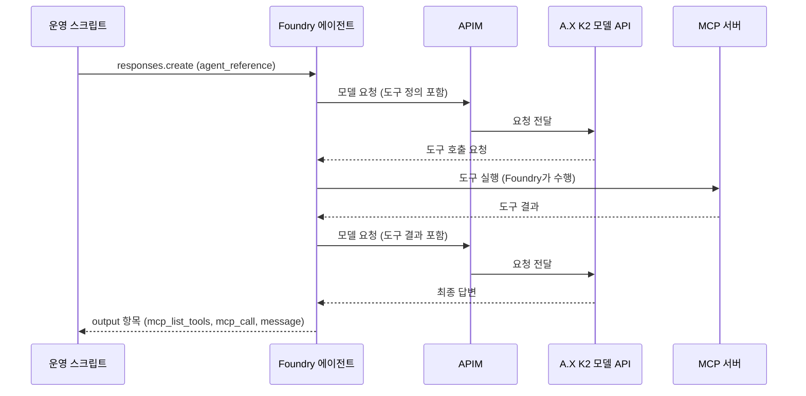

# Foundry BYOM 에이전트 데모: 설계와 확인 계획

이 문서는 `demo/foundry-byom/agent/` 스크립트의 설계와 확인 계획이다.
Phase 0 작성 시점에는 Foundry에서 A.X K2를 실제로 호출해 확인한 사항이 없었다.
이후의 실측 결과와 인프라 담당이 보고한 APIM 기록은 3.4절에 구분해 모았다. 모델 응답을 받은 호출 결과도 3.4절에 있다.
실측 결과에는 모델 API의 코드 버전을 붙였다. "e70debb 시점"은 수정 전 모델 API이고, "9cd2220 시점"은 수정 후 재배포본이다. 모델 API 코드가 다시 바뀌면 해당 결과를 다시 확인해야 한다.
인프라(APIM, Foundry 리소스, 연결)와 모델 API는 이 문서의 범위 밖이다.

## 0. 표기

| 표기 | 뜻 |
|---|---|
| 확인됨(문서) | Microsoft Learn 또는 공개 샘플에서 직접 확인한 사실이다. 이 환경에서 동작한다는 뜻은 아니다. |
| 확인됨(로컬) | 이 저장소의 코드, 설치한 SDK, 단위 테스트로 확인한 사실이다. |
| 확인됨(실측) | 이 저장소의 스크립트를 실행한 결과다. `evidence/foundry-byom/`의 증거 파일이 뒷받침한다. |
| 관찰됨(실측) | 스크립트 실행 결과에서 직접 본 현상이다. 내부 원인과 Foundry의 처리 방식은 보지 못했다. 원인과 처리 방식은 추정 또는 미확인으로 따로 적는다. |
| 확인됨(1a 트레이스) | 인프라 담당이 첫 1a 시도(NVFP4, 도구 없음)의 APIM 기록에서 읽어 보고한 사실이다. 이 저장소의 스크립트가 측정한 값이 아니다. 요약은 `phase1a-plain.apim-report.json`에 있다. |
| 확인됨(ablation 트레이스) | 인프라 담당이 9cd2220 시점의 FP8 호출(MCP never v2, ablation)의 APIM 기록과 Foundry 추적에서 읽어 보고한 사실이다. 이 저장소의 스크립트가 측정한 값이 아니다. 요약은 `redeploy-9cd2220-fp8-ablation.apim-report.json`에 있다. |
| 보고됨(모델 API 담당) | 모델 API 담당이 모델 API 쪽에서 얻은 결과를 보고한 내용이다. Foundry를 거치지 않고 모델 API에 요청 본문을 직접 보낸 재생, 호출 없이 한 코드 분석, Foundry 호출 시간대에 vLLM이 센 토큰 증가분이 있다. 구조와 숫자만 보고받았다. 이 저장소의 스크립트가 측정한 값이 아니다. 행 이름의 "예비"는 원인을 확정하지 못한 분석이라는 뜻이다. |
| 부분 확인 | 일부만 확인했다. 확인한 범위와 남은 범위를 같은 행에 적는다. |
| 추정 | 근거는 있으나 직접 확인하지 못한 해석이다. 확인 조건을 같은 행에 적는다. |
| 미확인 | 문서에 없거나 문구가 모호하다. 실제 호출로 확인해야 한다. 3.3절에 모았다. |
| 권고 | 이 문서의 제안이다. 결정은 사용자가 한다. |
| 확인 필요 | 정보가 없어 지금은 판단할 수 없다. 담당자에게 확인해야 한다. |

"확인됨(문서)"와 "확인됨(로컬)"은 "Foundry에서 A.X K2가 동작한다"는 증거가 아니다.
"확인됨(1a 트레이스)"와 "확인됨(ablation 트레이스)"는 Foundry가 보낸 요청이 APIM을 거쳐 모델 API에 도달했고 모델 API가 응답했다는 증거다. A.X K2가 답했다는 증거가 아니다.
응답의 `model` 필드는 에이전트의 모델 참조(`<연결 이름>/<모델 이름>`)와 같다. 이 값만으로는 A.X K2가 답했다고 말할 수 없다. 7절의 (ii)와 (iii)가 같은 시간대에 일치해야 한다.
"보고됨(모델 API 담당)"의 재생과 코드 분석은 Foundry가 보낸 요청의 결과가 아니다. Foundry 쪽 동작의 증거로 쓰지 않는다. 토큰 증가분은 Foundry 호출 시간대에 모델 쪽에서 센 값이다. 7절의 (iii) 대조에만 쓴다.

## 1. 목적과 범위

### 1.1 목적

Foundry에서 만든 프롬프트 에이전트가 BYOM(Bring your own model) 연결로 A.X K2를 호출하고, MCP 도구를 쓰는 과정을 보여 준다.
도구는 두 단계로 시험한다. 먼저 인증이 없는 공개 MCP 서버를 시험하고, 다음에 Web IQ 검색을 연결한다.
이 작업은 외부 모델 연결(BYOM) 검증이다. Model Catalog 정식 등록이 아니다.

완료 기준은 "Foundry에서 A.X K2를 쓰는 에이전트가 검색 도구를 호출하고 답변하는 것을 보여 주는 것"이다.
콘솔이 어디까지 표시하는지는 실제 확인 전까지 미확인이다.

### 1.2 연결 구조

연결 구조는 `Foundry 에이전트 → APIM(인증·요청 전달) → A.X K2 모델 API → A100 서버`이다.
도구를 쓸 때의 예상 흐름은 아래와 같다.



그림 1. 문서 기반 예상 흐름 (미확인). 실제 호출 순서와 요청 내용은 Phase 1에서 확인한다.

### 1.3 단계

| 단계 | 내용 | 클라우드 호출 |
|---|---|---|
| Phase 0 | 문서 확인, 스크립트·테스트·설계 작성 | 없음 |
| Phase 0.5 | 제어 평면 점검: 연결 조회, 도구 없는 에이전트 버전 생성 | 읽기와 에이전트 버전 쓰기만. 모델 호출 없음. 도구 없음 |
| Phase 1 | 모델 호출, 공개 MCP, Web IQ, 콘솔 확인 | 에이전트 버전·대화·응답 생성 |

Phase 0과 Phase 0.5는 끝났다. Phase 1은 일부만 끝났다. 단계별 결과는 아래 표와 3.4절에 있다. 표의 코드는 호출 시점의 모델 API 버전이다.

| 항목 | NVFP4 (`<connection>/ax-k2-nvfp4`) | FP8 (`<connection-fp8>/ax-k2-fp8`) |
|---|---|---|
| 1a 평문 1턴 | 첫 시도는 모델 API가 준비되지 않아 503(`backend_unavailable`)으로 실패했다. e70debb 시점과 9cd2220 시점에 통과했다. | e70debb 시점에 통과했다. |
| 1b 함수 도구 왕복 | e70debb 시점에 통과했다. | e70debb 시점에 통과했다. |
| 1c Learn MCP, `require_approval=never` | 실행하지 않았다. | e70debb 시점: v1은 도구를 호출하지 않았다. v2는 통과했다. 9cd2220 시점: v2가 통과했다. |
| 1c Learn MCP, `require_approval=always` | 실행하지 않았다. | e70debb 시점에 v3가 통과했다. 승인 흐름을 확인했다. |
| 1c MCP never, temperature 미지정(ablation) | 실행하지 않았다. | 9cd2220 시점에 첫 호출은 Foundry가 500 `model_error`를 반환했다. 승인받은 재시험 3회는 모두 통과했다. 원인은 확정하지 못했다(U18). |
| 1c Web IQ 표식(더미 헤더) | 실행하지 않았다. | e70debb 시점에 400 `invalid_payload`(`param=tools`)를 받았다. 모델 호출은 없었다. |
| Web IQ 실키 | 실행하지 않았다. | 실행하지 않았다. 사용자 동의를 기다린다. |

아직 하지 않은 일은 아래와 같다.

- Web IQ 실키 실행. 옵션 D(4.6절)가 필요하다. 키가 Foundry 프로젝트 연결에 저장되므로 사용자 동의가 먼저다.
- 콘솔 확인. 사용자 로그인과 MFA가 필요하다(6절).
- 음성 대조 N1, N2(7절).
- APIM 기록, 웹앱 기록, 허브 기록을 같은 시간대에 대조하는 일(7절).
- ablation 500의 추가 시험(대조 호출, `tool_choice` 시험, 약한 지시문 재시험 등). 별도 승인이 있을 때만 한다. 승인받은 재시험 3회는 끝났다(U18).
- NVFP4의 MCP 시험.

Phase 1은 아래 세 조건을 전제로 시작했다.

1. 인프라 담당이 연결이 Active라고 확인한다. 시작 시점에 포털에서 Active 표시를 확인하지 못했다. 이 항목은 3.3절과 6절의 콘솔 확인에 남아 있다.
2. 모델 API가 배포되었다. 보고로 확인한 뒤 시작했다.
3. 모델 API 직접 스모크 시험이 통과했다. 보고로 확인한 뒤 시작했다.

### 1.4 허용과 금지

| 구분 | 내용 |
|---|---|
| 허용 | 기존 Foundry 프로젝트 안의 에이전트 버전·대화·응답 생성(Phase 1). 연결 읽기와 에이전트 버전 생성(Phase 0.5). |
| 금지 | 새 Azure 리소스 생성, RBAC 변경, APIM·웹앱 설정·배포, GPU·작업 변경. |
| 금지 | `az login`, `az account set`. `az` 로그인 상태는 같은 환경을 쓰는 모든 프로세스가 공유한다. |
| 금지 | 키, 토큰, 비밀번호, 구독 ID, tenant ID, 객체 ID, 구독 ID가 들어간 전체 리소스 ID를 출력·문서·커밋에 쓰는 일. |
| 제한 | 실제 모델 호출은 최소로 한다. 동시성 1, 출력 상한 설정, thinking 끔. |

### 1.5 서술 규칙

- 기존 앱 경로(MAF `/api/agent`)에서 Web IQ가 성공한 기록은 별도 경로의 증거다. 이 데모의 증거로 쓰지 않는다.
- 이전 환경에서 측정한 처리량·지연 수치를 이 환경의 수치로 쓰지 않는다.
- 미확인 항목을 확인됨으로 바꾸려면 Phase 1의 실제 증거가 있어야 한다.

## 2. 잠정 계약

아래 값은 인프라 담당과 맞춘 잠정 값이다. 값이 바뀌면 이 표를 고친다.
배포별 실제 이름은 저장소에 쓰지 않고, 실행할 때 환경변수와 CLI 인자로만 전달한다.
이 문서의 `<connection>`과 `<connection-fp8>`은 증거 파일과 README에서 `<conn-nvfp4>`와 `<conn-fp8>`로 적은 별칭과 같은 연결이다.

| 항목 | 값 |
|---|---|
| 프로젝트 엔드포인트 | `https://<resource>.services.ai.azure.com/api/projects/<project>` |
| BYOM 연결 | `<connection>`(NVFP4), `<connection-fp8>`(FP8). 카테고리 ApiManagement, 인증 ApiKey, `deploymentInPath=false`, 정적 모델 목록 |
| 에이전트 모델 참조 | `<connection>/ax-k2-nvfp4`, `<connection-fp8>/ax-k2-fp8` |
| 모델 API 경로 | FP8: `/v1/...`, NVFP4: `/models/nvfp4/v1/...`. 엔드포인트는 `GET /v1/models`, `POST /v1/chat/completions` |
| 호출 방식 | 프롬프트 에이전트와 Responses API(`agent_reference`). 고전 Assistants API는 쓰지 않는다. |
| 호출자 인증 | Microsoft Entra 토큰(`az` 로그인 계정). Foundry 계정은 로컬 키 인증을 끈 상태다. |
| 필요한 역할 | 프로젝트 범위의 Foundry User(구 Azure AI User) 이상 |

## 3. 확인된 사실과 미확인 항목

### 3.1 문서에서 확인한 사실

출처 표기는 아래와 같다.

| 표기 | 출처 |
|---|---|
| [BYOM] | https://learn.microsoft.com/azure/foundry/agents/how-to/ai-gateway (로컬 사본 기준 2026-08-13 갱신) |
| [MCP] | https://learn.microsoft.com/azure/foundry/agents/how-to/tools/model-context-protocol |
| [MCP-AUTH] | https://learn.microsoft.com/azure/foundry/agents/how-to/mcp-authentication (ms.date 2026-09-04) |
| [FUNC] | https://learn.microsoft.com/azure/foundry/agents/how-to/tools/function-calling |
| [TRACE] | https://learn.microsoft.com/azure/foundry/observability/how-to/trace-agent-setup |
| [TRACE-DATA] | https://learn.microsoft.com/azure/foundry/observability/concepts/trace-data |
| [REPLAY] | https://learn.microsoft.com/azure/foundry/observability/how-to/trace-agent-replay |
| [SAMPLE] | `microsoft-foundry/foundry-samples` 저장소의 `infrastructure/infrastructure-setup-bicep/01-connections/` |
| [SAMPLE-MCP] | 같은 저장소의 `samples/python/prompt-agents/code-interpreter-custom/`, `samples/python/prompt-agents/agent-identity-and-skills/`, `samples/python/hosted-agents/SUPPORTED_TOOLBOX_SCENARIOS/tools/mcp-key-auth.md` |

| ID | 사실 | 출처 |
|---|---|---|
| D1 | 에이전트의 모델 참조 형식은 `<connection-name>/<model-name>`이다. | [BYOM] |
| D2 | 호출 순서는 `agents.create_version(PromptAgentDefinition)` → `get_openai_client()` → `conversations.create()` → `responses.create(..., extra_body={"agent_reference": {"name": ..., "type": "agent_reference"}})`이다. | [BYOM] |
| D3 | 이 기능은 프롬프트 에이전트만 지원한다. 같은 절에 "The Response API isn't supported at present."라는 문장도 있다. 이 문장의 뜻은 U1에서 따로 다룬다. | [BYOM] Supported configurations |
| D4 | 지원 도구에 MCP와 Functions가 있다. 웹 검색·Bing 도구는 목록에 없다. 따라서 검색은 MCP 서버로 연결한다. | [BYOM] |
| D5 | 필요한 역할은 프로젝트의 Foundry User(구 Azure AI User) 이상이다. SDK는 azure-ai-projects 2.0.0 이상, Python 3.10 이상이다. | [BYOM] |
| D6 | ApiManagement 연결의 기본값: 모델 목록 `/deployments`, 모델 조회 `/deployments/{deploymentName}`, 제공자 AzureOpenAI. 인증은 API 키 또는 Entra ID다. 명시한 메타데이터 값이 기본값보다 우선한다. | [BYOM] |
| D7 | Foundry는 모델 프로토콜에 따라 요청 경로를 붙인다. `Include deployment name in URL path` 설정은 `/deployments/{name}/chat/completions` 경로를 만든다. | [BYOM] |
| D8 | 연결 확인 방법: Admin-connected models 탭(Manage → Resource details), SDK 시험 프롬프트, APIM 분석에서 Agent Service 엔드포인트의 요청 확인. | [BYOM] |
| D9 | 문제 해결: 연결이 Inactive이면 URL과 자격 증명을 확인한다. 에이전트가 model not found 오류를 반환하면 `<connection>/<model>` 형식을 확인한다. 오류가 나는 시점은 적혀 있지 않다. | [BYOM] |
| D10 | APIM 쪽 기록: Application Insights 연결, 진단 로그(샘플링 100%, 오류 항상 기록, 상세도 Information). 조회 테이블은 `requests`, `dependencies`, `exceptions`, `traces`, `ApiManagementGatewayLogs`다. | [BYOM] |
| D11 | BYOM은 프롬프트 에이전트를 Responses API로 호출할 때만 동작한다. 고전 Assistants API는 `invalid_engine_error: Failed to resolve model info`로 실패한다. 게이트웨이는 OpenAI 호환 Chat Completions(POST)와 함수·도구 호출을 지원해야 한다. | [SAMPLE] |
| D12 | 정적 모델 목록은 샘플 Bicep의 매개변수 `staticModels`로 받아 연결 메타데이터의 `models` 키에 문자열로 저장한다. 다른 키는 `modelDiscovery`, `customHeaders`, `inferenceAPIVersion`, `deploymentAPIVersion`, `deploymentInPath`다. API 키 헤더는 기본 `api-key`이며 `authConfig`로 바꿀 수 있다. | [SAMPLE] |
| D13 | MCP 도구의 `require_approval` 기본값은 `always`다. 값은 `always`, `never`, `{"never": [도구 이름...]}`이다. | [MCP] |
| D14 | `always`이면 응답에 `mcp_approval_request` 항목이 나온다. 이어 가려면 `mcp_approval_response` 항목(`approval_request_id`는 승인 요청 항목의 ID, `approve: true`)을 `input`에 담고, `previous_response_id`에 원래 응답 ID를 넣고, `agent_reference`를 함께 보낸다. 문서의 Python 샘플은 첫 요청에 conversation을 쓰고 승인 후속 요청에는 `previous_response_id`를 쓴다. | [MCP] |
| D15 | 응답 출력 항목 종류: `message`, `function_call`, `mcp_list_tools`, `mcp_call`, `mcp_approval_request`, `oauth_consent_request`. 함수 호출은 `call_id`가 같은 `function_call_output` 항목으로 답한다. | [MCP], [FUNC] |
| D16 | MCP 제한: 스트리밍이 아닌 호출은 100초 제한이 있다. 도구 정의에 `anyOf`/`allOf`가 있거나 매개변수가 여러 타입을 받으면 "Invalid tool schema" 오류가 날 수 있다. 런타임은 원격 MCP 서버 엔드포인트만 받는다. | [MCP] |
| D17 | MCP 도구는 원격 서버가 필요로 하는 사용자 지정 헤더(예: 인증 키)를 전달할 수 있다. 문서는 전달하는 데이터를 검토하고 감사용으로 기록하라고 경고한다. | [MCP] |
| D18 | MCP 인증 방식: 키 기반(프로젝트 연결의 Custom keys), Entra 에이전트 ID, Entra 프로젝트 관리 ID, OAuth ID 통과, 인증 없음. 프로젝트에 접근할 수 있는 사람은 프로젝트 연결에 저장된 API 키에 접근할 수 있다. 공유 자격 증명은 런타임에 전달하지 말고 프로젝트 연결에 저장하라고 권고한다. | [MCP-AUTH] |
| D19 | 프로젝트 연결은 `azd ai connection create <name> --kind remote-tool --target <url> --auth-type custom-keys --custom-key "Header=Value"`로 만든다. `--auth-type` 값에는 `none`, `custom-keys`, `oauth2`, `user-entra-token` 등이 있다. | [MCP] |
| D20 | 추적은 기본으로 꺼져 있다. Application Insights를 프로젝트에 연결하면 서버 측 추적이 켜진다. 추적에는 사용자 입력, 모델 입출력, 도구 호출과 인자·결과가 기록된다. 조회에는 Log Analytics Reader 역할이 필요하다. | [TRACE], [TRACE-DATA] |
| D21 | 포털에서는 에이전트의 Traces 페이지에서 Response ID 또는 Trace ID로 검색하고 Conversation ID를 선택해 대화 이력, 실행 단계와 도구 호출, 사용자와 에이전트의 입출력을 본다. 최근 90일 추적을 조회할 수 있다. | [TRACE] |
| D22 | Trace Replay(미리보기)는 Conversation ID 또는 Trace ID에서 연다. Trajectories 보기에 에이전트 추론, 도구 호출, 대화 턴이 계층 구조로 나온다. User 보기는 대화를 채팅 형태로 보여 준다. | [REPLAY] |
| D23 | MCP 도구의 `project_connection_id`는 MCP 서버 엔드포인트와 인증 방식을 저장한 프로젝트 연결의 이름이다. 연결의 엔드포인트와 `server_url`이 다르면 연결의 엔드포인트를 쓴다. | [MCP-AUTH] |
| D24 | 샘플의 MCP 키 연결은 `category=RemoteTool`, `authType=CustomKeys`, `target`(MCP 엔드포인트), `credentials.keys`로 만든다. 샘플의 키 이름은 `x-ms-apikey`이고, 문서 예시의 키 이름은 `Authorization`이다. 샘플의 에이전트 코드는 연결의 전체 ARM ID 또는 연결 이름을 `project_connection_id`로 넘긴다. 이 샘플들은 Azure OpenAI 배포 모델을 쓰며 BYOM 연결을 쓰지 않는다. | [SAMPLE-MCP], [MCP-AUTH] |

### 3.2 로컬에서 확인한 사실

azure-ai-projects 2.9.0, azure-identity 1.26.0으로 확인했다. 이 버전은 시험에 쓴 버전이며 최소 요구 버전이 아니다(최소는 D5).

| 항목 | 확인한 내용 |
|---|---|
| 클래스와 필드 | `AIProjectClient`, `PromptAgentDefinition`(`model`, `instructions`, `temperature`, `tools`, `tool_choice` 등), `MCPTool`(`server_label`, `server_url`, `allowed_tools`, `require_approval`, `project_connection_id`, `headers`, `authorization` 등), `FunctionTool`(`name`, `description`, `parameters`, `strict` 등)이 있다. |
| 에이전트 API | `agents.get`, `agents.get_version`, `agents.create_version`, `agents.delete`가 있다. |
| 연결 API | `connections.list`, `connections.get(name, include_credentials=False)`가 있다. 자격 증명 값을 요청하지 않고 조회할 수 있다. |
| OpenAI 클라이언트 | `get_openai_client()`는 `{프로젝트 엔드포인트}/openai/v1`을 기준 URL로, `https://ai.azure.com/.default`를 토큰 범위로 쓴다. |
| 자격 증명 고정 | `AzureCliCredential(subscription=...)`는 토큰 명령에 `--subscription`을 붙인다. |
| 단위 테스트 | SDK를 모킹한 단위 테스트가 `tests/test_foundry_byom_agent.py`에 있다. SDK가 없는 환경에서는 SDK 호환성 시험만 건너뛴다. |

### 3.3 미확인 항목과 현재 상태

아래 항목은 Phase 0에서 문서가 없거나 모호했던 항목이다. 단계 열은 확인할 수 있는 가장 이른 단계다.
Phase 1을 실행한 뒤 각 행에 확인한 부분과 남은 부분을 나누어 적었다. 표기의 뜻은 0절에 있고 세부 결과는 3.4절에 있다. 결과에 모델 API 코드 버전(e70debb 시점 또는 9cd2220 시점)이 붙어 있으면 그 시점의 결과다. U18과 U19는 Phase 1에서 새로 생긴 항목이다.

| ID | 항목과 현재 상태 | 확인 방법 | 단계 |
|---|---|---|---|
| U1 | "The Response API isn't supported at present." 문장의 뜻. 모델 백엔드가 Responses 프로토콜을 받지 못한다는 뜻인지, 에이전트를 Responses API로 호출할 수 없다는 뜻인지 모른다. 같은 문서의 샘플은 `responses.create`로 에이전트를 호출한다. **확인됨(실측):** `agent_reference`를 담은 `responses.create`가 평문, 함수 도구, MCP 호출에서 Responses 형식의 `output` 항목을 돌려줬다(NVFP4와 FP8). 에이전트를 Responses API로 호출할 수 없다는 뜻이 아니다. **확인됨(1a 트레이스, ablation 트레이스):** Foundry가 모델 쪽으로 보낸 요청은 Chat Completions 형태(`/chat/completions`, `messages` 필드)다. 그래서 이 문장이 모델 백엔드 프로토콜을 가리킨다고 본다(추정). | 도구 없는 에이전트를 `responses.create`로 호출해 응답을 받는다. | 1 |
| U2 | 에이전트 버전 생성이 모델 참조를 검증하는지 여부. D9는 오류 시점을 적지 않았다. | 생성 후 `agents.get`으로 저장된 참조를 읽는다. 생성이 성공해도 검증 여부는 알 수 없으므로 "수락됨, 검증 여부 미확인"으로 기록한다. 잘못된 참조 대조는 7절 N1에서 한다. | 0.5, 1 |
| U3 | 연결의 Active/Inactive 상태를 SDK로 읽을 수 있는지 여부. | `connections.get` 결과에서 상태 필드를 찾는다. 없으면 포털의 Admin-connected models 탭에서 확인한다(6절). | 0.5 |
| U4 | Foundry가 모델 API로 보내는 요청 필드. **확인됨(1a 트레이스, 도구 없는 에이전트):** 경로는 연결 대상 경로 뒤에 `/chat/completions`를 붙인 형태다. 쿼리 문자열과 `api-version`이 없다. 최상위 필드는 `messages`(system과 user 2개), `stream`(true), `max_completion_tokens`, `stream_options`, `model`(`ax-k2-nvfp4`), `temperature`, `top_p`다. `tools`와 User-Agent는 없다. **확인됨(ablation 트레이스, FP8, MCP 도구 1개):** 최상위 필드에 `tools`, `parallel_tool_calls`, `tool_choice`가 더해진다. 값은 `tools` 1개, `parallel_tool_calls=false`, `tool_choice="auto"`다. MCP 도구는 함수 도구 1개로 변환되어 갔고 이름은 `mcp___mcp_<서버 라벨>___<도구 이름>` 형식이다. 같은 요청의 값은 `model=ax-k2-fp8`, `stream=true`, `stream_options={include_usage:true}`, `max_completion_tokens=384`, `top_p=1.0`이다. `temperature`는 에이전트 정의에 지정하면 그 값(0.3, JSON 값 0.3000000119209289)이, 지정하지 않으면 1.0이 실렸다(각 1건). **확인됨(실측):** 평문, 함수 도구, MCP 호출이 NVFP4와 FP8에서 응답으로 끝났다. 모델 API가 이 요청 형태를 처리했다는 뜻이다. 예외는 ablation 호출이다. 모델 API가 200을 돌려줬는데도 Foundry가 500으로 끝냈다(U18). **미확인:** 1b의 함수 도구 요청 형태(보고 없음). 함수 도구의 `strict` 필드 값. | 1b의 함수 도구 호출과 Learn MCP 호출 때 인프라 담당에게 APIM 기록의 필드 이름과 비밀이 아닌 값(숫자, 논리값)을 받는다. 1b는 받지 못했다. | 1 |
| U5 | `max_output_tokens`, `max_tool_calls`, `timeout`을 `agent_reference`와 함께 보낼 수 있는지 여부. **확인됨(실측):** Foundry는 `max_output_tokens`를 256(평문, 함수 도구)과 384(MCP)로 담은 요청을 거부하지 않았다. 이 값 때문에 난 400은 없었다. **확인됨(로컬):** `timeout`은 SDK 요청 옵션이며 요청 본문에 실리지 않는다. `--max-tool-calls 0`이면 `max_tool_calls`를 보내지 않는다. **확인됨(1a 트레이스):** 모델 요청에 `max_completion_tokens` 필드가 있었다. **확인됨(ablation 트레이스):** `max_output_tokens=384`로 보낸 호출의 모델 요청에서 `max_completion_tokens=384`가 관측되었다(1건). **미확인:** 256일 때의 `max_completion_tokens` 값. 0이 아닌 `max_tool_calls`를 Foundry가 받는지 여부. 출력 길이가 상한을 지키는지 여부(응답을 받은 호출의 출력은 모두 상한보다 짧았다). | 0이 아닌 `max_tool_calls`로 호출한다. 출력이 상한에 닿는 호출에서 `usage`를 본다. | 1 |
| U6 | 응답 `model` 필드의 값. **확인됨(실측):** 응답의 `model` 필드는 에이전트의 모델 참조(`<연결 이름>/ax-k2-…`)와 같다. 모델 API가 쓰는 이름(`ax-k2-…`) 앞에 연결 이름이 붙는다. 에이전트 정의의 참조를 되돌려 준 값으로 보이며(추정), 이 값만으로는 A.X K2가 답했다는 증거가 아니다. **확인됨(1a 트레이스, ablation 트레이스):** 모델 API로 가는 요청의 `model` 값은 `ax-k2-nvfp4`(1a)와 `ax-k2-fp8`(ablation)다. | 응답의 `model` 필드와 APIM 요청 본문의 `model`을 같은 시간대에서 맞춘다(7절). | 1 |
| U7 | 실행 시점 MCP 헤더(`headers`, `authorization`)를 BYOM 에이전트의 `agent_reference` 호출에서 쓸 수 있는지, 헤더가 MCP 서버에 적용되는지, 값이 응답과 저장소에 남지 않는지 여부. **확인됨(실측, e70debb 시점, FP8):** 요청에 `tools`를 담아 `agent_reference`와 함께 보내면 Foundry가 400 `invalid_payload`(`param=tools`, "Not allowed when agent is specified.")로 거부한다. 요청 단위 헤더는 쓸 수 없다. 이 400은 요청 검증 단계에서 났으므로 모델 호출은 없었다고 본다. 옵션 B는 불가다(4.5절). **미확인:** `tools` 외의 필드(`tool_choice` 등)를 요청에서 바꿀 수 있는지 여부. | 4.5절 시험을 마쳤다. | 1 |
| U8 | Custom keys 연결의 키 이름(`x-apikey`)이 그대로 헤더 이름으로 전달되는지 여부. D19의 예시는 `Authorization`이고 D24의 샘플은 `x-ms-apikey`다. **미확인:** 연결을 만들지 않았다. `project_connection_id`에 연결 이름과 전체 ARM ID 중 어느 쪽이 BYOM 에이전트에서 통하는지도 모른다(D24). | 옵션 D의 더미 키 연습(사용자 승인 후, 4.6절의 D-1). 오류 문구로 헤더가 서버에 도달했는지 가린다. | 1 |
| U9 | Web IQ `web` 도구의 스키마와 전송 방식이 Foundry MCP 도구와 호환되는지 여부. D16의 스키마 제한에 걸릴 수 있다. Web IQ 스키마는 읽지 않았다. **미확인:** Web IQ는 연결하지 않았다. 참고로 Learn MCP의 `microsoft_docs_search` 1개는 `mcp_list_tools`에서 스키마 오류 없이 나왔다(확인됨(실측)). | Web IQ 연결 뒤의 `mcp_list_tools` 결과. | 1 |
| U10 | MCP 출력 항목의 실제 모양과 승인 흐름. 스크립트는 승인 후속 요청을 D14의 샘플과 같이 `previous_response_id`로 보낸다. **확인됨(실측, e70debb 시점, FP8):** `never`이면 항목이 `mcp_list_tools`, `mcp_call`, `message` 순서로 나온다(v2). `always`이면 첫 응답이 `mcp_list_tools`, `mcp_approval_request`에서 끝난다. `mcp_approval_response`(`approval_request_id`, `approve: true`)를 `previous_response_id`와 함께 보내면 `mcp_list_tools`, `mcp_call`, `message`가 나온다(v3). **관찰됨(실측):** 승인 뒤 두 번째 응답의 항목(`mcp_call`, 최종 답)은 대화 항목(`conversations.items.list`)에 남지 않았다. 두 번째 응답의 `conversation_id`가 null이다. `previous_response_id`로 이어 가서 대화에 붙지 않은 것으로 추정한다. | 완료. 콘솔의 Traces에서 두 번째 응답의 도구 단계가 보이는지는 U11에서 확인한다. | 1 |
| U11 | 포털 화면별 표시 범위. 6절의 화면 이름은 문서 기준이다. BYOM 에이전트에서 모델 참조·대화·도구 단계가 어디까지 보이는지 모른다. **미확인:** 콘솔을 아직 보지 않았다. 사용자의 로그인과 MFA가 필요하다. | 콘솔 확인과 캡처(6절). | 1 |
| U12 | 실행 신원의 데이터 평면 권한. 역할 부여 뒤 전파에 시간이 걸릴 수 있다. | Phase 0.5 첫 호출 결과(401/403 여부). | 0.5 |
| U13 | `deploymentInPath=false`일 때 실제 요청 경로, ApiManagement 연결이 API 키를 싣는 헤더 이름. **확인됨(1a 트레이스):** 경로는 연결 대상 경로 뒤의 `/chat/completions`이며 `/deployments/…` 구간이 없다. 키는 `api-key` 헤더로 도착했다. 게이트웨이는 4건 모두에서 이 헤더, 구독 키 헤더, 쿼리 문자열을 지우고 `Authorization`(게이트웨이 키)을 붙여 전달했다. 모델 API가 401이 아니라 503을 돌려줬으므로 키 거부가 아니다. **확인됨(ablation 트레이스):** FP8 요청의 경로는 `/fp8/v1/chat/completions`이고 쿼리 문자열이 없다. 이 요청은 모델 API에서 200을 받았다. **확인됨(실측):** 어떤 호출에서도 401, 403, 404가 없었다. **미확인:** FP8 요청과 도구 호출 요청에서 게이트웨이가 키 헤더를 지우고 게이트웨이 키를 붙였는지. 1a의 정책 확인은 NVFP4 요청에 대한 것이다. 모델 API의 200 응답은 인증을 통과했다는 뜻이다. | 정책 확인이 필요하면 인프라 담당에게 APIM 기록을 다시 읽도록 요청한다. | 1 |
| U14 | thinking 끔 방법. Foundry가 thinking을 끄는 요청 필드를 보낼 수 있는지 모른다. 보낼 수 없으면 모델 API의 기본값이 꺼짐이어야 한다. **관찰됨(실측):** 응답을 받은 모든 호출에서 reasoning 항목이 없었고 reasoning 토큰이 0이었다. 출력 토큰은 호출마다 15~142개로 짧았다. 그래서 thinking이 꺼져 있었다고 본다(추정). **확인됨(ablation 트레이스):** 모델 요청의 최상위 필드에 thinking을 제어하는 필드가 없다. **미확인:** 모델 API의 기본값. | 모델 API 담당에게 기본값을 확인한다. 응답의 reasoning 흔적은 `no_thinking_trace` 검사가 본다. | 1 |
| U15 | APIM 진단 로그에 요청 본문이 남는지 여부와 Foundry 호출자를 식별할 단서. **확인됨(1a 트레이스):** 인프라 담당은 APIM 기록에서 본문의 필드 이름, `model`과 `stream` 값, 메시지 개수와 역할을 읽었다. 호출자 단서는 두 가지다. 하나는 연결 전용 APIM 구독이다. 다른 하나는 같은 Application Insights의 `invoke_agent <에이전트>:<버전>` 스팬이며, 시각으로 맞춰 본다. 요청에 User-Agent 헤더가 없다. 다른 헤더는 보고에 없다. **확인됨(ablation 트레이스):** 인프라 담당이 정책을 배포한 뒤(21:43 KST) 들어온 요청부터 `max_completion_tokens`, `stream_options`, `temperature`, `top_p` 같은 숫자·논리값과 `tools` 개수, 도구 이름, `tool_choice`가 기록에 남는다. 응답 본문은 기록에 없다. **미확인:** 메시지 내용이 기록에 남는지 여부(보고 없음). 요청 ID로 Foundry 쪽 기록과 APIM 기록을 직접 연결할 수 있는지 여부. 지금은 시각과 스팬 이름으로 맞춘다. | 호출마다 시작·종료 시각(KST)을 인프라 담당에게 전달하고 같은 방식으로 읽는다. | 1 |
| U16 | Foundry를 거친 호출에서 모델 서버가 도구 호출을 구조화해 돌려주는지 여부. 모델 서버는 `--tool-call-parser hermes`와 `--enable-auto-tool-choice`가 있어야 한다(`docs/SERVING_DESIGN.md` 187~203행, `docs/HANDOFF.md` 201행). 없으면 `<tool_call>` 원문이 `content`에 섞인다. **확인됨(실측):** 함수 도구 호출(`function_call` 항목)과 MCP 도구 호출(`mcp_call` 항목)이 구조화된 항목으로 돌아왔다. 함수 호출의 `call_id`는 `call_chatcmpl-tool-<16자리 16진수>_agents` 형태다. 증거 파일의 최종 답에서 `<tool_call>` 원문은 찾지 못했다. | 완료. | 1 |
| U17 | 대화·응답 조회 API(`conversations.items.list`, `responses.retrieve`)가 BYOM 에이전트의 기록에도 동작하는지 여부. **확인됨(실측):** 두 API가 BYOM 에이전트의 응답과 대화에 동작했다. 오류가 없었다. 예외는 `always` 승인 흐름의 두 번째 응답 항목이다(U10). | 완료(`collect_evidence.py`). | 1 |
| U18 | 9cd2220 시점 FP8의 ablation 호출이 Foundry 500 `model_error`로 끝난 원인. 에이전트 `byom-demo-mcp-ablation-fp8` 버전 1은 v2와 지시문이 같고 `temperature`만 지정하지 않았다(Foundry 기본값). **관찰됨(실측):** Foundry가 HTTP 500을 돌려줬다. 오류 본문의 `type`은 `model_error`, `code`는 null이고 메시지는 "The model produced invalid content."로 시작한다. 클라이언트 재시도는 없었다(`client_http` 2/1). 응답 항목은 비어 있다. **확인됨(ablation 트레이스):** 모델 API 요청은 1건이었고 ±30초 안에 다른 요청이 없었다(Foundry의 재전송 없음). 게이트웨이와 백엔드 응답이 모두 200이었다. 백엔드 1,127.9ms, 전체 1,129.1ms다. Foundry 스팬은 `invoke_agent`(500, 1,218ms)와 `execute_tool`이고 `chat` 스팬은 없다. `execute_tool`의 도구 이름은 이 호출에서 `functions.microsoft_learn.microsoft_docs_search`였고, 정상 호출(v2)에서는 `mcp_microsoft_learn.microsoft_docs_search`였다. 응답 본문은 기록에 없다. **추정:** 모델이 선언된 함수 이름과 다른 이름으로 도구를 호출했다. **관찰됨(실측, 재시험):** 같은 에이전트 버전과 같은 프롬프트로 Foundry에 3회 다시 요청했다(23:24, 23:25, 23:26 KST. 호출 간격 50초 이상). 3회 모두 `completed`였고 항목은 `mcp_list_tools`, `mcp_call`, `message` 순서였다. 500은 나오지 않았다. 이 에이전트의 Foundry 호출 4회 중 실패는 1회다. 재시험도 `temperature`를 지정하지 않았다. 모두 성공했으므로 대조 호출(`byom-demo-mcp-agent-fp8` 버전 2, `temperature=0.3`)은 하지 않았다. **관찰됨(실측, GET):** 실패한 22:16 호출의 대화는 지금도 조회된다. 항목은 0개다(22:20 증거 수집과 23:19 조회 전용 재확인). 그래서 `mcp_call`의 `name`이 `functions.`로 시작했는지 대화 항목으로 확인하지 못한다. **미확인:** 원인. 실패가 다시 나는 조건. `temperature`(0.3과 1.0)가 원인인지 여부. 첫 호출의 모델 요청은 v2와 `temperature`만 달랐다. 그러나 `temperature`를 지정하지 않은 재시험 3회는 성공했다. 재시험의 모델 요청 값은 인프라 담당의 확인 전이다. **보고됨(모델 API 담당):** 재구성한 요청을 모델 API에 직접 44회 보냈지만 이 500은 재현되지 않았다. 재생의 프롬프트 토큰은 44회 모두 472개이고 실제 실패 요청에서 vLLM이 센 증가분은 482개다. 재구성한 요청이 Foundry의 실제 요청과 토큰 단위로 같지 않으므로, 재현되지 않았다는 사실로 모델 API를 배제하지 못한다. 모델 API 담당의 코드 분석(합성 스트림 69건, 예비)에서는 중계 코드가 "invalid content"를 직접 만들었을 가능성이 낮다고 봤다(추정). 재생 결과와 코드 분석은 3.4절의 해당 행에 있다. | 원인은 정해지지 않았다. 대조 호출, `tool_choice` 시험, 라운드별 vLLM 프롬프트 토큰 확인은 별도 승인 뒤에만 한다. 시연 중 500이 났을 때의 대응은 9.1절에 있다. | 1 |
| U19 | MCP `never` 호출에서 모델이 도구를 부르지 않은 원인. **관찰됨(실측, e70debb 시점, FP8):** v1(지시문이 약하고 `temperature` 미지정)은 `mcp_list_tools` 뒤에 `mcp_call` 없이 답했다. 이 답에는 도구 결과 없이 쓴 URL이 있었다(URL이 실제로 있는지는 확인하지 않았다). v2(지시문을 강화하고 `temperature=0.3`)는 e70debb 시점에 1회, 9cd2220 시점에 1회 `mcp_call`을 만들었다. v3(`always`, v2와 같은 지시문과 `temperature=0.3`)도 도구 호출을 요청했다(`mcp_approval_request`). **관찰됨(실측, 9cd2220 시점):** 강한 지시문에 `temperature`를 지정하지 않은 에이전트(ablation)는 완료된 재시험 3회 모두 `mcp_call`을 만들었다. 같은 에이전트의 첫 호출(22:16)은 500으로 끝났고 항목이 없다. 그러나 Foundry 추적에는 `execute_tool` 스팬이 있었다(U18). 조건별 결과는 아래와 같다. 약한 지시문과 기본 `temperature`는 1회 중 0회(e70debb 시점). 강한 지시문과 `temperature=0.3`은 2회 중 2회(e70debb 시점 1회, 9cd2220 시점 1회). 강한 지시문과 기본 `temperature`는 완료된 3회 중 3회(9cd2220 시점)다. **추정:** 약한 지시문에서 도구를 부르지 않았고 강한 지시문에서 불렀으므로 지시문이 영향을 줬을 수 있다. **미확인:** 원인이 지시문인지 우연인지. 약한 지시문은 1회만 시험했고 e70debb 시점이다. 강한 지시문의 재시험은 9cd2220 시점이라 모델 API 코드 버전도 다르다. **보고됨(모델 API 담당):** 강한 지시문으로 재구성한 요청을 모델 API에 직접 보냈을 때 `temperature` 1.0은 29회 중 도구 없이 글만 답한 경우가 1회, 글과 도구 호출을 함께 낸 경우가 2회였다. 0.3은 15회 모두 도구를 불렀다. 도구를 쓰지 않은 경우는 1.0에서만 나왔다. 그러나 1.0에서도 대부분 도구를 불렀고 표본이 작아서 `temperature`의 영향이라고 말할 수 없다(추정). | 약한 지시문(v1) 조건의 재시험은 별도 승인 뒤에만 한다. 표본을 늘리면 지시문의 영향이 우연인지 가를 수 있다. | 1 |

### 3.4 실측 결과

Phase 0.5(제어 평면)와 Phase 1(모델 호출)을 실행했다. 증거 파일은 `evidence/foundry-byom/`에 있다. 시각은 모두 KST다.
이 절은 증거 파일이 뒷받침하는 사실만 적는다. 응답 ID와 요청 ID는 앞 8자만 적는다.
"확인됨(1a 트레이스)"와 "확인됨(ablation 트레이스)" 행은 인프라 담당이 APIM 기록에서 읽어 보고한 내용이다. "보고됨(모델 API 담당)" 행은 모델 API 담당이 보고한 내용이다. 이 저장소의 스크립트가 측정한 값이 아니다.
e70debb 시점은 수정 전 모델 API이고 9cd2220 시점은 재배포 뒤의 모델 API다. 호출마다 어느 시점의 결과인지 적었다.

**호출 결과 목록**

| 증거 이름 | 모델 API | 에이전트(버전) | 시작 | 결과 | usage(입력/출력) | `client_http`(requests/responses_posts) |
|---|---|---|---|---|---|---|
| `phase1a-plain` | e70debb | `byom-demo-agent`(1), NVFP4 | 20:45:07 | 실패. HTTP 503, 오류 코드 `model_error`. 모델 쪽 원문은 `backend_unavailable`이다. | 없음 | 카운터 없음 |
| `phase1a-fp8-plain` | e70debb | `byom-demo-agent-fp8`(1) | 21:28:11 | 성공. 항목 `message`. 답에 확인 코드가 있다. | 80/15 | 2/1 |
| `phase1b-fp8-function` | e70debb | `byom-demo-fn-agent-fp8`(1) | 21:29:05 | 성공. 라운드 0 출력 `message`, `function_call`(`lookup_demo_stock`). 라운드 1 출력 `message`. | 310/96, 390/36 | 3/2 |
| `phase1c-fp8-learn-never` | e70debb | `byom-demo-mcp-agent-fp8`(1), `never` | 21:30:23 | 완료. 항목 `mcp_list_tools`, `message`. `mcp_call` 없음(U19). | 477/88 | 2/1 |
| `phase1c-fp8-learn-never-v2` | e70debb | `byom-demo-mcp-agent-fp8`(2), `never` | 21:39:06 | 성공. 항목 `mcp_list_tools`, `mcp_call`, `message`. `mcp_call` 출력 43,220자. | 10,531/136 | 2/1 |
| `phase1c-fp8-learn-always` | e70debb | `byom-demo-mcp-agent-fp8`(3), `always` | 21:40:05 | 성공. 라운드 0 출력 `mcp_list_tools`, `mcp_approval_request`. 승인 뒤 라운드 1 출력 `mcp_call`, `message`. | 480/41, 10,533/102 | 3/2 |
| `phase1c-fp8-webiq-marker` | e70debb | `byom-demo-webiq-agent-fp8`(1) | 21:43:38 | 실패. HTTP 400 `invalid_payload`(`param=tools`). 모델 호출은 없었다고 본다(추정). | 없음 | 2/1 |
| `phase1a-nv-plain` | e70debb | `byom-demo-agent`(1), NVFP4 | 21:46:43 | 성공. 항목 `message`. 답에 확인 코드가 있다. | 80/15 | 2/1 |
| `phase1b-nv-function` | e70debb | `byom-demo-fn-agent-nv`(1) | 21:47:19 | 성공. 라운드 0 출력 `function_call`, 라운드 1 출력 `message`. | 309/25, 367/29 | 3/2 |
| `redeploy-9cd2220-nv-plain` | 9cd2220 | `byom-demo-agent`(1), NVFP4 | 22:13:28 | 성공. 항목 `message`. 답에 확인 코드가 있다. 소요 1.7초. | 81/16 | 2/1 |
| `redeploy-9cd2220-fp8-learn-never-v2` | 9cd2220 | `byom-demo-mcp-agent-fp8`(2), `never` | 22:14:42 | 성공. 항목 `mcp_list_tools`, `mcp_call`, `message`. `mcp_call` 출력 43,220자. 소요 11.3초. | 10,533/142 | 2/1 |
| `redeploy-9cd2220-fp8-learn-never-tempdefault` | 9cd2220 | `byom-demo-mcp-ablation-fp8`(1), `never` | 22:16:28 | 실패. HTTP 500. 오류 본문의 `type`은 `model_error`, `code`는 null이다. 항목 없음(U18). | 없음 | 2/1 |
| `retest-9cd2220-fp8-ablation-1` | 9cd2220 | `byom-demo-mcp-ablation-fp8`(1), `never` | 23:24:27 | 성공. 항목 `mcp_list_tools`, `mcp_call`, `message`. `mcp_call` 출력 43,220자. 소요 10.6초. | 10,531/129 | 2/1 |
| `retest-9cd2220-fp8-ablation-2` | 9cd2220 | `byom-demo-mcp-ablation-fp8`(1), `never` | 23:25:31 | 성공. 항목 `mcp_list_tools`, `mcp_call`, `message`. `mcp_call` 출력 43,220자. 소요 9.3초. | 10,531/131 | 2/1 |
| `retest-9cd2220-fp8-ablation-3` | 9cd2220 | `byom-demo-mcp-ablation-fp8`(1), `never` | 23:26:32 | 성공. 항목 `mcp_list_tools`, `mcp_call`, `message`. `mcp_call` 출력 58,340자. 소요 10.4초. | 15,554/123 | 2/1 |

- 에이전트의 모델 참조는 이름으로 구분한다. `byom-demo-agent`와 `byom-demo-fn-agent-nv`는 NVFP4 연결(`<connection>/ax-k2-nvfp4`)을 쓴다. 이름에 `fp8`이 들어간 에이전트는 FP8 연결(`<connection-fp8>/ax-k2-fp8`)을 쓴다.
- 시작 시각은 `*.run.json`의 `started_at`이다. 9cd2220 시점 파일에는 첫 요청 시각(`last_request_at`)과 종료 시각(`finished_at`)도 있다. NVFP4 평문은 22:13:31과 22:13:33, MCP `never` v2는 22:14:43과 22:14:54, ablation은 22:16:29와 22:16:31이다. ablation 재시험 1~3회는 23:24:29와 23:24:40, 23:25:32와 23:25:41, 23:26:33과 23:26:43이다.
- `requests`는 SDK가 보낸 HTTP 요청 수이며 대화 생성 요청을 포함한다. `responses_posts`는 `/responses`로 간 POST 수다. 모든 호출에서 `responses_posts`가 `responses.create` 호출 수와 같았다. SDK의 자동 재시도는 없었다. 1a 시도 1에는 이 카운터가 없었다.
- 응답을 받은 12개 호출에는 스트림 해석 오류로 보이는 오류가 없었다. 500으로 끝난 ablation 첫 호출 1건은 U18에서 따로 다룬다.
- 프롬프트의 확인 코드는 호출마다 만든 무작위 값(`r-<hex>`)이다. 값은 증거 파일에 있다. ablation 재시험 3회는 22:16 호출과 같은 프롬프트를 다시 보냈다. 확인 코드도 같다. 이 4회는 확인 코드가 아니라 시각으로 구분한다.

**항목별 결과**

| 항목 | 상태 | 내용 | 증거 파일 |
|---|---|---|---|
| 연결 계약 | 확인됨(실측) | 연결 2개가 계약과 같다. 카테고리는 ApiManagement, 인증은 ApiKey, `deploymentInPath=false`이고 모델 목록이 맞는다. 조회 결과에 자격 증명 값은 없다. 대상 경로는 NVFP4가 `/nvfp4/v1`, FP8가 `/fp8/v1`이다. 서비스가 FP8 연결에 `isDefault=true`를 붙였다. 에이전트의 모델 참조가 명시적이므로 영향이 없다. 프로젝트에는 AppInsights 연결도 있다. | `phase05-connections.connections.json` |
| U3 | 확인됨(실측) | `connections.list`와 `connections.get`은 Active/Inactive 상태를 돌려주지 않는다. 메타데이터 키는 `deploymentInPath`와 `models`뿐이다. 상태는 포털에서 확인해야 한다(6.5절). | 위와 같음 |
| D12 | 확인됨(실측) | 정적 모델 목록이 연결 메타데이터의 `models` 키에 들어 있다(샘플의 `staticModels` 매개변수가 이 키로 저장된다). 연결에 `authConfig`와 `modelDiscovery` 설정은 없다. 그래서 API 키 헤더는 기본값(`api-key`)일 것으로 예상했다. 1a 시도 1의 APIM 기록에서 키가 `api-key` 헤더로 도착했다(확인됨(1a 트레이스), U13). | 위와 같음 |
| U2 | 부분 확인 | 에이전트 버전 생성이 `<connection>/ax-k2-nvfp4`를 받아들였다. `agents.get`과 `agents.get_version`이 같은 참조를 돌려줬다. 생성이 참조를 검증하는지는 모른다. 잘못된 참조 대조(7절 N1)는 하지 않았다. | `phase05-create-agent.create.json` |
| U12 | 확인됨(실측) | 프로젝트 범위 권한으로 연결 조회, 에이전트 버전 생성, 대화 생성, 응답 요청이 401/403 없이 통과했다. | 위 두 파일과 `phase1a-plain.run.json` |
| U1 | 부분 확인 | **확인됨(실측):** `agent_reference`를 담은 `responses.create` 요청이 평문, 함수 도구, MCP 호출에서 모델의 답을 거쳐 Responses 형식의 `output` 항목으로 끝까지 돌아왔다(NVFP4와 FP8). 에이전트를 Responses API로 호출할 수 없다는 뜻이 아니다. **확인됨(1a 트레이스, ablation 트레이스):** 모델 쪽으로 간 요청은 Chat Completions 형태(`/chat/completions`, `messages` 필드)다. 그래서 문서의 "The Response API isn't supported at present."는 모델 백엔드 프로토콜을 가리킨다고 본다(추정). **미확인:** 문서 문장의 정확한 뜻. 문서 작성자만 확인할 수 있다. | `phase1a-fp8-plain.run.json`, `phase1a-plain.apim-report.json`, `redeploy-9cd2220-fp8-ablation.apim-report.json` |
| 모델 쪽 오류 | 확인됨(실측) | 모델 쪽이 503을 돌려주면 Foundry는 HTTP 503, 오류 코드 `model_error`로 감싸고 메시지에 모델 게이트웨이 응답 원문을 싣는다. 시도 1의 원문은 `backend_unavailable`("The model backend is not ready. Retry later.")였다. 필드를 거부하는 400이 아니다. 이 503이 모델 API(웹앱)에서 왔다는 것은 APIM 기록이 확인했다(아래 "APIM 수신" 행). | `phase1a-plain.run.json`, `phase1a-plain.apim-report.json` |
| APIM 수신(1a 시도 1) | 확인됨(1a 트레이스) | 같은 POST 요청 4건이 20:45:12.13, 20:45:12.63, 20:45:18.12, 20:45:23.60(KST)에 도착했다. 간격은 0.5초, 5.5초, 5.5초다. 4건 모두 503이다. 503은 APIM이 아니라 모델 API(웹앱)가 돌려줬다. APIM 자체 오버헤드는 1.2~5.7 ms이고 모델 API 구간은 5.9~72.0 ms다. 429, APIM 예외, 정책 오류는 없다. 모델 API가 6~72 ms 만에 응답했으므로 GPU 대기 시간 초과가 아니라 사전 점검에서 빨리 실패한 것으로 보인다(보고자의 추정). | `phase1a-plain.apim-report.json` |
| 요청 형태(1a 시도 1) | 확인됨(1a 트레이스) | 인프라 담당은 4건을 같은 요청으로 보았다. 경로는 연결 대상 경로 뒤의 `/chat/completions`이고 쿼리 문자열과 `api-version`이 없다. 본문은 `stream=true`, `model=ax-k2-nvfp4`이며 `max_tokens`가 아니라 `max_completion_tokens`를 쓴다. 최상위 필드는 `messages`(system과 user 2개), `stream`, `max_completion_tokens`, `stream_options`, `model`, `temperature`, `top_p`다. 에이전트 정의에 `temperature`와 `top_p`를 지정하지 않았는데도 두 필드가 실렸다. `tools`와 User-Agent는 없다. 이 요청은 도구 없는 에이전트의 것이다. 이 보고에는 필드 값(`max_completion_tokens`, `stream_options`, `temperature`, `top_p`)이 없다. 값은 이후 ablation 트레이스에서 읽었다(U4). 이 시도는 503으로 끝났으므로 모델 API가 이 필드를 처리하는지는 이 시도로 알 수 없었다. 이후 호출 결과는 U4에 있다. | `phase1a-plain.apim-report.json` |
| 게이트웨이 정책(1a 시도 1) | 확인됨(1a 트레이스) | 4건 모두에서 게이트웨이가 `api-key` 헤더, 구독 키 헤더, 쿼리 문자열을 지우고 `Authorization`(게이트웨이 키)을 붙여 전달했다. 모델 API가 401이 아니라 503을 돌려줬으므로 키 거부가 아니다. | `phase1a-plain.apim-report.json` |
| 호출 추적(1a 시도 1) | 확인됨(1a 트레이스) | 같은 Application Insights에 `invoke_agent <에이전트>:<버전>` 스팬이 4개 있다. 결과 코드는 500이고 소요는 98~169 ms이며 시도마다 별도 트레이스다. 추적 수집 경로는 동작한다. | `phase1a-plain.apim-report.json` |
| Foundry의 5xx 재시도 | 추정 | 이 저장소의 클라이언트는 `responses.create`를 1번 보냈고 자동 재시도를 껐다(`max_retries=0`). 루프백 서버 시험에서도 503을 받은 호출이 서버에 1번만 도달했다(확인됨(로컬)). 그런데 APIM에는 같은 요청 4건과 `invoke_agent` 스팬 4개가 있다. 그래서 Foundry 서비스가 모델 쪽 503을 3번 다시 보냈다고 추정한다. 시도 1에는 클라이언트 요청 카운터가 없었다. 모델 쪽 5xx로 실패한 다음 호출에서 `client_http.responses_posts`가 1이고 같은 호출의 APIM 요청이 2건 이상이면 확인된 것으로 바꾼다. 모델 API가 복구된 뒤에는 모델 API가 5xx를 돌려준 호출이 없어서 이 조건은 시험하지 못했다. Foundry가 모든 5xx를 다시 보내는지 503만 다시 보내는지는 모른다. 참고 자료가 하나 있다. ablation 호출은 Foundry가 500으로 끝냈지만 모델 API 요청은 1건이었고 ±30초 안에 다른 요청이 없었다(확인됨(ablation 트레이스), U18). 이 500은 모델 API가 200을 돌려준 뒤에 났으므로 모델 API의 5xx를 다시 보낸 사례가 아니다. 호출 1번이 모델 API에 최대 4번 도달할 수 있으므로 모델 호출 예산은 `responses.create` 횟수가 아니라 APIM 요청 수로 센다(8.3절). | `phase1a-plain.run.json`, `phase1a-plain.apim-report.json` |
| 서버 측 도구 실행(MCP) | 관찰됨(실측) | `never`에서 `responses.create` 1회(POST 1번)가 `mcp_list_tools`, `mcp_call`, 도구 결과를 반영한 `message`를 모두 돌려줬다(v2. e70debb 시점 1회, 9cd2220 시점 1회. ablation 에이전트의 9cd2220 시점 재시험 3회). `mcp_call`은 `microsoft_docs_search`이고 상태가 `completed`이며 오류가 없다. 출력은 43,220자다. 재시험 3회째만 58,340자다. `always`는 POST가 2번이다. 첫 응답은 `mcp_approval_request`에서 멈췄고, 승인 뒤 응답이 `mcp_call`과 `message`를 돌려줬다(v3. e70debb 시점 1회). 클라이언트가 보낸 HTTP 요청은 대화 생성과 `/responses` POST뿐이다(`client_http`). 그러므로 도구 실행은 Foundry 쪽에서 일어났다. **추정:** 도구 결과를 받은 뒤의 답은 같은 POST 안에서 모델을 한 번 더 호출해 만들었다. **미확인:** 그 두 번째 모델 호출이 APIM을 거쳐 A.X K2에 도달했는지(아래 "APIM 요청 수와 A.X K2 사용 증명" 행). 응답의 `usage`가 모델 호출 몇 회분인지. | `phase1c-fp8-learn-never-v2.run.json`, `phase1c-fp8-learn-always.run.json`, `redeploy-9cd2220-fp8-learn-never-v2.run.json`, `retest-9cd2220-fp8-ablation-{1,2,3}.run.json` |
| 대화 항목에 남는 기록 | 확인됨(실측) | `conversations.items.list`가 함수 도구 호출(`function_call`, `function_call_output`)과 MCP 호출(`mcp_list_tools`, `mcp_call`)을 항목으로 돌려줬다. 함수 도구와 MCP `never`에서는 도구 단계와 최종 답이 모두 대화에 남았다. 항목 수는 함수 도구가 FP8 5개와 NVFP4 4개, MCP `never` v2가 4개(두 시점 모두), ablation 재시험이 호출마다 4개, v1이 3개다. `always`는 3개(`message`, `mcp_list_tools`, `mcp_approval_request`)이고, 승인 뒤 응답의 `mcp_call`과 최종 답은 없다(U10). **미확인:** 이 항목이 포털의 대화 화면에 같은 모양으로 보이는지(U11). | `phase1b-fp8-function.json`, `phase1b-nv-function.json`, `phase1c-fp8-learn-never-v2.json`, `phase1c-fp8-learn-always.json`, `redeploy-9cd2220-fp8-learn-never-v2.json`, `retest-9cd2220-fp8-ablation-{1,2,3}.json` |
| 요청 단위 `tools`(U7) | 확인됨(실측) | `agent_reference`와 함께 요청에 `tools`를 담으면 Foundry가 HTTP 400을 돌려줬다. 오류 코드는 `invalid_payload`, `param`은 `tools`, 메시지는 "Not allowed when agent is specified."다(e70debb 시점, FP8, 더미 헤더를 담은 Web IQ MCP 도구 정의). 그래서 요청 단위 헤더로 키를 넘기는 옵션 B는 쓸 수 없다(4.5절). 이 400은 요청 검증 단계에서 난 것으로 본다(추정). 따라서 헤더가 MCP 서버에 적용되는지, 헤더 값이 기록에 남는지는 이 시험으로 알 수 없다. 시험에 쓴 값은 무작위 더미 표식이며 실제 키가 아니다. | `phase1c-fp8-webiq-marker.run.json` |
| 응답 `model` 필드(U6) | 확인됨(실측) | 응답을 받은 12개 호출의 모든 라운드에서 `model` 필드가 에이전트의 모델 참조(`<connection>/ax-k2-nvfp4`, `<connection-fp8>/ax-k2-fp8`)와 같았다. 이 값은 A.X K2가 답했다는 증거가 아니다(0절). | 각 `*.run.json` |
| ablation 500(U18) | 관찰됨(실측) | 9cd2220 시점에 FP8의 `byom-demo-mcp-ablation-fp8`(v2와 지시문이 같고 `temperature`만 지정하지 않음)을 `never`로 호출했더니 Foundry가 HTTP 500을 돌려줬다. 오류 본문의 `type`은 `model_error`, `code`는 null이고 메시지는 "The model produced invalid content."로 시작한다. 클라이언트 재시도는 없었다(`client_http` 2/1). **확인됨(ablation 트레이스):** 모델 API 요청은 1건이었고 모델 API는 200을 돌려줬다. 정상 호출 v2와 다른 요청 값은 `temperature`(0.3 대 1.0)뿐이다. 세부는 U18에 있다. **추정:** 모델이 선언된 함수 이름과 다른 이름으로 도구를 호출했다. **미확인:** 원인. `temperature`가 원인인지 여부. 이 호출은 1건이었다. 같은 설정의 재시험 3회는 성공했다(아래 "ablation 재시험 3회(U18)" 행). | `redeploy-9cd2220-fp8-learn-never-tempdefault.run.json`, `redeploy-9cd2220-fp8-learn-never-tempdefault.json`, `redeploy-9cd2220-fp8-ablation.apim-report.json` |
| ablation 재시험 3회(U18) | 관찰됨(실측) | 같은 에이전트(`byom-demo-mcp-ablation-fp8` 버전 1, `temperature` 미지정, `never`)와 22:16 호출과 같은 프롬프트로 `responses.create`를 3회 보냈다. 호출은 순차였고 간격은 50초 이상이었다. 출력 상한은 384토큰이고 SDK 재시도는 0이다. 3회 모두 `completed`였다. 항목은 모두 `mcp_list_tools`, `mcp_call`, `message` 순서였다. `mcp_call`은 `microsoft_docs_search`이고 상태 `completed`, 서버 라벨 `microsoft_learn`이며 오류가 없었다. 인자 `query`의 길이는 47자, 47자, 42자다. `mcp_call` 출력은 43,220자, 43,220자, 58,340자다. 최종 답은 277자, 288자, 272자이고 모두 확인 코드를 담았다. 세 답은 같은 Learn 문서 주소를 인용했고 그 주소가 도구 출력에 있다. 소요는 10.6초, 9.3초, 10.4초다. usage(입력/출력)는 10,531/129, 10,531/131, 15,554/123이다. `client_http`는 모두 2/1이다. 생각 토큰은 없었다(`reasoning_tokens` 0, 추론 항목 0). 호출마다 새 대화를 만들었다. 증거 수집 결과는 호출마다 확인됨 10, 실패 0, 미확인 6, 해당 없음 3이다. 미확인 6개는 콘솔 3개(모델 설정, 대화, 도구 기록), APIM 기록, 허브 기록, 추적 가시성이다. **미확인:** 호출별 APIM 요청 수와 모델 요청의 `temperature` 값. 인프라 담당의 확인을 기다린다. | `retest-9cd2220-fp8-ablation-{1,2,3}.run.json`, `retest-9cd2220-fp8-ablation-{1,2,3}.json` |
| 재시험의 vLLM 토큰 대조 | 보고됨(모델 API 담당) | 모델 API 담당이 재시험 3회의 호출 시각에 맞춰 두 프로필(FP8, NVFP4)의 vLLM 토큰 증가분을 12초 간격 폴러로 읽었다. 호출마다 4개 샘플의 관찰 창을 봤다. FP8의 프롬프트/출력 증가분은 호출 1이 11,017/129, 호출 2가 11,017/131, 호출 3이 16,040/123이다. Foundry의 usage(입력/출력)는 10,531/129, 10,531/131, 15,554/123이다. NVFP4의 증가분은 세 창 모두 0/0이다. 두 프로필 모두 링크, 준비, 상태, 검증, 출처 표시가 정상이었다. 활성화 기준은 바뀌지 않았고 대기열은 최대 0/0이었다. **관찰:** 출력 증가분은 세 호출 모두 Foundry의 출력 usage와 정확히 같다. 입력 증가분은 세 호출 모두 Foundry의 입력 usage보다 486 크다. 출력이 정확히 같으므로 이 창의 FP8 출력은 이 호출이 만든 것으로 보인다(추정). 증가분은 호출마다 한 샘플에서 한꺼번에 관찰됐다(호출 1은 23:24:48.523). 그래서 이 값은 MCP 호출 전체 구간의 합이다. 첫 모델 라운드의 프롬프트(재구성 요청 472, 실제 실패 요청 482)를 따로 떼어 보지 못했다. 입력 차이 486이 어느 라운드의 프롬프트인지는 모른다. **미확인:** 입력 차이 486의 원인. 라운드별 vLLM 프롬프트 토큰이 있어야 가를 수 있다. 이 값으로 재구성 요청과 실제 요청이 같다고 판정하지 않는다. 이 대조는 7절 (iii)의 부분 증거다. APIM 요청 본문의 모델 이름((ii))은 아직 읽지 않았다. | 저장소에 증거 파일이 없다. 모델 API 담당이 자기 증거 JSON을 따로 올린다고 보고했다. |
| 22:16 실패 대화 조회 | 관찰됨(실측) | 실패한 호출의 대화(`conv_06aa6c44…`)는 지금도 있다. 생성 시각은 22:16:30 KST이고 메타데이터는 비어 있다. `conversations.items.list`는 항목 0개를 돌려준다(22:20 증거 수집과 23:19 조회 전용 재확인). 사용자 입력 항목도 없다. 그래서 `mcp_call.name`이 남아 있지 않고 `functions.` 접두어 가설(U18)을 항목으로 확인하지 못한다. 호출이 실패하면 입력과 출력이 대화에 저장되지 않는 것으로 보인다(추정. 표본 1건). 23:19 재확인의 증거 파일은 없다. | `redeploy-9cd2220-fp8-learn-never-tempdefault.json`(22:20 수집) |
| 직접 재생 | 보고됨(모델 API 담당) | ablation 호출의 요청을 재구성한 본문을 9cd2220 시점의 FP8 모델 API에 Foundry와 APIM 없이 직접 44회 보냈다(처음 8회와 확대 36회). 본문은 ablation 에이전트의 지시문과 같은 프롬프트, `mcp_list_tools` 증거의 도구 설명과 스키마, 인프라 담당이 읽은 요청 값(`max_completion_tokens` 384, `top_p` 1.0)으로 만들었다. 도구는 함수 1개(이름 `mcp___mcp_microsoft_learn___microsoft_docs_search`)이고 `tool_choice="auto"`, `parallel_tool_calls=false`, `stream=true`, `stream_options.include_usage=true`다. `temperature`는 A가 1.0(29회), B가 0.3(15회)이다. **결과:** 44회 모두 HTTP 200이었고 `[DONE]`은 1번씩이었다. 비JSON 줄, SSE 오류 청크, U+FFFD, NUL, 특수 토큰, `functions.` 접두어는 없었다. 도구 호출은 43개였고 이름이 모두 선언된 이름과 정확히 같았다. 인자는 모두 올바른 JSON이었다. A는 정상 도구 호출 26회, 글과 도구 호출을 함께 낸 경우 2회, 도구 없이 글만 답한 경우 1회였다. B는 15회 모두 정상 도구 호출이었다. 생성 토큰은 A가 40~91개(중앙값 42), B가 42개다. **Foundry의 500은 재현되지 않았다.** 재생의 프롬프트 토큰은 44회 모두 472개다. 실패한 요청에서 vLLM이 센 프롬프트 토큰 증가분은 482개다. 재구성한 요청이 Foundry의 실제 요청과 토큰 단위로 같지 않다. 원인은 모른다. Foundry가 시스템 메시지나 도구 정의를 가공했을 수 있다(추정). 실패한 요청의 출력은 37토큰이다. 재생의 최소 생성 토큰은 40개이므로 출력 형태가 달랐을 수 있다(추정). 이 숫자는 모델 API 담당이 보고한 최종 집계다(보고된 커밋 289295e). | 저장소에 증거 파일이 없다. 재생 본문은 저장소 밖 개인 디렉터리에 있다. |
| 모델 API 스트림 중계 코드 분석(예비) | 보고됨(모델 API 담당) | 모델 API의 스트림 중계 코드(9cd2220)를 합성한 업스트림(vLLM) SSE 스트림 69건으로 분석했다. 모델 서버 호출은 없다. 정상으로 끝난 스트림의 `tool_calls`, 이름, 인자, `finish_reason`, ID, 인덱스는 바이트 그대로 전달된다. 이 코드가 스스로 만드는 비정상 형태는 HTTP 200 스트림 안의 오류 청크뿐이다. 그래서 이 코드가 "invalid content"를 직접 만들었을 가능성은 낮다고 본다(추정). 가장 부합하는 원인으로 `temperature`와 `top_p`가 1.0일 때의 모델 출력 편차(이름 변형, 깨진 인자, 빈 답)를 꼽았지만 확정하지 않았다. **미확인:** Foundry가 오류 청크와 불량 인자를 어떻게 처리하는지. | 저장소에 증거 파일이 없다. |
| 완화책 | 권고 | 도구를 쓰는 에이전트에는 `temperature`를 0.3으로 지정한다. 예방 조치이며, 이 설정이 500을 막는다는 증거는 없다. 모델 API, APIM, 연결을 바꾸지 않는다. 지정하지 않으면 Foundry 기본값 1.0이 그대로 모델에 전달된다(확인됨(ablation 트레이스)). 근거는 아래와 같다. 0.3은 직접 호출 15회와 Foundry 호출 2회(MCP `never` v2, 21:39와 22:14)에서 문제가 없었다. 기본값은 ablation 에이전트의 Foundry 호출 4회 중 1회가 500이었고 3회는 성공했다. 직접 호출에서 1.0은 29회 중 정상 도구 호출 26회, 글과 도구 호출을 함께 낸 경우 2회, 도구 없이 글만 답한 경우 1회였다. 500의 원인을 확정하지 못했다(U18). | `phase1c-fp8-learn-never-v2.run.json`, `redeploy-9cd2220-fp8-learn-never-v2.run.json`, `retest-9cd2220-fp8-ablation-{1,2,3}.run.json` |
| MCP `never`에서 도구를 부르지 않은 호출(U19) | 관찰됨(실측) | v1(약한 지시문, `temperature` 미지정)은 `mcp_list_tools` 뒤에 `mcp_call` 없이 답했다(e70debb 시점 1회). v2(강한 지시문, `temperature=0.3`)는 2회 모두 `mcp_call`을 만들었다(e70debb 시점 1회, 9cd2220 시점 1회). ablation 에이전트(강한 지시문, `temperature` 미지정)는 완료된 재시험 3회 모두 `mcp_call`을 만들었다(9cd2220 시점). 조건별로 정리하면 약한 지시문과 기본 `temperature`는 1회 중 0회, 강한 지시문과 `temperature=0.3`은 2회 중 2회, 강한 지시문과 기본 `temperature`는 완료된 3회 중 3회다. **추정:** 지시문이 영향을 줬을 수 있다. **미확인:** 원인이 지시문인지 우연인지. 약한 지시문은 1회만 시험했고 e70debb 시점이다. 강한 지시문의 재시험은 9cd2220 시점이라 모델 API 코드 버전도 다르다. **보고됨(모델 API 담당):** 강한 지시문으로 재구성한 요청의 직접 재생에서 `temperature` 1.0은 29회 중 도구 없이 글만 답한 경우가 1회, 글과 도구 호출을 함께 낸 경우가 2회였다. 0.3은 15회 모두 도구를 불렀다. 직접 재생에서 도구를 쓰지 않은 경우는 1.0에서만 나왔다. 그러나 표본이 작아서 `temperature`의 영향이라고 말할 수 없다(추정). | `phase1c-fp8-learn-never.run.json`, `phase1c-fp8-learn-never-v2.run.json`, `redeploy-9cd2220-fp8-learn-never-v2.run.json`, `retest-9cd2220-fp8-ablation-{1,2,3}.run.json` |
| APIM 요청 수와 A.X K2 사용 증명 | 미확인 | 인프라 담당이 확인한 누적 APIM 요청은 재시험 전까지 19건(200 ×15, 503 ×4)이고 상한은 32건이다. 호출별 요청 수는 보고에 없다. 재시험 3회의 요청 수는 아직 확인되지 않았다. 호출당 2건이라고 가정하면(추정) 6건이 늘어 25건이다. 호출별 요청 수를 아래와 같이 가정하면 합이 19가 된다(추정): 1a 시도 1이 4, FP8 평문 1, FP8 함수 도구 2, MCP `never` v1 1, MCP `never` v2 2, MCP `always` 2, Web IQ 표식 0, NVFP4 평문 1, NVFP4 함수 도구 2, 9cd2220 시점 NVFP4 평문 1, 9cd2220 시점 MCP `never` v2 2, ablation 1. 다른 분해도 합이 같을 수 있다. 이 분해가 맞다면 도구 호출이 있는 호출은 모델 요청이 2건이고, 같은 POST 안에서 모델을 한 번 더 호출한다는 추정과 맞는다. 이 호출들이 A.X K2에 도달했다고 말하려면 7절의 (ii)와 (iii)가 필요하다. 같은 시간대에 APIM 요청 본문의 모델 이름과 웹앱·허브 쪽 모델 런타임 출처가 맞아야 한다. 재시험 3회에는 (iii)의 일부가 있다. FP8의 vLLM 출력 토큰 증가분이 Foundry의 출력 usage와 정확히 같았고 NVFP4의 증가분은 0이었다(위 "재시험의 vLLM 토큰 대조" 행). APIM 요청 본문의 모델 이름은 아직 읽지 않았다. 그래서 A.X K2 사용은 아직 확정하지 않는다. | `phase1a-plain.apim-report.json`, `redeploy-9cd2220-fp8-ablation.apim-report.json` |
| 증거 파일의 `failed` 표기 | 확인됨(로컬) | `collect_evidence.py`가 쓴 `failed`에는 두 뜻이 섞여 있다. 하나는 사실로 확인된 실패다. `phase1c-fp8-learn-never.json`의 `tool_called`와 `tool_then_answer_order`는 `mcp_call`이 실제로 없었다는 뜻이다. 다른 하나는 확인하지 못한 항목이다. `phase1c-fp8-webiq-marker.json`의 `tool_listed`, `tool_called`, `conversation_tool_history`가 해당한다. 이 파일은 df44ee3 이전의 코드로 만들었고 그 코드는 요청이 실패한 호출의 도구 점검도 `failed`로 적었다. 이 호출은 400으로 끝나 도구 단계에 닿지 못했다. df44ee3 이후의 코드는 이런 항목을 `unverified`로 적는다. ablation 증거 파일이 그 예다. `phase1c-fp8-learn-always.json`의 `conversation_tool_history=failed`는 스크립트 오류가 아니라 Foundry의 동작이다(U10). | `phase1c-fp8-webiq-marker.json`, `phase1c-fp8-learn-never.json`, `phase1c-fp8-learn-always.json`, `redeploy-9cd2220-fp8-learn-never-tempdefault.json` |

## 4. Web IQ 연결 방식

### 4.1 기존 클라이언트(확인됨(로컬))

`demo/frontend/web_iq.py`의 형식만 읽었다. 비밀 값은 읽지도 복사하지도 않았다.

| 항목 | 내용 |
|---|---|
| 서버 URL | 환경변수 `AXK2_WEBIQ_ENDPOINT`. API 키 방식에서 비어 있으면 기본값 `https://api.microsoft.ai/v3/mcp`를 쓴다. |
| 인증 헤더 | API 키는 `x-apikey: <키>`, 토큰은 `Authorization: Bearer <토큰>`이다. 값은 `AXK2_WEBIQ_API_KEY`, `AXK2_WEBIQ_BEARER_TOKEN`에서 읽는다. 둘을 함께 설정하면 거부한다. |
| 도구와 인자 | 도구 `web`, 질의 필드 `query`, 기본 인자 `language=ko`, `region=KR`. |
| 사용 승인 | `AXK2_WEBIQ_ACCESS_APPROVED=1`이 있어야 호출한다. |
| 전송과 제한 | Streamable HTTP MCP. HTTP 제한 시간 20초. |

### 4.2 옵션 비교

기준은 비밀이 저장되는 위치와 보안 영향이다.

| 옵션 | 비밀이 놓이는 곳 | 보안 영향 | 상태와 평가 |
|---|---|---|---|
| A. 인증 없는 공개 MCP(Microsoft Learn MCP) | 없음 | 없음 | 첫 도구 시험에 썼다. 비밀이 필요 없다. Learn MCP 시험 결과는 3.4절에 있다. |
| B. 실행 시점 헤더(`responses.create`의 도구 정의 `headers`/`authorization`) | 호출 프로세스 메모리와 전송 구간. 저장 위치는 없다고 추정한다. | 에이전트 정의에는 남지 않는다고 설계했다. 요청이 거부되어 Foundry가 값을 기록하는지는 알 수 없다. | **쓸 수 없다(확인됨(실측), U7).** 도구 정의에 필드는 있다(확인됨(로컬)). 그러나 `agent_reference`와 함께 요청 단위 `tools`를 보내면 Foundry가 HTTP 400을 돌려준다(4.5절). |
| C. 에이전트 정의의 `headers` | 에이전트 버전. 추정. | 에이전트를 읽을 수 있는 모든 사람이 값을 볼 수 있다. | 쓰지 않는다. 이유는 4.4절에 있다. |
| D. 프로젝트 연결(Custom keys, `project_connection_id`) | Foundry 프로젝트 연결 | 프로젝트에 접근할 수 있는 사람이 키를 읽을 수 있다(D18). 새 리소스를 만들므로 승인이 필요하다. | 옵션 B를 쓸 수 없으므로 실제 키가 필요하면 이 방식뿐이다. 문서가 권고하는 방식이다. 키 이름은 U8이다. 사용자 승인 전에는 연결을 만들지 않는다. 절차 초안은 4.6절에 있다(미실행). |
| E. Entra ID, 관리 ID, OAuth | 해당 없음 | 해당 없음 | Web IQ가 키 또는 Bearer 토큰 방식이므로 후보에서 제외한다. |
| F. APIM 앞단 프록시가 키를 붙이는 방식 | APIM | 인프라 변경이 필요하다. | 이 단계의 범위 밖이다. |

### 4.3 질문별 답

| 질문 | 답 |
|---|---|
| 프로젝트 연결이 반드시 필요한가? | 실제 키가 필요하면 필요하다. 요청 단위 헤더는 400으로 거부되었고(확인됨(실측), U7), 에이전트 정의에 값을 넣는 옵션 C는 쓰지 않기 때문이다. 키가 필요 없는 공개 MCP(Learn MCP)는 연결 없이 동작했다(확인됨(실측)). 문서도 공유 자격 증명을 프로젝트 연결에 저장하라고 권고한다(D18). |
| 실행 시점 헤더 전달이 가능한가? | 불가능하다(확인됨(실측), U7). `agent_reference`와 함께 요청 단위 `tools`를 보내면 Foundry가 HTTP 400(`invalid_payload`, `param=tools`, "Not allowed when agent is specified.")을 돌려준다. |
| 헤더 값이 기록에 남는가? | 옵션 B에서는 요청이 거부되어 알 수 없다. 옵션 D에서 키가 기록에 남는지는 미확인이다. 문서에는 없다. 추적에는 도구 인자와 결과가 기록된다(D20). 연결이 MCP 서버로 보내는 헤더가 기록에 포함되는지 모른다. 4.6절 D-4의 점검으로 확인한다. |

### 4.4 권고

1. 첫 도구 시험은 옵션 A(공개 Learn MCP)로 했다(완료, 확인됨(실측)). 비밀이 필요 없다.
2. 옵션 B(실행 시점 헤더)는 쓸 수 없다. 더미 표식 값으로 시험했고 Foundry가 400으로 거부했다(4.5절).
3. 옵션 C(에이전트 정의의 헤더)는 쓰지 않는다. 이유는 네 가지다.
   - 값이 에이전트 버전에 저장된다. `agents.get`, `get_version`, 포털의 에이전트 상세 화면, 이 저장소의 증거 JSON에 나타날 수 있다(추정).
   - 버전이 쌓이므로 키를 교체해도 이전 버전에 옛 값이 남는다.
   - 문서가 공유 자격 증명을 런타임에 전달하지 말고 프로젝트 연결에 저장하라고 권고한다(D18).
   - 에이전트 정의의 헤더가 BYOM 에이전트에서 MCP 서버에 적용되는지 시험하지 않았다.
4. 이 단계에서 실제 Web IQ 키를 쓸 수 있는 방식은 옵션 D(프로젝트 연결)뿐이다. 옵션 F(APIM 프록시)는 인프라 변경이 필요해 범위 밖이다. 옵션 D는 키를 Foundry 프로젝트 연결에 저장하므로 사용자의 명시 승인을 받은 뒤에만 쓴다. 승인 전에는 연결을 만들지 않고 실제 키를 쓰지 않는다.
5. 옵션 D를 쓰면 데모 전용이며 교체할 수 있는 키를 쓴다. 프로젝트 접근자를 최소로 두고, 데모가 끝나면 연결을 삭제하고 키를 폐기한다.
6. 실제 키를 넣기 전에 더미 키로 같은 절차를 한 번 연습하기를 권고한다. 더미 키 연습도 연결을 만들므로 연결 생성 승인이 필요하다(4.6절).

비밀을 어디에 새로 두는지는 사용자가 결정한다. 위 순서는 권고이며 결정이 아니다.

### 4.5 옵션 B 시험 결과

시험은 e70debb 시점에 FP8 에이전트로 한 번 했다. 더미 표식은 비밀이 아닌 무작위 문자열이고 실제 키는 쓰지 않았다. 표식은 환경변수 `BYOM_PROBE_HEADER`에 넣었고 `run_prompt.py --mcp-request-header x-apikey=BYOM_PROBE_HEADER`로 보냈다. 헤더 이름 `x-apikey`는 Web IQ의 API 키 헤더 이름이다.

| 단계 | 결과 |
|---|---|
| 기준선(모델 호출 0) | 로컬 `curl`로 Web IQ 서버(`https://api.microsoft.ai/v3/mcp`)에 헤더 없이 요청하면 401 `auth_missing_token`이고 더미 표식 헤더를 붙이면 401 `auth_invalid_api_key`다(확인됨(로컬), 저장소에 증거 파일 없음). 서버가 헤더의 유무를 구분한다. |
| Foundry 시험 | `agent_reference`와 함께 더미 헤더를 담은 Web IQ MCP 도구 정의를 요청에 담았다. Foundry가 HTTP 400 `invalid_payload`(`param=tools`, "Not allowed when agent is specified.")를 돌려줬다(확인됨(실측)). `client_http`는 2/1이다. |
| 표식 검색 | 이 400은 요청 검증 단계에서 났다고 본다(추정). 그러므로 표식 값이 서버 기록에 없다는 결과는 헤더 기록 여부의 증거가 아니다. `phase1c-fp8-webiq-marker.json`의 `request_secret_not_in_server_records=confirmed`도 같은 이유로 증거가 아니다. |

판정은 아래와 같다.

- 옵션 B는 쓸 수 없다. `agent_reference`와 함께 요청 단위 `tools`를 보낼 수 없다(U7).
- 헤더가 MCP 서버에 적용되는지, Foundry가 헤더 값을 기록하는지는 이 시험으로 알 수 없다.
- 요청 단위 `tools`가 아닌 다른 필드(`tool_choice` 등)를 요청에서 바꿀 수 있는지는 시험하지 않았다. 이 시험은 모델 호출 0으로 할 수 있다. 400이 나오지 않으면 모델이 호출될 수 있어서 별도 승인 뒤에만 한다(추정).

증거 파일은 `phase1c-fp8-webiq-marker.run.json`과 `phase1c-fp8-webiq-marker.json`이다.

### 4.6 옵션 D 절차 초안 (미실행)

이 절은 사용자가 옵션 D를 승인한 뒤에 따를 절차의 초안이다. 연결을 만들지 않았고 실제 키를 쓰지 않았다. 이 절에는 키 값이 없다. 값이 필요한 단계는 환경변수 이름으로만 적는다.

**연결의 모양**

| 항목 | 내용 | 근거 |
|---|---|---|
| 리소스 | Foundry 프로젝트 안의 연결이다. 키는 이 연결에 저장된다. | D18, D24 |
| `category` | `RemoteTool` | D24 |
| `authType` | `CustomKeys`(CLI에서는 `--auth-type custom-keys`) | D19, D24 |
| `target` | MCP 서버 URL이다. Web IQ는 `https://api.microsoft.ai/v3/mcp`다(4.1절). | D24 |
| 키 이름 | `x-apikey`다(Web IQ의 API 키 헤더, 4.1절). 샘플은 `x-ms-apikey`를, 문서 예시는 `Authorization`을 쓴다. 키 이름이 그대로 헤더 이름이 되는지는 미확인이다(U8). | D19, D24 |
| 연결 이름 | 배포 이름이 없는 일반 이름을 쓴다. 문서와 증거에서는 `<conn-webiq>`로 바꾼다(`BYOM_REDACT_LITERALS`). | |

연결을 만들 권한이 있는 쪽이 연결을 만든다. 지금까지는 인프라 담당이 만들었다. 이 세션의 역할로 연결을 만들 수 있는지는 모른다. 만드는 방법은 문서의 `azd ai connection create <이름> --kind remote-tool --target <URL> --auth-type custom-keys --custom-key "<키 이름>=<값>" --project-endpoint <프로젝트 엔드포인트>`(D19)와 샘플의 Bicep(D24)이 있다.

**에이전트의 도구 정의**

에이전트 정의에는 키가 없고 연결 이름만 있다(D23). `create_agent.py --mcp-connection <연결 이름>`이 `project_connection_id`를 채운다. 이 인자는 이름만 받는다(영숫자와 `_`, `.`, `-`). 샘플은 연결의 전체 ARM ID도 넘기지만 ARM ID에는 구독 ID가 들어 있어서 문서와 증거에 넣을 수 없다. BYOM 에이전트에서 이름과 ARM ID 중 어느 쪽이 통하는지는 미확인이다(U8).

**단계**

| 단계 | 내용 | 중단 조건 |
|---|---|---|
| D-0 | 사용자가 승인한다. 승인 범위는 아래 네 가지다. ① 프로젝트 연결 생성(연습용과 실제 키용) ② 실제 키를 Foundry 프로젝트 연결에 저장 ③ Web IQ 호출 3회 이하 ④ 데모 뒤 삭제와 키 폐기. 사용자는 키가 데모 전용이고 교체할 수 있는지 확인한다. | 승인이 없으면 D-1부터 하지 않는다. |
| D-1 | 더미 키로 연습한다. Foundry가 연결의 키 값을 기록에 남기는지 모르므로(U8) 실제 키보다 먼저 무작위 더미 값으로 본다. 더미 값으로 연결을 만들고, 이 연결을 쓰는 에이전트 버전을 만든 뒤 `run_prompt.py --scenario mcp`를 1회 실행한다. 판정은 이 표 아래의 "연습의 판정"에 있다. | 더미 값이 기록에서 발견되면 D-2로 가지 않는다. |
| D-2 | 실제 키로 연결을 만든다. 연결을 만드는 쪽이 같은 프로세스 안에서만 키를 넣는다. 값, 해시, 길이를 출력하지 않는다. 명령줄 인자로 넘긴 값은 프로세스 목록에 보일 수 있으므로 더 안전한 입력 방식이 있는지 먼저 본다(미확인). | D-1을 통과하지 못하면 하지 않는다. |
| D-3 | 에이전트 버전을 만든다. `create_agent.py --tool mcp --mcp-preset webiq --mcp-url https://api.microsoft.ai/v3/mcp --mcp-connection <연결 이름> --temperature 0.3 --instructions-file <지시문 파일>`을 쓴다. 지시문은 도구를 먼저 부르게 쓴다(8.3절). 모델 쪽 함수 이름은 `mcp___mcp_web_iq___web` 형태일 것이다(추정. Learn MCP 관찰에서 유추했다). | |
| D-4 | 키가 노출되지 않았는지 점검한다. 아래 표대로 호출 전과 후에 한다. | 키가 보이면 즉시 중단하고 사용자에게 알린다. |
| D-5 | 실제로 호출한다. Web IQ 호출은 3회 이하다. 한 번에 하나씩 하고 간격은 15초 이상이다. 증거에는 호출 횟수와 결과 제목 정도만 남기고 도구 결과 원문은 저장하지 않는다. 모델 호출은 APIM 요청 수로 세므로(8.3절) 호출 시각을 인프라 담당에게 알린다. | 첫 오류에서 중단하고 다시 시도하지 않는다. |
| D-6 | 정리한다(아래 "정리"). | |

**연습의 판정(D-1).** 로컬 `curl` 기준선에서 Web IQ 서버는 헤더가 없으면 401 `auth_missing_token`을, 틀린 키 헤더에는 401 `auth_invalid_api_key`를 돌려줬다(4.5절). 연습 호출의 오류 문구는 아래처럼 읽는다. 다만 Foundry가 서버의 오류 문구를 그대로 보여 주는지는 미확인이다.

- `auth_invalid_api_key`가 보이면 연결의 키가 헤더로 서버에 도달한 것이다. 연결의 키 이름과 `project_connection_id`가 맞다.
- `auth_missing_token`이 보이면 서버가 키 헤더를 받지 못한 것이다. 헤더가 적용되지 않았거나 헤더 이름이 달랐을 수 있다. 이 시험만으로는 둘을 가릴 수 없다.
- 오류 문구가 보이지 않으면 이 시험으로 판정하지 못한다.

연습 호출에 모델 호출이 몇 건 포함되는지도 미확인이다. 응답 `output`에서 `mcp_list_tools`가 항상 첫 항목이므로(3.4절) 도구 목록 조회가 실패하면 모델이 호출되지 않을 수 있다(추정).

**키 비노출 점검(D-4)**

| 점검 | 방법 | 통과 기준 |
|---|---|---|
| 에이전트 정의 | `agents.get`과 `get_version`의 결과를 본다. | 정의에 `project_connection_id`(연결 이름)만 있고 키 값과 헤더가 없다. |
| 응답과 대화 | 키가 든 환경변수를 `collect_evidence.py --scan-env <변수>`로 검사한다. 응답, 에이전트 버전, 대화 항목을 훑는다. 응답의 `tools`와 `mcp_list_tools`, `mcp_call` 항목도 이 검사에 들어간다. | `request_secret_not_in_server_records`가 `confirmed`다. |
| 연결 조회 | `connections.get`을 `include_credentials` 없이 호출해 결과를 본다. `inspect_connections.py`는 `--expect`로 지정한 연결을 하나씩 조회해 `credential_value_returned`를 적고, 목록의 다른 연결은 종류만 적는다. 이 스크립트는 BYOM 연결(모델 목록 대조)용이어서 RemoteTool 연결에 쓸 수 있는지는 시험하지 않았다. | 자격 증명 값이 돌아오지 않는다(`credential_value_returned`가 `false`). |
| Application Insights | 호출 시각대의 요청, 추적, 스팬을 KQL로 검색한다. 연습에서는 더미 값으로 검색한다. 실제 키는 검색어에 넣지 않는다. 검색어가 쿼리 감사 로그 등에 남을 수 있기 때문이다(추정). | 더미 값이 나오지 않는다. 더미 값이 나오면 실제 키를 쓰지 않는다. |
| 콘솔 | 사용자가 에이전트 상세, 연결 화면, Traces에서 값이 보이는지 눈으로 확인한다(6절). | 값이 화면에 없다. |

**정리(D-6).** 삭제는 승인 뒤에만 한다. 아래 순서로 한다.

1. 에이전트를 먼저 지운다. `create_agent.py --delete <에이전트 이름>`이 모든 버전을 지운다. 연결을 먼저 지우면 에이전트 정의가 존재하지 않는 연결을 가리키게 된다.
2. 연결을 지운다. 연결을 만든 쪽이 한다. 연결을 만들기 전에 `inspect_connections.py`의 `connection_count`를 기록해 두고, 삭제 뒤 같은 값이 나오는지 확인한다.
3. 대화를 지운다. `run_prompt.py --delete-conversation`은 그 실행이 만든 대화만 지운다. 이미 만든 대화를 ID로 지우는 기능은 현재 스크립트에 없다. README의 정리 목록에 있는 기존 대화를 지우려면 이 기능이 먼저 필요하다.
4. 키를 폐기한다. 키를 발급한 쪽(사용자)이 한다.

## 5. 스크립트

### 5.1 파일

| 파일 | 역할 | 클라우드 호출 | 단계 |
|---|---|---|---|
| `byom_common.py` | 설정 검증, 비밀 제거, 자격 증명 고정, SDK 클라이언트 생성, 증거 파일 쓰기 | 없음 | 공용 |
| `inspect_connections.py` | 프로젝트 연결을 읽기 전용으로 조회하고 2절 계약과 비교한다. 자격 증명 값은 요청하지 않는다. | 읽기 | 0.5 |
| `create_agent.py` | 에이전트 버전을 멱등하게 만든다. 만든 뒤 `agents.get`과 `agents.get_version`으로 읽어 저장된 모델 참조를 비교한다. `--delete`는 대조용 임시 에이전트만 지운다. | 에이전트 버전 쓰기와 읽기. 모델 호출 없음 | 0.5, 1 |
| `run_prompt.py` | 프롬프트를 한 번 실행하고 출력 항목 종류, 도구 호출 항목, 최종 답, usage를 요약한다. | 모델 호출 | 1 전용 |
| `collect_evidence.py` | 비밀을 제거한 증거 JSON을 만들고 점검 항목을 판정한다. | 읽기(선택) | 1 |
| `requirements.txt` | `azure-ai-projects>=2.0.0,<3`, `azure-identity>=1.26.0` | 없음 | 공용 |

`create_agent.py`와 `inspect_connections.py`는 OpenAI 클라이언트를 만들지 않으므로 모델을 호출할 수 없다.
`create_agent.py`는 저장된 최신 정의가 요청한 정의와 같으면 새 버전을 만들지 않는다. 새 버전이 필요하면 `--force`를 쓴다.

`run_prompt.py`는 OpenAI 클라이언트의 자동 재시도를 끈다(`max_retries=0`). 실행 요약의 `client_http`는 클라이언트가 실제로 보낸 HTTP 요청 수다.

| 키 | 뜻 |
|---|---|
| `requests` | OpenAI 클라이언트가 보낸 모든 HTTP 요청의 수. 대화 생성 요청을 포함한다. |
| `responses_posts` | `/responses`로 보낸 POST 요청의 수. `responses.create` 호출 수와 같아야 한다. 더 크면 SDK가 요청을 다시 보낸 것이다. |

`client_http`는 클라이언트가 보낸 요청만 센다. Foundry가 모델 API로 보낸 요청은 세지 않는다. 그 요청은 APIM 기록에서만 볼 수 있다(8.3절의 예산 규칙).

### 5.2 설정

| 환경변수 | CLI 인자 | 용도 | 기본값 |
|---|---|---|---|
| `FOUNDRY_PROJECT_ENDPOINT` | `--project-endpoint` | 프로젝트 엔드포인트. `--dry-run`이 아니면 필수다. | 없음 |
| `FOUNDRY_BYOM_AUTH` | `--auth` | `cli`(az 로그인), `default`(DefaultAzureCredential), `browser`(대화형 로그인) | `cli` |
| `FOUNDRY_BYOM_AZ_SUBSCRIPTION` | 없음 | `cli` 방식에서 토큰 명령에 `--subscription`을 붙인다. | 없음 |
| `FOUNDRY_BYOM_CONNECTION` | `--connection` | BYOM 연결 이름 | 없음 |
| `FOUNDRY_BYOM_MODEL` | `--model` | 연결 뒤의 모델 이름 | `ax-k2-nvfp4` |
| `FOUNDRY_BYOM_AGENT` | `--agent-name` | 에이전트 이름 | `byom-demo-agent` |
| `FOUNDRY_BYOM_MCP_URL` | `--mcp-url` | MCP 서버 URL(https, 쿼리 없음). `webiq` 프리셋은 필수다. | 프리셋 |
| `FOUNDRY_BYOM_MCP_CONNECTION` | `--mcp-connection` | MCP 자격 증명을 담은 프로젝트 연결의 이름(값이 아니다) | 없음 |
| `BYOM_REDACT_LITERALS` | 없음 | 출력에서 가릴 배포별 문자열. 쉼표로 구분하며 `실제값=별칭` 형식을 쓸 수 있다. | 없음 |
| `BYOM_PRIVATE_DIR` | 없음 | 개인 원본 디렉터리. 절대 경로이며 저장소 밖이어야 한다. 지정하면 증거 파일의 복사본을 여기에 쓴다. 복사본은 비밀 제거는 같고 응답 ID와 대화 ID를 줄이지 않는다. POSIX에서는 현재 사용자 소유의 0700 디렉터리여야 하며 없으면 만든다. 파일 권한은 0600이다. | 없음(복사본을 쓰지 않는다) |

그 밖의 주요 인자는 아래와 같다.

| 인자 | 스크립트 | 뜻 |
|---|---|---|
| `--dry-run` | 전부 | SDK 불러오기, 자격 증명, 네트워크 없이 실행 계획만 출력한다. |
| `--tool none\|function\|mcp` | `create_agent.py` | 에이전트에 붙일 도구. 기본 `none`. |
| `--instructions TEXT`, `--instructions-file PATH` | `create_agent.py` | 에이전트 지시문. 기본값은 도구를 먼저 부르고 도구 결과에만 근거해 답하라는 짧은 지시문이다. 이 기본 지시문으로는 MCP 도구를 부르지 않은 호출이 있었다(U19). 도구를 부르게 하려면 질문에 답하기 전에 반드시 도구를 호출하라고 적는다(8.3절). |
| `--temperature FLOAT` | `create_agent.py` | 에이전트 정의에 `temperature`를 저장한다. 지정하지 않으면 정의에 이 키가 없고 Foundry의 기본값 1.0이 모델 요청에 실린다(확인됨(ablation 트레이스)). 값이 바뀌면 새 버전이 만들어진다. |
| `--mcp-preset learn\|webiq`, `--mcp-allowed-tools`, `--require-approval never\|always` | `create_agent.py` | MCP 서버 프리셋, 허용 도구, 승인 정책. 기본 `learn`, `never`. |
| `--evidence-label LABEL` | `inspect_connections.py`, `create_agent.py`, `run_prompt.py` | 결과를 `evidence/foundry-byom/<LABEL>.connections.json`, `.create.json`, `.run.json`에 저장한다. |
| `--scenario plain\|function\|mcp` | `run_prompt.py` | 시나리오 프롬프트. 기본 `plain`. |
| `--agent-version VERSION` | `run_prompt.py` | 에이전트 버전을 고정한다. 기본은 최신 버전이다. |
| `--prompt TEXT`, `--prompt-file PATH` | `run_prompt.py` | 시나리오 프롬프트 대신 쓸 프롬프트. 확인 코드가 없으면 끝에 붙인다. |
| `--nonce CODE` | `run_prompt.py` | 로그 대조에 쓰는 확인 코드. 기본은 무작위 `r-<8자리 16진수>`다. |
| `--no-conversation` | `run_prompt.py` | 대화를 만들지 않고 후속 요청을 `previous_response_id`로 잇는다. MCP 승인 후속 요청은 이 인자가 없어도 이 방식을 쓴다. |
| `--delete-conversation` | `run_prompt.py` | 실행이 끝나면 이 실행이 만든 대화를 지운다. 기본은 콘솔 확인을 위해 남긴다. 이미 있는 대화를 ID로 지우는 기능은 없다. |
| `--max-output-tokens`, `--max-tool-calls`, `--max-rounds`, `--timeout` | `run_prompt.py` | 호출 상한. 기본 512, 4, 4, 180초. `--max-rounds`를 뺀 셋은 0이면 상한을 보내지 않는다. Phase 1 실행에서는 `--max-output-tokens`를 평문·함수 256, MCP 384로 지정했다. |
| `--approve-tool NAME` | `run_prompt.py` | 이 도구의 MCP 승인 요청만 승인한다. |
| `--expect-failure` | `run_prompt.py` | 음성 대조. 호출이 실패해야 성공으로 판정한다. |
| `--mcp-request-header NAME=ENVVAR` | `run_prompt.py` | 실험용. 값은 환경변수에서 읽고 출력·저장하지 않는다. 에이전트 호출에서는 요청 단위 `tools`가 거부되어 400으로 끝난다(U7, 4.5절). 지금은 쓸 수 없다. |
| `--label`, `--mark ID=STATUS[:NOTE]`, `--scan-env ENVVAR`, `--offline` | `collect_evidence.py` | 증거 파일 이름, 수동 점검 결과 기록, 비밀 반향 검사, 네트워크 없는 실행. |

종료 코드는 아래와 같다.

| 코드 | 뜻 |
|---|---|
| 0 | 성공 |
| 1 | 실행 또는 API 오류, 판정 실패 |
| 2 | 설정 오류 |
| 3 | 미완. 확인되지 않은 점검이 남았다. |

`run_prompt.py`의 실행 요약(`*.run.json`)에는 시각 필드가 있다. 값은 UTC이고 초 단위다. KST는 9시간을 더한다.

| 필드 | 뜻 |
|---|---|
| `started_at` | 실행을 시작한 시각 |
| `last_request_at` | 마지막 `responses.create` 요청을 보낸 시각. 중간에 실패해도 남는다. |
| `finished_at` | 실행을 끝낸 시각 |
| `rounds[].requested_at`, `rounds[].elapsed_s` | 응답을 받은 각 요청의 시작 시각과 소요 시간(초) |

e70debb 시점 실행 파일(`phase1*`)에는 `started_at`만 있다. `redeploy-9cd2220-*` 파일부터 나머지 필드가 있다. 첫 요청이 실패하면 `rounds`가 비어서 `requested_at`이 없고 `last_request_at`만 남는다. APIM 기록과 맞출 때는 `last_request_at`과 `requested_at`을 쓴다.

### 5.3 비밀 처리 규칙

1. 비밀은 환경변수로만 받는다. CLI 인자, 파일, 출력에 값을 쓰지 않는다.
2. 배포별 이름(리소스 이름 접두어, 구독 이름, 연결 이름)은 `BYOM_REDACT_LITERALS`로 실행할 때만 지정한다. 이 값은 커밋하지 않는다.
3. 모든 출력과 증거 파일은 저장 전에 비밀 제거를 거친다. 대상은 GUID, 이메일, JWT, `Authorization` 헤더, Azure 호스트 이름, IPv4, 전체 리소스 ID, `/api/projects/<이름>` 경로, 환경변수에서 읽은 비밀 값이다.
4. 출력 키 중 `credential`, `credentials`, `headers`, `token`, `secret`, `password`, `authorization`, `api_key`는 값을 통째로 가린다.
5. `FOUNDRY_BYOM_AZ_SUBSCRIPTION`을 지정하면 `az` 토큰 명령에 구독이 고정된다. 지정하지 않으면 공유 `az` 로그인의 활성 구독을 따른다.
6. 커밋하는 증거 파일에는 응답 ID, 대화 ID, 요청 ID의 앞 8자만 남긴다(예: `resp_1a2b3c4d…`). 전체 값은 `BYOM_PRIVATE_DIR`의 개인 원본에만 있다. 콘솔에서 대화를 찾을 때는 개인 원본의 전체 값을 쓴다.

### 5.4 실행 환경과 시험

- Python 3.10 이상이 필요하다. 가상환경은 저장소 밖에 만들고 `pip install -r demo/foundry-byom/agent/requirements.txt`로 설치한다. 가상환경을 커밋하지 않는다.
- 실행 계획만 확인하는 예시는 아래와 같다. `my-connection`은 예시 이름이다.

```bash
python demo/foundry-byom/agent/create_agent.py --dry-run --connection my-connection --model ax-k2-nvfp4
python demo/foundry-byom/agent/create_agent.py --dry-run --connection my-connection --tool mcp --mcp-preset learn
python demo/foundry-byom/agent/run_prompt.py --dry-run --scenario mcp
python demo/foundry-byom/agent/inspect_connections.py --dry-run --expect my-connection=ax-k2-nvfp4
```

- 단위 테스트 실행 명령은 아래와 같다. 네트워크와 자격 증명을 쓰지 않는다.

```bash
python -m unittest discover -s tests -p "test_foundry_byom*.py"
```

## 6. 콘솔 확인 계획

화면 이름은 문서 기준이다. 실제 화면과 다를 수 있으며 U11에서 확인한다.

### 6.1 확인 대상별 화면

| 확인 대상 | 화면 위치 | 볼 것 | 근거 | 점검 ID |
|---|---|---|---|---|
| (a) 모델 설정 | Foundry 포털 → Manage → Resource details → Admin-connected models 탭 | 연결이 목록에 있음, 모델 목록, 연결 상태(Active/Inactive) | 확인됨(문서) D8, D9 | `console_model_settings` |
| (a) 모델 설정 | 에이전트 상세 화면, 모델 선택 화면 | 에이전트의 모델이 `<connection>/ax-k2-nvfp4`로 보이는지 | 미확인(U11) | `console_model_settings` |
| (b) 대화 | 에이전트의 Traces 페이지 → Response ID 또는 Trace ID로 검색 → Conversation ID 선택 | 대화 이력, 사용자와 에이전트의 입출력 | 확인됨(문서) D21 | `console_conversation`, `tracing_visible` |
| (c) 도구 실행 기록 | Traces 페이지의 Conversation ID 또는 Trace ID → Trace Replay(미리보기)의 Trajectories 보기 | 모델 호출, 도구 실행, 응답을 span 단위로 선택해 확인 | 확인됨(문서) D22 | `console_tool_history` |

API로 읽은 대화 항목의 도구 기록은 콘솔 점검이 아니다. `collect_evidence.py`가 `conversation_tool_history`로 따로 점검한다.

### 6.2 선행 조건

- 추적은 기본으로 꺼져 있다. 프로젝트에 Application Insights가 연결되어 있어야 한다(D20).
- 조회하는 사용자는 연결된 Application Insights의 Log Analytics Reader 역할이 필요하다.
- 연결이 없으면 인프라 담당에게 요청한다. 이 단계에서 직접 연결하지 않는다.

### 6.3 로그인과 캡처

1. 포털 로그인은 사용자가 직접 한다. 자격 증명과 MFA 입력은 사용자에게 맡긴다.
2. 로그인 화면이 나타나면 작업을 멈추고 사용자에게 넘긴다.
3. 이미 로그인된 브라우저 창에서만 화면을 읽는다.
4. 캡처는 자동화 도구로 하거나 사용자가 스크린샷을 보내는 방식으로 한다. 두 방식 모두 아래 점검표를 쓴다.
5. 스크린샷은 기본으로 저장소 밖에 둔다. 저장소에 올리는 이미지는 점검표를 통과한 것만 올리며, 올릴지는 사용자가 결정한다.

### 6.4 비식별 점검표

캡처 전에 아래 항목을 모두 확인한다.

- [ ] 구독 ID, tenant ID, 객체 ID와 이름이 보이지 않는다.
- [ ] 테넌트 도메인, 계정 이메일, 표시 이름이 보이지 않는다.
- [ ] 실제 리소스 그룹, 리소스, 프로젝트 이름과 호스트 이름이 보이지 않는다.
- [ ] 키, 토큰, 연결 문자열이 보이지 않는다.
- [ ] 주소 표시줄이 잘렸다. 포털 URL의 `wsid=` 값에 전체 리소스 ID가 들어 있다.
- [ ] 브라우저 탭 제목과 북마크가 보이지 않는다.
- [ ] IP 주소가 보이지 않는다.
- [ ] 시연 입력과 출력에 개인정보가 없다. 추적에는 도구 인자와 결과가 기록된다(D20).

### 6.5 사용자 확인 체크리스트

사용자가 로그인한 브라우저에서 아래 순서로 확인한다. 캡처하기 전에 6.4절 점검표를 적용한다.
화면에 보이지 않는 항목은 "표시 없음"으로 기록한다. 추측해서 채우지 않는다(U11).
Response ID와 Conversation ID의 전체 값은 개인 원본(`BYOM_PRIVATE_DIR`)에서 읽는다. 저장소의 증거 파일에는 앞 8자만 있다.

| 순서 | 화면 | 할 일 | 기대 결과(문서 기준) | 기록 |
|---|---|---|---|---|
| 1 | Foundry 포털 | 사용자가 직접 로그인하고 대상 프로젝트를 연다. 자격 증명과 MFA는 사용자만 입력한다. | 프로젝트 화면이 열린다. | 없음 |
| 2 | Manage → Resource details → Admin-connected models 탭 | 연결 2개를 찾는다. | 두 연결이 목록에 있다. 상태가 Active다. 모델 이름이 `ax-k2-nvfp4`와 `ax-k2-fp8`이다. | 상태와 모델 이름이 보이는 화면. `console_model_settings` |
| 3 | 에이전트 상세 화면 | 에이전트가 쓰는 모델 표시를 본다. | 모델이 `<connection>/ax-k2-nvfp4`로 보인다. | 모델 표시 화면. `console_model_settings` |
| 4 | 에이전트의 Traces 페이지 | 실행 결과의 Response ID로 검색한다. 시간대로 좁혀도 된다. | 호출 한 건이 목록에 나온다. | 검색 결과 화면. `tracing_visible` |
| 5 | Conversation ID 선택 | 대화 이력을 본다. | 사용자 입력, 에이전트 출력, 확인 코드(`r-<hex>`)가 보인다. | 대화 화면. `console_conversation` |
| 6 | Trace Replay(미리보기) → Trajectories 보기 | 모델 호출과 도구 호출 span을 하나씩 선택한다. | 도구 이름, 인자, 결과, 최종 답변이 보인다. | span 상세 화면. `console_tool_history` |

결과는 `collect_evidence.py --mark <점검 ID>=<STATUS>[:<메모>]`로 기록한다.
STATUS는 `confirmed`, `failed`, `unverified`, `not_applicable` 중 하나다.
예: `--mark console_model_settings=confirmed:Admin-connected models 탭에서 Active 확인`.

**시연 후보 호출(KST)**

4~6단계는 아래 호출에서 찾는다. 시각은 `*.run.json`의 `started_at`을 KST로 바꾼 값이다(KST는 UTC+9시간이다). 같은 날의 호출이다.
Traces 페이지에서 시간 범위를 이 시각 전후로 좁힌다. 화면이 KST로 표시하는지 UTC로 표시하는지는 모른다(미확인, U11).

| 시각 | 증거 이름 | 에이전트(버전) | 콘솔에서 볼 것 | 모델 API |
|---|---|---|---|---|
| 21:39:06 | `phase1c-fp8-learn-never-v2` | `byom-demo-mcp-agent-fp8`(2) | MCP `never`. 한 호출에 `mcp_list_tools`, `mcp_call`, 도구 결과를 반영한 최종 답이 있다. | e70debb |
| 21:40:05 | `phase1c-fp8-learn-always` | `byom-demo-mcp-agent-fp8`(3) | MCP `always`. 승인 요청과 승인 뒤 호출. 응답이 2개다. | e70debb |
| 21:47:19 | `phase1b-nv-function` | `byom-demo-fn-agent-nv`(1) | NVFP4의 함수 도구 호출, 도구 결과, 최종 답. | e70debb |
| 22:13:28 | `redeploy-9cd2220-nv-plain` | `byom-demo-agent`(1) | NVFP4의 도구 없는 호출. 모델 설정 화면(순서 2~3)과 함께 본다. | 9cd2220 |
| 22:14:42 | `redeploy-9cd2220-fp8-learn-never-v2` | `byom-demo-mcp-agent-fp8`(2) | 재배포 뒤의 MCP `never` 재확인. | 9cd2220 |

- `always` 호출의 두 번째 응답에 있는 `mcp_call`과 최종 답은 대화 항목에 없다(U10). 그 단계가 Traces에 보이는지는 Trace ID로 따로 확인한다.
- 실패한 호출은 시연 후보가 아니다. 실패한 호출이 콘솔에서 어떻게 보이는지 확인할 때만 연다. 20:45:07의 1a 시도 1(503)과 22:16:28의 ablation(500)이 해당한다. 인프라 담당이 읽은 ablation의 Foundry 스팬은 `invoke_agent`(500)와 `execute_tool`이고 `chat` 스팬이 없다(확인됨(ablation 트레이스), U18).
- 호출마다 Response ID와 Conversation ID의 전체 값이 필요하다. 개인 원본에서 읽는다. 시연 전에 사용자가 어느 호출을 열지 정한다.

## 7. 증거 설계: 사용 모델이 A.X K2임을 보이는 방법

한 가지 증거만으로는 부족하다. 세 증거 (i)~(iii)가 같은 추적 문자열(`r-<hex>` 형식의 무작위 값, `--nonce`)과 같은 시간대에서 서로 맞아야 한다.
모델의 자기소개 답변은 증거로 쓰지 않는다.

| 번호 | 증거 | 수집 위치 | 점검 ID | 한계 |
|---|---|---|---|---|
| (i) | 에이전트 정의의 모델 참조가 `<connection>/ax-k2-nvfp4`다. | `create_agent.py` 출력의 `verification`, `agents.get_version`, 콘솔 에이전트 상세 화면 | `agent_definition_model_reference`, `response_agent_reference`, `console_model_settings` | 정의가 A.X K2를 가리킨다는 증거일 뿐, 실제 호출이 A.X K2로 갔다는 증거는 아니다. |
| (ii) | APIM 호출 기록에서 요청 본문의 모델명과 Foundry 호출자 흔적을 본다. | Application Insights의 `requests`, `dependencies`, `ApiManagementGatewayLogs` | `apim_gateway_log` | 1a 시도 1에서 APIM 기록의 본문 필드 이름, `model`, `stream`을 읽었다(확인됨(1a 트레이스)). 정책 배포(21:43 KST) 뒤에는 `max_completion_tokens`, `temperature` 같은 값과 `tools` 개수, 도구 이름, `tool_choice`도 읽었다. ablation 호출과 9cd2220 시점 MCP `never` v2의 첫 요청에서 읽은 값이다(확인됨(ablation 트레이스)). 메시지 내용과 요청 ID 연결은 U15다. 호출자는 연결 전용 APIM 구독과 같은 시각의 `invoke_agent` 스팬으로 맞춘다. 본문 값이 없으면 시간대와 호출 수로 맞춘다. Foundry가 요청을 다시 보내면 요청 수가 늘어난다(8.3절). |
| (iii) | 웹앱·허브 쪽 기록의 모델 런타임 출처(예: `skt/A.X-K2-NVFP4`)가 같은 시간대의 요청과 맞는다. | 웹앱 또는 허브 로그. 위치는 모델 API 담당에게 확인 필요. | `backend_hub_log` | 같은 시간대에 다른 호출이 섞이지 않도록 동시성 1로 실행한다. |
| (iv) | 음성 대조: 존재하지 않는 모델 참조를 쓰면 호출이 실패한다. 에이전트가 다른 모델로 대체 응답하지 않는다는 증거다. | `run_prompt.py --expect-failure` | `negative_control_failed_as_expected` | 호출이 실패하는 시점은 U2다. |

**현재 상태(재시험까지, 9cd2220 시점)**

| 번호 | 상태 | 내용 |
|---|---|---|
| (i) | 확인됨(실측) | 에이전트 버전 정의와 응답의 `model` 필드가 요청한 모델 참조와 같다(3.4절). 콘솔 화면에서 같은 참조가 보이는지는 U11이다. |
| (ii) | 일부 확인됨(ablation 트레이스) | 정책 배포 뒤의 호출 2건에서 요청 본문의 `model`과 값을 읽었다. 성공한 호출마다 시각, 요청 수, `model` 값을 맞춘 표는 아직 없다(미확인). 재시험 3회의 읽기는 인프라 담당의 확인을 기다린다(미확인). |
| (iii) | 일부 보고됨(모델 API 담당) | ablation 첫 호출은 vLLM이 센 프롬프트 토큰 증가분이 482이고 출력이 37토큰이다(U18). 재시험 3회는 FP8의 vLLM 출력 토큰 증가분이 Foundry의 출력 usage와 정확히 같았고 NVFP4의 증가분은 0이었다(3.4절). 입력 증가분은 Foundry의 입력 usage보다 486 컸고 원인은 모른다. 두 프로필의 출처 표시(provenance)는 정상으로 보고됐다. 이것은 요청 단위의 대조가 아니다. 모델 런타임 출처(`skt/A.X-K2-NVFP4` 등)를 요청 단위로 맞춘 결과는 보고에 없다(미확인). |
| (iv) | 미실행 | N1과 N2를 하지 않았다. 하려면 별도 승인이 필요하다(권고). |

(i)만으로는 A.X K2가 답했다는 것을 증명하지 못한다. 성공한 호출에서 (ii)와 (iii)가 같은 시간대로 맞는지는 아직 확인하지 않았다. 재시험 3회는 (iii)의 토큰 대조만 있고 (ii)는 없다.

음성 대조는 공유 인프라를 바꾸지 않는다. 임시 에이전트를 새로 만들고 끝나면 지운다.

| 대조 | 방법 |
|---|---|
| N1 | 모델 이름이 존재하지 않는 에이전트(`<connection>/<없는 모델>`)를 만들고 `run_prompt.py --expect-failure`로 호출한다. |
| N2 | 연결 이름이 존재하지 않는 에이전트(`<없는 연결>/ax-k2-nvfp4`)로 같은 방식으로 호출한다. |
| 정리 | `create_agent.py --delete <임시 에이전트 이름>`으로 임시 에이전트를 지운다. |

## 8. 실행 절차와 중단 조건

### 8.1 사전 점검

`az` 로그인 계정이 실제 배포 계정과 같은지 확인한다. 값은 실행할 때만 지정하고 커밋하지 않는다. 계정은 출력하지 않고 일치 여부만 출력한다.

```bash
# SUB와 EXPECTED_ACCOUNT는 실행할 때만 지정한다.
test "$(az account show --subscription "$SUB" --query user.name -o tsv)" = "$EXPECTED_ACCOUNT" \
  && echo "account: match" || echo "account: MISMATCH (중단)"
```

일치하지 않으면 중단하고 보고한다. 로그인과 계정 전환은 하지 않는다.

### 8.2 Phase 0.5 절차

1. 8.1절의 사전 점검을 실행한다.
2. 환경변수 `FOUNDRY_PROJECT_ENDPOINT`, `FOUNDRY_BYOM_AZ_SUBSCRIPTION`, `BYOM_REDACT_LITERALS`를 실행할 때만 지정한다.
3. `inspect_connections.py --expect <connection>=ax-k2-nvfp4 --expect <connection-fp8>=ax-k2-fp8 --evidence-label <LABEL>`을 실행한다. 계약과의 차이를 기록한다. 연결이 없거나 모델이 목록에 없으면 4단계 전에 보고한다.
4. `create_agent.py --connection <connection> --model ax-k2-nvfp4 --evidence-label <LABEL>`을 실행한다(도구 없음).
5. `verification.ok`로 저장된 모델 참조가 요청과 같은지 확인한다. 생성 성공은 "수락됨, 검증 여부 미확인"으로 기록한다(U2).
6. 증거 파일에 배포별 이름이 없는지 확인한 뒤 커밋한다.

Phase 0.5에서는 `run_prompt.py`를 실행하지 않는다. 모델 호출, 도구 호출, 음성 대조도 하지 않는다.

### 8.3 Phase 1 절차

시작 조건은 1.3절에 있다. 승인 없이 시작하지 않는다.

1. 도구 없는 호출: `run_prompt.py --scenario plain --max-output-tokens 256 --max-tool-calls 0 --evidence-label <LABEL>`을 실행한다.
2. 함수 도구: `create_agent.py --connection <connection> --agent-name <fn-agent> --tool function`으로 에이전트를 만들고 `run_prompt.py --agent-name <fn-agent> --scenario function --max-rounds 3`을 실행한다. 함수는 스크립트가 로컬에서 실행한다.
3. 공개 MCP: `create_agent.py --connection <connection> --agent-name <mcp-agent> --tool mcp --mcp-preset learn --require-approval never --temperature 0.3 --instructions-file <지시문 파일>`로 에이전트를 만들고 `run_prompt.py --agent-name <mcp-agent> --scenario mcp --max-output-tokens 384`를 실행한다. 지시문 파일에는 질문에 답하기 전에 `microsoft_docs_search`를 먼저 호출하고 그 결과에만 근거해 답하라고 쓴다. 기본 지시문과 `temperature` 미지정 조건에서는 모델이 도구를 부르지 않은 적이 있다(U19). 이어서 `--require-approval always`로 새 버전을 만들고 `--approve-tool microsoft_docs_search`로 승인 흐름을 확인한다(U10).
4. Web IQ: 요청 단위 헤더(옵션 B)는 쓸 수 없다(4.5절). 키를 프로젝트 연결에 저장하는 옵션 D는 사용자 승인 뒤에만 한다. 절차 초안은 4.6절이다.
5. 콘솔 확인과 캡처: 6절을 따른다.
6. 증거 수집: `collect_evidence.py --label <LABEL>`을 실행한다. 수동 점검 결과는 `--mark`로 기록한다.
7. 음성 대조(7절 N1, N2)를 실행한다.
8. 확인됨, 실패, 미확인을 나눈 증거 JSON과 이 디렉터리의 `README.md`를 정리한다.

진행 상태(재시험까지, 9cd2220 시점): 1~3단계는 했다(MCP는 `never`와 `always` 모두). ablation 에이전트의 재시험 3회도 했다(U18). 4단계는 사용자 결정을 기다린다. 5단계는 사용자 로그인이 필요해서 하지 않았다. 6단계는 호출별 증거 파일을 만들었고 수동 점검 6개는 모두 `unverified`다. 7단계는 하지 않았다. 8단계는 이 문서와 `README.md`를 갱신하는 중이다.

모델 호출 예산은 APIM 요청 수로 센다. `responses.create` 호출 수로 세지 않는다.

- 도구 없는 호출은 모델 API가 정상일 때 APIM 요청 1건이다.
- 함수 도구는 도구 호출 왕복에 `responses.create`가 2번 필요하다. 호출마다 APIM 요청이 1건 이상이다.
- MCP 도구는 Foundry가 도구를 실행한 뒤 도구 결과를 담아 모델을 다시 부른다. `responses.create` 1번에 APIM 요청이 2건 이상일 것으로 예상한다(추정).
- 모델 쪽 5xx는 Foundry가 다시 보낼 수 있다(추정). 1a 시도 1에서는 `responses.create` 1번에 APIM 요청이 4건이었다(3.4절).
- 호출마다 시작 시각(KST)을 기록해 인프라 담당에게 전달한다. 인프라 담당이 그 시각대의 APIM 요청 수와 필드 값을 읽는다.
- 재시험 전까지 사용한 APIM 요청은 19건이고 상한은 32건이다(인프라 담당 확인, 3.4절). 재시험 3회는 호출당 2건이라고 가정하면 25건이다(추정). 인프라 담당의 확정을 기다린다.
- 남은 예산이 4건보다 적으면 호출하기 전에 보고한다(권고).

Phase 1에서 알게 된 실행 규칙이다.

- 호출은 순차로 하고(동시성 1) 호출 사이에 15초 이상 둔다(재배포 뒤 단계에서 정한 규칙). ablation 재시험은 45초 이상으로 정했고 실제 간격은 50초 이상이었다.
- 출력 상한은 평문과 함수 도구에 256, MCP에 384를 썼다.
- MCP 도구 결과가 크다. `microsoft_docs_search` 출력이 43,220자였고 입력 토큰이 약 1만 개(10,531과 10,533)였다. 재시험 3회째는 출력이 58,340자였고 입력 토큰이 15,554개였다. 9cd2220 시점에 MCP `never`는 9.3~11.3초 걸렸다(v2 11.3초, 재시험 9.3~10.6초). NVFP4 평문은 1.7초 걸렸다.
- 도구를 쓰는 에이전트에는 `temperature`를 0.3으로 지정한다(권고. 예방 조치이며 3.4절의 완화책이다). `temperature`를 지정하지 않은 ablation 에이전트는 Foundry 호출 4회 중 1회가 500 `model_error`로 끝났고 3회는 성공했다(U18, 원인 미확인).

### 8.4 중단 조건

| 조건 | 행동 |
|---|---|
| 계정 점검 불일치 | 중단하고 보고한다. 로그인과 계정 전환은 하지 않는다. |
| 401 또는 403 | 역할 전파 지연일 수 있다. 한 번만 다시 시도한다. 계속 실패하면 신원과 역할 상태를 보고한다. |
| 404 | 프로젝트, 연결, 에이전트 이름이 맞는지 확인하고 보고한다. 반복 호출하지 않는다. |
| 5xx 또는 시간 초과 | 멈추고 오류 원문(상태 코드, Foundry 오류 코드, 메시지)을 보고한다. 다시 시도하는 것은 승인을 받은 뒤 한 번만 한다. 실패한 호출이 모델 API에 보낸 요청 수를 예산에서 뺀다(8.3절). |
| 응답 `content`에 `<tool_call>` 원문이 섞임 | 모델 서버의 도구 호출 파서 설정 문제일 수 있다(U16). 보고한다. |
| 예상하지 않은 `mcp_approval_request` | 자동으로 승인하지 않고 보고한다. |
| 요청 헤더 값이 응답, 에이전트 버전, 대화 항목에서 발견됨(`request_header_echoed`) | 즉시 중단한다. 해당 키의 폐기와 교체를 보고한다. |
| 출력에 비밀로 의심되는 문자열이 있음 | 파일에 저장하기 전에 폐기하고 보고한다. |

## 9. 위험과 Phase 1 입력

### 9.1 위험

| 위험 | 영향 | 대응 |
|---|---|---|
| 모델 서버에 도구 호출 파서 플래그가 없음(U16) | 도구 호출이 `content` 원문으로 와서 Foundry가 도구를 실행하지 못한다. | 모델 API 담당에게 플래그 확인을 요청한다. |
| thinking이 켜져 있음(U14) | 출력 토큰, 지연, 시간 초과가 늘고 reasoning이 노출될 수 있다. | 모델 API 기본값을 확인한다. `--max-output-tokens`로 상한을 둔다. |
| Web IQ 도구 스키마가 D16 제한에 걸림(U9) | 도구 목록 조회 또는 호출이 실패한다. | `allowed_tools`로 `web`만 허용한다. 실패하면 보고한다. |
| MCP 호출이 100초를 넘김(D16) | 호출이 실패한다. | 시간 초과로 기록하고 보고한다. |
| 프로젝트 연결의 키를 프로젝트 접근자가 읽을 수 있음(D18) | 키 노출 범위가 프로젝트 접근자 전체다. | 데모 전용 키를 쓰고 사용 후 폐기한다. |
| 문서 문구가 모호함(U1) | 지원 범위를 잘못 해석할 수 있다. | 실제 호출로 확인하기 전까지 미확인으로 둔다. |
| 공유 `az` 로그인이 바뀜 | 다른 계정의 권한 오류나 의도하지 않은 계정 사용이 생긴다. | 실행 전에 계정을 점검하고 `FOUNDRY_BYOM_AZ_SUBSCRIPTION`으로 구독을 고정한다. |
| 경로 규칙과 API 키 헤더 이름이 맞지 않음(U13) | APIM이 401 또는 404를 반환한다. | APIM 기록으로 원인을 찾고 인프라 담당에게 보고한다. |
| 콘솔 Playground에서 직접 시험함 | 스크립트 밖의 모델 호출이 생겨 호출 최소·동시성 1 원칙과 7절의 시간대 대조가 깨진다. | 시연 호출은 스크립트를 기본으로 한다. Playground는 사용자와 합의한 시점에만 쓴다. |
| 캡처에 식별 정보가 남음 | 공개 저장소로 노출될 수 있다. | 6.4절 점검표를 적용한다. |
| 추적에 프롬프트와 도구 인자·결과가 기록됨(D20) | 민감한 내용이 Application Insights에 남는다. | 시연 입력에 개인정보와 비밀을 넣지 않는다. |
| 응답 ID와 대화 ID가 증거 파일에 남음 | 배포를 식별할 수 있는 값이 공개 저장소에 올라간다. | 커밋하는 증거에는 앞 8자만 남긴다. 전체 값은 개인 원본(`BYOM_PRIVATE_DIR`)에만 둔다. |
| 모델 API 장애 때 호출이 늘어남(Foundry의 5xx 재시도, 추정) | `responses.create` 1번이 모델 API에 최대 4번 도달한다(1a 시도 1). 예산이 4분의 1로 줄 수 있다. | APIM 요청 수로 예산을 센다. 첫 실패에서 멈춘다. 모델 API 복구를 확인한 뒤에 다시 호출한다. |
| MCP `never`에서 모델이 도구를 부르지 않음(U19) | `mcp_call` 없이 답한다. 도구 결과 없이 쓴 URL이 답에 있었다(1회). 시연이 도구 호출을 보여 주지 못한다. | 지시문에 도구를 먼저 호출하라고 쓴다. 강화한 지시문은 `temperature`를 지정하지 않은 재시험 3회에서도 모두 도구를 불렀다. `temperature` 0.3은 예방 조치로 함께 지정한다(권고). 호출 뒤 `item_sequence`에 `mcp_call`이 있는지 확인한다. 없으면 같은 프롬프트를 다시 보내지 않고 보고한다. |
| Foundry가 모델 출력을 "invalid content"로 보고 500을 돌려줌(U18) | 호출이 500 `model_error`로 끝나고 응답 항목이 없다. 같은 에이전트의 Foundry 호출 4회 중 1회에서 났고 나머지 3회는 성공했다. 재현되지 않았고 원인은 모른다. 시연 중에도 날 수 있다(추정). | 도구를 쓰는 에이전트에 `temperature` 0.3을 지정한다(권고. 예방 조치이며 500을 막는다는 증거는 없다). 500이 나오면 같은 호출을 바로 다시 보내지 않고 보고한다. 시연 중에 다시 시도할지는 정해지지 않았다(확인 필요). |
| `always` 승인 뒤 두 번째 응답의 항목이 대화에 남지 않음(U10) | `conversations.items.list`로 승인 뒤의 `mcp_call`과 최종 답을 볼 수 없다. 콘솔의 대화 화면에서도 보이지 않을 수 있다(미확인, U11). | 증거는 응답 객체의 `output`(`*.run.json`의 `rounds`)에서 가져온다. 콘솔에서는 Traces로 따로 찾는다(6.5절). 대화 화면에서 도구 단계를 보이려면 `never`를 쓴다(권고). |
| 요청 단위 헤더로 키를 넘길 수 없음(U7) | Web IQ 실키를 쓰려면 프로젝트 연결에 키를 저장해야 한다(옵션 D). 키가 Foundry에 저장되고 프로젝트 접근자가 읽을 수 있다(D18). | 사용자 승인 뒤에만 한다(4.6절). 더미 키 연습으로 키가 노출되지 않는지 먼저 점검한다. 시연이 끝나면 연결을 지우고 키를 폐기한다. |
| MCP 도구 결과가 큼 | 입력 토큰이 약 1만 개로 늘고 호출이 11초 이상 걸린다(9cd2220 시점). 결과가 더 크면 MCP 100초 제한(D16)과 `--timeout`에 가까워진다. | `allowed_tools`로 도구를 제한한다. 호출 시간을 기록한다. |
| Foundry 호출과 APIM 요청을 시각으로만 맞춤(U15) | 같은 시간대의 다른 호출과 섞이면 7절의 (ii)가 틀릴 수 있다. | 호출은 순차로 하고 15초 이상 띄운다. 호출마다 시작·종료 시각(KST)을 인프라 담당에게 전달한다(8.3절). |
| 스크립트에 대화 ID로 대화를 지우는 기능이 없음 | `run_prompt.py --delete-conversation`은 그 실행이 만든 대화만 지운다. 이미 있는 대화는 지울 수 없다. 에이전트는 `create_agent.py --delete`로 지운다. | 정리가 필요하면 대화 ID를 받아 지우는 기능을 추가한다(별도 승인). 정리 대상은 `README.md`에 있다. |

### 9.2 Phase 1 시작에 필요한 입력

1. 연결이 Active라는 인프라 담당의 확인과 실제 이름(환경변수로 전달).
2. 웹앱 모델 API 배포 완료와 직접 스모크 통과.
3. 모델 API 담당의 확인: `tools`와 `tool_choice` 전달, thinking 끔 기본값, 도구 호출 파서 플래그.
4. Application Insights 연결, APIM 진단 로그 설정(가능하면 본문 로깅), 로그 읽기 권한.
5. 실행 신원의 프로젝트 RBAC.
6. Web IQ 엔드포인트와 인증 방식에 대한 사용자 결정.
7. 웹앱·허브 로그의 위치.
8. 호출마다 인프라 담당이 APIM 요청 수와 필드 값을 읽는 일. 호출 시각(KST)은 호출한 쪽이 전달한다.

**현재 상태(재시험까지, 9cd2220 시점)**

| 입력 | 상태 | 내용 |
|---|---|---|
| 1 | 일부 확인됨(실측) | SDK로 두 연결이 계약과 같음을 확인했고 두 연결로 호출이 성공했다. Active 상태 표시는 포털에서만 보이며 아직 보지 않았다(U3, U11). |
| 2 | 보고됨(모델 API 담당) | e70debb 배포와 9cd2220 재배포 뒤에 직접 스모크를 통과했다는 보고를 받았다. 이 저장소의 호출은 두 시점 모두 응답을 받았다. |
| 3 | 일부 확인됨(실측) | `tools`가 전달되어 함수 도구와 MCP 도구 호출이 구조화된 항목으로 돌아왔다(U16). `tool_choice`는 요청에 `auto`로 실렸다(확인됨(ablation 트레이스)). thinking 끔의 기본값과 도구 호출 파서 플래그 값은 보고에 없다(U14, U16). |
| 4 | 일부 확인됨 | 프로젝트에 Application Insights 연결이 있고 `invoke_agent` 스팬이 수집된다(확인됨(1a 트레이스)). APIM 정책이 21:43 KST부터 요청 값을 기록한다. 메시지 내용이 기록에 남는지와 사용자의 로그 읽기 권한은 미확인이다(U15, 6.2절). |
| 5 | 확인됨(실측) | 프로젝트 범위 권한으로 호출이 통과했다(U12). |
| 6 | 사용자 결정 대기 | 옵션 B는 쓸 수 없다(U7). 옵션 D는 사용자 승인이 필요하다(4.6절). 실키는 쓰지 않았다. |
| 7 | 미확인 | 위치 보고가 없다. 모델 API 담당은 ablation 첫 호출과 재시험 3회의 vLLM 토큰 증가분을 읽었다(U18, 3.4절). |
| 8 | 진행 중 | 호출 시각(KST)을 인프라 담당에게 전달하고, 인프라 담당이 요청 수와 필드 값을 읽는다. 재시험 전까지 누적 APIM 요청은 19건이다(3.4절). 재시험 3회의 요청 수는 인프라 담당의 확정을 기다린다. |
