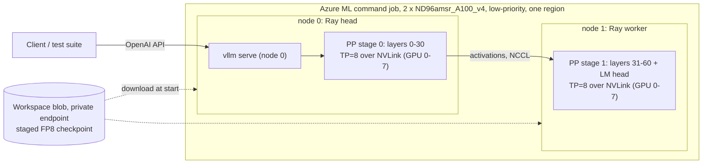

# A.X-K2 서빙 설계: A100에서의 표준 멀티노드 추론

스냅샷: 2026-10-04. 이 문서는 A100 경로에 대해 [인수인계 문서](HANDOFF.md)의
"blocked" 결론을 대체한다. 각 단계의 결과는 8절과 `evidence/`에 있다.
[VLLM_CONFIGS.md](VLLM_CONFIGS.md)는 이 문서에서 서빙한 모든 vLLM 구성을
데모의 운영 상태와 함께 하나의 카탈로그로 모은다.

## 1. 방법 검토: 이전 접근의 문제

**GPU 클러스터 도구는 여러 GPU를 하나의 큰 GPU로 합치지 않는다.** Slurm, Ray,
Kubernetes(KubeRay, LeaderWorkerSet, KAITO), CycleCloud, Azure ML은
*노드를 할당하고 프로세스를 시작할 뿐이다*. "하나의 모델, 하나의 엔드포인트"
경험은 분산 **추론 엔진**(vLLM, SGLang, TensorRT-LLM)이 만든다. 엔진은
tensor/pipeline/expert parallelism으로 가중치를 샤딩하고, NCCL로 activation을
옮긴다(노드 안에서는 NVLink, 노드 사이에서는 InfiniBand/Ethernet). 그리고
continuous batching과 paged KV cache로 하나의 OpenAI 호환 API를 서빙한다.
"하나의 큰 GPU"로 마케팅되는 랙 스케일 시스템도 내부에서는 모델 병렬화를 실행한다.

SKT는 A.X-K2를 정확히 이 방식으로 서빙한다. SKT의 fork에는
`k2_dsa_test/scale_ab/serve_k2.sbatch`가 있다. 이 스크립트는 Slurm `srun`과
pyxis/enroot 컨테이너 이미지로 8xB300 노드 1대에서 `vllm serve --tensor-parallel-size 8`을
실행한다. SKT는 DP+EP 대신 TP를 의도적으로 선택했다. long-context 평가에서
DP/EP lock-step이 멈췄기 때문이다.

이 저장소의 이전 작업(`experiments/axk2_dist_*`)은 block runtime을 직접 작성했다.
FP32로 dequantize한 가중치, 자체 loader, 블록마다 한 번의 blocking NCCL
send/receive를 썼고, batching, paged KV cache, API는 없었다. 이것은 SM80용
sparse-attention 커널이 없는 문제를 피하기 위한 정확성 우회책이었고, **서빙 방법이
아니다**. 지금은 수치 오라클로만 유지한다.

이 설계가 따르는 모범 사례는 다음과 같다.

- 하나의 엔드포인트 뒤에 하나의 엔진 프로세스 그룹을 둔다. 일반적인 멀티노드 배치는
  **tensor parallel = 노드당 GPU 수**(NVLink), **pipeline parallel = 노드
  수**이다(vLLM parallelism 문서, KAITO 멀티노드 프리셋, 2 x 8 A100에서 TP8 x PP2로
  Qwen3-235B를 서빙하는 Azure `inference-toolkit` 샘플).
- 모든 노드에 동일한 컨테이너 이미지와 모델 경로를 둔다. Ray(또는 Slurm, LWS)는
  그룹을 구성하는 역할만 한다.
- **하나의 리전, 하나의 네트워크 패브릭을 쓴다.** 여러 리전의 쿼터를 모아 하나의
  모델을 구성하는 방식은 실현 가능하지 않다. 모든 디코드 스텝이 pipeline stage마다
  한 번씩 WAN을 건너야 하고, 어느 한 곳에서 eviction이 발생하면 엔진 전체가 멈춘다.
  서로 다른 리전은 로드 밸런서 뒤의 별도 *replica*를 호스팅할 수 있지만, 하나의 모델을 호스팅할 수는 없다.

## 2. 쿼터 증설 없이 확보한 용량

| 풀 | 이 구독의 한도 | 허용되는 A100 80GB 노드 |
| --- | --- | --- |
| VM 쿼터, A100 패밀리(확인한 모든 리전) | 0 vCPU | 0 |
| VM Spot 쿼터 | 리전당 100 vCPU, 증설 요청은 throttle됨(429) | 1 x ND96amsr (96 vCPU) |
| **Azure ML low-priority 컴퓨트** | **리전당 300 vCPU, 패밀리별 상한 없음** | **3 x ND96amsr_A100_v4 (24 GPUs)** |

`Standard_ND96amsr_A100_v4`(8 x A100 80GB, NVLink, InfiniBand)는
swedencentral, westus2, uksouth, francecentral, italynorth, polandcentral에서
Azure ML low-priority를 지원한다. 노드 2대(192 vCPU, 16 GPUs,
1280 GB)는 약 656 GiB의 FP8 가중치를 GPU당 약 41 GiB로 담고, KV cache를 위한
여유를 남긴다. SKT의 4-bit NVFP4 체크포인트(371 GiB)는 노드 1대에 들어간다(8.4).
Azure ML은 2026-03-31에 low-priority VM을 폐지했다. 이런 클러스터는 이제
**Spot**으로 할당되고 과금된다. 선점될 수 있고, pay-as-you-go 가격을 넘지 않으며,
가격 상한은 설정할 수 없다. Sweden의 Spot 요금은 노드-시간당 USD 10.55였다.
`evidence/azure-capacity-snapshot.json`을 참조한다.

## 3. 아키텍처

| 계층 | PoC 선택 | 프로덕션 대응 |
| --- | --- | --- |
| 용량 | Azure ML compute cluster, low-priority ND96amsr x 2, 최소 0 노드 | 고객 구독에서 같은 SKU를 on-demand/reserved로 사용 |
| 오케스트레이션 | AML command job 1개, `distribution: pytorch`, 노드당 프로세스 1개. 스크립트가 Ray head/worker를 시작 | AKS + KubeRay 또는 LeaderWorkerSet(KAITO), 또는 CycleCloud Slurm |
| 엔진 | vLLM 0.23.0 + SKT fork + TRITON_MLA_SPARSE 포트(5b절), `--tensor-parallel-size 8 --pipeline-parallel-size 2 --distributed-executor-backend ray` | 같은 명령과 이미지 |
| SM80 커널 | FP8 weight-only Marlin(linear와 MoE). Native DSA: Triton MQA-logits indexer + Triton sparse MLA. Dense 모드: Triton MLA 디코드, FlashAttention-2 MLA 프리필 | 같음. Hopper/Blackwell은 native FP8 및 DSA 커널 사용 |

파일: `aml/src/entry.sh`(노드별 launcher), `aml/jobs/*.yml`
(job 템플릿), `aml/render_job.py`, `aml/fetch_results.py`, `aml/Dockerfile`.

## 4. 엔진 이미지: stock vLLM과 해시 검증된 fork 소스

SKT fork `axk2-v0.23.0` @ `023bc760`은 upstream `v0.23.0` @ `0fc695fc`에
29개 커밋(47개 파일)을 더한 것이다. 유일한 CUDA 변경은 `cache_kernels.cu`의
UE8M0 tile-scale 반올림이다. 이 변경은 SM100 또는 `VLLM_DS_MLA_UE8M0_SCALE`로
게이트되어 있어 A100에서는 실행될 수 없다. 수정된 Python 파일 21개는 모두 릴리스된
vLLM 0.23.0 wheel과 fork base에서 바이트 단위로 동일하다. 따라서 fork Python 파일
25개를 `vllm/vllm-openai:v0.23.0-cu129` 위에 복사하면 CUDA 재빌드 없이 fork의
Python 트리를 정확히 재현한다. `aml/src/apply_overlay.py`는 설치된 버전,
각 base 파일 해시, 다운로드한 각 fork 파일 해시, AXK2 등록
(`aml/src/overlay_manifest.json`)을 확인한다. `aml/Dockerfile`은
프로덕션 레지스트리용으로 같은 단계를 이미지에 굽는다. CUDA 12.9 이미지 변형을
쓰는 이유는 CUDA 12 minor-version 호환성 덕분에 오래된 호스트 드라이버에서도 실행되기
때문이다. 기본 0.23.0 이미지는 CUDA 13을 대상으로 한다.

첫 실제 실행에서 A100 전용 변경 2개가 나왔다.

- **vLLM 0.23에서 Ray는 선택 사항이며** 이미지에 없다. launcher는 vLLM 프로세스가
  시작되기 전에 `ray[cgraph]`를 설치한다(문서화된 단계).
- **MLA chunked-context 프리필의 Ampere FP8 버그(upstream v0.23.0에도 있음).**
  SM80에서는 FP8 가중치가 Marlin을 통해 실행되고, Marlin은
  `kv_b_proj.weight`를 int32 타일로 repack한다. 그러면
  `_compute_prefill_context`의 dtype guard가 BF16 activation을 int32로 cast하고,
  캐시된 context에서 이어지는 첫 프리필(chunked된 긴 프롬프트 또는 prefix-cache
  hit)에서 `marlin_gemm`이 ``unsupported `a` scalar_type``으로 실패한다.
  Hopper는 가중치가 FP8로 유지되므로 영향을 받지 않는다. `apply_overlay.py`는
  각 anchor가 정확히 한 번 나타나는지 확인한 뒤, 두 위치 모두에서 floating이 아닌
  가중치 dtype에 대해 cast를 건너뛴다. 다른 GPU에서의 FP8/BF16 동작은 바뀌지 않는다.

## 5. Dense 모드: DSA 커널 없이 DSA 체크포인트 실행

fork의 DeepSeek 방식 sparse attention(DSA) indexer와 sparse MLA
커널은 SM90/SM100(FlashMLA sparse, DeepGEMM)이 필요하다. fork는
dense 모드도 지원한다. `vllm/transformers_utils/configs/axk2.py`는
`index_topk`, `index_n_heads`, `index_head_dim`이 있을 때만 indexer를 붙이고,
그렇지 않으면 model loader가 indexer 텐서를 건너뛴다("so a DSA checkpoint can be
served as a plain AXK2 model"). `aml/src/make_dense_dir.py`는 모든
체크포인트 파일을 symlink하고 이 세 키를 뺀 config를 작성한다.

DSA에서 위치 *p*의 query는 보이는 *p + 1*개 key 중 상위 `index_topk` = 2048개에
attend한다. *p + 1* <= 2048인 동안에는 모든 key가 선택되므로, DSA와
dense causal attention은 **같은 함수**이다. context가 2048 토큰을 넘으면
dense 모드는 학습된 모델보다 더 많은 key에 attend한다. 이것은 근사이며 품질을
측정해야 한다(SKT는 AA-LCR, RULER, NIAH로 평가한다). DeepSeek도 프로덕션에서
같은 항등성을 쓴다: "for short-sequence prefilling, we specially implement a masked MHA mode to
simulate DSA"(DeepSeek-V3.2-Exp report).

## 5b. A100에서의 Native DSA: TRITON_MLA_SPARSE 포트

이제 dense 모드만이 유일한 선택지는 아니다. upstream vLLM PR
[#38476](https://github.com/vllm-project/vllm/pull/38476)(open 상태, merge되지 않음.
작성자 본인의 설명: "a concept")은 A100에 없는 것을 추가한다.

- `TRITON_MLA_SPARSE`: 순수 Triton sparse MLA backend이다. 선택된 상위 k개의
  latent KV 항목에 대해서만 정확히 MQA를 계산하고, split-KV 디코드를 쓴다.
- lightning indexer(프리필 및 paged 디코드)용으로 DeepGEMM의 FP8 MQA logits를
  Triton으로 구현한 것이다. SM80에는 FP8 tensor core가 없으므로 FP8 key는
  커널 안에서 디코딩한다.
- DeepGEMM이 지원되지 않는 곳에서 절대 호출되지 않게 하는 dispatch guard이다.

이 PR은 2026년 3월의 vLLM main을 기준으로 작성되었고, SKT fork는
v0.23.0(6월)이다. `git apply --3way`는 `sparse_attn_indexer.py`를 제외하고 깨끗하게
적용되었다. 그 파일에서는 v0.23의 XPU 분기와 PR의 Triton 분기를
XPU, DeepGEMM, Triton 순서로 병합했다. guard 하나를 추가했다.
PR은 Hopper도 쓰는 우선순위 목록에서 `TRITON_MLA_SPARSE`를 `FLASHMLA_SPARSE`보다 앞에
두었다. 그래서 이제 이 backend는 SM90/SM100을 거부하고, 이들은 native 커널을
유지한다. `aml/src/dsa_port.json`은 그 결과를 기록한다. 여기에는 PR 커밋에서
다운로드하고 해시를 확인한 새 파일 5개와, 수정된 파일 5개에 대한 정확한 context
diff가 있으며, 각 diff에는 예상 before-hash와 after-hash가 있다. v0.23 + fork 파일에
오프라인으로 적용하면 이 포트는 병합된 git tree와 바이트 단위로 동일하다.

v0.23과의 상호작용 확인 결과는 다음과 같다.

- backend가 확장하는 XPU sparse base class는 3월 이후 바뀌지 않았다.
- AXK2의 indexer는 같은 `SparseAttnIndexer` op와 64개 head를 쓴다(padding 없음).
- 4D indexer cache view와 2D `seq_lens`는 PR의 base에 이미 있었다.
- `persistent_topk`(디코드 top-k)는 SM70만 필요하다. PR에 보고된 long-context
  hang은 v0.23 이전에 upstream #41444로 수정되었다.
- 이후의 수정 #49139는 v0.23 wheel에 없다. 이 수정은 32K 토큰보다 긴 시퀀스 2개가
  같은 CTA group 안에서 더 짧은 시퀀스 1개를 사이에 두고 스케줄되는 디코드 배치에
  영향을 준다. needle 테스트는 요청을 한 번에 하나씩 보내고, 8.1의 throughput
  sweep 각 지점은 하나의 입력 길이로 된 요청만 배치하므로, 긴 시퀀스 사이에 짧은 시퀀스가 놓이지 않는다.
- 포트는 `TRITON_MLA_SPARSE`에 대해 batch invariance도 선언하며,
  `VLLM_BATCH_INVARIANT=1`일 때 KV split 1개를 쓴다. A100에서는 이 경로에 도달할 수 없다.
  이 모드를 지원하는 FP8 MoE 커널이 없기 때문이다(8.1).

native 모드에서는 SKT 체크포인트와 config를 **변경 없이** 서빙한다. config를
수정하지 않고, indexer 가중치도 로드한다. 모든 layer는 B300과 같은 규칙으로 query마다
상위 2048개 key를 선택한다. 다만 커널과 그 산술이 다르므로, 값이 거의 같은 개별 key는
여전히 다르게 선택될 수 있다.

## 5c. 레퍼런스 단일 노드 배포와의 차이

레퍼런스는 모델 카드 명령 `vllm serve skt/A.X-K2
--tensor-parallel-size <N> --tool-call-parser hermes --reasoning-parser
deepseek_v3`이며, 4 x B300에서 검증되었다. SKT 자체 스크립트는 이 모델을
8 x B300 노드 1대에서 TP8, `fastsafetensors`, `--max-model-len 131072`, 그리고
BF16 KV-cache 기본값으로 서빙한다. 이 레퍼런스와의 모든 차이는 다음과 같다.

| 영역 | 레퍼런스(B300/H100급 노드 1대) | 이 A100 배포 | 영향 |
| --- | --- | --- | --- |
| 가중치, config, tokenizer, chat template, 모델 코드 | 체크포인트 4237c6a6, SKT fork `axk2.py` | 같은 파일, 수정 없음(native 모드) | 없음 |
| Linear 및 MoE matmul | FP8 tensor core에서 FP8 x FP8(block-scaled W8A8) | FP8 가중치를 커널 안에서 확장, BF16 activation(Marlin W8A16). A100에는 FP8 tensor core가 없음 | 가중치 메모리는 같음. activation은 양자화되지 않음. compute-bound일 때 더 느림. 비트 단위로 동일하지 않음 |
| Indexer 점수 | DeepGEMM FP8 MQA logits | 같은 FP8 양자화 q/k에 대한 Triton 커널, BF16 dot, FP32 누산(PR #38476) | 입력과 규칙은 같고 커널은 다름 |
| Top-k 선택 | `persistent_topk` | 같은 커널 | 없음 |
| 선택된 2048개 key에 대한 sparse MLA | FlashMLA / FlashInfer sparse | Triton sparse MLA(PR #38476, upstream 미병합) | 같은 계산. 더 느림. upstream 지원 대상 아님 |
| KV cache | 기본 BF16, FP8(`fp8_ds_mla`) 선택 가능 | BF16만 | FP8-KV 메모리 절감 없음. cache는 모든 TP rank에 복제되므로 16 x A100이 673,792 토큰(native)을 담으며, 긴 입력에서 동시성을 제한함(8.1) |
| 엔진 코드 | vLLM 0.23 + SKT fork | 같음. 여기에 PR 포트와 `mla_attention.py`의 2줄 A100 수정 추가 | 수정이 없으면 A100에서 서버가 crash함 |
| 병렬화 | 노드 1대, TP 4 또는 8, multiprocessing executor | 노드 2대, TP8 x PP2(layer 0-30 / 31-60), Ray | 스텝마다 네트워크 hop 1회. 어느 노드든 잃으면 서비스가 멈춤 |
| 노드 간 네트워크 | 해당 없음 | GPUDirect RDMA를 쓰는 InfiniBand 위 NCCL: GPU 쌍당 20.6 GB/s(TCP: 0.35 GB/s). 처음 두 실행은 TCP를 사용 | PP2 디코드에서는 영향 없음. 노드 간 TP에는 필수 |
| Tool calling | `--tool-call-parser hermes` | 같은 parser에 `--enable-auto-tool-choice` 추가. 두 모드 모두 9/9 케이스 정답(8.1) | 추가 플래그가 없으면 vLLM은 `tool_choice: auto` 호출을 `content` 안의 raw `<tool_call>` 텍스트로 반환함. 이는 레퍼런스 명령에도 해당함 |
| Context 길이 | 추가 플래그 없이 256K | `max_model_len` 262,144. SKT의 needle 테스트 252,728 토큰까지 9/9(native) | Dense 모드는 126K 또는 253K 토큰에서 needle을 하나도 찾지 못함 |
| Loader 및 한도 | `fastsafetensors`, 시퀀스 64개 | 기본 loader. 시퀀스 64개. 스텝당 batched 토큰 8,192개로 vLLM의 B200 기본값(A100 기본값은 2,048) | 로드 시간에만 영향 |
| 결정성 | 기본적으로 batch-invariant 아님 | 같음. 그리고 A100에서는 batch-invariant 모드를 시작할 수 없음: 이를 지원하는 SM80용 FP8 MoE 커널이 없음(8.1) | 동일한 greedy 요청이 68-264자 이후 갈라짐 |
| Speculative decoding | `skt/A.X-K2-EAGLE3` drafter: tech report Fig. 8 기준 +23-30% | 사용 불가: EAGLE3는 PP와 함께 실행할 수 없고, TP16에서는 A100 MLA 디코드 커널이 multi-token draft를 검증할 수 없음(8.1) | A100에서는 속도 향상 옵션이 없음 |
| 4-bit 가중치 | 4 x B200에서 `skt/A.X-K2-NVFP4`: routed expert가 FP4 tensor core에서 W4A4 | 이 2노드 배포에서는 사용하지 않음. 이 체크포인트는 upstream vLLM 변경을 backport한 뒤 A100 노드 1대에서 실행됨. 이때 expert는 W4A16으로 실행됨(8.4) | 1노드 NVFP4 옵션은 짧은 입력에서 거의 같은 속도로 GPU를 절반만 씀. 한계는 8.4에 정리 |
| 품질 근거 | SKT가 공개한 평가 | 기능 probe, 253K 토큰까지의 needle, tool call, 2-layer log-probability 비교 | 벤치마크 동등성은 측정하지 않음 |
| 속도 | Tech report Fig. 7: B200 노드 1대, 동시성 32, 출력 1K | 16 A100에서 같은 벤치마크: 1K-8K 입력에서 B200 노드의 0.43-0.51x, 16K-120K에서 0.10-0.36x(native) | 짧은 입력에서 GPU당 B200 throughput의 약 4분의 1. 긴 입력에서는 더 낮음. 1노드 NVFP4 옵션은 GPU당 약 절반에 도달함(8.4) |

**체크포인트 revision.** `skt/A.X-K2`의 Hub 이력이 재작성되었다.
revision 2287ca45는 2026-10-20에 404를 반환했고, `main`의 커밋 17개 중에도 없다.
데모 job은 이제 4237c6a6을 고정한다. 2287ca45의 staging 기록 3개는
파일 355개와 694,408,282,999 바이트를 나열하며, 4237c6a6도 `stage_weights.py` 파일
필터 기준으로 합계가 같다. 2287ca45에 대해 기록된 shard sha256 값 9개
(shard 00001-00007, 00345, 00346)도 모두 일치한다. 최신 head인 d0805cfd(2026-10-20)는
4237c6a6과 `README.md` 및 `generation_config.json`에서만 다르다. 후자에서는 기본
temperature가 0.6에서 0.9로 바뀐다. 그래서 데모는 서빙 기본값을 유지하기 위해
4237c6a6에 머문다. 실험 job 템플릿, `aml/src/hub_probe.py`, evidence 파일은
측정 당시의 revision인 2287ca45를 여전히 가리킨다. 이들은 4237c6a6으로
다시 실행해야 한다.

`persistent_topk` 수정 #49139는 SKT 자체 fork를 포함한 모든 vLLM 0.23 빌드에 없다.
따라서 A100 고유의 공백이 아니다.

**1노드 NVFP4 변형(8.4).** SKT의 4-bit 체크포인트는 다음 행을 바꾼다.
나머지 행은 표와 같다.

- 가중치: `skt/A.X-K2-NVFP4` revision 9e2e804e(398 GB), 수정 없음.
- MoE matmul: NVFP4 routed expert는 BF16 activation으로 실행된다(Marlin
  W4A16). B200은 이를 FP4 tensor core에서 W4A4로 실행한다. FP8 layer는
  표와 같이 실행된다.
- 엔진 코드: backport한 capability check도 포함한다(`NVFP4_SM80_PORT=1`).
- 병렬화와 네트워크: 노드 1대, TP8, multiprocessing executor. 노드를 건너는 것은
  없다.
- KV cache와 context: batched 토큰 8,192개에서는 254,016 토큰이므로
  context가 그 값으로 auto-fit된다. 2,048개에서는 272,960 토큰이므로 전체 262,144가 들어간다.
- 속도: 동시성 32까지는 16 A100의 FP8 체크포인트만큼 빠르고,
  64-128에서는 0.81-0.86x이며, 프리필은 더 느리다.

## 6. 구독 정책 제약(MCAPS)

`modify` effect가 있는 management-group Azure Policy가 모든 storage
account를 `publicNetworkAccess=Disabled`와 `allowSharedKeyAccess=false`로 강제한다.
이 설계는 정책 안에서 동작하며 정책을 우회하지 않는다.

- Workspace managed VNet(`allow_internet_outbound`)과 blob, file, Key Vault로의
  private endpoint를 쓴다. system datastore는 identity 모드이다. 각
  compute cluster는 system-assigned identity를 가지며, workspace storage account에
  대해서만 Storage Blob Data Contributor 권한을 가진다.
- CLI는 VNet 밖에서 `code:` 스냅샷을 업로드할 수 없고, Batch는
  매우 긴 명령줄을 거부한다. `aml/render_job.py`는 `aml/src`를
  `AXK2_SRC_B64` 환경 변수(base64 tar.gz)에 넣는다. AML은 전체 docker 인자 크기
  (환경 변수와 명령의 합)에도 상한을 둔다. base64 약 62K는 동작했고, 약 91K는
  `ArgumentTooLong`으로 실패했으며, 이 오류는 실행의 RunHistory `/details`에만 표시되었다.
  그래서 데모 job은 대신 frontend에서 tarball을 다운로드하고(`GET /api/link/src`, job token)
  `AXK2_SRC_SHA256`을 확인한다.
- Artifact는 private storage에 남는다. Job은 JSON 요약과
  zlib 압축된 위치별 시계열을 chunked MLflow tag로 보고한다(ASCII-escape,
  호출당 최대 90개 tag, 재시도 포함). 이 값은 workspace API를 통해
  `aml/fetch_results.py`로 읽는다. `aml/jobs/peek-run-logs.yml`과
  `collect-run-outputs.yml`은 VNet 안에서 job의 스트리밍 로그 또는 완료된 출력을
  읽는다.

## 7. 검증 단계

| 단계 | 증명하는 것 | 비용 |
| --- | --- | --- |
| A. CPU tiny AXK2 (`experiments/validate_dense_equivalence.py`) | 프리필과 캐시된 디코드에서 `index_topk` 이내일 때 Dense == sparse. 그 이상에서는 갈라짐 | 없음 |
| B1. 2-layer 실제 가중치 cut, CPU에서 공식 Transformers FP32 sparse, 최대 7,166 토큰 프롬프트 | SKT 자체 모델 정의에서 얻은 레퍼런스 log-probability | CPU 수 분 |
| B2. A100에서 PR #38476 Triton 커널 테스트 | 포팅한 indexer-logits 및 sparse-MLA 커널을 각 레퍼런스와 비교 | 수 분 |
| B3. 대상 노드에서 같은 cut: vLLM native DSA와 dense, 단일 노드 TP8, 이어서 Ray 위 native TP8 x PP2 | 실제 가중치에서 정확한 launch 경로, overlay, DSA 포트, SM80 커널 확인. `index_topk` 이내와 그 이상에서 B1과의 일치 | C 할당 중 수 분 |
| C. 2 x ND96amsr_A100_v4에서 전체 모델, TP8 x PP2, native와 dense | 61개 layer 전체 로드 및 서빙. 기능, 추론, 정확도, 결정성, 60K 토큰까지의 needle, latency 및 throughput sweep | 시간당 약 USD 26 |
| D. 같은 할당에서 서버 구성 6개를 순서대로 실행(`verify-remaining-nd96-hub.yml`) | InfiniBand 대 TCP. tool calling. 256K까지 SKT의 needle 테스트. batch-invariant 모드 유무에 따른 결정성. tech report의 Fig. 7 sweep. TP16과 EAGLE3 | 약 4.7시간 |
| E. ND96amsr_A100_v4 1대에서 SKT의 NVFP4 체크포인트, TP8(`nvfp4-a100-nd96.yml`) | capability-check 포트. 기능, tool, auto-fit된 context까지의 needle, 절반의 GPU로 C latency 표와 Fig. 7 sweep | 노드 1대로 약 2.1시간 |

`aml/jobs/native-dsa-bench-nd96-hub.yml`은 B2, B3, C를 하나의 할당에서 실행한다.
B2와 B3가 실행되는 동안 두 노드는 백그라운드에서 Hub의 전체 체크포인트를 다운로드한다.
`aml/jobs/full-native-dense-nd96-hub.yml`은 C만 실행한다. Spot
용량이 부족했으므로, 같은 job을 최대 12개 리전에 큐잉했다.
`aml/first_capacity_wins.sh`는 두 노드를 모두 확보한 첫 리전을 선택하고,
다른 job을 모두 취소하며, 이미 노드를 확보한 나머지 클러스터를 삭제한다.
1노드 `nvfp4-a100-nd96.yml`은 `NODES=1`로 실행한다.

## 8. 결과

### 8.1 검증 실행: 미해결 항목과 기술 보고서의 속도 (2026-10-03, uksouth)

근거: `evidence/a100-verification-and-doc-speed.json`. 작업
`aml/jobs/verify-remaining-nd96-hub.yml`은 동일한 2 x ND96amsr_A100_v4의
Spot 할당 하나에서 실행했다. 전체 모델을 여섯 가지 구성으로 차례로 서빙했다.
각 구성은 하나의 OpenAI 호환 엔드포인트였다. 모든 구성은 모델 카드의 parser와
`--enable-auto-tool-choice`를 사용했고, step당 batched token은 8,192개였다.

| 항목 | 결과 |
| --- | --- |
| 노드 간 InfiniBand | 동작한다: GPUDirect RDMA로 GPU 쌍당 20.6 GB/s (TCP: 0.35 GB/s). 시작에 성공한 모든 구성이 사용했다 |
| Tool calling, 9개 케이스, native와 dense | 두 모드 모두 9/9 정답 |
| 32K / 128K / 256K에서 SKT의 needle 테스트, native | 9/9 |
| 같은 테스트, dense | 32K에서 3/3, 128K와 256K에서 **0/6** |
| 결정성, 기본 kernel | 동일한 greedy 요청이 68-264자 뒤에 갈라진다 |
| Batch-invariant 모드 | **A100에서 시작할 수 없다** |
| 기술 보고서 Fig. 7 조건, native | 1K-8K 입력에서 B200 노드 1개의 0.43-0.51x, 16K-120K에서 0.10-0.36x |
| 두 노드에 걸친 TP16, dense | 1K-8K 입력에서 TP8 x PP2보다 12-41% 빠르다. KV cache는 절반이다 |
| EAGLE3 drafter | 사용할 수 없다: CUDA graph 시작이 실패한다. eager fallback은 4-5배 느리고 step당 1.05 token을 수락한다 |
| NVFP4 checkpoint | 여기서는 시도하지 않았고, 불가능하다고 잘못 기술했다: A100 노드 1개에서 실행된다 (8.4) |

**InfiniBand.** 작업 컨테이너는 각 노드의 200 Gb/s InfiniBand HCA 8개를
노출한다. vLLM 이미지에는 RDMA userland가 이미 들어 있다. Memlock은
무제한이다. Azure의 NDv4 NCCL topology 파일은 VM의 모든 GPU와 HCA PCI
주소와 일치했다. 각 노드의 GPU 0 사이 NCCL 결과는 다음과 같다.

| | TCP (처음 두 실행) | InfiniBand, GPUDirect RDMA |
| --- | ---: | ---: |
| 왕복, 작은 메시지 | 454 µs | 122 µs |
| Send/receive, 256 MiB | 0.35 GB/s | 20.6 GB/s |
| All-reduce, 256 MiB | 0.37 GB/s | 18.2 GB/s |

이후 시작에 성공한 모든 구성은 8개 HCA 모두에서 `NET/IB`를 사용했다.
PP2의 디코드는 거의 변하지 않았다. 1K 입력, concurrency 32에서 median TPOT는
72 ms였다. 이전 TCP 실행에서는 77 ms였다 (그때 출력 token은 256개였다).
디코드 step마다 stage들은 batch의 새 token에 대한 hidden state와 residual만
교환한다. 그리고 디코드는 각 GPU의 MoE weight 읽기에 묶여 있다. InfiniBand는
프리필에서 중요하다. 프리필에서는 8,192-token chunk 하나가 stage 사이에서
hidden state와 residual 235 MB를 옮긴다 (TCP로 0.67 s, IB로 11 ms).
InfiniBand는 노드에 걸친 TP16을 실현 가능하게 만드는 요소이기도 하다.

**Tool calling.** 모델 카드 명령은 `--tool-call-parser hermes`를 설정하지만
`--enable-auto-tool-choice`는 설정하지 않는다. 이 flag가 없으면 vLLM 0.23은
`tool_choice: "auto"`에서 parser를 건너뛴다. 이것은 tool을 보낼 때의
기본값이다. 그 결과 `<tool_call>` 블록을 `content`의 텍스트로 반환한다
(`chat_completion/serving.py:1095`). Named tool choice와 `required` tool
choice는 여전히 동작한다. 이 flag를 켜면 두 모드 모두 아홉 케이스를
처리했다:

- 한국어 단일 호출;
- 병렬 호출 두 개 (서울, 부산);
- 인자 세 개;
- thinking과 호출, reasoning이 분리됨;
- tool이 필요 없음;
- tool 결과를 받은 후속 turn;
- streaming;
- named tool;
- `required`.

자동 검사는 "tool이 필요 없음" 케이스를 실패로 표시했다. 모델이 "서울" 대신
"Seoul"로 답했기 때문이다. 모델은 호출을 하지 않았고 답도 맞다. 이제 검사는
두 표기를 모두 허용한다.

**긴 context.** 여기서는 SKT의 자체 needle 테스트를 사용한다
(`examples/vllm/niah_test.py`, needle, filler, 질문, 깊이, 코드가 동일하다).
요청은 한 번에 하나씩 보냈고 thinking은 껐다:

| Prompt token | Native: 찾음 | Native: 요청당 초 | Dense: 찾음 | Dense: 초 |
| ---: | ---: | ---: | ---: | ---: |
| 31,597 | 3/3 | 6-9 | 3/3 | 2-4 |
| 126,368 | 3/3 | 38-52 | **0/3** | 13-18 |
| 252,728 | 3/3 | 125-167 | **0/3** | 39-52 |

126K와 253K token에서 dense 모드는 filler 문장으로 답했다. 모델이 학습한
2,048-key 선택이 없으면 attention이 prompt 전체로 퍼진다. 8.2의 60K까지
12/12 needle 결과와 합치면, dense 모드는 약 60K token의 context까지만 사용할
수 있다. 그 이상에서는 native DSA가 필요하다.

**결정성.** 동일한 greedy 200-token 요청, 기본 kernel, native 결과:

- 두 번째 새 실행은 107번째 문자에서 처음 달라진다;
- prefix-cache hit는 264번째 문자에서 처음 달라진다;
- 16개 batch 안의 실행은 68번째 문자에서 처음 달라지고, 두 batch
  실행끼리도 서로 다르다.

Bitwise 재현성에는 vLLM의 batch-invariant 모드가 필요하다. 이 모드는 이
모델에서 A100에서 "No FP8 MoE backend supports the deployment
configuration" 오류로 시작에 실패한다 (`fused_moe/oracle/fp8.py:417`). 이
모드에서 vLLM은 batch invariance를 선언한 MoE kernel만 남긴다
(`fused_moe/modular_kernel.py:577`). 그런 kernel은 Triton MoE kernel 하나뿐이다
(`experts/triton_moe.py:125`). 그리고 그 FP8 경로는 compute capability 8.9가
필요하다 (`platforms/cuda.py:546`). A100의 Marlin W8A16 MoE kernel은 조건을
충족하지 않는다. 따라서 attention 포트에 추가한 batch-invariance 연결은
A100에서 도달할 수 없다.

**기술 보고서 조건에서의 속도.** 기술 보고서 Fig. 7은 B200 노드 1개(GPU 8개)에서
vLLM bench serve를 측정한다. 조건은 random dataset, concurrency 32, 출력
token 1,024개, FP8 weight, BF16 KV cache다. 여기서는 같은 client 명령을
16 x A100에서 실행했다. Total tok/s는 입력과 출력을 합해 센다. 따라서 출력
기준 비율도 동일하다.

| 입력 token | B200 노드 (Fig. 7) | A100 native | 비율 | A100 dense | 비율 | 실행 중 요청, native / dense |
| ---: | ---: | ---: | ---: | ---: | ---: | ---: |
| 1,024 | 1,900 | 815 | 0.43 | 980 | 0.52 | 32 / 32 |
| 2,048 | 2,700 | 1,165 | 0.43 | 1,457 | 0.54 | 32 / 32 |
| 4,096 | 3,600 | 1,699 | 0.47 | 2,202 | 0.61 | 32 / 32 |
| 8,192 | 4,800 | 2,424 | 0.51 | 3,070 | 0.64 | 32 / 32 |
| 16,384 | 6,300 | 2,275 | 0.36 | 3,637 | 0.58 | 32 / 32 |
| 32,768 | 8,200 | 1,930 | 0.24 | 3,331 | 0.41 | 20 / 23 |
| 65,536 | 10,600 | 1,535 | 0.14 | 3,242 | 0.31 | 10 / 11 |
| 120,000 | 12,300 | 1,184 | 0.10 | 2,802 | 0.23 | 5 / 6 |

- **8K 입력까지는 A100 16개가 B200 노드 1개의 약 절반을 낸다.** GPU당으로는
  약 4분의 1이다. A100에는 FP8 tensor core가 없다. 그래서 FP8 weight는
  Marlin W8A16 kernel로 실행된다. Concurrency 32의 디코드는 MoE weight 읽기에
  묶여 있다: native median TPOT는 72-109 ms다. B200 수치로 추정하면 약
  33 ms다.
- **16K부터는 두 가지 이유로 격차가 커진다.**
  - *KV 용량.* MLA cache는 모든 tensor-parallel rank에 복제된다.
    그래서 GPU 16개가 담는 token은 673,792개(native) 또는 766,032개(dense)다.
    SKT의 모델 카드는 4 x B300에서 약 968K token을 보고한다. 32K 입력에서는
    32개 요청 중 20개만 들어가고, 64K에서는 10개, 120K에서는 5개만 들어간다.
    나머지는 대기열에 들어간다: native median TTFT는 225 s, 665 s,
    1,646 s다.
  - *Indexer.* A100에서 DSA indexer는 DeepGEMM FP8 대신 BF16 Triton kernel로
    실행되고, 모든 TP rank에 복제된다. 그 프리필 비용은 입력 길이의 제곱으로
    늘어난다.
- **Dense는 모든 길이에서 native보다 1.2-2.4배 빠르다.** 그러나 긴 context
  검색에는 실패한다 (위 참조).
- **곡선의 모양이 다르다.** Total tok/s는 prompt token을 포함한다. 그래서
  FP8 프리필이 빠른 B200에서는 120K 입력까지 계속 오른다. A100에서는
  indexer의 프리필 비용과 KV 한도 때문에 8K-16K에서 정점을 찍은 뒤
  떨어진다.

**TP16과 EAGLE3 (dense, `max_model_len` 32,768).** TP16은 16개 GPU 전체에
pipeline stage 하나를 실행한다. Tensor-parallel all-reduce는 InfiniBand로
수행한다. EAGLE3가 PP와 함께 실행될 수 없기 때문에 TP16을 사용했다.

| 입력 token | TP8 x PP2 | TP16 | TP16 + EAGLE3 (eager) | B200: Fig. 8 / Fig. 7 |
| ---: | ---: | ---: | ---: | ---: |
| 1,024 | 980 | 1,386 (B200의 0.73x) | 324 | 1.26 |
| 4,096 | 2,202 | 2,638 (0.73x) | 595 | 1.11 |
| 8,192 | 3,070 | 3,449 (0.72x) | 643 | 1.23 |

- **짧은 입력에서 TP16은 TP8 x PP2보다 12-41% 빠르다.** 그 KV cache는
  362,848 token을 담는다. 이는 PP2의 절반이므로 짧은 context에만 적합하다.
- **EAGLE3는 A100에서 이 스택을 빠르게 할 수 없다.**
  - Drafter는 layer 2, 30, 58의 hidden state가 필요하다. 이 layer들은 두 PP
    stage에 걸쳐 있다 (5c).
  - TP16에서 CUDA graph를 사용한 시작은 `assert m.max_query_len <=
    self.reorder_batch_threshold`에서 실패한다 (`mla_attention.py:1827`).
    SM80의 유일한 MLA 디코드 kernel인 TRITON_MLA는 단일 token 디코드만
    선언한다 (`query_len_support` SINGLE_ONLY). 초안 token 3개를 검증하려면
    4-token query가 필요하고, 이는 MLA 프리필 경로로 fallback된다.
  - Eager fallback은 올바르게 서빙했다 (기능 검사 4/4). 그러나 drafter 없이
    CUDA graph로 실행한 TP16보다 4-5배 느렸다.
  - Step당 1.05 token을 수락했다: 초안 token의 1.5%이고, 첫 위치에서는
    2-5%다. 기술 보고서는 같은 유형의 benchmark에서 B200 기준 2.24를 제시한다.
    그 수락률이라 해도 192 ms step은 token당 86 ms가 된다. 이는 일반 TP16의
    43 ms의 두 배다. 그래서 낮은 수락률은 더 조사하지 않았다.
  - Fig. 8의 막대 label은 이 길이들에서 Fig. 7 대비 +11%에서 +26%를 제시한다.
    보고서 본문은 모든 길이에서 23-30%라고 말한다.

**시도하지 않은 항목:**

- NVFP4 checkpoint: vLLM 0.23의 ModelOpt mixed-precision 방식은 compute
  capability 8.9를 요구한다 (`quantization/modelopt.py:2219`). 이 절은 처음에
  이를 하드웨어 부족으로 해석했다. 실제로는 소프트웨어 검사다. 8.4는 upstream
  변경을 backport한 뒤 A100에서 이 checkpoint를 실행한다;
- native sparse 포트에서의 EAGLE3, 소프트웨어 한계: 초안이 있으면 vLLM 0.23은
  token별 sequence 길이를 indexer에 전달한다. 그러나 포트의 디코드 indexer
  kernel은 요청당 길이 하나만 읽는다.

**비용.** 두 노드를 약 4.7시간 점유했다. 중복된 italynorth 할당은 약 6분
점유했다. 따라서 합계는 약 9.6 node-hour다. 이는 low-priority 요금으로 약
USD 80, Spot 요금으로 약 USD 125다 (node-hour당 USD 8.19 또는 12.89.
on demand는 USD 40.96이다). GPU cluster는 21:45Z에, resource group은
22:04Z에 삭제했다.

### 8.2 같은 할당에서 native DSA와 dense 비교 (2026-10-03, italynorth)

모든 단계를 통과했다. 근거: `evidence/a100-native-dsa-2layer-vs-official.json`,
`evidence/a100-native-vs-dense-full-model.json`,
`evidence/a100-native-dsa-deployment-log.json` (실패, 수정, 비용).

**Kernel.** PR #38476의 Triton kernel 테스트 94개가 A100에서 통과한다. vLLM
로그는 사용한 경로를 확인해 준다:

- **Native 모드:** "DeepGEMM not supported on this platform; using Triton
  fallback for sparse attention indexer"와 "Using TRITON_MLA_SPARSE
  attention backend".
- **Dense 모드:** `TRITON_MLA`.
- **두 모드 모두:** linear layer에 `MarlinFP8ScaledMMLinearKernel`, 그리고
  MARLIN FP8 MoE backend.

**실제 weight에서의 정확성.** 바이트 단위로 동일한 2-layer 절단본을 공식
Transformers 구현(FP32, sparse DSA)과 14,618개 prompt 위치에서 비교했다. 그중
7,262개는 7.2K-token 모델 카드 안에서 `index_topk`를 넘어선 위치다. 표는
선택된 token의 평균 |Δ log-probability|를 보여 준다:

| A100의 vLLM | `index_topk` 이내 | `index_topk` 초과 | 초과 구간 최대 |
| --- | ---: | ---: | ---: |
| Native DSA, 노드 1개 TP8 | 0.0116 | **0.0111** | 0.13 |
| Native DSA, 노드 2개 TP8 x PP2 | 0.0120 | **0.0115** | - |
| Dense, 노드 1개 TP8 | 0.0116 | 0.0123 | 0.22 |

`index_topk` 이내에서는 두 모드가 같은 함수를 계산한다. 0.0116은 BF16 대
FP32의 하한이다. 그 너머에서 native는 그 하한에 머물고 dense는 벗어난다.
Dense와 native의 서로 간 차이는 `index_topk` 초과 구간(0.0120)이 이내
구간(0.0051)보다 2.4배 크다. 따라서 native는 학습된 sparse attention을
재현한다. 이 비교는 layer 두 개로 효과의 크기를 가늠한 것이다. 전체 모델은
FP32 CPU reference에서 실행할 수 없다.

**전체 688B 모델, 엔드포인트 1개, 16 x A100 80GB.** 설정: TP8 x PP2,
`max_model_len` 65,536, 최대 128 sequence.

| | Native DSA | Dense |
| --- | --- | --- |
| 시작 후 healthy까지 | 302 s | 171 s |
| GPU당 weight / KV cache | 42.2 GiB / 26.4 GiB | 41.7 GiB / 26.8 GiB |
| KV cache 용량 | 724,544 token | 821,312 token |
| 기능 (한국어/영어, 번역, 코드) | 6/6 | 6/6 |
| Reasoning 모드 | 정답 | 정답 |
| 1.4K / 8K / 30K / 60K token의 needle, 각 3개 깊이 | 12/12 | 12/12 |
| Thinking 없는 산술 | 14/20 | 14/20 |
| 동일한 greedy 요청 두 개가 bitwise 일치 | 아니다 | 아니다 |

산술 오답 여섯 개는 모두 정상 종료(`stop`)했고, 숫자만 틀렸다. 예를 들어
86 x 8 + 83에 761로 답했다. 이는 잘림이 아니라 thinking 없는 모델의 암산
결과다. 같은 유형의 문제는 reasoning 모드에서 정답을 냈다.

아래 속도 결과는 random-token prompt, 출력 token 256개, `--ignore-eos`로
실행한 `vllm bench serve`에서 나온다.

| 시나리오 | Native: 출력 tok/s | Native: median TTFT | Native: median TPOT | Dense: 출력 tok/s | Dense: median TTFT | Dense: median TPOT |
| --- | ---: | ---: | ---: | ---: | ---: | ---: |
| 요청 1개, 1K 입력 | 49 | 355 ms | 19.2 ms | 60 | 199 ms | 15.8 ms |
| 요청 1개, 8K 입력 | 38 | 1.65 s | 20.0 ms | 50 | 0.85 s | 16.7 ms |
| 요청 1개, 32K 입력 | 20 | 7.21 s | 21.1 ms | 31 | 3.33 s | 19.1 ms |
| 1K 입력, concurrency 8 | 216 | 1.51 s | 31.0 ms | 243 | 1.09 s | 28.4 ms |
| 1K 입력, concurrency 32 | 360 | 1.83 s | 76.7 ms | 494 | 0.99 s | 58.1 ms |
| 1K 입력, concurrency 64 | 618 | 1.70 s | 90.3 ms | 707 | 0.76 s | 85.8 ms |
| 1K 입력, concurrency 128 | 812 | 2.94 s | 145.5 ms | 898 | 1.20 s | 132.9 ms |
| 16K 입력, concurrency 4 | 53 | 6.30 s | 43.5 ms | 69 | 4.92 s | 37.5 ms |
| 16K 입력, concurrency 16 | 51 | 25.4 s | 208 ms | 84 | 13.1 s | 140 ms |

두 모드는 정확성과 속도를 맞바꾼다:

- **Native는 학습된 sparse-attention 규칙을 유지한다** (query당 상위 2048개
  key). 이를 대체 kernel로 계산한다. Token당 디코드 비용은 context 1K에서
  32K token까지 거의 일정하다 (19.2에서 21.1 ms). 이는 설계대로다.
  포트는 아직 최적화되지 않은 Triton이다. PR 작성자는 이를
  "a concept"라고 부른다.
- **A100에서 dense는 10-60% 빠르다.** 프리필은 성숙한 FlashAttention-2
  경로를 사용한다. 이 context 길이에서는 디코드 attention 비용이 작다.
  디코드 비용은 context에 따라 늘어난다 (15.8에서 19.1 ms). 그래서 격차가
  줄어든다. Dense는 context token 2,048개까지만 정확하다.

어느 모드를 고를지는 workload에 달려 있다. Native는 reference에 가장 가까운
구성이다. 또한 긴 context에서 정보를 찾아내는 유일한 구성이다: 8.1에서 dense
모드는 126K나 253K token에서 needle을 하나도 찾지 못했다. Prompt와 출력의
합이 약 60K token 이내라면 dense를 정당화할 수 있다.

### 8.3 첫 전체 모델 실행, dense만 (2026-10-02, italynorth)

근거: `evidence/axk2-dense-equivalence-cpu.json`,
`evidence/a100-2layer-vs-official.json`,
`evidence/a100-full-model-tp8-pp2-results.json`,
`evidence/a100-deployment-attempts.json` (모든 실패와 수정).

**B: 실제 weight, A100의 vLLM 대 공식 Transformers (FP32, sparse DSA).**
약 3,300개 prompt 위치에서 선택된 token의 log-probability:

| vLLM 구성 | Pearson | 평균 절대 차이 | Top-1 일치율 |
| --- | --- | --- | --- |
| 단일 노드, TP8 | 0.99995-0.999996 | 0.008-0.013 | 97-100% |
| 노드 2개, TP8 x PP2 | 0.99998-0.999996 | 0.008-0.013 | 93-100% |

이는 BF16 activation과 FP32 reference 사이에서 예상되는 일치 수준이다. 노드
2개와 단일 노드의 greedy token은 동일했다. 동시 요청 8개도 모두 완료했다.

**C: 전체 688B 모델, 16 x A100 80GB에서 엔드포인트 1개 (2 x ND96amsr, TP8 x PP2).**

- SM80에서 vLLM이 선택한 kernel: linear에 `MarlinFP8ScaledMMLinearKernel`,
  MARLIN FP8 MoE backend, TRITON_MLA 디코드, FLASH_ATTN MLA 프리필. Rank
  0-7은 노드 0에, 8-15는 노드 1에 있다.
- Weight: GPU당 41.7 GiB, page cache에서 약 78 s 만에 load했다 (694 GB
  다운로드는 Hub에서 약 1.1 GB/s로 노드당 약 640 s 걸렸고, B2와 겹쳐 진행했다).
  서버는 시작 181 s 후 healthy 상태가 됐다: engine 초기화는 torch.compile과
  CUDA graph를 포함해 50 s 걸렸다.
- KV cache: GPU당 27.6 GiB, 843,920 token. 이는 8K-token 요청 103개를 동시에
  처리할 수 있는 양이다.

| 테스트 | 결과 |
| --- | --- |
| 한국어/영어 기능 대화, 번역, 코드 | 6/6 정답 |
| Reasoning 모드 (`<think>`) | 정답, reasoning trace 포함 |
| 1,380 token(정확한 DSA 구간) / 5,469 token(dense 근사)의 needle | 찾음 / 찾음 |
| 짧은 thinking 없는 산술, 24-token 상한 | 14/20 (개별 답은 기록하지 않음) |
| 동일한 greedy 요청 두 개 | Bitwise 동일하지 않음 (기본 kernel은 batch-invariant가 아니다) |
| 단일 stream | TTFT 72 ms, 약 75 tokens/s |

합성 부하, 1024-token prompt, 출력 token 128개:

| Concurrency | 출력 tok/s | Total tok/s | Median TTFT | Median TPOT |
| ---: | ---: | ---: | ---: | ---: |
| 1 | 65 | 581 | 198 ms | 14.0 ms |
| 8 | 228 | 2,052 | 917 ms | 26.1 ms |
| 32 | 472 | 4,245 | 984 ms | 57.1 ms |

지출은 약 USD 34였다: 선택된 2-노드 cluster 61분, 취소한 중복 할당 6분,
그리고 CPU 작업이다. 이후 모두 삭제했다. Native-DSA 라운드(8.2)는 약
USD 71이 추가로 들었다. 대부분 italynorth cluster 2.5시간이다. 이것도
삭제했다. 검증 실행(8.1)은 약 USD 80-125가 들었다.

### 8.4 A100 노드 1개에서 SKT의 NVFP4 checkpoint (2026-10-04, uksouth)

근거: `evidence/a100-nvfp4-single-node.json`. 작업
`aml/jobs/nvfp4-a100-nd96.yml`은 SKT의 4-bit checkpoint
`skt/A.X-K2-NVFP4`(revision 9e2e804e, 61개 layer 전체)를 Standard_ND96amsr_A100_v4
**1대**에서 서빙했다: 8 x A100 80GB, TP8, native DSA, OpenAI 호환
엔드포인트 1개. 서버는 두 번 실행했다. step당 batched token은 각각 8,192개와
2,048개였다. 모든 단계를 통과했다.

**정정.** 8.1은 처음에 이 checkpoint가 compute capability 8.9를 필요로 하므로
A100에서 불가능하다고 보고했다. 이는 틀렸다. 8.9는 vLLM 0.23의 소프트웨어
검사다 (`ModelOptMixedPrecisionConfig.get_min_capability()`). 하드웨어 요구
사항이 아니다: checkpoint의 두 종류 quantized layer 모두 이미 SM80 kernel이
있다. Upstream vLLM은
[#45306](https://github.com/vllm-project/vllm/pull/45306)에서 이 검사를 8.0으로
낮췄고, v0.24.0에 출시했다.

**Checkpoint.** ModelOpt mixed precision이며 수정 없이 사용했다. 60개 MoE
layer의 routed expert(linear layer 46,080개)는 NVFP4다: 4-bit, group size 16.
DSA indexer를 포함한 attention, shared expert, layer 0의 dense MLP는 FP8로
남는다. Embedding, LM head, norm, MoE router는 BF16으로 남는다. Checkpoint는
398 GB다. FP8 checkpoint는 694 GB다.

**Engine 변경.** `aml/src/nvfp4_sm80_port.json`은 upstream commit 두 개를 SKT의
vLLM 0.23.0 fork에 옮겨 온다: #45306 전체(capability 89에서 80으로), 그리고
[#45295](https://github.com/vllm-project/vllm/pull/45295)의 `modelopt.py` 한 줄이다.
이 한 줄은 FP8 linear layer에 `layer.orig_dtype`을 설정한다. Marlin FP8 경로가
이 값을 읽는다. #45295의 나머지인 Marlin tile padding은 필요 없다: TP8에서
rank별 행렬 shape는 모두 이미 정렬되어 있다. `apply_overlay.py`는
`NVFP4_SM80_PORT=1`일 때만 포트를 적용한다. 적용 전후에 파일의 SHA-256을
검사한다. 따라서 다른 작업은 변하지 않는다. vLLM 0.24.0 이상에는 두 변경이
모두 들어 있다. SKT의 fork는 아직 0.23.0 기반이다.

**수치 연산.**

| Layer | B200 (SKT: 4 x B200, TP4 + expert parallel) | A100에서의 이 실행 |
| --- | --- | --- |
| Routed expert (NVFP4) | FP4 tensor core에서 W4A4 | Marlin W4A16: 4-bit weight를 kernel 안에서 확장, BF16 activation (`MARLIN` NvFp4 MoE backend) |
| 기타 quantized layer (FP8) | FP8 tensor core에서 W8A8 | Marlin W8A16, 8.1-8.3과 같음 |
| Sparse attention | FlashInfer sparse MLA | `TRITON_MLA_SPARSE` (PR #38476 포트), 8.1-8.2와 같음 |
| KV cache | BF16 | BF16 |

vLLM 로그도 이를 밝힌다: "Your GPU does not have native support for FP4
computation ... Weight-only FP4 compression will be used leveraging the
Marlin kernel." Activation은 quantize하지 않는다. 따라서 산술 정밀도는 같은
4-bit weight에서 B200의 W4A4 경로와 최소한 같다. 그러나 bit 단위로 동일하지는
않다. vLLM은 `W4A16_NVFP4` 감지도 로그에 남긴다. vLLM은 선언된 구성 옆에
항상 그 구성을 함께 만든다 (v0.23.0의 `modelopt.py` 2281-2300행). 이
checkpoint의 expert는 NVFP4를 선언한다.

**결과.**

| 항목 | 결과 |
| --- | --- |
| Hub에서 다운로드 | 398 GB를 404 s에 |
| GPU당 weight | 48.5 GiB (FP8 checkpoint: GPU 16개 각각에 41.7 GiB) |
| 시작 후 healthy까지 | batched token 8,192개로 433 s, 2,048개로 352 s |
| KV cache | batched token 8,192개에서 GPU당 18.53 GiB, 254,016 token. 2,048개에서 19.91 GiB, 272,960 token. FP8 노드 2개: 673,792 token |
| Context 길이 (`--max-model-len -1`, auto-fit) | batched token 8,192개에서 254,016. 2,048개에서 전체 262,144 |
| 기능 검사 (한국어, 영어, 번역, 코드) | 4/4 |
| Tool calling, 8.1의 9개 케이스 | 9/9 |
| 32K / 128K / 256K에서 SKT의 needle 테스트 | 9/9, prompt token 31,597 / 126,368 / 244,898 (256K prompt는 254,016-token context에 맞춰 크기를 정했다) |
| 최대 GPU 메모리 | 각 GPU에서 77,411 MiB (`gpu_memory_utilization` 0.92) |

**16 A100의 FP8 checkpoint 대비 속도.** 명령은 8.2 표의 명령과 같다. 8.2는
batched token 2,048개로 16 A100(TP8 x PP2, TCP 경유)에서 FP8 checkpoint를
서빙했다. 아래 NVFP4 수치도 같은 설정을 사용한다.

| 시나리오 | NVFP4, 8 A100: 출력 tok/s | Median TTFT | Median TPOT | FP8, 16 A100: 출력 tok/s | Median TTFT | Median TPOT | 출력 비율 |
| --- | ---: | ---: | ---: | ---: | ---: | ---: | ---: |
| 요청 1개, 1K 입력 | 49 | 349 ms | 19.0 ms | 49 | 355 ms | 19.2 ms | 1.01 |
| 요청 1개, 8K 입력 | 34 | 2.44 s | 19.7 ms | 38 | 1.65 s | 20.0 ms | 0.90 |
| 요청 1개, 32K 입력 | 15 | 11.56 s | 20.9 ms | 20 | 7.21 s | 21.1 ms | 0.74 |
| 1K 입력, concurrency 8 | 229 | 0.94 s | 30.5 ms | 216 | 1.51 s | 31.0 ms | 1.06 |
| 1K 입력, concurrency 32 | 363 | 1.83 s | 75.6 ms | 360 | 1.83 s | 76.7 ms | 1.01 |
| 1K 입력, concurrency 64 | 533 | 1.65 s | 112.9 ms | 618 | 1.70 s | 90.3 ms | 0.86 |
| 1K 입력, concurrency 128 | 655 | 3.06 s | 181.1 ms | 812 | 2.94 s | 145.5 ms | 0.81 |
| 16K 입력, concurrency 4 | 34 | 10.57 s | 76.6 ms | 53 | 6.30 s | 43.5 ms | 0.64 |
| 16K 입력, concurrency 16 | 50 | 25.4 s | 219 ms | 51 | 25.4 s | 208 ms | 0.98 |

Batched token 8,192개에서는 디코드가 약간 느렸다 (1K 요청 1개의 TPOT
20.4 ms). Concurrency 128은 673 tok/s에 도달했다. 근거 파일에는 두 실행이
모두 들어 있다.

**기술 보고서 Fig. 7 조건에서** (concurrency 32, 출력 token 1,024개,
batched token 8,192개, 8.1과 같음):

| 입력 token | NVFP4, 8 A100: total tok/s | Median TTFT | 최대 실행 중 요청 | B200 노드 1개 대비 | 16 A100의 FP8 대비 | GPU당, 16 A100의 FP8 대비 |
| ---: | ---: | ---: | ---: | ---: | ---: | ---: |
| 1K | 925 | 5.0 s | 32 | 0.49x | 1.14x | 2.27x |
| 2K | 1,309 | 6.5 s | 32 | 0.48x | 1.12x | 2.25x |
| 4K | 1,683 | 14.1 s | 32 | 0.47x | 0.99x | 1.98x |
| 8K | 1,703 | 23.0 s | 30 | 0.35x | 0.70x | 1.41x |
| 16K | 1,875 | 163 s | 15 | 0.30x | 0.82x | 1.65x |
| 32K | 1,674 | 317 s | 7 | 0.20x | 0.87x | 1.73x |

B200 노드도 GPU가 8개다. 따라서 "B200 노드 1개 대비" 열은 GPU당 비율이기도
하다: 1K-4K 입력에서 약 절반이다. 16 A100의 FP8 checkpoint는 0.21-0.24다
(8.1).

**출력 token 100만 개당 비용.** 측정한 처리량과 uksouth의
Standard_ND96amsr_A100_v4 Azure 소매 가격을 사용했다. Node-hour당 USD로: on
demand 40.96, 1년 예약 26.22, 3년 예약 18.02, Spot 12.89, low priority 8.19.
각 셀은 다섯 가격을 이 순서로 나열한다.

| Workload | NVFP4, 노드 1개 | FP8, 노드 2개 | 변화 |
| --- | --- | --- | ---: |
| Concurrency 32, 입력 1K, 출력 1K (Fig. 7, batched token 8,192개) | 24.60 / 15.75 / 10.82 / 7.74 / 4.92 | 55.87 / 35.76 / 24.58 / 17.58 / 11.17 | -56% |
| Concurrency 128, 입력 1K, 출력 256 (batched token 2,048개) | 17.38 / 11.12 / 7.64 / 5.47 / 3.47 | 28.01 / 17.93 / 12.32 / 8.82 / 5.60 | -38% |

Batched token 8,192개에서는 두 번째 NVFP4 셀이 FP8보다 40% 낮다
(on demand 16.90).

**의미.**

- 낮거나 중간 수준의 concurrency에서 디코드는 weight 읽기에 제한된다. 그
  바이트 대부분은 routed expert다. NVFP4는 이를 절반으로 줄인다. 그래서
  8 A100이 FP8 checkpoint의 16 A100만큼 빠르게 디코드한다: concurrency
  1-32에서 출력 tok/s가 1.01-1.06x다.
- 처리 중인 요청이 많아지면 compute와 attention이 지배한다. 그러면 절반으로
  줄어든 GPU 수가 드러난다: concurrency 64에서 0.86x, 128에서 0.81x다.
- 프리필은 compute-bound다. A100에는 FP8 tensor core도 FP4 tensor core도 없다.
  그래서 어느 checkpoint든 프리필은 BF16 산술이고, 여기서는 GPU가 절반이다.
  32K-token prompt 하나는 첫 token까지 11.6 s를 기다린다. FP8에서는 7.2 s다.
- KV cache가 긴 입력을 제한한다. BF16 MLA cache는 모든 TP rank에 복제된다.
  그래서 노드 1개는 254,016 token을 담고, 노드 2개는 673,792 token을 담는다.
  Fig. 7 조건에서 16K 입력은 32개 요청 중 15개만 동시에 실행됐고, 32K 입력은
  7개만 실행됐다.
- B200과의 나머지 격차는 하드웨어다: 메모리 대역폭이 3.9배다 (8 대
  2.0 TB/s). 그리고 FP8/FP4 tensor core가 있다 (dense TFLOPS 4,500 / 9,000,
  A100은 BF16 312 TFLOPS). B200에서 SKT는 expert를 W4A4로 실행한다.
  A100에서는 소프트웨어로 이 격차를 메울 수 없다.
- FP8 배포가 사용하는 노드 두 개에 NVFP4 replica 두 개를 load balancer 뒤에
  두면, 짧은 입력 처리량이 FP8 배포의 약 두 배가 되고 독립된 KV cache 두
  개를 갖게 될 것이다. 이는 노드 1개 수치로 추정한 값이며 측정값이 아니다.

**한계.** Capability 변경은 upstream commit을 vLLM 0.23에 우리가 backport한
것이다. vLLM 0.24 이상, 또는 그 위로 rebase한 SKT fork를 우선 사용한다.
Engine을 바꾼 뒤에는 이 작업을 다시 실행한다. 품질은 위의 기능 검사, tool
호출, needle로만 확인했다. SKT는 NVFP4 품질이 FP8과 비슷하다고 보고한다.
이는 A100에서 다시 측정하지 않았다. 결정성, EAGLE3, 노드 두 개에 걸친
NVFP4는 테스트하지 않았다.

**비용.** `NODES=1`로 실행한 `first_capacity_wins.sh`가 같은 12개 region에
작업을 대기열에 넣었다. uksouth가 13:32Z에 노드를 확보했다. francecentral과
italynorth도 각각 노드 하나를 할당했고, watcher가 몇 분 안에 둘 다 삭제했다.
uksouth 노드는 약 2.1시간 실행했다. 따라서 이 실행은 최대 약 2.4
node-hour를 사용했다: low-priority 요금으로 약 USD 20, Spot 요금으로 약
USD 31이다. GPU cluster는 15:36Z에, resource group은 15:51Z에 삭제했다.

## 8.5 이중 모델 상시 demo profile

Frontend는 기존 FP8 TP8/PP2 2-노드 서비스와 공식 NVFP4 TP8/PP1 1-노드 서비스를
분리한다. 사용자는 기존 UKSouth LowPriority compute의 최대값을 2에서 3으로
바꾸는 것을 승인했다. 최소값, priority, 실행 중인 FP8 작업은 바꾸지 않는다.
사용 가능한 quota/구성이 Spot 재고를 보장하지는 않는다. 새
`demo-nvfp4-nd96.yml`은 section 8.4의 benchmark가 아니라 상시 서빙이다: 노드
1개 MP 실행과 로컬 checkpoint barrier를 사용한다. 검증된 SM80 Marlin
W4A16/BF16 activation 포트를 사용하며, native FP4 Tensor Core 연산은 아니다.

각 profile은 자체 supervisor, reverse link, queue, 영속 작업 상태를 가진다.
공유 compute의 노드 계산은 실제 AML RunId를 사용한다. 새 NVFP4 readiness
검사는 실제로 staging된 repo/revision, TP/PP/world size, source hash를
확인한다. 실행 중인 기존 FP8 link는 침습적인 재시작 없이 호환성을 유지한다.
실제 AML 구성과 runtime 모델/context metadata는 요청된 label과 별도로
노출한다.

Source bundle은 gzip mtime이 0이다. 그리고 배포 코드와 독립된, SHA 주소 기반의
불변 저장소를 사용한다. 기존 활성 작업은 rollout 전에 정확한 원본 archive와
작업/hash 매핑이 필요하다. 매핑이 없으면 실패한다. 다른 고정 checksum을 가진
새로 렌더링한 archive로 대체하지 않는다.

Chat 형식 비교는 공통 입력을 고정하고 모델별 workspace/artifact를 분리한다.
독립/공통 context 모드는 이전 모델 응답을 생략한다. Continuation 모드는 의도적으로
모델마다 다른 history를 가진다. Tool 실행은 갈라질 수 있다. 표시되는
timing/token 지표는 추정값이나 이전 GPU 직접 측정값이 아니라 실제 frontend
lifecycle과 모델 usage를 사용한다. `demo/README.md`를 참조한다.

## 8.6 Foundry BYOM 사전 데모용 모델 전용 API

이 경로는 bring-your-own-model(BYOM) 사전 데모 경로다. Model Catalog
등록이 아니며, 이 절의 어떤 내용도 그런 등록을 뜻하지 않는다. 자체 모델을
쓰는 Foundry agent에는 OpenAI 호환 chat-completions endpoint가 필요하다.
Foundry는 connection의 base URL 뒤에 `chat/completions`를 붙이고, 요청 본문의
`model` 필드에 모델 이름을 넣는다. 호출 체인은 다음과 같다.

    Foundry agent -> gateway (key check, forwarding) -> web app model API
      -> reverse GPU link -> vLLM

API는 데모 web app(`demo/frontend/model_api.py`) 안에 있다. reverse GPU link를
잡고 있는 hub가 그 프로세스 안에만 있기 때문이다. API는 link로
`/v1/chat/completions`만 보낸다. 이 경로는 link가 이미 허용하는 두 upstream 경로
중 하나이므로 GPU 쪽은 바뀌지 않았다. 데모 채팅(`/api/chat`)과 Agent Framework
데모(`/api/agent`)는 별도 경로이며 바뀌지 않았다. 이 절은 모델 API만 다룬다.
gateway와 Foundry agent는 다른 곳에서 설정한다. 이 경로의 성능 수치는 여기에
기록하지 않는다(connection이 동작하면 고객 시나리오로 지연 시간과 부하를
측정한다).

**Endpoint.** 각 profile은 자체 base path, 모델 이름, alias를 가진다.

| Profile | Base path | 모델 이름 | Alias |
| --- | --- | --- | --- |
| FP8 | `/v1` | `ax-k2-fp8` | `skt/A.X-K2` |
| NVFP4 | `/models/nvfp4/v1` | `ax-k2-nvfp4` | `skt/A.X-K2-NVFP4` |

- `POST {base}/chat/completions`: 채팅, tool, streaming을 처리한다.
- `GET {base}/models`와 `GET {base}/models/{id}`: 모델 이름만 담은 정적 OpenAI
  형식 목록이다. GPU에 의존하지 않으므로 connection 점검에 GPU 상태가 섞이지
  않는다. `{id}`는 이름이나 alias일 수 있다.
- `GET {base}/health`: profile이 준비되면 200을 반환한다(link가 연결되어 있고,
  NVFP4는 node가 예상한 모델 근거를 보고한 상태). 그렇지 않으면
  `Retry-After: 30`과 함께 503을 반환한다. 본문은 `{status, ready, state, profile, model}`이다
  (`status`는 `ok` 또는 `unavailable`이고, `state`는 profile의 전원 상태로, 예를 들어
  `ready` 또는 `off`다). 본문에 region이나 job 세부 정보는 없다.
- agent는 모델을 `<connection>/<model name>`으로 가리키므로 이름에 slash가
  없다. 모델 이름도 alias도 아닌 이름은 404 `model_not_found`다. vLLM은 항상
  자체 served name인 `axk2`를 받는다.

**인증.** 모든 route는 key를 `Authorization: Bearer <key>`
또는 `api-key: <key>`로 요구한다. 설정에는 key의 SHA-256 digest(hex)만
저장한다. key 교체 중에는 digest를 여러 개 나열할 수 있고, 비교는 constant
time으로 한다. 유효한 digest가 없으면 route가 mount되지 않고 `/v1`은 404로
응답한다(fail closed). 데모의 cookie, password, admin token으로는 이 API를 열 수
없고, key로는 `/api` 아래의 어떤 것도 열 수 없다. key가 없거나 틀리면 401
(`missing_api_key`, `invalid_api_key`)이다.

**요청.** upstream 본문은 allow-list로 만든다. 따라서 호출자는
`chat_template_kwargs`, `guided_*`, `priority` 같은 vLLM 확장을 설정할 수 없다.

- 허용: `model`; `messages`(role은 `system`, `developer`(`system`으로 전송),
  `user`, `tool_calls`가 있는 `assistant`, `tool_call_id`가 있는 `tool`이다.
  content는 문자열 또는 text part 배열이다); `tools`(function tool)와
  `tool_choice`(기본값 `auto`), `parallel_tool_calls`. 이 둘은 tool이 있을 때만
  전달한다; `max_completion_tokens` 또는 `max_tokens`(먼저 있는 것이 우선한다);
  `temperature`(0~2, 기본값 0.6); `top_p`(0~1, 기본값 0.95); `stop`(최대 문자열
  4개); `seed`; `stream`; `stream_options.include_usage`; `type`이 `text`인
  `response_format`. `null` 필드는 없는 것으로 본다.
- 400 `unsupported_value`로 거부: image, audio, file content, 1보다 큰 `n`,
  `logprobs`, 0보다 큰 `top_logprobs`, `logit_bias`, `functions`, audio
  출력, 그 밖의 `response_format` type. `logprobs: false`와
  `top_logprobs: 0`은 SDK가 보내므로 허용한다.
- 오류 없이 버림: 그 밖의 모든 필드(`store`, `metadata`, `user`,
  `service_tier`, `reasoning_effort`, vLLM 확장 등). 필드 이름만 log에
  남긴다.
- thinking은 항상 꺼져 있다(`enable_thinking` false). 호출자는 이를 켤 수 없다.
  상한을 넘는 token 한도는 거부하지 않고 상한으로 줄인다. 잘못된 값(0, 음수,
  소수, 잘못된 type)은 400 `invalid_value`다.
- UTF-8로 담을 수 없는 텍스트(`\ud800` 같은 JSON escape는 짝 없는 UTF-16
  surrogate다)와 너무 깊게 중첩된 JSON은 400 `invalid_json`이다. 이 검사는
  요청을 queue에 넣거나 보내기 전에 한다. 이런 값 하나가 hub의 writer를
  실패시키면, 진행 중인 모든 요청 아래에서 해당 profile의 GPU link가 닫힌다.
  또한 client는 5xx 응답을 재시도할 수 있다.

**응답.**

- Stream: vLLM의 `data:` chunk를 그대로 통과시키고, stream은
  `data: [DONE]`으로 끝난다. `event:` 줄은 없다. vLLM은 항상
  `include_usage`를 받는다. 호출자가 요청하지 않으면 마지막 usage chunk를
  제거한다. `reasoning_content`는 제거한다. 선언되지 않은 tool call 이름이
  선언된 이름 중 정확히 하나와 `mcp_` 부분만 다르면, 그 선언된 이름으로
  바꾼다(같은 chunk로 만드는 non-stream 응답도 마찬가지다). 그 chunk만 compact
  JSON으로 다시 직렬화한다. 첫 token이 10초보다 오래 걸리면 응답을 시작하고
  (HTTP 200), 10초 동안 조용할 때마다 `: keepalive` comment 줄을 보낸다. 첫
  byte 이후의 실패는 `data:` chunk 안의 error 객체와 그 뒤의 `[DONE]`이다. 첫
  byte 이전의 실패는 일반 HTTP 오류다.
- Non-stream: vLLM의 chunk로 만든 `chat.completion` JSON 하나다.
  `tool_calls` delta는 index별로 합치고, `function.arguments`는 JSON 문자열이며,
  `finish_reason`(`stop`, `length`, `tool_calls`)과 `usage`를 포함한다.
- 모든 응답에는 `x-request-id`(호출자의 값이
  `[A-Za-z0-9._:-]{1,128}`에 맞으면 그 값, 아니면 생성한 값), `x-axk2-profile`
  (`fp8` 또는 `nvfp4`), `Cache-Control: no-store`가 붙는다.

**오류.** 모든 오류는 `{"error": {"message", "type", "param", "code"}}`
형식이며, stack trace, 내부 세부 정보, secret은 없다.

| Status | `code` | 의미 |
| --- | --- | --- |
| 400 | `invalid_json`, `invalid_value`, `missing_required_parameter`, `unsupported_value`, `invalid_request` | 형식이 잘못되었거나 지원하지 않는 요청 |
| 400 | `context_length_exceeded` | prompt가 모델의 context에 맞지 않음(vLLM에서 옴) |
| 401 | `missing_api_key`, `invalid_api_key` | 인증 오류, `WWW-Authenticate: Bearer` 포함 |
| 404 | `model_not_found`, `not_found` | 알 수 없는 모델 이름, 알 수 없는 URL |
| 405, 408, 413 | `method_not_allowed`, `request_timeout`, `request_too_large` | 잘못된 method, 30초 안에 본문을 받지 못함, 한도를 넘는 본문 |
| 429 | `capacity_exceeded`, `rate_limit_exceeded` | gate에 자리가 없음, 요청 한도, 또는 잘못된 key 한도. `Retry-After` 포함 |
| 500 | `internal_error` | 서버 결함, 세부 정보 없음 |
| 502 | `upstream_error` | vLLM 또는 link가 쓸 수 없는 것을 반환함 |
| 503 | `backend_unavailable` | link가 준비되지 않음(즉시 응답, `Retry-After: 30`), 또는 요청 중 link가 끊기거나 vLLM이 바쁨(`Retry-After: 5`) |
| 504 | `timeout` | 시간 한도 안에 완전한 응답이 없음 |

client는 5xx 응답을 재시도할 수 있다(첫 trace에서 Foundry는 호출 하나에 요청
4개를 보냈고, 각각 503을 받았다). 따라서 결코 성공할 수 없는 요청은 4xx로
남아야 한다.

**보호.**

- 각 profile은 데모 채팅과 별개인 자체 gate(기본값 실행 4개, 대기 8개)를
  가진다. 따라서 API 트래픽이 데모의 자리를 다 쓸 수 없고, 그 반대도 같다.
  요청은 자리를 최대 `QUEUE_TIMEOUT`초 기다리고, 모델은 전송부터 응답 끝까지
  `TIMEOUT`초를 가진다.
- 각 profile은 인증된 채팅 요청을 분당 최대 `RATE_PER_MINUTE`개 받는다. 거부된
  요청도 센다.
- 잘못된 key는 호출자 주소별(1분에 10개)과 전체 주소 합계(1분에 300개)로
  세며, 두 profile을 합쳐서 센다. 한도에 도달하면 key를 검사하기 전에 요청이
  429를 받는다. 따라서 올바른 key도 1분이 지날 때까지 거부된다.
- 떠난 호출자를 감지한다(일반 호출이거나 첫 byte 이전이면 약 1초 안에). 그
  자리를 반환하고 vLLM에 cancel을 보내며, vLLM은 생성을 중단한다.
- API가 스스로 거부한 요청(인증, 검증, 크기, 한도, 또는 준비되지 않은 link)은
  link에 도달하지 않으며, 잡고 있던 gate 자리는 반환된다.

**설정.** 모든 이름은 `AXK2_MODEL_API_`로 시작한다. 어떤 설정도 key를 담지
않는다. `KEY_SHA256`은 digest만 담는다. parse할 수 없는 값은 기본값으로
돌아가고, 허용 범위를 벗어난 숫자는 범위 안으로 줄인다.

| 이름(prefix 뒤) | 기본값 | 의미 |
| --- | --- | --- |
| `KEY_SHA256` | 없음(API 꺼짐) | 허용할 key의 SHA-256 hex digest. comma, semicolon, 공백으로 구분 |
| `NAME_FP8`, `NAME_NVFP4` | `ax-k2-fp8`, `ax-k2-nvfp4` | 모델 이름 |
| `ALIASES_FP8`, `ALIASES_NVFP4` | `skt/A.X-K2`, `skt/A.X-K2-NVFP4` | 추가로 허용할 이름. comma 또는 줄바꿈으로 구분 |
| `MAX_ACTIVE`, `MAX_QUEUE` | 4, 8 | profile별 실행 요청과 대기 요청 수 |
| `QUEUE_TIMEOUT`, `TIMEOUT` | 30, 300 | 자리를 기다리는 초; 모델이 응답하는 초 |
| `RATE_PER_MINUTE` | 60 | profile별 분당 채팅 요청 수 |
| `MAX_TOKENS`, `DEFAULT_MAX_TOKENS` | 8192, 4096 | 출력 상한(더 큰 요청은 상한으로 줄임); 값이 없을 때의 기본값 |
| `MAX_BODY_BYTES` | 2097152 | 요청 본문 크기 |
| `MAX_MESSAGES`, `MAX_TOOLS`, `MAX_SCHEMA_BYTES` | 400, 64, 131072 | message 수, tool 수, 직렬화한 tool 정의 크기 |

**Log.** 요청마다 stdout에 JSON 한 줄을 쓴다(logger `axk2.model_api`).
`request_id`, `profile`, `route`, `stream`, `status`, `prompt_tokens`,
`completion_tokens`, `ttft_ms`, `queue_ms`, `total_ms`, `finish_reason`, 짧은
`error` code, `dropped_fields`(이름만)를 담는다. tool 이름을 바꾼 경우에만
`tool_name_repairs`를 담는다(길이만 담고 이름은 절대 담지 않는다. 모델이 보낸
이름의 `emitted_len`과 선언된 이름의 `declared_len`이며, 최대 8개 항목이다).
prompt, 응답, header, key, 호출자 주소는 절대 log에 남기지 않는다.
모델 API가 vLLM의 응답을 읽기 시작하면, 그 줄에 `tool_calls`도 담는다.
`count`(응답 안의 tool call 수), `names`(최대 8개 항목, call마다 하나이며 각각
`len`, `declared`, `repaired`, `mcp_parts`(이름에 `mcp_`가 나오는 횟수),
`functions_prefix`, `has_dot`를 담는다. 모두 교체 전, 모델이 쓴 그대로의 이름
기준이다), `finish_without_calls`(`finish_reason`이 `tool_calls`인데 응답에
call이 없음), `marker_in_text`(응답 텍스트에 `<tool_call>` 또는 `</tool_call>`
tag가 남아 있음)로 구성된다. 이 항목은 개수, 길이, flag만 담고 관찰만 한다.
이 항목이 있든 없든 응답은 같다. arguments는 검사하지 않고 reasoning 텍스트도
보지 않는다. 거부된 요청이나 vLLM의 응답을 읽기 전에 실패한 요청에는
`tool_calls` key가 없다.

**Foundry의 요청.** API Management gateway의 trace는 Foundry agent가 보내는
내용을 보여 준다. query string(`api-version` 없음)과 `User-Agent` header 없이
`POST {base}/chat/completions`를 보낸다. 최상위 필드는 `messages`,
`stream`(true), `max_completion_tokens`(`max_tokens` 아님), `stream_options`,
`model`(connection의 모델 이름), `temperature`, `top_p`다. 마지막 두 필드는
agent가 설정하지 않으면 Foundry 기본값인 각각 1.0이다. tool이 있는 turn은
`tools`, `parallel_tool_calls`, `tool_choice`(`auto`)를 더하고, MCP tool은
`mcp___<label>___<tool>`이라는 이름의 function으로 모델에 전달된다. backend가
준비되지 않았을 때 Foundry는 호출 하나에 약 11초 동안 요청 4개를 보냈고, 각각
503을 받았다. 이는 한 번 관찰되었으며, 재시도였는지는 확인되지 않았다. 그 밖의
필드는 관찰되지 않았다. 다른 필드는 위에서 설명한 대로 허용하거나 버리며, fake로만
테스트했다. 테스트는 기본 형태를 고정한다. `stream_options`는
`{"include_usage": true}`, `{}`, `{"include_obfuscation": false}`로, `temperature`와
`top_p`는 숫자 또는 null로 테스트한다.

**Smoke test.** `demo/tools/model_api_smoke.py`는 `models`, `chat`, `stream`,
`tool`, `tool_result`, `auth` 검사를 실행한다(`--only`로 일부를 고른다).

    python demo/tools/model_api_smoke.py --base-url https://<host>/v1 \
        --model ax-k2-fp8 --key-file <file> --out <result.json>

key를 `api-key`로만 받는 gateway에는 `--auth-header api-key`를 더한다.
NVFP4에는 `/models/nvfp4/v1` base path와 `--model ax-k2-nvfp4`를 쓴다. key는
`--key-file`, `--key-stdin`, 또는 `--key-env`가 가리키는 변수(기본값
`AXK2_MODEL_API_KEY`)에서 가져오며, 절대 출력하지 않는다. GPU에 도달하는 호출은
최대 4개이며, 한 번에 하나씩, 재시도 없이, 작은 출력 한도(`--max-tokens`)와
thinking off로 보낸다. JSON 요약에는 secret이 없다. 요약은 모든 검사의
`x-request-id`를 기록한다. stream 검사에는 chunk 수, 첫 chunk까지의 지연, time to
first token, time per output token, chunk 사이의 전체 구간과 가장 긴 간격을
기록한다(gateway가 stream을 buffer하는지 보여 주기 위해서다). `auth` 검사는 status
401만 확인하므로 gateway 자체의 401 본문이어도 괜찮다.

테스트(`tests/test_demo_model_api*.py`)는 fake hub link와 fake vLLM을 쓴다.
인증, 검증, stream과 non-stream relay, tool-call 왕복, 오류 매핑, 한도,
취소, 잘못된 형식의 텍스트, 응답과 log에 secret이 없음을 다룬다. 이는 live
결과가 아니다.

**배포와 live 점검.** 첫 배포 `e70debb`는 Foundry agent에서 일반 채팅,
function tool, MCP tool(approval `never`와 `always`)에 사용했고, NVFP4 route도
포함했다. fake link를 쓴 실패 경로 테스트에서 그 버전의 입력 결함 두 가지를
찾았다. 짝 없는 surrogate와 너무 깊게 중첩된 JSON이다("요청" 참조).
`9cd2220`은 두 가지를 모두 고치며 `model_api.py`만 바꾼다. 이 commit의 정확한
package(파일 52개)로 배포했고, 이 배포로 처음 허용된 web app 재시작 3회 중 마지막
1회를 썼다. 그 뒤 회귀 점검과 직접 smoke test를 통과했다(4/4). 이 입력에 대한
이전 동작은 fake link로만 재현했다. 이전 코드는 live로 탐색하지 않았다.

이후 2026-10-20에 데모 소유자가 추가 유지보수를 승인했다. 그 뒤 web app을 두
번 다시 배포했고(web만, 매번 정확한 revision으로), App Service plan을 Always
On이 켜진 B1로 복원했다(한도 9). web app을 재시작할 때마다 GPU link는 1분 안에
다시 연결되었고, GPU job은 재시작하지 않았다.

**수정 사항의 live probe.** 수정 사항이 실행 중인 코드임을 보이기 위해 web
app 자체 주소로 probe 3개를 보냈다. 한 번에 하나씩, 재시도 없이 보냈다. 각
probe는 이전 버전도 hub에 무엇이든 쓰기 전에 실패했던 입력이다(fake link
테스트에서 500). 따라서 어느 probe도 link를 닫을 수 없었다.

| Probe | Profile | 입력 | 응답 | 시간 |
| --- | --- | --- | --- | --- |
| P1 | NVFP4 | tool 정의 안의 짝 없는 surrogate | 400 `invalid_json`, `param` null | 187.7 ms |
| P1 | FP8 | 같은 입력 | 400 `invalid_json`, `param` null | 135.3 ms |
| P2 | NVFP4 | 이력 안의 tool call에서 `arguments`가 너무 깊게 중첩됨 | 400 `invalid_value`, `param` `messages[1].tool_calls[0].function.arguments` | 354.4 ms |

probe 전후로 두 profile의 link, readiness, health, 모델 검증, activation
상태가 같았다. queue는 비어 있었고 vLLM token counter는 움직이지 않았다. 따라서
GPU에 도달한 것은 없었다. 시간은 거부된 요청의 시간이며 성능 수치가 아니다.
추가 probe P3는 승인되지 않았고 보내지 않았다. 코드를 읽어 보면, P3는 오류
code로 두 버전을 구별했을 것이다(수정 전 400 `invalid_value`, 수정 후 400
`invalid_json`). 그러나 P1이 이미 두 profile 모두에서 짝 없는 surrogate가 어떻게
거부되는지 보여 주었다.

**K2가 응답한다는 근거.** Foundry의 usage를 turn 전후에 읽은 vLLM token
counter와 비교했다. output token은 정확히 일치했다. NVFP4 turn은 16과 16,
MCP tool이 있는 turn은 142와 142였다. MCP tool이 있는 FP8 agent에 대한 추가
호출 3개도 같은 방식으로 일치했다(Foundry의 usage와 counter 모두 output token
129, 131, 123). 그동안 NVFP4 counter는 움직이지 않았다. 각 호출의 수치는
redacted 기록
`demo/evidence/fp8-foundry-default-temperature-repeat-redacted.json`에 있다. 이는
그 turn들이 이 모델을 사용했다는 독립적인 근거다. prompt token은 다르다. 첫
turn에서 4, 두 번째 turn에서 488, 세 번의 반복에서 각각 486 차이가 난다. 한 가지
해석은 Foundry의 usage가 turn 안 마지막 모델 요청의 input만 세고 vLLM은 모든
요청을 센다는 것이다. 그러면 차이는 첫 요청의 input이다. 세 번의 반복에서 같은
차이가 나온 것은 이 해석과 맞지만, 직접 확인하지는 않았다. counter를 12초마다
sample했기 때문에 첫 요청과 두 번째 요청을 구분할 수 없었다. 이후의 측정도 이
해석과 맞는다. 성공한 run의 첫 모델 요청은 vLLM에서 482 token이며(아래
"캡처한 요청의 replay" 참조), 482에 첫 turn에서 본 4를 더하면 486이다.

**설명되지 않은 Foundry `model_error`.** MCP tool(approval `never`)이 있는 FP8
agent의 run 하나가 약 2초 뒤 Foundry 500 `model_error`("The model
produced invalid content. Consider modifying your prompt...")로 끝났다. 이
agent는 `temperature` 0.3에서 동작했던 agent와 같은 instructions를 가졌지만
`temperature`를 설정하지 않았다. 그래서 Foundry는 기본값 1.0을 보냈다. 요청은
vLLM에 도달했고 vLLM은 37 token을 생성했다. API Management gateway는 1.1초 뒤
backend의 200을 기록했다. Foundry는 재시도하지 않았다. Foundry의 trace에서 tool
실행 span의 이름은 성공한 run의 span과 다르게 붙어 있었다(세부 사항: Foundry BYOM
README `demo/foundry-byom/README.md`의 9절). 한 가지 추측은 모델이 선언된
이름과 맞지 않는 tool 이름을 써서 Foundry가 그 call을 MCP call로 다루지 않았다는
것이다. trace는 모델이 쓴 이름을 보여 주지 않는다. 성공한 run의 trace에서도
tool 이름이 선언된 이름과 다르다(`mcp_` 형태를 가진다). 따라서 trace에는
Foundry 자체 변환 후의 이름이 담긴다. 이 추측은 검증되지 않았다.

그 뒤 같은 agent 정의를 `temperature` 없이, 같은 prompt로 Foundry에서
Responses API를 통해 세 번 더 실행했다. 호출은 하나씩 최소 45초 간격으로 보냈고
SDK의 재시도는 껐다. 세 번 모두 완료되었고, 각각 Foundry가 만든 MCP tool call을
포함했으며, 어느 것도 `model_error`로 끝나지 않았다. 실패한 것이 없었으므로
temperature 0.3의 대조 호출은 보내지 않았다.

모델 API를 통한 직접 replay에서는 오류가 재현되지 않았다. 실패한 run의 요청을
재구성하여(function tool 하나, `tool_choice` `auto`, `stream` true,
`stream_options`) web app 자체 주소의 FP8 route로 44번 보냈다. temperature
1.0에서 29번, 0.3에서 15번이다. 호출은 순차적이었고 최소 15초 간격이었으며
재시도는 없었다. 모든 호출이 HTTP 200과 `[DONE]` 하나를 반환했다.

| Temperature | 호출 | 텍스트 없이 tool call | 텍스트 후 tool call | 텍스트만 |
| --- | --- | --- | --- | --- |
| 1.0 | 29 | 26 | 2 | 1 |
| 0.3 | 15 | 15 | 0 | 0 |

43개 tool call 모두 선언된 tool 이름을 정확히 담았고, `arguments`는 유효한
JSON이었다. 어떤 stream에도 tool 이름의 `functions.` prefix, U+FFFD, NUL,
`error` chunk, 또는 `[DONE]` 외에 JSON이 아닌 `data:` 줄이 없었다. 호출 하나는
1.0에서 40~91 token(중앙값 42), 0.3에서 42 token을 생성했다. 실패한 호출은 37
token을 생성했다. replay 후 두 profile의 link, readiness, health, 모델 검증,
activation 상태는 이전과 같았고 queue는 비어 있었다.

prompt 크기가 일치하지 않는다. 실패한 요청은 vLLM에서 482 token이었다. replay에
쓴 재구성은 모든 호출에서 472였다. 따라서 replay는 실패한 요청과 token 단위로
동일하지 않다. 이후에 얻은 성공한 run의 첫 모델 요청의 정확한 본문(아래
"캡처한 요청의 replay" 참조)도 vLLM에서 482 token으로, 실패한 요청과 같다. 이
값은 Foundry 재테스트의 첫 요청에 대한 이전 추정치인 약 486을 대체한다. "K2가
응답한다는 근거"의 486은 같은 agent의 성공한 run에서 측정한 482에, 요청이 하나인
turn에서 Foundry의 input count가 보인 차이 4를 더한 값과 맞는다. 이는 직접
확인하지 않았고, 차이 4의 원인은 알려지지 않았다.

이 결과가 보여 주는 것: 오류는 재현되지 않았고, 그 원인은 알려지지 않았다. 44번의
직접 replay(temperature 1.0에서 29번, 0.3에서 15번)에는 비정상 stream이 없었다.
Foundry에서 `temperature`가 없는 agent 정의는 네 번 실행되어 실패 1번, 성공
3번이었다. 같은 instructions에 `temperature` 0.3을 쓴 경우는 두 번 실행되어 두 번
성공했다. 이 sample로는 temperature의 효과와 우연을 구분할 수 없다. 원인은 모델의
출력, Foundry가 stream을 읽은 방식, 또는 요청의 차이일 수 있다. 모델 API가 원인이라는
근거는 없다. 44번의 replay 중 어느 것도 비정상 stream을 보이지 않았고, Foundry
재테스트 세 번이 완료되었으며, 아래의 stream 분석은 모델 API가 stream을 바꾸는 몇
안 되는 방식을 보여 준다. agent에 `temperature`를 0.3으로 설정하는 것은 재배포가
필요 없는 예방 조치다. 그 값에서 직접 replay 15/15와 Foundry run 2/2가 문제
없었다. 이 개수는 그것이 오류를 막는다는 통계적 근거가 아니다. 이 단락의 Foundry
run 개수는 44번 replay 당시의 개수다. 두 번째 실패를 포함한 이후의 run은 Foundry
BYOM README(`demo/foundry-byom/README.md`)의 9절에서 센다.

**캡처한 요청의 replay.** 실패한 run과 같은 agent의 성공한 Foundry run이 gateway
trace를 남겼고, 그 trace에서 첫 모델 요청의 정확한 본문을 얻었다(2,333 byte). 이
본문은 vLLM에서 prompt token 482개로, 실패한 요청과 같은 개수다. 위의 재구성은
472였다. 본문을 바꾸지 않고 FP8 route로 직접(API Management나 Foundry를 거치지
않고) temperature 1.0에서 100번 보냈다. 그리고 `temperature` 값만 0.3으로 바꿔
100번 더 보냈다. 호출은 순차적이었고 최소 3초 간격이었으며 재시도는 없었다. 두
series는 섞지 않고 차례로 실행했다. 모든 호출이 HTTP 200을 반환했고, 어떤
stream에도 `error` chunk가 없었다.

| Temperature | 호출 | 선언된 tool 이름 | `mcp_` 하나가 빠진 이름 | 텍스트만 |
| --- | --- | --- | --- | --- |
| 1.0 | 100 | 91 | 3 | 6 |
| 0.3 | 100 | 100 | 0 | 0 |

가까운 이름 3개는 선언된 이름의 49자가 아니라 45자였다.
`mcp___mcp_<label>___<tool>` 대신 `mcp___<label>___<tool>`였다. 모델 API는 받은
그대로 보냈다. 아래 stream 형태 표의 tool 이름 교체는 이 replay 이후에 추가했다.
선언된 tool 이름을 담지 않은 응답은 1.0에서 100개 중 9개(가까운 이름 3개와 텍스트만
6개), 0.3에서 100개 중 0개였다. 가까운 이름만의 차이인 3 대 0은 우연으로 생길 수
있는 범위 안이다. 선언된 이름이 없는 응답 전체의 차이인 9 대 0은 우연일 가능성이
낮다. 두 series를 차례로 실행했으므로 그 사이의 변화를 배제할 수 없다. replay는
모델이 선언된 이름과 다른 이름, 여기서는 `mcp_` 하나가 빠진 이름을 반환할 수
있음을 보여 준다. 그런 이름이 Foundry `model_error`를 일으키는지는 보여 주지
않는다. replay한 본문은 성공한 run에서 왔고 실패한 응답의 본문은 보관되지
않았으므로, 둘 사이의 연결은 추측이다.

**Stream 형태(offline 분석).** 모델 API가 Foundry가 invalid로 볼 수 있는 무엇을
stream에 더할 수 있는지 보기 위해, 합성 upstream stream 69개를 fake link와 함께 실제
relay 코드에 넣었다. 보낸 byte와 받은 byte를 비교했고, 각 출력을 OpenAI Python
SDK로 parse했다. 44개 stream은 vLLM이 보낸 그대로 모델 API를 나갔다(줄 끝 제외).
나머지 25개는 표에 나온 대로 모델 API가 바꾸거나 응답했고, 그중 하나는 stream이
아니라 일반 HTTP 오류다.

| upstream stream에 있는 것 | 모델 API가 보내는 것 | 책임 |
| --- | --- | --- |
| 유효한 JSON이 아니거나 잘린 tool-call `arguments`(`finish_reason` `length`); 선언되지 않았거나, 철자가 틀렸거나, prefix(예: `functions.`)가 붙은 tool 이름(아래 `mcp_` 행의 경우 제외); 빈 응답; tool call과 섞인 텍스트; call이 없는 `tool_calls`, 또는 `stop`이 있는 call; 빠진 `id`, `type`, `index`; 반복된 `finish_reason`; 호출자가 usage를 요청했을 때 이상한 위치의 usage chunk | 같은 byte | 모델 |
| U+FFFD, `\u0000` 또는 `\ud800` escape, 유효하지 않은 UTF-8 byte, 여러 read에 걸쳐 나뉜 multi-byte 문자 | 같은 byte | 모델 |
| 호출자가 요청하지 않은 usage chunk(빈 `choices`) | 없음: chunk를 제거함 | 모델 API, 설계상 |
| `reasoning_content` | reasoning만 있는 chunk는 버림. 다른 delta 필드가 있으면 compact JSON으로 다시 직렬화함 | 모델 API, 설계상 |
| 선언되지 않았고, 양쪽에서 모든 `mcp_`를 제거하면 선언된 이름 중 정확히 하나와 같은 tool 이름 | 그 자리에 선언된 이름. chunk를 compact JSON으로 다시 직렬화함 | 모델 API, 설계상 |
| `[DONE]` 없음, 두 번째 `[DONE]`, 그 뒤의 event, `event:`, `id:`, `retry:` 줄, CRLF | 끝에 `[DONE]` 하나, 나머지는 버림, CRLF는 LF로 | 모델 API, 설계상 |
| 첫 chunk 전에 10초 이상 데이터 없음 | `: keepalive` comment 줄. OpenAI Python SDK는 이를 무시함 | 모델 API, 설계상 |
| upstream error event, `finish_reason` 없는 종료, 끊긴 link, 시간 한도, 응답 시작 후의 upstream 4xx, JSON 문자열 안의 raw NUL byte | HTTP 200 응답 안에 `error` 객체가 있는 `data:` chunk, 그 뒤 `[DONE]`. log의 `error` 필드가 설정됨(한계 7) | 모델 API |
| byte 전송 전의 upstream 4xx | OpenAI 오류 본문이 있는 일반 HTTP 오류 | 모델 API |
| 같은 chunk 안의 `reasoning_content`와 짝 없는 surrogate escape | `internal_error` chunk, 그 뒤 `[DONE]`(한계 8) | 모델 API, 결함 |

`mcp_` 행은 위 offline 분석의 일부가 아니다.
`tests/test_demo_model_api_tool_names.py`가 fake로 이를 다룬다. live 호출에서
교체가 한 일은 아래 "live 트래픽에서의 교체"에서 설명한다.

모델 API는 위의 `mcp_` 경우에만 tool 이름을 바꾼다. arguments,
`finish_reason`, id, index는 절대 바꾸지 않으며, tool call을 검증하거나
재시도하지 않는다. 모델이 만든 그 밖의 잘못된 tool call은 그대로 Foundry에
도달한다. 설계상 stream은 그 외에는 바뀌지 않고 통과하기 때문이다. `error`
chunk에는 `choices`가 없다. OpenAI Python SDK는 이 chunk에서 `APIError`를 발생시키고
comment 줄은 무시한다. Foundry의 parser가 둘을 어떻게 다루는지는 알려지지 않았다.

모델의 출력과 모델 API의 결함을 구분하려면, 모델 API의 log 줄에서 요청의
`x-request-id`를 찾는다. `status`가 200이고 `error`가 비어 있으면, 위에서
"설계상"으로 표시한 변경을 제외하면 stream은 모델 자체의 출력이었다. 줄에
`tool_name_repairs` key가 있으면 모델 API가 그 요청에서 tool 이름을 바꿨고, 모델이
보낸 이름이 선언된 이름과 달랐다는 뜻이다. 그 줄은 길이만 담고 이름은 절대 담지
않는다. `tool_calls`에서 `declared`가 false이고 `repaired`가 false인 이름은 모델이 쓴
그대로 호출자에게 도달했다. `finish_without_calls`가 true이면 `finish_reason`이
`tool_calls`인데 응답에 tool call이 없다는 뜻이다. `marker_in_text`가 true이면
텍스트에 tag가 남았다는 뜻이다. 모델 API는 둘 다 보고하고 바꾸지 않는다.
`finish_reason`이 `length`이거나 `completion_tokens`가 token 상한에 가까우면
응답이 잘렸다는 뜻이다. `status`가 200이고 `error`가 비어 있지 않으면(예:
`upstream_error`, `backend_unavailable`, `timeout`, `internal_error`) 모델 API가
error chunk를 보냈다는 뜻이다.

**live 트래픽에서의 교체.** 모델 API에 교체가 들어간 상태에서 Foundry를 통해
43개 호출이 지나갔다. series 30개, 추가 호출 3개, 시연 10개다. 어느 것도 Foundry
500 `model_error`로 끝나지 않았다. series의 처음 12개 호출은 모델 API의 log 줄을
저장하기 전에 실행되었으므로, 그 호출들에서 교체가 작동했는지는 알 수 없다. 저장된
log 줄에는 Microsoft Learn tool 호출 22개가 있고, 그중 5개에 가까운 이름이 있었다.
선언된 이름의 49자가 아니라 45자였고 `mcp_` 하나가 빠져 있었다. 모델 API는 각각을
선언된 이름으로 바꿨고, 5개 호출 모두 완료되었다. 그 `tool_calls` 항목에서 가까운
이름은 `mcp_` 부분이 하나였고(선언된 이름은 둘이다), dot과 `functions.` prefix는
없었다. 역시 `mcp_` 부분이 둘인 Web IQ tool의 이름(전체 22자)은 7개 호출에서 한
번도 짧아지지 않았다. 저장된 log 줄에서 `finish_without_calls`와 `marker_in_text`는
한 번도 true가 아니었다. 교체 이전에는 같은 agent 설정이 약 15개 호출 중 두 번 500
`model_error`로 끝났다.

이 개수는 "설명되지 않은 Foundry `model_error`"의 추측, 즉 모델이 선언된 이름과
맞지 않는 tool 이름을 썼다는 추측을 뒷받침한다. 또한 교체가 500을 막았다는 것과도
맞는다. 그러나 둘 중 어느 것에 대한 통계적 근거도 아니다. sample이 작고, series의
처음 12개 호출은 관찰되지 않았다. 가까운 이름은 모두 Foundry에 도달하기 전에
교체되었으므로, 교체되지 않은 이름을 Foundry가 어떻게 다루는지 보여 주는 호출은
없다. 교체 이전의 호출은 과거 이력이지, 교체를 끈 대조 run이 아니다.

**알려진 한계.**

1. Foundry의 요청은 일부만 관찰되었다. Foundry는 두 profile을 모두 호출했고,
   관찰된 turn은 일반 채팅, function tool, MCP tool(approval `never`와
   `always`)이다. 위의 요청 필드는 gateway trace가 기록한 것이다. 그 목록에 없는
   필드, 예를 들어 `response_format`, `reasoning_effort`, `store`, `metadata`,
   `user`는 설계상 허용하거나 버리며, fake로만 테스트했다.
2. 응답의 `model` 필드는 공개 모델 이름이 아니라 vLLM의 served name(`axk2`)이다.
   stream chunk가 바뀌지 않고 통과하기 때문이다.
3. NVFP4 route는 FP8과 같은 코드를 쓴다. 테스트는 hub가 NVFP4 profile을 ready로
   판단하기 전에 요구하는 모델 근거(checkpoint, revision, parallelism, source)를
   보고하는 fake link로만 이 route에 도달한다. live NVFP4 실행은 직접 smoke
   test와 위의 Foundry turn이다.
4. 잘못된 key는 마지막 `X-Forwarded-For` 항목에서 얻은 호출자 주소별로
   제한한다. gateway 뒤에서는 모든 호출자가 주소 하나를 공유한다. 따라서 1분에
   잘못된 key 10개가 들어오면 window가 지날 때까지 올바른 key도 막힌다(429
   `rate_limit_exceeded`, `Retry-After: 60`). gateway가 잘못된 key를 거부하게
   하고, 401을 무작정 재시도하지 않는다.
5. 모델이 조용한 동안 stream을 떠난 호출자는 다음 write 때에야, 즉 최대 약 10초
   뒤(keepalive 간격)에야 감지될 수 있다. vLLM에 대한 cancel과 자리 반환은 그때
   이루어진다.
6. smoke test의 `models` 검사는 모델 이름만 허용한다. `--model`은 목록이
   반환하는 이름이어야 하므로, 채팅은 alias를 허용하지만 alias는 이 검사에서
   실패한다.
7. stream의 첫 byte 이후의 실패는 HTTP status를 바꿀 수 없다. status는 그 byte와
   함께 이미 보냈기 때문이다. 실패는 HTTP 200 응답 안의 `error` chunk이므로, App
   Service HTTP 5xx metric과 그 metric 기반 alert는 이를 세지 않는다. 대신 모델
   API log 줄의 `status`와 `error` 필드를 쓴다. 첫 byte 이전의 실패는 일반 4xx
   또는 5xx다.
8. `reasoning_content` key와 단독 surrogate escape(`\ud800` 등)를 함께 담은
   vLLM의 chunk는 전달할 수 없다. 모델 API가 reasoning을 제거한 뒤 쓰는 compact
   JSON(`ensure_ascii=False`)을 UTF-8로 encode할 수 없기 때문이다. 그래서
   client는 그 chunk 대신 `internal_error` chunk와 `[DONE]`을 받는다. vLLM은 단독
   surrogate를 내보내지 않고 thinking이 꺼져 있으므로, 실제로는 도달하기 어렵다.
   이는 알려진 한계이며, 재배포가 필요하므로 고치지 않았다. 다음 배포를 위한 최소
   수정은 `Events.chunk`에 있다. UTF-8 encoding이 실패하면 `ensure_ascii=True`로
   chunk를 쓰는 것이며, 이렇게 해도 reasoning 제거는 유지된다. 별도 점검은
   escape된 텍스트가 encode되고 같은 chunk로 다시 parse됨을 보여 준다.
9. 이 저장소 밖의 subscription 수준 automation이 web app의 App Service plan을 Free
   tier로 낮추고 Always On을 껐다. 이틀 연속 하루 중 같은 시각에 일어났다. plan은
   매번 복원했다(B1, Always On). 그 시각에 web app이 재시작되고, 첫 모델 요청이
   503을 받을 수 있다(한 번 관찰됨).

**아직 검증되지 않은 사항.**

- 한 번의 Foundry `model_error`를 일으킨 원인: 모델의 출력, Foundry가 stream을
  읽은 방식, 또는 요청의 차이. 44번의 직접 replay와 3번의 Foundry 재테스트에서
  재현되지 않았다. 캡처한 요청의 replay에서 모델은 temperature 1.0에서 100번 중
  3번, 0.3에서 100번 중 0번 `mcp_` 하나가 빠진 이름을 반환했다. 그런 이름이 오류를
  일으키는지는 확인하지 않았다. 교체를 적용한 live 호출은 이를 뒷받침하지만
  확인하지는 않는다("live 트래픽에서의 교체" 참조).
- tool 이름 교체가 Foundry `model_error`를 막는지 여부. log가 남은 live 호출에서
  교체는 가까운 이름 5개를 바꿨고, Foundry를 통한 43개 호출 중 어느 것도 이 오류로
  끝나지 않았다. 그러나 sample이 작고, 30개 series의 처음 12개 호출은 관찰되지
  않았다("live 트래픽에서의 교체" 참조).
- 실제 모델이 얼마나 자주 `finish_reason` `tool_calls`로 call 없이 응답을
  끝내는지, 또는 텍스트에 tag를 남기는지. 지금까지 저장된 log 줄에서
  `finish_without_calls`와 `marker_in_text`는 한 번도 true가 아니었다. 작은
  sample이다.
- Foundry의 input count에서 어느 계층이 4 token을 빼는지. 확인한 Foundry 경유
  호출 27개 중 27개에서, input count는 그 호출의 마지막 모델 요청의 prompt
  token에서 4를 뺀 값이었고, output count는 그 호출의 모든 모델 요청의 completion
  token을 더한 값이었다. 직접 호출(Foundry를 거치지 않음)에서는 API가 반환한
  usage가 vLLM token counter와 같았다. Foundry의 usage 보고가 4를 뺀다는 것은
  추측이며 확인하지 않았다.
- Foundry의 parser가 stream 안의 `error` chunk를 어떻게 다루는지.
- Foundry가 잘못된 argument가 있는 tool call을 어떻게 다루는지. 한 사례가
  관찰되었다. Web IQ tool이 `location` argument를 형식이 잘못되었다고 거부했고,
  Foundry는 그 run을 400 `tool_user_error`로 끝냈으며 두 번째 모델 요청을 보내지
  않았다. 확인하지 않은 것: 다른 argument, 다른 tool, `arguments`가 유효한 JSON이
  아닌 tool call.
- Foundry console이 이 connection에 대해 보여 주는 것: 모델 설정, 대화, tool
  실행. 이는 console에 로그인한 사람이 확인해야 한다.
- Web IQ key의 header 이름. 실제 key로 Foundry를 통한 호출 3개 중 3개가
  성공했고, 이후 그 tool에 대한 시연 호출도 성공했다. Foundry가 connection에
  설정된 key 이름을 그대로 요청 header 이름으로 보낸다는 것은 추측이며 확인하지
  않았다.

**데모 채팅의 관련 문제(변경 없음).** `POST /api/chat`은 모델 API가 이제 막은
것과 같은 노출을 가진다. 짝 없는 surrogate(`\ud800` 같은 JSON escape)가 있는 사용자
message는 검증을 통과하고, hub의 writer를 실패시키며, profile의 GPU link를 닫는다.
그러면 그 link 위에서 진행 중인 모든 요청이 끝난다. 다른 사용자의 데모 채팅과 모델
API 호출도 포함된다. link는 다시 연결된다. 이 문제를 일으키려면 데모 로그인이
필요하다. fake link로 재현했고, 기존 문제로 여기에 기록한다. hub와 데모 채팅은 이
API 범위 밖이므로 이 API와 함께 바꾸지 않았다. 수정한다면 데모 채팅의 요청 검증에
같은 encodability 검사를 적용한다.

## 8.7 A100에서의 expert parallelism (2026-10-21, uksouth)

근거: `evidence/a100-expert-parallel-comparison.json`. 템플릿:
`aml/jobs/ep-compare-fp8-nd96.yml`(2노드)과 `aml/jobs/ep-compare-nvfp4-nd96.yml`
(1노드)이다. 질문은 expert parallelism(EP)이 A.X K2 배포를 더 빠르게 만드는가였다.
모든 layout은 4절과 5b절의 엔진을 변경 없이 실행했다. layout 간 차이는 실행 flag뿐이다.
baseline은 같은 할당에서 다시 측정했다. 따라서 8.1의 TP16 dense 수치는 재사용하지
않았다.

**vLLM 0.23이 expert parallelism을 구성하는 방식** (SKT fork `023bc760`에서 확인):

- `--enable-expert-parallel`(`-ep`)은 크기가 아니라 스위치다. EP 크기 옵션은 없다.
  스위치를 켜면 `FusedMoEParallelConfig.make`(`fused_moe/config.py`)가 모든
  MoE layer에 해당 pipeline stage의 DP x PCP x TP를 EP 크기로 주고, TP를 1로 설정한다.
  EP group은 한 stage의 rank를 DP, PCP, TP 전체에 걸쳐 묶는다(`parallel_state.py`,
  rank 순서 ExternalDP x DP x PP x PCP x TP). 따라서 "TP16 + EP16"은 스위치를 켠 TP16이다.
  TP8 x PP2는 각 stage에서 EP8이 되고, DP2 x TP8은 EP16이 되며, 1노드 TP8은 EP8이 된다.
- 256개의 routed expert만 이동한다. attention은 TP(또는 DP) layout을 유지하고, shared
  expert는 TP로 분할된 상태를 유지한다. 기본 linear 배치에서 EP rank r은
  expert r x 256/EP부터 (r+1) x 256/EP - 1까지를 소유한다. 실행 로그에는 EP16에서
  EP rank 8(두 번째 노드)이 expert 128-143을 소유한다고 기록되었다.
- DP = 1이면 아무것도 dispatch하지 않는다. 모든 rank가 모든 token을 유지하고, 자기 expert를
  실행한 뒤, routed 출력과 shared 출력의 합을 TP group에서 all-reduce한다
  (`MoEPrepareAndFinalizeNoDPEPModular`). 이는 EP가 없을 때와 같은 collective다.
  DP > 1이면 vLLM은 기본 all2all backend인 `allgather_reducescatter`
  (`AgRsAll2AllManager`)와 sequence-parallel MoE를 사용한다.
- vLLM 0.23은 `pplx`와 `naive` backend를 제거했다. 이미지에는 DeepEP 1.2.1이 들어 있지만,
  v0.23.0 Dockerfile은 이를 `9.0a 10.0a` 용으로만 빌드한다. 따라서 A100 kernel이 없다.
- A100에서는 모든 layout에서 expert가 Marlin으로 실행된다(FP8 W8A16, NVFP4 W4A16).
  `MarlinExperts`는 expert map을 받는다.
- `AXK2MoE`는 DeepSeek-V3처럼 구성되어 있다(FusedMoE, top-8, EPLB, sequence-parallel
  연결). 따라서 EP에 모델 변경이 필요 없다. attention head 64개는 TP16에서 rank당 4개가 된다.
  이식한 sparse-MLA kernel은 head를 16개 단위 블록으로 masking하며, rank당 4 head에서도
  올바르게 서빙했다.

**방법.** 모든 layout에 같은 설정을 사용했다.

- 같은 weight와 native DSA, 그리고 데모의 parser, priority scheduling,
  8,192 batched token;
- KV cache에 맞춰 자동으로 정한 context(`--max-model-len -1`);
- FP8은 GPU memory 0.90에서 64 sequence, NVFP4는 0.92에서 128 sequence.

각 layout은 8.1의 기능 점검 4개와 tool-calling 사례 9개를 통과했다. 그다음
`vllm bench serve`로 matrix 하나를 실행했다.

- `--ignore-eos`를 적용한 random dataset;
- 1K, 8K, 32K token 입력;
- concurrency 1(요청 4개)과 32(요청 64개, 32K에서는 32개);
- 출력 1,024 token과 측정점별 seed;
- 입력 길이마다 그 전에 warm-up 요청;
- 측정점당 sample 1개.

**Layout과 용량 (FP8, 16 x A100).** 모든 layout이 CUDA graph로 시작했고
4/4와 9/9를 통과했다.

| Layout | EP 크기 (GPU당 expert 수) | healthy까지 걸린 시간 | KV cache token | Context | GPU당 Weight / KV |
| --- | --- | ---: | ---: | ---: | --- |
| A. TP8 x PP2, 데모 layout | 없음 | 261 s | 673,792 | 262,144 | 42.3 / 25.0 GiB |
| B. TP16 + EP | EP16 (16) | 231 s | 309,376 | 262,144 | 43.3 / 22.6 GiB |
| C1. TP8 x PP2 + EP | stage당 EP8 (32) | 151 s | 673,216 | 262,144 | 42.3 / 25.0 GiB |
| B0. EP 없는 TP16 (B의 대조군) | 없음 | 251 s | 310,080 | 262,144 | 43.3 / 22.6 GiB |
| C2. DP2 x TP8 + EP (Ray data-parallel backend) | EP16 (16) | 221 s | 238,720 + 238,656 | 238,656 | 46.4 / 17.4 GiB |

- TP16은 MLA cache를 16개 rank에 복제하고, 각 rank가 61개 layer 전체를 보유한다. 따라서
  A의 token 수의 0.46x만 유지한다.
- DP2는 8-GPU replica마다 모든 layer의 attention weight를 유지한다. 그 결과 각 replica는
  약 239K token을 보유하고, context는 238,656으로 줄어든다.
- 32K 입력과 concurrency 32에서 동시에 실행된 요청 수는 A와 C1이 20개, TP16 layout이
  9개, C2가 14개(replica당 7개)였다.

**속도 (FP8).** 초당 출력 token 수이며, 괄호 안은 A 대비 비율이다.

| Layout | 1K, c1 | 1K, c32 | 8K, c1 | 8K, c32 | 32K, c1 | 32K, c32 |
| --- | ---: | ---: | ---: | ---: | ---: | ---: |
| A. TP8 x PP2 | 48 | 404 | 42 | 208 | 32 | 61 |
| B. TP16 + EP | 33 (0.70) | 397 (0.98) | 30 (0.72) | 205 (0.98) | 22 (0.70) | 51 (0.83) |
| C1. TP8 x PP2 + EP | 42 (0.88) | 373 (0.92) | 37 (0.89) | 191 (0.92) | 29 (0.91) | 56 (0.92) |
| B0. TP16 | 38 (0.79) | 421 (1.04) | 34 (0.82) | 218 (1.04) | 25 (0.77) | 54 (0.89) |
| C2. DP2 x TP8 + EP | 24 (0.50) | 454 (1.12) | 23 (0.54) | 284 (1.36) | 18 (0.56) | 72 (1.18) |

TPOT 중앙값 / TTFT 중앙값. 32K, c32의 TPOT는 동시에 들어가는 요청 수에 좌우된다. 따라서
그 지점은 출력 tok/s로 읽는다.

| Layout | 1K, c1 | 1K, c32 | 8K, c1 | 8K, c32 | 32K, c1 | 32K, c32 |
| --- | ---: | ---: | ---: | ---: | ---: | ---: |
| A. TP8 x PP2 | 20.7 ms / 0.35 s | 72.6 / 6.2 | 21.5 / 2.5 | 142.9 / 9.8 | 22.7 / 8.9 | 262.3 / 213 |
| B. TP16 + EP | 29.9 / 0.36 | 75.1 / 5.6 | 30.7 / 2.5 | 145.8 / 10.0 | 31.9 / 13.4 | 152.6 / 278 |
| C1. TP8 x PP2 + EP | 23.5 / 0.38 | 79.2 / 6.8 | 24.3 / 2.7 | 156.5 / 10.8 | 25.6 / 9.3 | 284.5 / 229 |
| B0. TP16 | 26.2 / 0.35 | 70.1 / 5.7 | 26.9 / 2.3 | 137.3 / 9.3 | 28.2 / 12.7 | 143.1 / 261 |
| C2. DP2 x TP8 + EP | 41.3 / 0.51 | 66.8 / 5.5 | 41.8 / 2.7 | 98.9 / 15.4 | 42.7 / 14.0 | 154.5 / 213 |

**NVFP4, 1노드.** TP8 + EP(EP8, GPU당 expert 32개)는 442 s 대비 312 s 만에 시작했고
4/4와 9/9를 통과했다. KV token 253,120개를 보유했고(TP8: 254,016), GPU당 weight는
같은 48.5 GiB였다. 모든 측정점에서 더 느렸다. 출력 tok/s는 0.93-0.95x였고, TPOT와 TTFT는
1.05-1.09x였다. 예를 들어 1K, c32에서 TPOT는 65.7 대비 69.2 ms였고, 8K,
c32에서 출력은 188 대비 175 tok/s였다.

**결과.**

- EP 단독으로는 한 번도 이득이 없었다. 다른 조건이 같은 layout에서 EP를 켜면
  TP16에서 throughput이 6%(B vs B0), TP8 x PP2에서 8%(C1 vs A), 1노드
  NVFP4에서 5-7% 줄었다. 요청 1개에서는 2노드에서 TPOT가 13-14%, 1노드에서 8% 늘었다.
- 질문받은 layout인 TP16 + EP는 데모 layout보다 빠르지 않다. 요청 32개에서
  8K 입력까지 0.98x, 32K에서 0.83x에 그친다. 요청 1개에서는 1.4x 느리고,
  KV cache는 0.46x만 보유한다. TP16 자체가 요청 1개에서 TPOT를 24-26% 늘린다. 모든
  layer의 all-reduce가 InfiniBand를 거치기 때문이다. group이 노드를 넘으면
  custom all-reduce가 비활성화된다.
- DP2 x TP8 + EP는 부하 상태에서 데모 layout을 이긴 유일한 EP layout이다. 1K, 8K,
  32K에서 출력 tok/s가 1.12x, 1.36x, 1.18x였고, 8K에서 TPOT는 0.69x였다. 대가로 단일
  요청의 TPOT가 약 2x, 8K와 c32의 TTFT가 1.56x가 되고, context가 262,144 대신
  238,656이 된다.
- SKT가 장문 context 평가에서 hang이 발생해 피했던 DP/EP lock-step(1절)은
  여기서 hang이 나지 않았다. 다만 32K까지의 입력만 시험했다.

**해석 (측정하지 않음).** 평균적으로 TP와 EP는 rank당 활성화된 expert weight 중 같은
비율을 읽는다. TP는 활성화된 모든 expert를 전체 rank에 나눠 자른다. EP는 routing이
고른 rank에 expert를 통째로 준다. 따라서 한 step은 가장 바쁜 rank를 기다린다.
이 불균형이 일정한 EP 손실을 설명할 수 있다. rank별 expert 부하는 측정하지 않았고,
EPLB(redundant expert를 쓰는 `--enable-eplb`)도 시도하지 않았다. C2가 부하 상태에서
이득을 보는 이유는 attention이 NVLink 위의 독립 TP8 group 두 개로 실행되고, 각 group이
요청의 절반을 처리하기 때문이다. 요청 1개에서 손해를 보는 이유는 그때 모든 MoE layer가
InfiniBand로 gather와 scatter를 하고, 유휴 replica는 dummy step을 실행하기 때문이다.

**데모 결정.** FP8은 TP8 x PP2, NVFP4는 TP8을 유지한다. 이 layout이 단일 대화에서 가장
낮은 지연, 262,144 token 전체 context, 가장 많은 KV cache를 제공한다.
DP2 x TP8 + EP는 단일 요청 지연이 커지는 것과 238,656 token까지의 context를 받아들이는
throughput 중심 batch 서빙에만 맞는다. TP16 + EP는 여기서 이점이 없다.

**비용.** FP8 job은 2노드에서 3 h 2 min, NVFP4 job은 1노드에서 1 h 29 min 실행되어 합계
7.5 node-hour였다. 노드 준비와 해제를 포함하면 최대 약 8.2였다. Spot meter 기준으로
약 USD 97-105다. 실제 청구액은 확인하지 않았다. 두 job은 데모를 멈추기 전에
queue에 넣었다. AML은 비워진 노드를 이 job에 넘기지 않았다. 세 노드를 모두 해제하고
새 노드를 할당했으며, 이에 약 10분이 걸렸다. preemption은 없었다.

**한계.**

- 측정점당 sample 1개다. 반복하면 몇 퍼센트 수준의 차이는 바뀔 수 있다.
- random prompt만, concurrency 1과 32만, 32K token까지의 입력만 시험했다.
- 시험하지 않음: EPLB, `--enable-ep-weight-filter`, round-robin 배치, DeepEP.
- 품질은 기능 suite와 tool-calling suite로만 점검했다.
- vLLM의 `info_once`는 rank와 expert 배치 줄을 노드당 rank 하나에서만 기록한다.
  나머지 mapping은 소스에서 도출했다.

## 9. 알려진 한계와 다음 단계

- Low-priority/Spot 용량은 preemption될 수 있고 부족했다. 요청 시점에 2 x ND96amsr를
  쓸 수 있는 region은 12개 중 2개였다. 프로덕션에는 고객 subscription의
  on-demand 또는 reserved 용량이 필요하다. 그곳에서 같은 이미지와 명령을
  AKS + KubeRay/LWS 또는 CycleCloud Slurm으로 실행한다.
- **역방향 GPU link 안정성.** 데모의 low-priority 노드는 계속 실행 상태로 두었다.
  2026-10-19부터 2026-10-20까지 약 16시간 동안 serving job과 web app 사이의 역방향
  GPU link가 profile별로 세어 8번 닫혔다(FP8 4, NVFP4 4). 그중 두 쌍은 서로 몇 초
  간격으로 닫혔다. 따라서 사건은 6건이다. 닫힌 시점부터 첫 ready 상태까지로 세면,
  profile이 ready가 아닌 시간은 약 32분에서 116분이었다. 이는 관측 시간이며, 일부는
  시작 단계로부터 추정한 값이고, 보장값이 아니다. 유력한 원인은 Spot eviction이다
  (아래 원인 참고). 확정되지 않았다. 사건 중 두 건(둘 다 2026-10-19)은 비식별화 기록
  `demo/evidence/recurrent-link-loss-recovery-redacted.json`에 있다. 이 두 건이 아래의
  첫 번째 손실과 두 번째 손실이다. 원시 데이터는 공개하지 않는다.
  - *복구 시간.* 관측된 시간에는 약 32, 43, 56, 66, 67분이 있었고, 가장 긴 시간은
    약 116분(NVFP4)이었다. 32분 복구(8번째 닫힘)에는 supervisor 조치가 필요 없었다. AML이
    같은 job을 같은 node ID에서 스스로 다시 실행했다. supervisor 해제도, 새 submit도
    없었고, vLLM counter는 0으로 초기화되었다. 43, 56, 66, 67분 복구는 supervisor
    해제(job을 cancel하고 대체 job을 시작한다) 또는 승인된 수동 재시작 뒤에 이루어졌다.
    가장 긴 값을 포함한 일부 값은 job이 보고한 시작 단계로부터 추정한 값이다. 직접 본
    ready 상태가 아니다.
  - *첫 번째 손실.* 두 profile 모두 3.1초 간격으로 link를 잃었다. supervisor는
    손실 20분 39초 뒤 FP8 job을 해제했고, FP8은 그로부터 22분 15초 뒤,
    즉 손실 43분 뒤 ready가 되었다. NVFP4는 승인된 수동 재시작이 한 번 있었다.
    재시작은 손실 44분 뒤 요청되었고, 요청 22분 뒤, 즉 손실 66분 뒤 안정적으로
    ready가 되었다.
  - *두 번째 손실.* FP8만 link를 잃었다. 약 7분 뒤 job이 사용 가능한 노드 없이
    Queued 상태가 되었고, supervisor가 규칙에 따라 해제했다. 규칙은 1,200초 동안
    link 없음, 그리고 사용 가능한 노드 2개 미만이다. FP8이 처음
    ready가 된 시점은 손실 66분 49.7초 뒤, 해제 46분 18.6초 뒤, 두 노드가 모두
    할당된 31분 47.8초 뒤였다. 할당 시점부터만 세어도 첫 FP8 대체 job의 해제부터
    ready까지 시간(22분 15초)보다 길다. 원인은 찾지 못했다. Spot 용량과 cache 상태는
    후보일 뿐이며 확인하지 않았다. NVFP4에서는 link 손실이 관측되지 않았다. 다만 손실
    전후의 sample 간격이 최대 112초였으므로 짧은 재연결을 배제할 수 없다.
  - *원인: Spot eviction이 유력하나 확정되지 않음.* Azure ML은 2026-03-31에
    low-priority VM을 퇴역시켰다. `tier: low_priority`를 지정한 cluster는 여전히
    job을 실행하지만, 이제 Azure Batch가 노드를 Spot VM으로 할당한다. 따라서 Spot
    eviction 동작이 적용된다. 노드는 용량 사유로만 evict된다(Microsoft Learn, "Manage
    and optimize Azure Machine Learning costs", "Use low-priority virtual machines"
    절). 데모 노드는 이런 cluster에서 온다(2절). 따라서 Spot eviction으로 닫힘을
    설명할 수 있다. 이에 부합하는 징후는 정황 증거다. Run History는 종료된 AML job
    5개 모두에 preemption 경고를 표시한다. 이 경고에는 시간이나 code 필드가 없고,
    닫힘과의 일대일 대응은 확인되지 않았다. 일부 경우 AML은 supervisor의 submit 없이
    같은 job을 다른 노드에서 다시 실행했다. 이는 자동 requeue와 맞는다. 그러나 읽어 본
    job 하나에 대해 Run History는 이를 확인하지 못했다. 그 job의 attempt 필드는
    attempt 1, retry나 requeue 속성 없음, 마지막 시작 시간 없음을 보여 주었다. GPU
    telemetry는 닫히기 5초에서 21초 전에 멈췄다(마지막 건은 40초).
  - *원인: 미해결 사항.* 한 가지 모순이 해결되지 않았다. Azure Monitor metric
    `Preempted Nodes`(1분 단위)와 진단 설정은 측정한 모든 분에서 0을 보였다.
    Microsoft Learn은 이 metric을 사용 가능한 노드 pool에서 빠진 low-priority 노드로
    정의한다(Azure Machine Learning monitoring data reference). 이 metric이 Azure
    Batch가 Spot VM으로 evict한 노드를 세지 않는다는 것은 추론이다. 문서로 확인되지
    않았다. 확인한 시간 기록 중 eviction을 보여 주는 것은 없다. 두 번째 손실 전후
    10분 구간의 Azure Activity Log에는 항목 52개가 있었고, 모두 read였으며, Resource
    Health나 Service Health 이벤트는 없었다. Resource Health 조회는 사용할 수
    없었으므로 그 source는 관측하지 못했다. 따라서 노드의 eviction이나 재생성은
    확인되지 않았고, worker process만의 재시작도 확인되지 않았다. 부하는 원인으로
    보이지 않는다. 처음 7번의 닫힘 각각 직전 10분 동안 GPU 사용률은 0%였다(분 단위
    snapshot, device sample 800개). snapshot 사이의 짧은 요청은 배제하지 않는다.
  - *시간 패턴.* 처음 7번의 닫힘은 모두 분의 끝자리가 7인 시각에 일어났다. 8번째는
    그렇지 않았다. 따라서 이를 주기 규칙으로 사용하면 안 된다. 처음 7번이 이 패턴을
    공유한 이유는 알 수 없다. 첫 번째와 두 번째 손실의 FP8 닫힘은 10,804.9초
    (3시간 4.9초) 간격이다. 우연일 수 있으며 주기적 원인의 증거가 아니다.
  - *supervisor가 보는 것.* supervisor는 45초마다 점검한다. AML이 terminal status를
    보고하면 다음 점검에서 job을 해제한다. stale 규칙은 active job이 1,200초 넘게
    link가 없고, 사용 가능한 노드가 job에 필요한 수보다 적을 때만 해제한다. link를
    마지막으로 본 시각은 link가 있을 때마다 갱신된다. 따라서 죽은 model server 위에서
    재연결하는 link process가 있으면 이 규칙이 발동하지 않는다. job status는 AML의
    대략적인 status이며, 같은 run의 재실행을 보여 주지 않는다. job 내부의 `phase`는
    시작이 처음 healthy가 될 때 `ready`로 설정된다. job이 server를 재시작할 때까지
    `ready`로 남는다. 따라서 이후의 `/health` 실패를 따라가지 않는다. job은 process가
    종료되거나 `/health` 점검이 18번 연속 실패하면(약 3분에서 6분) server를
    재시작한다. healthy가 되지 못한 시작도 재시작된다. 최대 3,600초를 기다리고,
    `--enforce-eager`로 최대 3,600초 동안 한 번 더 재시도한 뒤다. Ray executor(2노드
    job)에서는 모든 노드가 아직 Ray cluster에 있을 때만 job이 server를 재시작한다.
    노드 하나가 떠났으면 `a node left the Ray cluster`로 즉시 실패한다. 재시작은
    최대 2번 허용된다. 횟수를 다 쓰면 job은 code 40으로 종료하고 supervisor가 대체한다.
  - *결정.* supervisor 규칙을 추가하지 않았다. "N분 동안 ready가 아니면 cancel" 같은
    규칙은 AML이 곧 복구할 job을 끊을 수 있다(32분 사례). cancel 후 재submit이 더
    빠르다는 것은 보여지지 않았다. 관측된 해제부터 ready까지 시간은 22분 15초와
    46분 18.6초였고(위 참고), 한 번의 자체 재실행은 전체 32분이 걸렸으며, 1,200초
    규칙 이전의 cancel은 시험한 적이 없다. 8번째 닫힘에서 job은 손실 약 13분에서
    19분 뒤 사용 가능한 노드가 없음을 보였고, link는 약 19분에 돌아왔으며, profile은
    약 32분에, 즉 link 복귀 약 13분 뒤에 처음 ready가 되었다. 이후 규칙은 ready가
    아닌 상태가 아니라 진행 없음을 검사해야 한다. 즉 `phase`, `since`,
    `download_gb`, `load_pct`, 그리고 link hello의 `started` 시각으로 된 tuple이
    N분 동안 변하지 않는지 본다. N은 45초 점검 주기, 30초 status 신선도 한계,
    web app 재배포 공백, link의 재연결 backoff보다 충분히 커야 한다. timer는 각
    profile 자신의 job 상태에 둔다. 이는 설계 제안이며, 구현하거나 검증하지 않았다.
  - *대안: dedicated 노드.* 데모 subscription에서 NDAMSv4 A100 family의 dedicated
    quota는 0이다(2절). 따라서 dedicated 노드에는 먼저 quota 증설이 필요하다.
    uksouth(Linux)의 `Standard_ND96amsr_A100_v4` 소매 정가는 node-hour당 USD로
    dedicated 40.96, Spot 12.89, 이전 low-priority meter 8.19다(8.4에도
    기재). 변경은 하지 않았다. 자동 복구 경로는 그대로 둔다. dedicated 노드로의 전환은
    데모 소유자의 비용 및 quota 결정이다.
  - *영향.* link가 끊긴 동안 model API는 즉시 503 `backend_unavailable`과
    `Retry-After: 30`으로 응답한다(8.6). 이 503은 첫 번째 손실에서 관측되었다(Foundry가
    NVFP4 호출 하나에 요청 4개를 보냈고 각각 이를 받았다, 8.6). 복구를 감시한 session은
    두 번째 손실 동안 model 호출을 보내지 않았다(기록: 0). `GET {base}/health`는
    readiness를 보여 주지만 key가 필요하고 gateway가 이를 노출하지 않는다. 따라서
    gateway 뒤에서는 상태가 model 호출의 503으로만 드러난다. 데모 시작 전에
    web app 자체 주소에서 두 profile 모두 `GET {base}/health`를 호출하고 각각
    200으로 응답하는지 확인한다.
  - *결론.* 이 용량에서는 profile이 수십 분 동안 ready가 아닐 수 있다(관측 약
    32분에서 116분, 보장값 아님). A100 family의 VM quota는 0이다(2절). 따라서 노드는
    Azure ML low-priority(Spot) compute에서 오며, Spot eviction이 닫힘의 유력한
    원인이다(확정되지 않음, 위 원인 참고). 위 한계에서 말했듯이 프로덕션에는 on-demand
    또는 reserved 용량이 필요하다. 코드는 변경하지 않았고, supervisor 규칙도 추가하지
    않았으며, cluster를 dedicated 노드로 전환하지 않았고, 이 일로 재배포한 것도
    없다(link 손실 문제로 web app을 재시작하지 않았다). hub의 재연결 동작도
    변경되지 않았다.
- Native DSA는 hash 검사 overlay로 넣은, 아직 merge되지 않은 upstream PR에 의존한다.
  다른 vLLM 버전으로 옮기기 전에 다시 검증한다(kernel test와
  `native-dsa-bench-nd96-hub.yml`의 2-layer 비교). upstream 지원이 들어오면
  그쪽을 우선한다.
- 1노드 NVFP4 변형에는 upstream vLLM commit 두 개의 backport가 필요하다
  (`aml/src/nvfp4_sm80_port.json`). vLLM 0.24.0 이후에는 이 commit이 포함되어 있다.
  품질은 기능 점검, tool call, needle로만 확인했다. FP8 대신 선택하기 전에
  고객 데이터로 평가한다(8.4).
- v0.23의 `persistent_topk` decode kernel에는 upstream 수정 #49139가 없다(32K token보다
  긴 sequence 두 개가 더 짧은 sequence 하나를 사이에 두고 batch될 때의 문제). 32K
  token보다 긴 sequence를 다수 동시에 서빙하는 것은 이 수정을 포함한 vLLM
  build를 기다려야 한다.
- Needle, tool call, 기능 probe, 2-layer 비교는 전체 품질 평가가 아니다.
  AA-LCR, RULER 또는 고객 자체 set을 실행한다.
- Dense 모드는 약 60K token의 context로 제한된다. 126K나 253K token에서는 needle을
  하나도 찾지 못했다. 더 긴 prompt에는 native DSA를 사용한다.
- KV 용량이 긴 입력을 제한한다. BF16 MLA cache는 모든 TP rank에 복제된다. 따라서
  GPU 16개가 약 674K token을 보유한다. 이는 32K 요청 20개, 64K 요청 10개, 120K 요청
  5개를 동시에 처리하는 양이다. 더 많은 긴 요청을 서빙하려면 data-parallel replica를
  추가한다(replica마다 2노드 group 하나 추가). DP2 x TP8 + EP(8.7)는 약 239K token의
  pool 두 개와 238,656 token context를 보유한다. 각 replica가 여전히 cache를 TP rank
  8개에 복제하기 때문이다. 복제를 피할 수 있는 TP 없는 data-parallel attention
  (DP16 x TP1 + EP)은 시험하지 않았다. 1노드 NVFP4 변형은
  254,016-272,960 token을 보유한다(8.4).
- 동일한 요청 간에 출력이 bitwise로 재현되지 않는다. vLLM 0.23의 batch-invariant
  모드는 이 FP8 MoE 모델로 A100에서 시작할 수 없다. 정확한 재현성에는 FP8을 지원하는
  GPU(compute capability 8.9 이상)가 필요하고, 그 환경에서 검증해야 한다.
- 속도는 짧은 입력에서 B200 노드 1개의 약 절반이고, 16K 이상에서는 10-36%다
  (8.1). tech report의 두 가지 가속 기법 중 EAGLE3는 A100에서 사용할 수 없다.
  NVFP4는 A100 노드 1개에서 FP8 노드 2개와 거의 같은 짧은 입력 속도로 실행된다.
  이는 GPU당 B200의 4분의 1이 아니라 약 절반이다. A100에는 FP4 tensor core가 없어서
  expert가 W4A16으로 실행되며, 나머지 격차는 하드웨어 때문이다(8.4).
- 이제 모든 구성이 시작 probe가 InfiniBand를 확인하면 NCCL에 InfiniBand를 사용한다
  (`aml/src/ib_probe.py`). Azure의 NDv4 topology 파일은 azhpc-images 저장소에서
  가져오며, VM과 일치할 때만 사용한다.
- 694 GB의 Hub 다운로드는 멈출 수 있다(68%에서 한 번 관측). `stage_weights.py`의
  watchdog가 재시작하고 이어받는다. 프로덕션에서는 weight를 같은 region의
  storage나 이미지 cache에 한 번 staging해야 한다.
- Expert parallelism을 측정했다(8.7). A100에서 데모 layout을 이긴 것은 부하 상태의
  DP2 x TP8 + EP뿐이었고, 단일 요청 지연은 두 배였다. Data-parallel
  replica와 `fastsafetensors` 로딩은 여전히 이 검증의 범위 밖이다.
- Model 전용 API(8.6)는 BYOM 사전 데모 경로이며, Model Catalog 등록이 아니다.
  미해결 항목은 8.6 끝에 있다. 설명되지 않은 Foundry `model_error` 한 건의 원인과
  tool 이름 치환이 이를 막는지 여부, 어느 layer가 Foundry의 입력 token 수에서 4를
  빼는지, Foundry가 stream 오류 chunk와 관측된 한 사례 외의 잘못된 tool 인자를 어떻게
  처리하는지, console 표시 여부, Web IQ key의 header 이름이 그대로 전송되는지
  여부다. 지연과 부하는 측정하지 않았다. 연결이 완성되면 고객 시나리오로
  측정한다.
