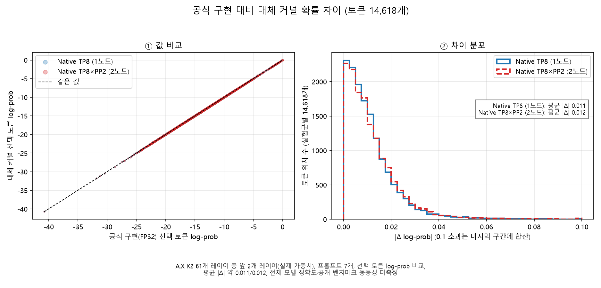

# 공식 구현 대비 대체 커널 확률 차이 (토큰 14,618개)



A.X K2 61개 레이어 중 앞 2개 레이어(실제 가중치), 프롬프트 7개, 선택 토큰 log-prob 비교, 평균 |Δ| 약 0.011/0.012, 전체 모델 정확도·공개 벤치마크 동등성 미측정

## 해석 범위

제목의 “확률 차이”는 **선택 토큰의 로그 확률(log-prob) 차이**를 뜻한다. 그래프는 확률 자체의 차이나 전체 어휘 확률분포를 보여 주지 않는다. 같은 프롬프트를 입력한 teacher-forced 조건에서 공식 구현(FP32 CPU)과 Native TP8(1노드), Native TP8×PP2(2노드)의 같은 토큰 위치를 비교한다. 각 실험군은 14,618개 위치를 공유하며, 두 실험군의 위치 수를 합쳐 보고하지 않는다.

원자료의 log-prob는 소수점 5자리로 반올림되어 있다. 평균 절대 차이는 저장된 값의 차이로 계산하며 백분율이나 정확도 점수가 아니다. 프롬프트별 첫 2,048개 위치와 나머지를 나누면 각각 7,356개와 7,262개다. 이 구분은 공식 구현의 `index_topk=2048`을 기준으로 한 위치 구분이며, 별도 실험군이 아니다.

| 실험군 | 전체 평균 \|Δ log-prob\| | 프롬프트별 첫 2,048개 위치 | 나머지 위치 |
|---|---:|---:|---:|
| Native TP8 | 0.0113578636 | 0.0116292809 | 0.0110829331 |
| Native TP8×PP2 | 0.0117410001 | 0.0119792156 | 0.0114997012 |

왼쪽 점선은 같은 log-prob 값을 나타낸다. 오른쪽 히스토그램은 0.1보다 큰 절대 차이를 마지막 구간에 합산한다. 평균은 이 표시용 상한을 적용하기 전의 모든 값으로 계산한다. 이 결과만으로 전체 61개 레이어 모델의 정확도나 공개 벤치마크 동등성을 판단할 수 없다.

## 로컬 재현

저장소 루트에서 실행한다. Python, NumPy, Matplotlib과 한글 글꼴이 필요하다. Windows에서는 기존 보고서와 같은 Malgun Gothic을 사용한다. 다른 환경에서는 Noto Sans CJK 또는 NanumGothic을 설치해야 한다. 한글 글꼴이 없으면 잘못된 제목을 저장하지 않고 오류로 종료한다.

```powershell
python docs\report\make_figures.py --only logprob
python -m unittest discover -s tests -p test_figures.py
```

출력은 `docs/report/figures/logprob-two.png`다. `--out`으로 출력 디렉터리를 바꿀 수 있다. 기본 처리량 그래프 명령의 동작은 바꾸지 않았으며, `--only all`에는 이 그래프도 포함한다. 렌더링 확인 환경은 Matplotlib 3.11.2, NumPy 2.5.4, Malgun Gothic이며, 다른 글꼴·버전에서는 픽셀과 파일 크기가 달라질 수 있다.

원본 로컬 보고서가 있으면 다음 명령으로 경량 evidence를 다시 추출하고 렌더링할 수 있다. 입력 경로는 실제 보관 위치로 바꾼다. UTF-8 BOM이 있는 입력도 읽는다. 클라우드 접근이나 모델 호출은 하지 않는다.

```powershell
python docs\report\make_figures.py --only logprob --logprob-sources "<oracle-long-full.json 경로>" "<magenta_engine_vgjw1yh229.json 경로>"
```

## 데이터 보관 판단

재현에 필요한 원본 시계열의 수치를 손실 없이 추출해 [`evidence/a100-native-2layer-logprob-series.json`](../../../evidence/a100-native-2layer-logprob-series.json)에 포함했다. 크기는 **428,114바이트(약 418 KiB)**다. 프롬프트 식별자와 각 위치의 공식·두 실험군 `chosen_logprob`만 보관하며, 그래프에서 쓰지 않는 `top1` 토큰 ID와 프롬프트 본문은 제외했다.

추출 출처는 `oracle-long-full.json`의 `reports["oracle.series"]`와 `magenta_engine_vgjw1yh229.json`의 `reports["node0.smoke-native-tp8.series"]`, `reports["node0.smoke-native-tp8-pp2.series"]`다. evidence의 `sources`에 파일명, 시계열 키, 원본 파일 바이트의 SHA-256을 기록했다. 로딩은 프롬프트별 길이, 두 실험군의 위치 정렬, 유한한 비양수 log-prob를 검사한다.

두 원본 보고서는 각각 495,219바이트와 1,494,296바이트로 총 1,989,515바이트(약 1.90 MiB)다. 그래프에 불필요한 실행 메타데이터를 반입하지 않도록 원문은 포함하지 않았다. 추출기는 허용한 숫자 배열만 복사하므로 나머지 보고서 필드는 저장하지 않는다. 이 evidence는 기록된 log-prob에서 그래프를 재현하기 위한 자료이며 모델 실행을 재현하는 전체 입력 묶음은 아니다.
